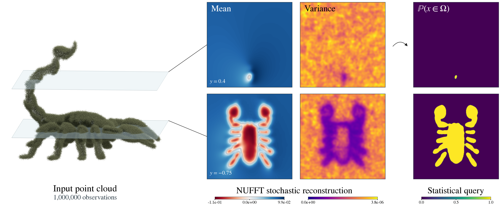

# Fast Stochastic Poisson Surface Reconstruction

GPU reproduction and acceleration experiments for **GeoSPSR**, with nonuniform
FFTs (NUFFT), matrix-free Gaussian-process solves, and an initial assessment of
fast multipole methods (FMM).

This is a research extension of [sholalkere/GeoSPSR](https://github.com/sholalkere/GeoSPSR),
the implementation of *Stochastic Poisson Surface Reconstruction with One Solve
using Geometric Gaussian Processes* by Sidhanth Holalkere, David S. Bindel,
Silvia Sellán, and Alexander Terenin (ICML 2025).
[Paper](https://arxiv.org/abs/2503.19136) · [Original project](https://geospsr.github.io/)



**Figure 1, at one million points.** Recreated in the visual style of the
[paper's Figure 1](https://arxiv.org/pdf/2503.19136), using **1,000,000 noisy
observations** of the released scorpion. All points enter the fit. The two planes
show posterior mean (white zero contour), variance, and the marginal probability
of being inside. On an **NVIDIA L40**, mean evaluation on both 256 × 256 slices
is **4,015× faster than the released pairwise query code: 35.43 ms versus
142.26 s**, with identical supplied weights and NUFFT source aggregation included.
This is a **mean-query speedup**, excluding fitting, variance, rendering, and
baseline kernel precomputation. The finite-Fourier GP fit took **1.35 s**;
variance from **256 conditional draws** took **300.67 s**.
[Measurements](reproduction/results/teaser/comparison.json) ·
[Model and sampling details](reproduction/results/teaser/million.json) ·
[PDF](assets/scorpion-million.pdf)

## What is here

- A headless GPU reproduction of the released scorpion example, retaining an
  untouched upstream checkout for comparisons.
- Joint posterior collision queries, ray transmittance, next-view scoring,
  sequential scanning, and uncertainty-aware hitbox meshes.
- cuFINUFFT source aggregation and query evaluation, including cached Fourier
  coefficients for means and coherent posterior samples.
- Matrix-free, Fourier-truncated covariance actions and batched conjugate-gradient
  solves, exercised up to **1,048,576 observations**.
- Corrections to covariance conditioning, noise handling, and example compatibility,
  covered by **eight numerical GPU tests**.
- A million-observation finite-Fourier GP posterior, including coherent
  conditional draws and the scorpion teaser above.
- Far-field block-rank experiments to assess a future FMM implementation.

The paper's complete application scenes, seeds, and timing configurations are
not included in the upstream release. Our applications reconstruct its task
**types on the released scorpion**, rather than exactly reproducing the original
dragon/cat/falcon figures. The paper used an RTX A6000; these measurements use an
L40. The historical SPSR baseline has not been rerun.

## Measured results

Environment: NVIDIA L40 with 48 GB, driver 570.158.01, Python 3.11.15,
JAX 0.6.2, Flax 0.10.6, and cuFINUFFT 2.5.1. GPU operations are synchronized before
timing ends. Fast-sum benchmarks retain first-call timings and three warm
repetitions; quoted warm times are medians. GPU clocks were not locked.
See [environment metadata](reproduction/results/environment.json).

### Million-point scorpion teaser

The teaser uses distinct area-uniform samples visible from the union of the
upstream example's two cameras, with independent coordinate and normal noise of
standard deviation 0.02. It does not duplicate the small released scan. The
renderer draws every observed point; the two horizontal planes are at
`y = 0.4` and `y = -0.75`, with query coordinates in `[-1.7, 1.7]²`.
The precise camera and slice settings of the original Figure 1 are not supplied
upstream, so this recreates its layout and rendering style, not its exact data.

The model uses a **101³-mode finite product-Matérn GP**, length scale 0.01,
per-axis variance 0.1, and observation-noise variance 0.02. Training and pathwise
conditioning use the same spectrum. The mean fit converged in 52 CG iterations;
all conditional solves converged. Marginal variance is estimated from 256
zero-mean conditional draws, with about **8.8% relative Monte Carlo standard
error per pixel**. The statistical query is `P(f(x) ≤ 0) = Φ(−μ(x)/σ(x))`, with
the mean shifted by its average at the observations. Shared color scales are
used across the slices. Display interpolation is bilinear; no field smoothing
is applied. The nearly binary probabilities reflect this densely observed model.

The matched query benchmark uses the **actual million-point fitted weights**
and all **131,072 displayed query positions**. The upstream comparator uses its
released Poisson cross-covariance and 50³ interpolation grid, evaluated in
64-query GPU batches. Its 142.26 s is one warmed complete pass; 35.43 ms is the
median of three NUFFT aggregation-plus-query passes (28.63–38.71 ms). The baseline's
13.60 s kernel precomputation and JIT compilation are excluded. The displayed
NUFFT means differ from the interpolated baseline by **1.09% relative L2**.
This measures the interpolation discrepancy, not the GP truncation error.

We did **not** run upstream's dense million-point training: one float32 covariance
matrix alone would require **4 TB**. The finite-spectrum fit differs from the
upstream analytic training kernel; its analytic-kernel residual on 64 sampled
scorpion rows is **6.80%**, a spot check rather than a global error bound. Thus
4,015× does not claim identical full posteriors or an end-to-end speedup.
The variance estimator is separately checked against dense finite-GP conditioning
in [a numerical test](tests/test_million_teaser.py).

### Kernel queries

| Experiment | Measurement |
| --- | ---: |
| Pairwise interpolation, N = 1,048,576, M = 4,096 | 7.838 s |
| NUFFT source aggregation, same N | 29.12 ms |
| NUFFT query, same M | 4.90 ms |
| Sum of aggregation and query medians | **34.02 ms** |
| Pairwise / NUFFT ratio | **230.4×** |
| Full-cutoff direct Fourier validation, relative L2 error | **2.8 × 10⁻⁶** |

The large-N benchmark uses synthetic sphere-supported sources and random vector
weights. Both query methods use the same finite Fourier kernel, but the baseline
approximates its values through a 50³ interpolation grid. Removing that
interpolation changes the large-N result by about 2.4% in relative L2; the much
smaller direct-Fourier validation error measures NUFFT accuracy separately.
Aggregation includes plan creation and source transfers; queries include plan
creation and query transfers. Training is excluded.


### Matrix-free training

Three normal-vector right-hand sides, one million sphere points, length scale
0.01, noise variance 0.02, and relative CG tolerance 10⁻⁵:

| Fourier cutoff | Modes | Setup | Solve | Iterations | Analytic-kernel residual on 64 sampled rows |
| --- | ---: | ---: | ---: | ---: | ---: |
| 50 | 101³ | 0.028 s | **0.701 s** | 23 | 1.40% |
| 100 | 201³ | 0.194 s | **1.670 s** | 24 | 0.0883% |

CG solves the **truncated covariance**, not the full analytic Matérn covariance.
Its finite-system residual is below 10⁻⁵ in these runs. The last column measures
the separate truncation discrepancy; a 64-row spot check does not bound the full
solution error. These are single solve measurements after warming transform
plans, not multi-run median timings. The relatively large regularizer makes
these particular systems easy. The real scorpion result above supplies an
additional surface-supported case, but harder noise regimes remain untested.

### Upstream scorpion baseline

691 observed points, 10,000 slice queries, 101³ Fourier modes, and a 50³
nonuniform interpolation grid:

| Operation | Time |
| --- | ---: |
| Build interpolation grid, first call | 13.66 s |
| Mean query, repeated API invocation | 1.09 s |
| Marginal variance, first call | 26.53 s |
| Four posterior samples, first call | 31.05 s |

First-call measurements include compilation. Repeated upstream API calls can
also rebuild closures and recompile. These are not directly comparable to a
cached-query-only timing.


Raw measurements: [baseline](reproduction/results/upstream_baseline.json) ·
[fast sums](reproduction/results/benchmark.json) ·
[training](reproduction/results/training.json) ·
[applications](reproduction/results/applications.json) ·
[sequential scanning](reproduction/results/sequential_scan.json).
The [full HTML report](reproduction/results/report.html) includes additional
figures and caveats; open it locally after cloning, since GitHub displays HTML
as source.

## Reproduce

Use Linux, an NVIDIA CUDA-capable GPU, Git, and
[uv](https://github.com/astral-sh/uv). The measured configuration has 48 GB of GPU
memory; a smaller-memory configuration has not been validated. Choose a writable
runtime directory with at least roughly 7 GB free for dependencies and caches.
Use a full clone so the historical upstream commit is available.

```bash
git clone https://github.com/alecjacobson/fast-stochastic-psr.git
cd fast-stochastic-psr

# Override this if another filesystem has more free space.
export GEOSPSR_RUNTIME="$HOME/.cache/fast-stochastic-psr-runtime"
./reproduction/setup.sh
./reproduction/run_env.sh -m pytest -q tests

# Run GPU experiments sequentially to avoid timing interference.
# The baseline must run first: it generates the scan used by later scripts.
./reproduction/run_env.sh reproduction/baseline.py --upstream
./reproduction/run_env.sh reproduction/applications.py
./reproduction/run_env.sh reproduction/sequential_scan.py
./reproduction/run_env.sh reproduction/benchmark.py
./reproduction/run_env.sh reproduction/training.py
./reproduction/run_env.sh reproduction/fmm_assessment.py
./reproduction/run_env.sh reproduction/solver_audit.py
./reproduction/run_env.sh reproduction/capture_environment.py
./reproduction/run_env.sh reproduction/make_report.py
```

To regenerate the million-point teaser, run the following GPU jobs sequentially.
The statistics take about five minutes and the pairwise comparison about two and
a half minutes on the measured L40. Blender uses a separate environment because
its Python module requires NumPy 1.x; allow another roughly 2 GB of disk space.

```bash
./reproduction/run_env.sh reproduction/million_teaser.py
./reproduction/run_env.sh reproduction/benchmark_million_teaser.py
./reproduction/render_setup.sh
"$GEOSPSR_RUNTIME/render-venv/bin/python" reproduction/render_million_cloud.py
./reproduction/run_env.sh reproduction/compose_million_teaser.py
```

The checked-in [slice fields](reproduction/results/teaser/fields.npz) and
[point-cloud render](reproduction/results/teaser/cloud_render.png) also let you
rerun only the composition step. The large generated cloud and solved weights
are ignored by Git and regenerated by the first command. The final figure is
written to `assets/scorpion-million.{png,pdf,svg}`.

Setup installs the [locked environment](reproduction/requirements-lock.txt) and
creates a detached worktree at upstream commit
[`2352f1ef98aab20e0303611c1fa2b0948acd2a05`](https://github.com/sholalkere/GeoSPSR/commit/2352f1ef98aab20e0303611c1fa2b0948acd2a05).
The lock is important: the unpinned latest Flax rejected the upstream kernel
container during our initial build.

The wrapper selects CUDA, disables JAX GPU preallocation, requests highest JAX
matrix-multiplication precision, and uses headless plotting. Keep
`GEOSPSR_RUNTIME` set for subsequent commands. On the original experiment machine,
the existing runtime is `/opt/geospsr-runtime`.

Results are written to `reproduction/results/`, including JSON timings, PNG
figures, OBJ hitboxes, and the HTML report. Generated NumPy archives are ignored
by Git and recreated by the scripts, except for the compact teaser slice fields.
Running the experiments overwrites the corresponding checked-in measurements,
so preserve a copy if you want to compare machines.

## How the fast sums work

For solved vector weights α at nonuniform source positions x, compute

```text
A(n) = Σ_j α_j exp(−i n·x_j)                  type-1 NUFFT
b(n) = −i ρ(n) [n·A(n)] / |n|²,  b(0) = 0   Poisson multiplier
f(q) = Re Σ_n b(n) exp(i n·q)                 type-2 NUFFT
```

Here ρ is the product-Matérn spectral density and n ranges over a finite integer
frequency grid. This evaluates the cross-covariance action without forming the
query-by-source matrix. Cached coefficients make additional queries independent
of the source count. Posterior samples add their prior coefficients before
querying.

The vector-field covariance has the finite representation
`K_L = Re Φ diag(ρ) Φ*`, permitting matrix-free CG with the same transforms.
**Spectral cutoff, NUFFT tolerance, and solve tolerance control different errors.**
Increasing the cutoff grows a three-dimensional grid; this motivates spatial
fast summation and hybrid approaches at shorter length scales.

## Statistical corrections and limitations

The upstream numerical implementation is preserved for baseline runs. The
working implementation makes these corrections:

1. Posterior covariance **subtracts** the conditioning update.
2. SDD and Cholesky consistently interpret `sigma` as **observation noise
   variance**, rather than disagreeing about whether to square it.
3. Pathwise conditioning draws observation noise. Pass `noise_key` independently
   of the key used for the prior samples.

The primary application sampler also accounts for the omitted vector-field
spectrum at observed points, using the full finite cross spectrum and a dense
residual covariance. Its empirical moments are tested. **This sampler still
uses dense training matrices**. The new million-point teaser instead uses the
explicitly finite-spectrum model throughout; its matrix-free conditional sampler
is implemented in `reproduction/million_teaser.py`.
The sequential-scanning experiment retains the paper-style smaller prior
spectrum and labels that approximation explicitly.

Other limits matter when interpreting the figures:

- Collision probabilities use discrete proxy-surface points, not certified
  continuous intersection tests. Primary application probabilities use 128
  coherent samples, giving a worst-case Monte Carlo standard error of about
  4.4 percentage points before model and discretization error.
- The most conservative hitbox reaches the query-domain boundary and has
  disconnected components; it is not a complete closed safety cage.
- Sequential scanning is one fixed-seed comparison. Its error metric is affected
  by meshing and unequal point counts; it does not establish consistent
  superiority over random views.
- The upstream SDD example does not converge sufficiently at its supplied
  learning rate in this scan. The [solver audit](reproduction/results/solver_audit.json)
  separates convergence from the noise-convention correction.
- Exact marginal variances at large N and scalable conditioning with the full
  analytic kernel require further work. The teaser uses Monte Carlo variances
  and a truncated training covariance.

## FMM direction

[FMM assessment results](reproduction/results/fmm_assessment.json) measure
far-field block ranks at controlled error. They show compression potential, but
**there is no FMM backend or measured FMM speedup in this repository yet**.

Next experiments are a periodic kernel-independent FMM for the full analytic
covariance, spatial preconditioning, and controlled near-field/spectral
splitting. A standard Laplace or Coulomb FMM is not a drop-in replacement for
the product-Matérn kernel. Comparisons need matched posterior accuracy, periodic
boundary handling, setup/rebuild costs, and real surface-supported scans.

## Code map

| Path | Purpose |
| --- | --- |
| `geospsr/gp.py`, `kernels.py`, `sdd.py` | Upstream GP machinery with the documented corrections |
| `geospsr/spectral.py` | cuFINUFFT cross sums, prior coefficients, and matrix-free CG |
| `reproduction/baseline.py` | Headless upstream scorpion experiment |
| `reproduction/posterior.py` | Reusable dense-fit posterior with cached Fourier coefficients |
| `reproduction/applications.py`, `sequential_scan.py` | Application reconstructions |
| `reproduction/million_teaser.py`, `benchmark_million_teaser.py` | Million-point posterior and matched mean-query comparison |
| `reproduction/render_million_cloud.py`, `compose_million_teaser.py` | Reproducible Figure-1-style rendering |
| `reproduction/benchmark.py`, `training.py` | Query and solve scaling experiments |
| `reproduction/fmm_assessment.py` | Far-field compression diagnostics |
| `tests/` | Covariance, sampling, solver, and NUFFT numerical checks |

## Attribution and license

The original GeoSPSR source, assets, and Git history are retained. The inherited
[MIT license](LICENSE) and copyright notice remain in place. Please credit the
original authors and paper when using the underlying method:

```bibtex
@misc{geospsr,
  title={Stochastic Poisson Surface Reconstruction with One Solve using Geometric Gaussian Processes},
  author={Sidhanth Holalkere and David S. Bindel and Silvia Sellán and Alexander Terenin},
  year={2025},
  eprint={2503.19136},
  archivePrefix={arXiv},
  primaryClass={cs.GR},
  url={https://arxiv.org/abs/2503.19136}
}
```
