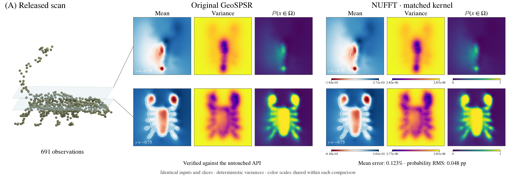
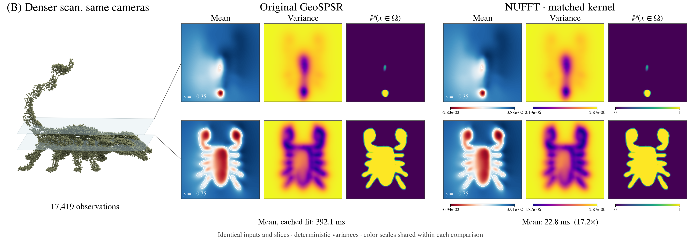

# Fast Stochastic Poisson Surface Reconstruction

GPU acceleration of [GeoSPSR](https://github.com/sholalkere/GeoSPSR), the implementation
of **Stochastic Poisson Surface Reconstruction with One Solve using Geometric
Gaussian Processes**, Holalkere, Bindel, Sellán and Terenin, ICML 2025.
[Paper](https://arxiv.org/abs/2503.19136) · [Project](https://geospsr.github.io/)

**Goal:** accelerate every paper application at matching quality, then demonstrate
those gains on massive scans beyond practical upstream execution.
[Tracking issue #1](https://github.com/alecjacobson/fast-stochastic-psr/issues/1) ·
[Benchmark protocol and coverage](reproduction/BENCHMARKS.md) ·
[Reproduction instructions and technical details](REPRODUCTION.md)

## Flagship comparisons

All times below were measured on an NVIDIA L40 (48 GB). Speedups have explicit
scopes; kernel-action timings are not complete-application speedups.

| Comparison | Quality evidence | Performance / status |
| --- | --- | --- |
| **A: released scorpion, 691 observations** | Same data and analytic training covariance; original APIs checked; mean error 0.123%, variance error 0.0022% | Reproduced. Cached original is faster at this size. |
| **B: denser scorpion, 17,419 observations** | Mean error 0.0305%, variance error 0.0074%; inside-probability RMS error 0.041 percentage points | Cached mean **17.2× faster**; deterministic variance **slower**. First computation stages **9.5× faster**. |
| **Collision, rays, next-view queries** | Paired coherent samples, uncertain collision probes, moving queries and two seeds; numerical gates pass | At B: prepared ray queries **11.1–11.2× faster**, collisions **10.5× faster**. Setup excluded; [report and remaining validation](reproduction/results/cached_queries/README.md). |
| **Full application demo (A)** | Same corrected posterior law; paired GPU control preserves events and all three hitboxes' connectivity | Fit through hitbox export **11.69 → 1.77 s (6.62×)** versus our earlier pipeline. [Report](reproduction/results/conditional_solves/README.md). Geometry/variance convergence remains open: [#4](https://github.com/alecjacobson/fast-stochastic-psr/issues/4). |
| **Sequential scanning** | Single-seed demonstration; rerun needed after [score correction](reproduction/results/view_score_audit/README.md) | Multi-seed quality, training/update costs and decision stability open: [#7](https://github.com/alecjacobson/fast-stochastic-psr/issues/7). |
| **ContactFusion robotics replay** | [Assessment and reproduction plan](reproduction/CONTACTFUSION.md); author project page marks code coming soon | No measured speedup. Sequential prior, modality noise and action-quality validation tracked in [#23](https://github.com/alecjacobson/fast-stochastic-psr/issues/23). |
| **Million-point mean fitting** | Independent analytic residuals; [16-probe covariance-tail diagnostic](reproduction/results/spectral_tail/README.md) provides separate limited covariance evidence | [First fit **27.2× faster**](reproduction/results/iterative_baseline/README.md). Single confirmation; full application quality remains open. |
| **Three-million-point mean fitting** | Two bandwidths pass sampled analytic checks; [64-step NUFFT mean/contour targets confirm on held-out planes](reproduction/results/output_stopping/README.md) | [Initial fits + queries **27.70–29.75 s**](reproduction/results/large_fit/README.md), under contention. Earlier stopping is an oracle study; no new timing ratio or complete-application claim. [Follow-up #36](https://github.com/alecjacobson/fast-stochastic-psr/issues/36). |
| **Million-point posterior conditioning** | Fused compact preconditioner: 128 shared draws pass numerical gates; held-out covariance discrepancy 0.00219% | [Warmed conditioning **30.54 → 21.44 s (1.42×)**](reproduction/results/nystrom_fused/README.md) versus plain packed CG; **1.04×** versus the stronger float32 preconditioner. Eight-draw pilot; setup adds **11.89 s**, making first use slower. Full-model/application convergence remains open. |
| **Three-million-point posterior conditioning** | [Eight shared draws pass tighter same-cube controls](reproduction/results/verified_preconditioning/README.md): fused covariance difference **0.00148%**, identical tested ray/collision events and view choice | Verified solves **167.35 → 136.05 s (1.23×)** versus plain packed CG; about **1.1×** versus float32 preconditioning. Setup adds **35.30 s**, making first eight slower than plain CG. Single pilot; full application convergence remains open. |
| **Million-point application convergence** | [256 coherent draws and five nested query resolutions](reproduction/results/query_refinement/README.md); checked archive replay passes numerical controls | Matching-quality speedup **not established**: sphere refinement changes collision probabilities by up to **21.875 percentage points**. Absolute Monte Carlo accuracy and continuous-geometry convergence remain open. |

Application query ratios use 128 shared **corrected** posterior draws and a strong
reference that also caches prior evaluation. Those runs used the earlier CPU
sampler (~13 s shared preparation). Optional GPU preparation now makes 128
corrected B draws **6.95× faster** within this implementation ([report](reproduction/results/conditional_solves/README.md)).
Additional compatibility-cache setup amortizes after about 17 ray batches in B.
These are repeated-query gains, not complete reconstruction or scanning speedups.
Absolute sampling accuracy and geometric discretization still need convergence studies.

### A — reproduce the released example



Both methods receive the **same 691 observations, normals and slice queries**,
using the released camera setup, noise seed, full analytic covariance and
cross-kernel interpolation. Variances are deterministic. Mean/variance errors
are relative L2; inside-probability RMS error is **0.048 percentage points**.
The lower slice `y = −0.75` is released; the upper `y = −0.35` is visually inferred.
The exact Figure 1 point set and second slice were not published.

### B — increase density and compare again



At **17,419 observations and 20,000 queries**, cached mean evaluation falls from
**392.05 ms to 22.77 ms (17.2×)**, including NUFFT source aggregation. Deterministic
variance takes **1.17 s for the cached reference and 2.27 s for NUFFT**, so the
combined warm mean/variance workload is currently slower. The sum of first
computation stages (kernel setup, fitting, centering, mean and variance) falls
from **28.10 s to 2.96 s (9.5×)**; this excludes process startup, scan generation,
rendering and probability postprocessing. Probability error is **0.041 percentage
points RMS**, **1.665 points maximum**.

[Methods, timing scope and error maps](reproduction/results/matched/README.md) ·
[Measurements A](reproduction/results/matched/A/comparison.json) ·
[Measurements B](reproduction/results/matched/B/comparison.json)

## Approach and current limits

NUFFT aggregates observations into Fourier coefficients and evaluates means or
coherent posterior samples at arbitrary queries. We retain a compatibility mode
for the released interpolated kernel and investigate direct Fourier evaluation
at controlled application error ([#5](https://github.com/alecjacobson/fast-stochastic-psr/issues/5)).

Exact variance remains a bottleneck. A [full-slice sampling study](reproduction/results/correction_contrast/README.md)
still misses the 1% spatial-contrast target at 8,192 draws on both A and B;
deterministic variance passes. No matched-quality variance speedup is established by this study.
[Packed sources and planar queries](reproduction/results/packed_factor_sources/README.md)
now pass the fixed full-slice gates with variance-stage medians of
**1.17 vs 1.62 s (1.38×)** on A and **3.58 vs 6.43 s (1.80×)** on B, including
estimator preparation. These direct-Fourier results use dense conditioning and
remain separate from the matched-interpolant teaser. At three million observations,
eight prepared coherent fields preserve tested ray/collision events while repeated
aggregation plus queries improves **0.396 → 0.278 s (1.43×)**. Setup plus the first
pass is slower; conditioning and complete-application gains remain unestablished.
A [matrix-free correction-sampling control](reproduction/results/inverse_root/README.md)
now reaches three million observations with numerical checks; it has not established
a variance speedup. [Verified solve refinement](reproduction/results/verified_posterior/README.md)
now also supports coherent posterior applications.
Matrix-free conditioning reaches a million observations with independently checked
training-bandwidth convergence,
but the full application quality bridge remains open. The authors' iterative
method also fits this million-point input; this scale is **not intractable for SDD**.
Compiled SDD wins the warm A/B fits in this comparison, motivating
[method selection by workload (#15)](https://github.com/alecjacobson/fast-stochastic-psr/issues/15).
The [training/sampling audit](reproduction/results/training_bandwidth/README.md)
includes coherent million-point draws and retained failures. Short-scale, low-noise
cases fail the earlier cube approximation. A new
[spectral-block GPU implementation](reproduction/results/spectral_blocks/README.md)
passes the fixed 16-query stress panel with a wider spectrum.
[Omitted-spectrum diagnostics](reproduction/results/block_tail/README.md) now
cover corners and the infinite tail, including a million-point panel; full
application validation remains open. A centered block-inverse pilot passed
quality checks but was slower than the existing cube solve.
[Local/FMM correction (#14)](https://github.com/alecjacobson/fast-stochastic-psr/issues/14)
remains another avenue.
A [spatial block-preconditioner pilot](reproduction/results/preconditioning/README.md)
preserves the finite-model numerical checks but does not reduce million-point
CG iterations; it remains optional, with no new speedup claimed.
A [global Nyström pilot](reproduction/results/nystrom_preconditioning/README.md)
reduces million-point iterations from **57 to 38**, passing the same numerical
checks, but adds a 3.8 GiB basis and setup cost.
[128-draw confirmation and reusable streaming](reproduction/results/nystrom_validation/README.md)
pass the numerical checks, including 120 pilot-held-out draws. Qualified timing
comparisons and full application convergence remain open.
An optional [compact basis](reproduction/results/nystrom_storage/README.md)
halves retained preconditioner storage to **1.9 GiB**; recomputed setup avoids
the full double-precision feature array. It establishes memory savings, with
no new speedup claimed.
An [exact periodic range-sum GPU prototype](reproduction/results/range_compact/README.md)
now uses **149 MB** at B, down from 349 MB, with a modest action slowdown.
Compiled planning gives a first mean-fit pilot of **1.85 → .523 s (3.54×)**
versus double dense Cholesky on B, including setup with the native library cached
(a separate cold build costs .98 s). Reused dense factors win. The full analytic
million-point action runs in **2.23 s** with **18.5 GB** retained storage and passes
1,024 sampled rows; massive fitting, SDD comparison and application gains remain open. FMM has no implemented backend or measured speedup. A dense matrix's memory
requirement alone does not establish that the authors' iterative method is intractable.

[Length-scale validation](reproduction/results/normalization/README.md) corrects
an inherited Fourier normalization mismatch and preserves an explicit released
coefficient mode. The .01/.005 flagship settings are unchanged; at length scale
1 the correction changes slice probabilities by up to 6.02 percentage points.

The full paper application scenes and timing configurations were not released.
Our application scenarios use the released scorpion and do not claim to recreate
the unpublished dragon/cat/falcon scenes. Earlier kernel-only benchmarks and the
exploratory million-point teaser remain documented in [REPRODUCTION.md](REPRODUCTION.md).

## Run

```bash
git clone https://github.com/alecjacobson/fast-stochastic-psr.git
cd fast-stochastic-psr
export GEOSPSR_RUNTIME="$HOME/.cache/fast-stochastic-psr-runtime"
./reproduction/setup.sh
./reproduction/run_env.sh -m pytest -q tests
```

See [REPRODUCTION.md](REPRODUCTION.md#reproduce) for GPU requirements, pinned
upstream checkout, commands for every experiment, rendering and raw outputs.

## Attribution

Original source, assets and history are retained under the [MIT license](LICENSE).
Please credit Holalkere et al. and their [paper](https://arxiv.org/abs/2503.19136)
when using the underlying method. [BibTeX](REPRODUCTION.md#attribution-and-license).
