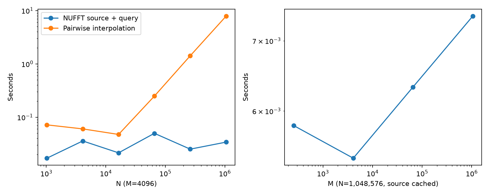
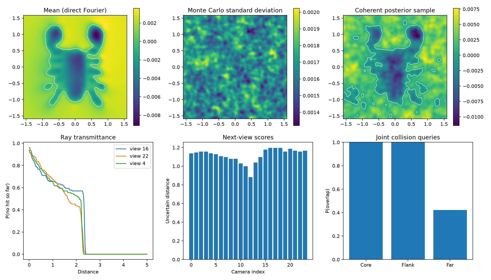

# Reproduction details and earlier experiments

This document retains the detailed methodology and historical measurements.
The [main README](README.md) is the current flagship status summary; the
[benchmark contract](reproduction/BENCHMARKS.md) defines acceptance criteria.

## Spectral normalization across length scales

The default periodic Matérn Fourier coefficients now agree with the analytic
kernel variance. The inherited coefficients lacked a factor
`1+exp(-sqrt(3)/lengthscale)` per axis. This matters at large length scales;
the .01/.005 flagship coefficients are bitwise unchanged. The
[normalization report](reproduction/results/normalization/README.md) compares
against the pinned upstream implementation and an independent formula, audits
all 20,000 released-A slice queries at five scales, and checks long-scale
coherent samples and tail estimates.

Use `normalization='released'` on `Matern32Kernel`, `FourierPoisson`,
`FourierCovariance`, `Posterior` or `SpectralPosterior` to reproduce the original
coefficients. This is coefficient compatibility; it does not undo the earlier
noise, covariance or sampler corrections. The outside-cube tail sampler rejects
this mode because the released spectrum also has an in-band normalization
defect. Numerical covariance differences below roundoff are labeled unresolved.

## Centered fluctuation solves and practical robotics target

The [centered hybrid report](reproduction/results/centered_hybrid/README.md)
keeps the vector prior and fitted mean at cutoff 200 while applying a smaller
inverse to zero-mean fluctuations. It includes exact dense A/B moments, retained
stress failures, fixed-RHS million-point comparisons and separate timing scopes.
`SpectralPosterior.draw(..., solve_cutoff=150)` exposes this experimental path;
it is not an exact posterior at either bandwidth. The default is unchanged.

A separate [positive spectral block implementation and audit](reproduction/results/spectral_blocks/README.md)
uses a core cube plus conjugate-paired slabs for GPU actions and coherent
finite-posterior draws. Independent direct sums and dense moments validate
the implementation. Core 150 / extent 800 passes the previously failing
short-scale, low-noise B panel, including the analytic residual gate; narrower
failures are retained. Full application quality and competitive timings remain
open.

The [stratified block-tail report](reproduction/results/block_tail/README.md)
now includes omitted inside-cube corners and the infinite outer tail. Dense
controls validate their covariance contributions separately; the million-point
panel and a three-probe float64 control provide limited large-input evidence.
Centered block-inverse pilots keep the prior/mean and stored RHS fixed and
retain rejected configurations. A CPU corner-refinement screen uses the old
inverse weights only; it predicts neither new posterior error nor runtime.
Full application coverage and competitive performance remain open.

The [ContactFusion assessment](reproduction/CONTACTFUSION.md) checks the practical
robotics use case against the paper and author project repository. Its
sequential scalar-prior update is not implemented here, and no ContactFusion
speedup is measured. The project page marks code coming soon; the replay plan
separates preserving its update from switching to a different geometric GP.

## Exact finite-cube symmetry folding

The [folded-cube report](reproduction/results/half_cube/README.md) retains every
frequency in the existing finite training cube while evaluating a positive
half and its zero-axis plane. At one million observations, eight conditional
draws take 38.16 s with full-cube transforms and 31.38 s with folded transforms:
a 1.22× improvement over our solver. These medians use every repetition passing
the predeclared process-audit rule (four of six and five of six, respectively).
Periodic process sampling does not establish exclusive hardware access.

`HalfCubePosterior` supports coherent draws, prepared queries and the existing
optional centered narrower inverse. Independent finite sums and dense moments
validate actions and the posterior law; a cutoff200 million-point execution
check covers coherent priors and independently checked covariance rows. The
128-shared-draw comparison preserves sampled events and the selected view, with
0.000596% empirical covariance error. Its contended timing is excluded.
Folding preserves the finite model; it does not resolve spectral truncation,
Monte Carlo convergence, complete application quality or ContactFusion replay.

## Conditioning at larger posterior sample counts

The [streaming application report](reproduction/results/streamed_applications/README.md)
evaluates coherent batches without retaining a full scalar-coefficient ensemble.
`HalfCubePosterior.draw_batches()` supports the same folded/packed conditioning
options as `draw()`; use `contextlib.closing` for early-exit cleanup. Online field
moments, covariance and ray/collision event counts have retained-ensemble
controls. Million-point execution includes independent finite rows, nested
geometry refinement and explicit Monte Carlo uncertainty. This is a numerical
and convergence diagnostic, not a new matched-quality application speed ratio.

The [checked replay and nested-query report](reproduction/results/query_refinement/README.md)
uses 256 fresh cube200 draws and five ray/sphere resolutions. Archive blocks
include source/model/geometry provenance, complete coverage and file hashes;
incomplete or damaged archives cannot be replayed. They support bounded-memory
query reuse, not sampler resumption. The 512 → 1,024 sphere refinement changes
collision probabilities by up to 21.875 percentage points, exposing a substantial
remaining geometry error. The stronger ordinary type-2 reference packs real
fields and reuses plans; its recorded query times are lower on this workload.
One replay was contended, so the declared timing protocol publishes no ratio.

The [next-view score audit](reproduction/results/view_score_audit/README.md)
corrects Boolean trapezoidal integration to numeric indicator integration.
All 53 available archived artifacts and 82 paired comparisons retain their
selected indices and regret-gate classifications under the corrected score;
the sequential trajectory lacks saved transmittance and still requires a rerun.

Paired real RHS are an optional alternative to folded inverse actions.
`HalfCubePosterior.draw(..., pack_rhs=True)` keeps the folded coherent prior
and fitted mean while conditioning with full-cube complex transforms. Each
real channel is scaled separately before packing to control roundoff leakage;
zero channels remain zero. This representation keeps every finite frequency.
The [packed-RHS report](reproduction/results/packed_rhs/README.md) records
repeated folded/packed comparisons, strict same-model gates and separate
larger-sample and coherent-sampler checks. Conditioning speed alone is not a
preparation-through-application speedup.

The [spatial preconditioning pilot](reproduction/results/preconditioning/README.md)
adds optional `solve(..., preconditioner=...)` to full, folded and packed kernels.
Morton-ordered analytic principal blocks are inverse preconditioners only; the
original covariance action and posterior prior remain fixed. Block sizes 64,
128 and 256 do not reduce million-point iterations against packed full-cube200
CG. Numerical fields/events and independent finite residual rows pass, but
setup and application costs prevent treating this as an acceleration result.
The default remains unpreconditioned; shared coarse-space alternatives remain
tracked in issue #30.

The [landmark Nyström pilot](reproduction/results/nystrom_preconditioning/README.md)
tests a global spectral preconditioner with the unchanged full-cube200 action.
Ranks 128/512/1,024 reduce iterations from 57 to 54/45/38. All numerical and
sampled-event gates pass; rank 1,024 retains 3.8 GiB and costs 9.1 s to construct.
The declared timing audits fail, so no speedup ratio follows. The optional
`--preconditioner-rank` benchmark flag constructs this reusable coarse space;
it is not a low-rank replacement posterior.
[Larger-ensemble and coherent-producer validation](reproduction/results/nystrom_validation/README.md)
now passes 128 common draws (120 held out from the pilot), plus a separate
eight-draw streaming control with bitwise-identical priors and RHS. Call
`HalfCubePosterior.prepare_conditioning_preconditioner(rank=1024)` once per
fixed map, then `draw_batches(..., preconditioned=True, pack_rhs=True)`.
Close partially consumed generators; clear the basis outside an active stream.
Defaults remain unpreconditioned. The report retains a low-noise covariance
failure and tolerance sweep; it makes no new timing-ratio claim. Basis
compression/streaming is tracked in #31.

The [compact-basis pilot](reproduction/results/nystrom_storage/README.md) adds
optional `basis_dtype='float16', recompute_features=True, apply_row_batch=32768`
to that preparation call. It stores a power-of-two-scaled half-precision basis
and decodes bounded row blocks for float32 projection/correction. RHS precision,
the finite covariance action and the posterior prior stay fixed. Two-pass
construction regenerates feature rows instead of retaining the full double
feature matrix. The numerical SPD guard checks the effective basis after
storage-to-accumulation conversion. Defaults remain unchanged.

The four-configuration pilot separates recomputation, blocked application and
storage precision. It includes event-counted CuPy pool live peaks with
end-state reconciliation; these exclude native NUFFT/context allocations and
are not exact device-memory peaks. All declared quality and timing outcomes
are retained. Shared-GPU contamination prevents a timing ratio for that storage sweep.

The subsequent [fused application study](reproduction/results/nystrom_fused/README.md)
adds `fused_apply=True` to half-basis preparation, replacing `apply_row_batch`.
The optional CUDA kernels decode in registers and accumulate at solve precision.
Three isolated profiles per size show 8.13×/8.38× faster preconditioner actions
at one/three million observations. Full conditioning improves much less:
eight common draws take 21.44 s versus 30.54 s for plain packed CG and 22.26 s
for the stronger float32 preconditioner. Setup adds 11.89 s, so first use is
slower at eight draws. These instrumented within-implementation pilots exclude
source generation, fitting and queries; they are not upstream application ratios.
The 128-draw and coherent streaming confirmations pass unchanged numerical
gates, and all 128 tests pass. Use `--fused-preconditioner` with
`--preconditioner-rank 1024 --basis-dtype float16 --recompute-features` in the
conditioning benchmark or streaming application CLI. The report preserves
fresh-cache compilation costs and all timing/quality records.

A [three-million-point visible scorpion input](reproduction/results/large_inputs/README.md)
is prepared with distinct observed positions and verified saved payload hashes.
The [full mean-fit study](reproduction/results/large_fit/README.md) now checks
complete finite cubes at cutoffs 200/250 against independent analytic residuals
on 1,024 held-out rows, with every observation included. Both pass; their means
differ by 0.0011%. First fit through 20,000 mean queries takes 27.70/29.75 s under
contention. The transferred SDD setting reaches its 600-second update budget
without passing the strict training-residual gate, yet its displayed mean is
already within 0.145% of the cutoff-250 result globally, with six sampled sign
changes. Local surface/probability quality remains unchecked. No speedup ratio or upstream
intractability claim follows. Issue #36 tracks application-aware stopping, and
larger-scale covariance, sampling and application validation remain open.
The compiled SDD/upstream-equivalence and folded-spectrum tests also pass.

The [marginal-variance pilot](reproduction/results/complement_variance/README.md)
uses the independent centered posterior and conditioning correction from coherent
pathwise draws. `reproduction.complement_variance` combines their second moments
using weights frozen on separate pilot draws, retaining negative estimates and
empty exact-law interval intersections. On released A, three seeds with 32 pilot
and 128 evaluation draws reduce total-variance error from 12–13% to 0.17–0.18%.
Error relative to the much smaller spatial contrast is still 17.6–19.4%.
This is not a replacement for the deterministic teaser comparison or a timing
claim. The report includes a prior-only baseline and the extra-query cost;
action rankings, B/million-point validation and fixed-quality timing remain open
in [#34](https://github.com/alecjacobson/fast-stochastic-psr/issues/34).

The subsequent [full-slice contrast study](reproduction/results/correction_contrast/README.md)
uses all 20,000 queries in both A and B, three independent seeds and fixed counts
through 8,192 draws. `DenseCorrectionSampler` draws `L^-T xi` and caches its
Fourier correction coefficients batch by batch, avoiding the full prior;
`CorrectionMoments` retains only query-sized second moments. These are correction
fields, not coherent posterior samples for ray/collision events. The dense factor
still costs quadratic memory. Source/query transform plans are reused.
Neither case reaches the prospective 1% contrast gate; the deterministic streamed
cross-factor baseline passes. All failures, component costs and convergence plots
are retained. The contended timings establish no matched-quality speedup.
[Issue #35](https://github.com/alecjacobson/fast-stochastic-psr/issues/35) proposes
matrix-free inverse-root sampling, with covariance/error validation still required.

Common-RHS preparation now hashes the serialized float32 RHS and scalar prior
arrays (schema2), and conditioning verifies source bytes, shapes and dtypes.
Legacy manifests hashed the float64 RHS before storage conversion; read-only
regeneration reproduced all 128 million-point and four B draws exactly.
Before using an existing legacy cache, create its required audit with:

```bash
./reproduction/run_env.sh -m reproduction.audit_common_rhs_storage \
  --scratch /opt/geospsr-runtime/common-rhs-128 \
  --output /opt/geospsr-runtime/common-rhs-128/storage_audit.json
```

Fresh schema2 caches do not require this migration audit. Their references
must use the same source manifests; historical hashes are not rewritten.
See the [storage audit and fresh readback](reproduction/results/nystrom_validation/README.md#source-integrity-correction).

The [fixed-RHS batching report](reproduction/results/nufft_batches/README.md)
tests one million observations with eight and 128 common conditional draws.
The eight-draw sweep has three timing repetitions: batching two or four draws
does not improve the solve; starting from the fitted mean gives a modest 1.07×
improvement at unchanged tolerance. A looser tolerance passes event checks but
fails covariance gates and is rejected. `FourierKernel.solve(..., x0=...)` and
`SpectralPosterior.draw(..., initial_mean=True)` expose mean reuse explicitly;
the default behavior is unchanged.

The larger comparison shares analytic SDD rows over all 384 scalar RHS and
checks conditional fields, covariance and local events. The first SDD stopping
pilot fails its independent residual holdout and is retained as a failure.
See the report for stricter confirmation, actual 128-draw timings and their
limits. Another GPU job contaminated the larger-panel SDD timing, which is
retained as a numerical check and excluded from new speed-ratio claims.
This experiment must not extrapolate the earlier eight-draw 4.39× ratio
to larger sample counts or claim full-analytic posterior equivalence.

## Posterior covariance error from the omitted spectrum

The [covariance-tail report](reproduction/results/spectral_tail/README.md)
adds a million-point covariance diagnostic to the earlier analytic-residual
checks. A PSD bound isolates omitted vector-training modes while preserving
the cutoff-50 scalar/cross model. Dense A/B calculations validate the bound
and its infinite-tail frequency estimator. A 16-query million-point panel
supports small covariance error at default parameters; the short-scale,
low-noise B case remains a failure. Production/stricter solver comparisons
separate numerical sensitivity from spectral truncation.

The report includes commands, fixed query/frequency seeds, raw arrays, the
derivation and limitations. These are covariance diagnostics, not complete
application accuracy or speedup measurements. Simply adding a full prior to
a truncated inverse does not recover the analytic posterior.

## Batched conditional solves and optimized exact sampling

The [conditional-solve report](reproduction/results/conditional_solves/README.md)
compares shared-RHS dense, compiled SDD and cutoff-200 NUFFT conditioning. At B,
the dense solve wins; at one million points, eight conditional solves favor
NUFFT by 4.39× over shared-row SDD. This is not the 27.2× mean-fit ratio, and the
large-input pilot's common prior omits the analytic high-frequency tail.

`Posterior.draw(..., rng_backend='gpu', joint_solve=True)` enables GPU Gaussian
generation and a shared triangular solve. `Posterior(..., upsampfac=1.25)` reduces
source-transform workspace with validated numerical error. CPU RNG remains the
default for historical realizations. The separable finite-vector covariance
construction is now the default; `covariance_backend='nufft'` retains the earlier
construction. Independent moment tests and common-randomness checks cover the
new paths; CPU and GPU seeds do not produce the same draws.

```bash
./reproduction/run_env.sh reproduction/benchmark_sampler_setup.py
./reproduction/run_env.sh reproduction/benchmark_conditional_solves.py --dataset B --samples 128
./reproduction/run_env.sh reproduction/benchmark_conditional_solves.py --dataset 1000000 --samples 8 --chunk 512
./reproduction/run_env.sh reproduction/applications.py --cache-queries --fast-sampling --output reproduction/results/conditional_solves/applications-optimized
```

The full small-scorpion computation through hitbox export takes 11.69 s with the
earlier CPU pipeline and 1.77 s with fast preparation, excluding startup/plotting.
This is a same-method improvement under the corrected posterior law, not a
comparison against the untouched Holalkere stochastic API. The report contains
the paired GPU-control output check, timing scopes and remaining accuracy work.

## Converged iterative conditioning baseline

The [SDD comparison](reproduction/results/iterative_baseline/README.md) includes
parameter tuning, full analytic checks on A/B, independent holdout analytic rows
at 100k/1m observations, and separate first/warm fit timings. The compiled update
loop is verified against the untouched upstream solver, with its noise argument
mapped to the same variance. Existing GP `sdd_params` can enable it with
`compiled_loop=True`; noise in the local API remains a variance.

At one million points, both methods pass the sampled residual gate; first fits
take 205.7 s for compiled SDD and 7.58 s for cutoff-200 NUFFT. SDD is feasible at
this size and wins the warm A/B mean fits. This does not establish a complete
application speedup or full posterior equivalence. See the report for commands,
configuration failures, timing scope and remaining batched-sampling comparisons.

## Independent vector training bandwidth

The [training-bandwidth report](reproduction/results/training_bandwidth/README.md)
compares direct finite-covariance references and NUFFT-CG with full analytic
conditioning on matched A/B inputs, then tests distinct 100,000/million-point
clouds using independent sampled analytic rows. It includes a coherent sampler
whose vector prior covers the larger training spectrum while sharing scalar
low-frequency modes. No dense omitted-spectrum factor is needed.

```bash
./reproduction/run_env.sh reproduction/training_bandwidth.py --case A
./reproduction/run_env.sh reproduction/training_bandwidth.py --case B
./reproduction/run_env.sh reproduction/scale_training_bandwidth.py
./reproduction/run_env.sh reproduction/scale_spectral_sampling.py
./reproduction/run_env.sh reproduction/summarize_training_bandwidth.py
```

The report retains a short-scale/low-noise failure, distinguishes observed-normal
and conditional-sampling residuals, and documents the remaining application and
upstream-iterative comparisons. These are conditioning/sampling measurements,
not complete-application speedups or a proof of full-model equivalence at large N.

## Paired application benchmarks

```bash
./reproduction/run_env.sh reproduction/paired_applications.py --case A
./reproduction/run_env.sh reproduction/paired_applications.py --case B
```

These compare shared corrected posterior draws with a cached reference using
the released interpolation kernel. They are not the untouched stochastic API.
Use `--rebuild-plans` to reproduce the earlier per-batch plan construction;
use `--output PATH` to retain a separate result set. See the
[paired application report](reproduction/results/paired_applications/README.md)
for quality gates, preparation/query scope and known coverage gaps.

Cached interpolation-only queries retain every Fourier mode. The newer
[cached-query report](reproduction/results/cached_queries/README.md) measures
moving queries, uncertain collision probes, paired moments and reference-grid
convergence. Run `paired_applications.py --cached-grids --uncertain-collisions`
with a separate `--output` directory to reproduce those comparisons.

The reusable `Posterior.prepare_query_cache()` prepares mean/sample caches;
`mean()` and `samples()` then support arbitrary new query positions. Redrawing
samples invalidates their cache. Caches add memory and preparation costs and
are optional. To use them in the application demonstration without overwriting
earlier results:

```bash
./reproduction/run_env.sh reproduction/applications.py --cache-queries --output reproduction/results/cached_queries/applications-cached
```

GPU reproduction and acceleration experiments for **GeoSPSR**, with nonuniform
FFTs (NUFFT), matrix-free Gaussian-process solves, and an initial assessment of
fast multipole methods (FMM).

This is a research extension of [sholalkere/GeoSPSR](https://github.com/sholalkere/GeoSPSR),
the implementation of *Stochastic Poisson Surface Reconstruction with One Solve
using Geometric Gaussian Processes* by Sidhanth Holalkere, David S. Bindel,
Silvia Sellán, and Alexander Terenin (ICML 2025).
[Paper](https://arxiv.org/abs/2503.19136) · [Original project](https://geospsr.github.io/)


**(A) Reproduce the released scorpion first.** The exact camera setup, scan density,
noise seed, kernel parameters, and analytic training covariance come from
[the authors' example](https://github.com/sholalkere/GeoSPSR/blob/2352f1ef98aab20e0303611c1fa2b0948acd2a05/experiments/example.py).
Both methods use the **same 691 observations and the same two slices**. The
original fields are checked against the untouched released API. Our NUFFT
representation of its interpolated kernel agrees to **0.123% relative mean
error**, **0.0022% relative variance error**, and **0.048 percentage points RMS
inside-probability error**. Variances are deterministic, with no Monte Carlo noise.
The lower slice, `y = −0.75`, is supplied by the example; the upper slice,
`y = −0.35`, is inferred from Figure 1's two-lobed pattern, since its height is
not supplied. This is a reproduction of the released setup, not a claim that the
paper's exact Figure 1 observations or second slice were recovered.


**(B) Increase density; compare both methods again.** The same two cameras now
produce **17,419 observations—25× more points and 635× more covariance entries**.
Both methods still use the full analytic training covariance and deterministic
variance. On an **NVIDIA L40**, the sum of first-call reconstruction stages drops
from **28.10 s to 2.96 s (9.5×)**, including kernel setup, fitting, centering, mean,
and variance, excluding scan generation and rendering. With fitting and kernel
setup cached, **mean queries take 22.77 ms versus 392.05 ms (17.2×)**, including
NUFFT source aggregation, for both 100 × 100 slices. Mean and variance agree to
**0.0305%** and **0.0074%** relative L2; inside-probability error is **0.041 percentage
points RMS**, **1.665 points maximum**. Exact variance remains a bottleneck:
the stronger cached reference takes **1.17 s**, versus **2.27 s** for our NUFFT
path. The 17.2× ratio applies to the mean, not all warm queries together.
[Measurements A](reproduction/results/matched/A/comparison.json) ·
[Measurements B](reproduction/results/matched/B/comparison.json) ·
[Methods and error maps](reproduction/results/matched/README.md) ·
[PDF A](assets/scorpion-matched-A.pdf) · [PDF B](assets/scorpion-matched-B.pdf)

## What is here

- A headless GPU reproduction of the released scorpion example, retaining an
  untouched upstream checkout for comparisons.
- Joint posterior collision queries, ray transmittance, next-view scoring,
  sequential scanning, and uncertainty-aware hitbox meshes.
- cuFINUFFT source aggregation and query evaluation, including cached Fourier
  coefficients for means and coherent posterior samples.
- Matrix-free, Fourier-truncated covariance actions and batched conjugate-gradient
  solves, exercised up to **1,048,576 observations**.
- Corrections to covariance conditioning, noise handling, and example compatibility,
  covered by **ten numerical GPU tests**.
- Matched original/NUFFT scorpion figures with deterministic variance and an
  explicit Fourier representation of the released interpolation kernel.
- An exploratory million-observation finite-Fourier GP posterior with coherent
  conditional draws; this uses a different training model from the release.
- Far-field block-rank experiments to assess a future FMM implementation.

The paper's complete application scenes, seeds, and timing configurations are
not included in the upstream release. Our applications reconstruct its task
**types on the released scorpion**, rather than exactly reproducing the original
dragon/cat/falcon figures. The paper used an RTX A6000; these measurements use an
L40. The historical SPSR baseline has not been rerun.

## Measured results

Environment: NVIDIA L40 with 48 GB, driver 570.158.01, Python 3.11.15,
JAX 0.6.2, Flax 0.10.6, and cuFINUFFT 2.5.1. GPU operations are synchronized before
timing ends. Fast-sum benchmarks retain first-call timings and three warm
repetitions; quoted warm times are medians. GPU clocks were not locked.
See [environment metadata](reproduction/results/environment.json).

### Matched scorpion reproduction

The new figures match **observations, normals, query positions, noise convention,
training covariance, and kernel interpolation**. Input hashes are stored with
both runs. The original `compute_mean` and `compute_variance` functions are
imported from the untouched upstream checkout and run on every displayed query
in both cases. A reference implementation that reuses one Cholesky factor
agrees with those APIs to better than `5 × 10⁻⁷` relative error. This stronger
reference supplies the cached-query comparison, so repeated fitting is not
counted as a NUFFT advantage.

| Agreement with original code | A: 691 points | B: 17,419 points |
| --- | ---: | ---: |
| Mean relative L2 error | 0.123% | 0.0305% |
| Variance relative L2 error | 0.0022% | 0.0074% |
| Inside-probability RMS error, percentage points | 0.048 | 0.041 |
| Inside-probability maximum error, percentage points | 0.621 | 1.665 |
| Original cached mean | 13.43 ms | 392.05 ms |
| NUFFT mean, aggregation included | 20.77 ms | 22.77 ms |
| Original cached variance | 19.06 ms | 1.17 s |
| NUFFT deterministic variance | 983.50 ms | 2.27 s |

At the small size the cached reference is faster. At the larger size NUFFT
accelerates the mean, while cached reference algebra still wins for variance.
The full first-call workflow benefits from fast kernel setup and shared
factorization: **23.37 → 1.56 s** for A and **28.10 → 2.96 s** for B. These are sums
of synchronized first-call stages, including compilation where applicable,
not process-launch timings. Warm mean figures are medians of three runs;
variance figures are one repeated full pass after its first invocation.
Both paths stream cross-kernel/variance rows in batches of 1,024.

The released implementation interpolates the cross kernel on a 50³ nonuniform
grid. Evaluating its underlying Fourier series directly changes that numerical
kernel. For the matched figures, we analytically integrate the interpolant's
periodic piecewise-linear basis to obtain Fourier coefficients, truncate at
**201³ modes**, then use NUFFT. This is a separate cutoff from the original
**101³-mode Poisson kernel**. The remaining discrepancy is explicitly measured
above. See [the implementation](reproduction/interpolated_nufft.py).

The original example adds `sigma = 0.02` to the covariance diagonal; we preserve
that convention, along with coordinate and normal perturbations of standard
deviation 0.02. The statistical query is `Φ(−μ/√variance)`, using the released
example's mean-centering convention and outward normals. Variance uses
`prior − ||L⁻¹ k_vf||²`, with **no stochastic estimator or spatial smoothing**.
Color limits are shared between methods for each field/slice, and explicitly
labeled; probability always uses `[0, 1]`. Denser observations produce sharper
probabilities in **both** methods.

The previous [million-point image](assets/scorpion-million.png) changed the scan
sampling, slice height, training covariance, variance estimator, and color
normalization simultaneously. It did not establish equivalence to the released
teaser. Its [measurements](reproduction/results/teaser/million.json) remain as an
exploratory finite-GP experiment. The new B uses 17,419 points so the full
original model can actually be run and checked. A single dense float32 training
matrix at one million points would require 4 TB; matched full-model results at
that size remain future work.

### Kernel queries

| Experiment | Measurement |
| --- | ---: |
| Pairwise interpolation, N = 1,048,576, M = 4,096 | 7.838 s |
| NUFFT source aggregation, same N | 29.12 ms |
| NUFFT query, same M | 4.90 ms |
| Sum of aggregation and query medians | **34.02 ms** |
| Pairwise / NUFFT ratio | **230.4×** |
| Full-cutoff direct Fourier validation, relative L2 error | **2.8 × 10⁻⁶** |

The large-N benchmark uses synthetic sphere-supported sources and random vector
weights. Both query methods use the same finite Fourier kernel, but the baseline
approximates its values through a 50³ interpolation grid. Removing that
interpolation changes the large-N result by about 2.4% in relative L2; the much
smaller direct-Fourier validation error measures NUFFT accuracy separately.
Aggregation includes plan creation and source transfers; queries include plan
creation and query transfers. Training is excluded.



### Matrix-free training

Three normal-vector right-hand sides, one million sphere points, length scale
0.01, noise variance 0.02, and relative CG tolerance 10⁻⁵:

| Fourier cutoff | Modes | Setup | Solve | Iterations | Analytic-kernel residual on 64 sampled rows |
| --- | ---: | ---: | ---: | ---: | ---: |
| 50 | 101³ | 0.028 s | **0.701 s** | 23 | 1.40% |
| 100 | 201³ | 0.194 s | **1.670 s** | 24 | 0.0883% |

CG solves the **truncated covariance**, not the full analytic Matérn covariance.
Its finite-system residual is below 10⁻⁵ in these runs. The last column measures
the separate truncation discrepancy; a 64-row spot check does not bound the full
solution error. These are single solve measurements after warming transform
plans, not multi-run median timings. The relatively large regularizer makes
these particular systems easy. The separate million-point finite-GP experiment supplies another
surface-supported case, but harder noise regimes remain untested.

### Upstream scorpion baseline

691 observed points, 10,000 slice queries, 101³ Fourier modes, and a 50³
nonuniform interpolation grid:

| Operation | Time |
| --- | ---: |
| Build interpolation grid, first call | 13.66 s |
| Mean query, repeated API invocation | 1.09 s |
| Marginal variance, first call | 26.53 s |
| Four posterior samples, first call | 31.05 s |

First-call measurements include compilation. Repeated upstream API calls can
also rebuild closures and recompile. These are not directly comparable to a
cached-query-only timing.



Raw measurements: [baseline](reproduction/results/upstream_baseline.json) ·
[fast sums](reproduction/results/benchmark.json) ·
[training](reproduction/results/training.json) ·
[applications](reproduction/results/applications.json) ·
[sequential scanning](reproduction/results/sequential_scan.json).
The [full HTML report](reproduction/results/report.html) includes additional
figures and caveats; open it locally after cloning, since GitHub displays HTML
as source.

## Reproduce

Use Linux, an NVIDIA CUDA-capable GPU, Git, and
[uv](https://github.com/astral-sh/uv). The measured configuration has 48 GB of GPU
memory; a smaller-memory configuration has not been validated. Choose a writable
runtime directory with at least roughly 7 GB free for dependencies and caches.
Use a full clone so the historical upstream commit is available.

```bash
git clone https://github.com/alecjacobson/fast-stochastic-psr.git
cd fast-stochastic-psr

# Override this if another filesystem has more free space.
export GEOSPSR_RUNTIME="$HOME/.cache/fast-stochastic-psr-runtime"
./reproduction/setup.sh
./reproduction/run_env.sh -m pytest -q tests

# Run GPU experiments sequentially to avoid timing interference.
# The baseline must run first: it generates the scan used by later scripts.
./reproduction/run_env.sh reproduction/baseline.py --upstream
./reproduction/run_env.sh reproduction/applications.py
./reproduction/run_env.sh reproduction/sequential_scan.py
./reproduction/run_env.sh reproduction/benchmark.py
./reproduction/run_env.sh reproduction/training.py
./reproduction/run_env.sh reproduction/fmm_assessment.py
./reproduction/run_env.sh reproduction/solver_audit.py
./reproduction/run_env.sh reproduction/capture_environment.py
./reproduction/run_env.sh reproduction/make_report.py
```

To regenerate the matched A/B figures, run the following jobs sequentially.
The reference commands execute the untouched released API and the stronger
cached-factorization baseline, and verify agreement. Allow a few minutes on the
measured GPU. Rendering uses a separate Blender environment (roughly 2 GB extra).

```bash
./reproduction/run_env.sh reproduction/matched_teaser.py --case A --backend original --literal-api
./reproduction/run_env.sh reproduction/matched_teaser.py --case A --backend compatible
./reproduction/run_env.sh reproduction/matched_teaser.py --case B --density 1000 --backend original --literal-api
./reproduction/run_env.sh reproduction/matched_teaser.py --case B --density 1000 --backend compatible
./reproduction/render_setup.sh
"$GEOSPSR_RUNTIME/render-venv/bin/python" reproduction/render_matched_cloud.py --case A
"$GEOSPSR_RUNTIME/render-venv/bin/python" reproduction/render_matched_cloud.py --case B
./reproduction/run_env.sh reproduction/compare_matched_teaser.py
./reproduction/run_env.sh reproduction/validate_matched_teaser.py
```

Inputs, fields, and cloud renders are checked in, so rerunning only
`compare_matched_teaser.py` regenerates the PNG/PDF/SVG figures without recomputing
statistics. The optional `--backend nufft` evaluates the original finite Fourier
kernel directly, bypassing its interpolant; those diagnostic fields are also
retained, but are not the matched-kernel panels.

The earlier million-point experiment is still reproducible with
`million_teaser.py`, `benchmark_million_teaser.py`, `render_million_cloud.py`, and
`compose_million_teaser.py`, in that order, using the respective compute/render
environments. It is separate from the matched original-model comparison.

Setup installs the [locked environment](reproduction/requirements-lock.txt) and
creates a detached worktree at upstream commit
[`2352f1ef98aab20e0303611c1fa2b0948acd2a05`](https://github.com/sholalkere/GeoSPSR/commit/2352f1ef98aab20e0303611c1fa2b0948acd2a05).
The lock is important: the unpinned latest Flax rejected the upstream kernel
container during our initial build.

The wrapper selects CUDA, disables JAX GPU preallocation, requests highest JAX
matrix-multiplication precision, and uses headless plotting. Keep
`GEOSPSR_RUNTIME` set for subsequent commands. On the original experiment machine,
the existing runtime is `/opt/geospsr-runtime`.

Results are written to `reproduction/results/`, including JSON timings, PNG
figures, OBJ hitboxes, and the HTML report. Generated NumPy archives are ignored
by Git and recreated by the scripts, except for the compact teaser fields and matched-comparison inputs/outputs.
Running the experiments overwrites the corresponding checked-in measurements,
so preserve a copy if you want to compare machines.

## How the fast sums work

For solved vector weights α at nonuniform source positions x, compute

```text
A(n) = Σ_j α_j exp(−i n·x_j)                  type-1 NUFFT
b(n) = −i ρ(n) [n·A(n)] / |n|²,  b(0) = 0   Poisson multiplier
f(q) = Re Σ_n b(n) exp(i n·q)                 type-2 NUFFT
```

Here ρ is the product-Matérn spectral density and n ranges over a finite integer
frequency grid. This evaluates the cross-covariance action without forming the
query-by-source matrix. Cached coefficients make additional queries independent
of the source count. Posterior samples add their prior coefficients before
querying.

The vector-field covariance has the finite representation
`K_L = Re Φ diag(ρ) Φ*`, permitting matrix-free CG with the same transforms.
**Spectral cutoff, NUFFT tolerance, and solve tolerance control different errors.**
Increasing the cutoff grows a three-dimensional grid; this motivates spatial
fast summation and hybrid approaches at shorter length scales.

## Statistical corrections and limitations

The upstream numerical implementation is preserved for baseline runs. The
working implementation makes these corrections:

1. Posterior covariance **subtracts** the conditioning update.
2. SDD and Cholesky consistently interpret `sigma` as **observation noise
   variance**, rather than disagreeing about whether to square it.
3. Pathwise conditioning draws observation noise. Pass `noise_key` independently
   of the key used for the prior samples.

The primary application sampler also accounts for the omitted vector-field
spectrum at observed points, using the full finite cross spectrum and a dense
residual covariance. Its empirical moments are tested. **This sampler still
uses dense training matrices**. The earlier million-point experiment instead uses the
explicitly finite-spectrum model throughout; its matrix-free conditional sampler
is implemented in `reproduction/million_teaser.py`.
The sequential-scanning experiment retains the paper-style smaller prior
spectrum and labels that approximation explicitly.

Other limits matter when interpreting the figures:

- Collision probabilities use discrete proxy-surface points, not certified
  continuous intersection tests. Primary application probabilities use 128
  coherent samples, giving a worst-case Monte Carlo standard error of about
  4.4 percentage points before model and discretization error.
- The most conservative hitbox reaches the query-domain boundary and has
  disconnected components; it is not a complete closed safety cage.
- Sequential scanning is one fixed-seed comparison. Its error metric is affected
  by meshing and unequal point counts; it does not establish consistent
  superiority over random views.
- The upstream SDD example does not converge sufficiently at its supplied
  learning rate in this scan. The [solver audit](reproduction/results/solver_audit.json)
  separates convergence from the noise-convention correction.
- The matched figures retain dense analytic training matrices. Scalable full-model
  conditioning and fast exact variance at million-point scale require further
  work. The earlier million-point experiment uses Monte Carlo variance and a
  truncated training covariance.

## FMM direction

[FMM assessment results](reproduction/results/fmm_assessment.json) measure
far-field block ranks at controlled error. They show compression potential, but
**there is no FMM backend or measured FMM speedup in this repository yet**.

Next experiments are a periodic kernel-independent FMM for the full analytic
covariance, spatial preconditioning, and controlled near-field/spectral
splitting. A standard Laplace or Coulomb FMM is not a drop-in replacement for
the product-Matérn kernel. Comparisons need matched posterior accuracy, periodic
boundary handling, setup/rebuild costs, and real surface-supported scans.

[Issue #18](https://github.com/alecjacobson/fast-stochastic-psr/issues/18) also
tracks exact sorted-range sums, motivated by
[Langrené, Warin and Gruet's product-Matérn decomposition](https://arxiv.org/abs/2508.01864).
A scalar periodic decomposition has been checked numerically; a stable GPU
implementation and measured conditioning/application gains remain unimplemented.

## Code map

| Path | Purpose |
| --- | --- |
| `geospsr/gp.py`, `kernels.py`, `sdd.py` | Upstream GP machinery with the documented corrections |
| `geospsr/spectral.py` | cuFINUFFT cross sums, prior coefficients, and matrix-free CG |
| `reproduction/baseline.py` | Headless upstream scorpion experiment |
| `reproduction/posterior.py` | Reusable dense-fit posterior with cached Fourier coefficients |
| `reproduction/applications.py`, `sequential_scan.py` | Application reconstructions |
| `reproduction/matched_teaser.py`, `interpolated_nufft.py` | Matched analytic-GP fields and Fourier representation of the released interpolant |
| `reproduction/compare_matched_teaser.py`, `validate_matched_teaser.py` | Paired figures, numerical agreement, and API checks |
| `reproduction/million_teaser.py`, `benchmark_million_teaser.py` | Exploratory finite-GP million-point experiment |
| `reproduction/render_million_cloud.py`, `compose_million_teaser.py` | Reproducible Figure-1-style rendering |
| `reproduction/benchmark.py`, `training.py` | Query and solve scaling experiments |
| `reproduction/fmm_assessment.py` | Far-field compression diagnostics |
| `tests/` | Covariance, sampling, solver, and NUFFT numerical checks |

## Attribution and license

The original GeoSPSR source, assets, and Git history are retained. The inherited
[MIT license](LICENSE) and copyright notice remain in place. Please credit the
original authors and paper when using the underlying method:

```bibtex
@misc{geospsr,
  title={Stochastic Poisson Surface Reconstruction with One Solve using Geometric Gaussian Processes},
  author={Sidhanth Holalkere and David S. Bindel and Silvia Sellán and Alexander Terenin},
  year={2025},
  eprint={2503.19136},
  archivePrefix={arXiv},
  primaryClass={cs.GR},
  url={https://arxiv.org/abs/2503.19136}
}
```
