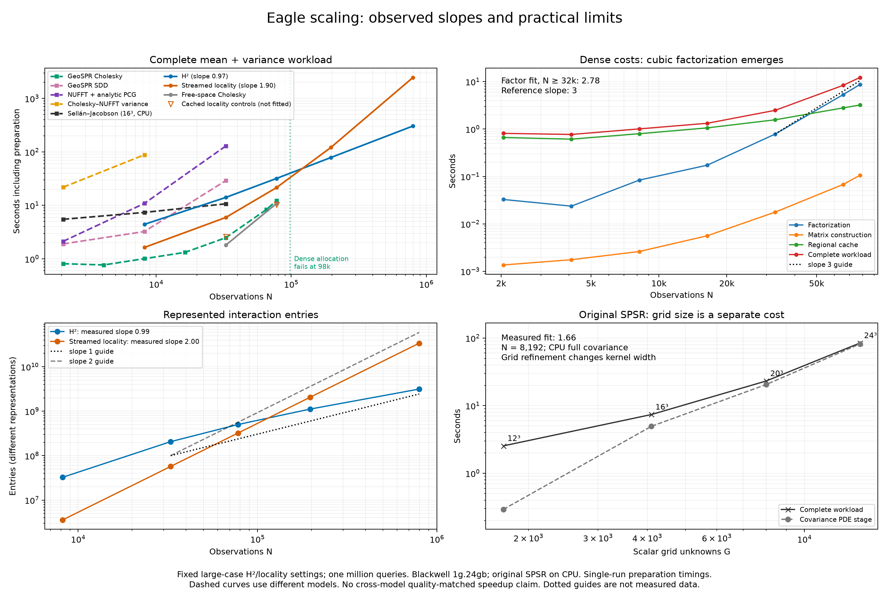

# Eagle scaling regimes (issue #104)

This extends the [initial comparison](../eagle_comparison/README.md). The goal
is a practical log-log slope comparison, not a precise complexity theorem.
All production totals include preparation, mean, marginal variance, CDF and
ambiguity evaluation for 16 batches of 65,536 queries in the same contact box.



**The strongest supported comparison is H² versus locality within the same
free-space model.** Periodic GeoSPR and original grid SPSR instantiate different
models. Their timings do not establish equal reconstruction or calibration
quality. The original's grid resolution remains unvalidated.

## Measured results

With all H²/locality settings fixed, the 32,768–796,825 range gives total-time
slopes **0.97 for H²** and **1.90 for streamed locality**. This is the expected
practical ballpark of linear versus quadratic growth, not proof of limiting
exponents. H² takes **305.04 s** on full Eagle versus **2,465.47 s** for locality
(**8.08×**), including the same million mean-and-variance queries.

| N | H² seconds | Streamed locality seconds |
|---:|---:|---:|
| 8,192 | 4.42 | 1.63 |
| 32,768 | 14.07 | 5.94 |
| 77,824 | 31.88 | 21.49 |
| 196,608 | 78.54 | 121.15 |
| 796,825 | 305.04 | 2,465.47 |

Dense factorization takes .785, 5.320 and 8.715 seconds at 32,768, 65,536 and
77,824 points. Its large-size slope is about **2.8**, close to cubic; the total
workload slope is shallower because regional preparation still contributes.
**Cholesky remains faster wherever it fits in this experiment.** At N=98,304,
the float32 matrix alone requests 36 GiB and allocation fails on the 24 GiB
partition. We observe a memory limit, not a measured runtime crossover with H².

At N=32,768, SDD takes 29.02 s and NUFFT + analytic PCG takes 128.87 s, both
passing the own-model gates. SDD's first passing checkpoints grow from 1,024
to 4,096 to 32,768 iterations at N=2k, 8k and 32k, with fixed batch 512 and
eta .1. Mean per-iteration times grow from .179 to .263 to .804 milliseconds.
NUFFT's 32k solve spends 1.70 s in Fourier warm starts and 123.89 s in full
analytic correction; the latter dominates this route. These results meet
the stopping criterion of an overlapping point slower than H², without
claiming optimal tuning or cross-model quality equivalence.

Original full-covariance SPSR takes 2.54, 7.39, 23.15 and 84.51 seconds at
G=12³, 16³, 20³ and 24³, holding N=8,192 fixed. The covariance PDE stage grows
from 4.95 to 81.70 seconds over 16³–24³ (slope about 2.3), while total runtime
includes other work. The 28³ attempt hits the 12 GiB address-space guard.
Its fixed-16³ observation curve remains shallow because grid work dominates.
This is not evidence that the grid is sufficiently resolved.

**Bandwidth is not converged.** At N=2,048, cutoff 50→75 changes direct-probe
CDFs by .0624 and variance/prior by .0699; 75→100 changes them by .0440 and
.0267. These far exceed the numerical gates. Cutoff 150 fails CUDA plan
creation with `CUFFT_INTERNAL_ERROR`; its resource-versus-library cause is
unresolved. The periodic curves therefore describe
fixed finite-band models, not converged infinite-band periodic reconstructions.
[Issue #105](https://github.com/alecjacobson/fast-stochastic-psr/issues/105)
tracks this separately; increasing bandwidth can only add another scaling
constraint to the current timings.

The global Cholesky–NUFFT variance route uses **float64 FFT work** in the final
fixed-setting series: 21.81 s at N=2,048 and 88.37 s at N=8,192. Both pass the
numerical/full-query checks; it is already slower than H² at the overlapping
8k size, so this series stops there. The faster float32 FFT trials are retained
in [hybrid-float32](hybrid-float32): variance error/prior is 1.063e-4 at 8k and
1.333e-4 at 32k, failing the 1e-4 gate. The failed 32k trial takes 313.6 s;
its timing is not an accepted result. The transpose-copy fix removes a
spurious allocation failure before these checks.

The original implementation's eigenspace ranks 64, 256, 1,024, 2,048 and 3,072
all fail comparison with its same-grid full covariance over the million
queries. CDF errors are respectively .0903, .0261, .00330, .00621 and .00391;
error is not monotone in the requested rank. No fast eigenspace timing is
substituted for a matching-accuracy full-covariance result.

An additional full-query comparison exposed a failure in the **older 196k
cached-locality control**. We independently solved the full kernel at the two
worst-disagreement locations and contact: H²'s CDF error is 8.90e-6, new
streamed locality's is 1.41e-4, and the old control's is **.001329**, above the
.001 gate. The older control is excluded from the accepted plot. The failed
pair comparisons remain in [diagnostic_checks_free.json](diagnostic_checks_free.json),
and the full-kernel evidence is in [targeted](targeted). Required comparisons
between the new fields pass. This strengthens the previous probe contract;
it does not provide a uniform error certificate against the exact GP.


Adjacent total-time slopes over 32k→78k→196k→797k are **.946, .973, .970**
for H² and **1.487, 1.866, 2.153** for locality. The latter moves toward the
quadratic regime as fixed/cache costs become less important. H² interaction
ranks are not held numerically constant: maximum hierarchy rank grows from
255 to 290, cross rank from 82 to 129, and mean iterations from 9 to 33.
The measured near-linear total trend persists despite that growth.

The cached-query sweeps give slopes **.91–.97** over 65,536–1,048,576 queries
in a single batch. All regional methods benefit from this O(M)-like reuse;
it is not exclusive to H². At N=32,768, setup still dominates even 64 query
batches. Smaller batches are visibly affected by launch/transfer overhead.

[Stage plots](stages.png) show why total slopes need not equal solve slopes.
[Query/rank diagnostics](diagnostics.png) vary query count and reuse separately.
[manifest.json](manifest.json) includes exact record hashes, settings, stages,
finite-range fits and adjacent local slopes. Failed allocation/accuracy/budget
endpoints receive no invented completion time and are excluded from fits.
Reference slope lines in the figure are guides, not runtime extrapolations.

## Rough cost expectations

Let N denote observations, M queries, G scalar grid unknowns, L Fourier modes,
d regional interpolation nodes, r compressed cross rank, b SDD minibatch,
I solve iterations, and E represented interaction entries. These symbols keep
independent dimensions visible; they are not a claim that r or I stay bounded.

| Method | Cost to watch in this experiment |
|---|---|
| Dense Cholesky | O(N²) matrix construction/storage; O(N³) factorization; O(N² r) triangular solves. |
| SDD | About O(I N b r), plus compilation/cache work. Both per-step cost and I are measured. |
| Cholesky–NUFFT global variance | Dense conditioning remains; global variance also transforms contributions from N inverse-factor columns. Fixed-L Fourier work can dominate before cubic setup does. |
| NUFFT + analytic correction | Finite Fourier actions cost roughly O(N + L log L) per RHS/iteration; the separate full-analytic correction has its own action cost and iteration count. |
| Locality | About O(I E r); fixed physical radius on a fixed object retains increasing neighbors as density grows. Streaming bounds workspace, not E. |
| H² | Roughly linear/log-linear actions when ranks and interaction lists stay controlled, multiplied by solve iterations and RHS count. Ranks and interactions are reported rather than assumed constant. |
| Original SPSR | Density-lumped observation conditioning, then grid assembly and PDE solves. Full grid covariance uses O(G²) storage and G RHS in each of two sparse solves; it is not an N³ dense GP factorization. |

All regional variants also pay for cross construction/compression and cache
projection (roughly O(N d²) at fixed order for the compression used here).
Once prepared, the polynomial marginal field costs O(M) at fixed order; its
constant grows with order. Original grid interpolation also costs O(M) for a
fixed interpolation stencil. Eigenspace reduction adds its own basis/rank
tradeoff. We compare it with the same-grid full-covariance implementation,
not an uncomputed continuum solution.

The methodological distinctions follow [GeoSPR §§3.2–3.3](https://arxiv.org/html/2503.19136v2)
and [Sellán–Jacobson §4.2](https://arxiv.org/html/2206.15236v2). We do not assign
precise asymptotic exponents to every implementation stage.

## Fixed implementation and accuracy

The periodic series is rerun with one source version. Dense construction uses
the fused float32 kernel; Cholesky factors in place. Both triangular solves
reuse the Fortran-order factor via a transpose **flag**, avoiding an accidental
second N² allocation. The discarded allocation-copy pilots are retained under
[pilots](pilots), never fitted. Common runtime warmup and offline validation
are excluded; numerical setup, compilation, compression and conditioning are
included. Single sequential preparation measurements use the same Blackwell
1g.24gb GPU, four-core CPU quota and 16 GiB host limit.

H² uses fixed order 7, cross tolerance 1e-8, hierarchy tolerance 1e-5, AFN
rank/neighbors 50/40, leaf size 40, RHS blocks 72, eight residual-corrected
variance iterations and mean tolerance 1e-8. Locality uses the same model,
regional order and AFN settings, cutoff κR=16 and 256 MiB streamed workspace.
Its RHS block policy is fixed to the full-Eagle setting. Smaller cases are
rerun with these large-case settings. Full-Eagle endpoints are reused after
[source review](reuse_audit.json): numerical kernels and timing boundaries
match; current code adds progress logging and fixes metadata lookup.
The older, cheaper cached locality controls at 32k and 78k remain checked
controls (open triangles in the plot), rather than being mixed into the
fixed streamed slope fit. These are fixed-setting scaling curves, not the
fastest possible per-size tuning envelope; the earlier tuned small H² runs
are faster than the conservative large-case settings used here.

The free-space model is isotropic Matérn-3/2 with lengthscale .03, amplitude
.0025 and relative noise .01. The periodic model is a product Matérn with
`ell=.03/(2*pi)`, the same component variance/noise, analytic normalization
and scalar/cross cutoff 50 (L=101³). This does not equate the models.
Periodic regional order is five, compression tolerance 1e-8. SDD fixes batch
512, eta .1, momentum .9 and Polyak .01, selecting the first passing tested
checkpoint. Matrix-free NUFFT fixes fit cutoff 50, 20 warm iterations,
128-point block preconditioning, four RHS per block, analytic variance
residual tolerance .001 and mean tolerance 1e-6.

Accepted approximate fields must have positive variance, max CDF error ≤.001
and max variance error/prior ≤1e-4 against their own model. These CDF checks
include errors in the contact-centered mean. We retain the existing free-space
full-kernel references and compare the complete million-query workloads.
Periodic small/medium references use 73 uncompressed probes. Large dense
references use 17 probes and explicit full-float64 residual error bounds;
the float32 factor is only a reference preconditioner. Near GPU capacity,
production succeeds but the convenient reference hits a leaf-cache byte cap
or CUDA plan-creation failure. The separate [bounded-workspace audit](../../audit_periodic_scaling.py)
rebuilds the reference offline and pins its result to the production record's
hash. These validation failures are not labeled production failures.

Original SPSR is unmodified gpytoolbox 0.3.8, CPU, full covariance, with a fixed
full-scan bounding box and native density lumping, Neumann solve and variance
shift. Its kernel width is 1.5 times minimum grid spacing, so a G sweep changes
the model as well as cost. cProfile separates the covariance factor/solves
from other setup. Original subprocesses have a 12 GiB address-space guard
within the 16 GiB host limit. A guard-triggered failure is distinguished from
an observed GPU allocation failure.

## Reproduction

Run from the repository root with the documented runtime and checksum-pinned
Eagle input available. The driver skips completed records from the same
source, preserving measured data. Use a fresh `--root` to rerun a changed
implementation; do not silently overwrite a fitted series.

```bash
./reproduction/run_env.sh -m reproduction.run_asymptotic_regimes
./reproduction/run_env.sh -m reproduction.run_fixed_free_space
./reproduction/run_env.sh -m reproduction.audit_periodic_scaling reproduction/results/asymptotic_regimes/periodic/dense-65536.json
./reproduction/run_env.sh -m reproduction.audit_periodic_scaling reproduction/results/asymptotic_regimes/periodic/dense-77824.json
./reproduction/run_env.sh -m reproduction.audit_scaling_disagreement
./reproduction/run_env.sh -m reproduction.verify_asymptotic_regimes
./reproduction/run_env.sh -m reproduction.scaling_queries
./reproduction/run_env.sh -m reproduction.audit_scaling_reuse
./reproduction/run_env.sh -m reproduction.plot_asymptotic_regimes
./reproduction/run_env.sh -m reproduction.summarize_scaling
./reproduction/run_env.sh -m pytest tests/test_eagle_comparison.py tests/test_scaling_reference.py tests/test_variance_series_gpu.py tests/test_reference_bounds.py tests/test_targeted_reference.py -q
```

Query sweeps report three actual replays and their median. The reuse total is
explicitly composed from measured preparation plus newly measured query time;
no unmeasured large-N preparation time is extrapolated. Raw failures, pilots,
checkpoint histories, solve iteration counts, source hashes and allocation
sizes are retained alongside accepted results.
