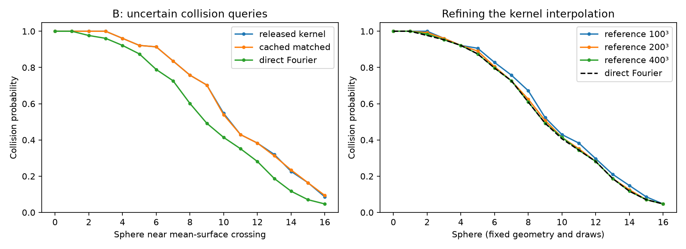

# Cached posterior queries

This experiment accelerates **repeated queries of prepared posterior samples**.
It retains every Fourier mode and uses the public cuFINUFFT interpolation-only
interface after caching the oversampled spatial grids. It does not yet accelerate
full-model fitting/sampling to a million observations. See the
[cuFINUFFT interface documentation](https://finufft.readthedocs.io/en/v2.5.1/c_gpu.html).

## Matched released-kernel application queries

A has 691 observations; B has 17,419. Both use 128 coherent posterior draws,
24 rays × 256 locations and 17 spheres × 256 surface locations. The spheres
are placed around a mean-surface crossing using deterministic calibration,
without inspecting realized sample events. Every backend gets identical probes.
Query positions translate between the three timed repeats; no query answers
are cached. All timings synchronize the GPU. Probability errors below compare
the final common translated geometry; independent field/covariance checks use
257 additional locations. Seeds 42 and 43 are both retained.

| Run | Strong reference rays | Cached compatible rays | Ratio | Strong reference collisions | Cached compatible collisions | Ratio |
| --- | ---: | ---: | ---: | ---: | ---: | ---: |
| A-moving | 14.83 ms | 11.25 ms | 1.32× | 11.87 ms | 8.51 ms | 1.39× |
| B-moving | 128.93 ms | 11.64 ms | 11.08× | 90.38 ms | 8.64 ms | 10.46× |
| B-seed43 | 128.78 ms | 11.46 ms | 11.24× | 90.26 ms | 8.59 ms | 10.51× |

The reference shares each released interpolated cross-kernel block across all
samples, reuses the analytic factorization and **also caches its prior grids**.
The accelerated compatibility path uses the existing 201³-mode representation
of the released kernel. Both receive the same corrected pathwise draws and
mean offset. This is stronger cached algebra, not untouched upstream stochastic
API timing; the sampler includes observation noise and the omitted vector
spectrum. Query timings include sample evaluation, joint events and view scores.

| Run | Ray RMS / max error (percentage points) | Collision max error (points) | Uncertain reference spheres | View-score regret | Paired gate |
| --- | ---: | ---: | ---: | ---: | --- |
| A-moving | 0.032 / 0.781 | 0.000 | 17 / 17 | 0.00000 | pass |
| B-moving | 0.036 / 1.562 | 0.781 | 13 / 17 | 0.00000 | pass |
| B-seed43 | 0.032 / 1.562 | 1.562 | 17 / 17 | 0.00000 | pass |

Gates: ray RMS ≤1 percentage point and maximum ≤2, collision maximum ≤2,
next-view regret ≤two ray steps. These compare paired numerical evaluations.
With 128 draws the worst-case marginal Monte Carlo standard error is 4.42
percentage points. Absolute probability convergence, sphere/ray discretization,
multi-step scanning and original unpublished application scenes remain open.

## Does caching change the random functions?

Independent tests cover random spectra, periodic translations, odd/even FFT
grids, production-bandwidth corner modes, changed query positions and partial
sample batches against direct Fourier sums and ordinary NUFFT. Two real-valued
functions are packed into one complex grid using their Hermitian spectra;
this halves storage without discarding frequencies. The 1.6× padded grid
limits float32 cancellation observed with the smaller 1.25× grid.

| Run | Cache field error / fluctuation norm | Empirical variance relative error | Empirical covariance relative error | Cache vs ordinary event changes |
| --- | ---: | ---: | ---: | ---: |
| A-moving | 4.23e-06 | 9.35e-07 | 2.22e-06 | 0 |
| B-moving | 5.11e-06 | 9.56e-07 | 3.11e-06 | 0 |
| B-seed43 | 5.16e-06 | 9.26e-07 | 2.93e-06 | 0 |

The covariance check uses the first 32 of 257 independent random queries.
These coupled finite-sample diagnostics isolate caching error, not population
covariance or model/truncation error. The numerical gates were fixed before
these runs: field error / fluctuation norm <5e-4, variance and covariance
relative errors <1e-4. Invalid checks stop the benchmark.

## Preparation, memory and amortization

| Run | Shared fit/mean + corrected draw preparation | Additional compatible spectrum/aggregation/grid setup | Reference prior-grid setup | Approx. ray batches to amortize extra setup |
| --- | ---: | ---: | ---: | ---: |
| A-moving | 12.06 s | 1.64 s | 0.067 s | 440 |
| B-moving | 13.40 s | 2.00 s | 0.066 s | 17 |
| B-seed43 | 13.87 s | 2.01 s | 0.070 s | 17 |

This break-even estimate assumes the reference kernel table already exists
and the measured shared conditioning/draws are available. It does not count
the original slow table setup as an advantage, and is not an independently
optimized cold-start application benchmark. Shared preparation still includes
direct sample aggregation for all paths. Calibration, independent validation
and ordinary baseline runs are diagnostic overhead outside query timings.

For 128 draws, the compatible cache payload is **16.22 GiB**;
the direct and reference-prior cache payloads are **2.03 GiB** each.
These are payload sizes, not total GPU peaks; coefficients, factorization,
runtime allocators and workspaces require additional memory. Caches are tested
sequentially. An initial unpacked compatible-cache allocation failed; the raw
`A-unpacked-memory-failure` record is retained. Packing resolved that failure.

The external 100 ms `nvidia-smi` monitor observed a maximum of **39.36 GiB**
across the monitored validation queue. This includes allocator/context memory;
shorter transients can be missed and monitoring began during the first run.

## Removing interpolation: a convergence bridge

The released 50³ kernel interpolation changes local probabilities appreciably.
To distinguish that bias from direct-NUFFT error, refine the same nonuniform
trilinear table while keeping analytic conditioning, draws, mean offset and
query hashes fixed. Table nodes use the independently validated finite-Fourier
kernel. This is a refined reference algorithm, not the untouched released setting.

| Reference grid | Direct ray RMS / max difference (points) | Direct collision max difference (points) | Direct paired gate | Strong reference / cached direct ray time |
| --- | ---: | ---: | --- | ---: |
| 100³ | 0.144 / 5.469 | 6.250 | FAIL | 144.23 / 10.89 ms |
| 200³ | 0.054 / 1.562 | 1.562 | pass | 162.87 / 10.92 ms |
| 400³ | 0.026 / 0.781 | 0.781 | pass | 194.00 / 10.84 ms |

This supports using direct Fourier evaluation for the intended finite-scalar,
analytic-vector posterior rather than permanently reproducing a coarse table.
It does not validate a truncated *training* covariance at massive N.



## Reusable API and hitbox check

`Posterior.prepare_query_cache()` enables cached mean/sample evaluation for
arbitrary later query coordinates. Redrawing invalidates the sample cache.
The application demo accepts `--cache-queries` and a separate `--output` path.
The [complete demo output check](application_cache_check.json) found identical
ray probabilities, next-view scores and collision probabilities; volume mean
and standard deviation differ by less than 1e-6 relative L2. All three hitbox
meshes retain identical faces, with maximum vertex displacement below 0.00011
in normalized scene coordinates. Existing domain clipping remains unchanged.
Single-call sample-volume evaluation fell from 128.0 to 11.9 ms; this is a
same-method implementation comparison, not a validated upstream hitbox speedup.
Preparation varied by about a second between those runs and dominates the
overall demo, so the isolated query improvement is not a cold-start claim.

## Reproduce

```bash
./reproduction/run_env.sh -m pytest -q tests
./reproduction/run_env.sh reproduction/paired_applications.py --case A --cached-grids --uncertain-collisions --query-jitter .002 --output reproduction/results/cached_queries/A-moving
./reproduction/run_env.sh reproduction/paired_applications.py --case B --cached-grids --uncertain-collisions --query-jitter .002 --output reproduction/results/cached_queries/B-moving
./reproduction/run_env.sh reproduction/paired_applications.py --case B --cached-grids --uncertain-collisions --query-jitter .002 --seed 43 --output reproduction/results/cached_queries/B-seed43
# Repeat with reference grids 100, 200, 400 and corresponding output paths:
./reproduction/run_env.sh reproduction/paired_applications.py --case B --cached-grids --uncertain-collisions --backends direct --reference-grid 200 --mean-offset direct --query-jitter .002 --output reproduction/results/cached_queries/B-grid200-fixed
./reproduction/run_env.sh reproduction/summarize_cached_queries.py
```

For the full demo output check, run `applications.py` with and without
`--cache-queries`, using the respective `--output` directories
`reproduction/results/cached_queries/applications-cached` and
`reproduction/results/cached_queries/applications-ordinary`, then run
`reproduction/compare_application_cache.py`. Demo meshes/large arrays are
regenerated rather than duplicated in Git; the numeric comparison is retained.

GPU runs must be sequential. The report generator uses saved results only.
Implementation and remaining scope: [issue #12](https://github.com/alecjacobson/fast-stochastic-psr/issues/12).
