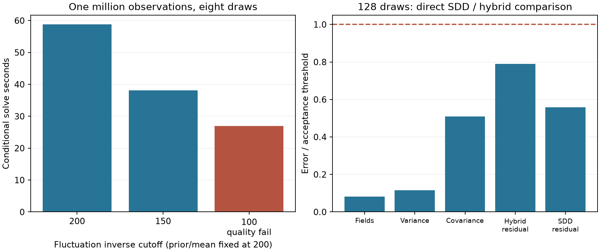

# Wider prior with a cheaper centered fluctuation solve

At one million observations, a cutoff-150 inverse applied only to centered
fluctuations is **1.54× faster** than the cutoff-200 centered control over
eight common draws (three repetitions each). The 128-draw confirmation takes
**616.29 s**. **No accepted 128-draw speed ratio against SDD is established.**
These are conditional-solve comparisons, **not full application speedups**.
The common vector prior and held mean remain at cutoff 200; scalar/cross cutoff
is 50. This experimental hybrid is not an exact posterior at either bandwidth.
The production sampler's default remains unchanged.



## Numerical controls and retained failures

[Declared protocol](PROTOCOL.md). The hybrid solves the centered prior-plus-noise
RHS from zero, then adds the held mean weights. Its CG tolerance is relative to
that centered RHS. A cutoff-200 centered control checks the effect of this
normalization against the existing original-RHS mean-start solver. It passes
the stricter same-model field gates; narrower inverses use the declared
cross-model gates. Independent analytic holdouts still test **total weights
against original RHS**, with the unchanged 0.1% gate.

All three eight-draw configurations have sampled GPU isolation. Times are
medians and ranges, not confidence intervals. Covariance errors compare to the
cutoff-200 centered control except the 200 control itself, which compares to
the earlier mean-start solver.

| Inverse cutoff | Solve median [min, max], s | Paired covariance error % | Analytic holdout upper % | All gates |
| --- | ---: | ---: | ---: | --- |
| 200 | 58.78 [58.77, 58.80] | 0.00638 | 0.04631 | pass |
| 150 | 38.14 [38.12, 38.15] | 0.00979 | 0.07884 | pass |
| 100 | 26.98 [26.98, 27.00] | 0.08099 | 0.26733 | FAIL |

Cutoff 100 is rejected: it fails covariance and analytic-residual gates despite
matching the tested events. The short-scale/low-noise dense case below also
fails. Neither speed is promoted as an accepted gain.

## 128 shared draws against a strong SDD reference

SDD shares each analytic kernel row across all 384 scalar RHS, starts from the
same held mean, uses row batch 2,048, and stops on 2,048 fixed analytic rows at
a maximum marginal bootstrap upper endpoint below 0.05%. A fresh, disjoint
4,096-row panel (seed 2711) audits both solvers. SDD validation rows are now
regenerated in blocks of 64 instead of retaining an 8 GB stopping matrix.
This memory option preserves the update; a B/4-draw smoke check with a partial
257-row validation block stops at the same 1,024 iterations and preserves events.

The direct paired comparison passes: field error
divided by fluctuation norm **0.016466%**,
variance error **0.002320%**, covariance
error **0.010180%**. Maximum ray/collision
probability differences are **0.78125 /
0.78125 percentage points**;
selected views are 14 and 14.
The JSON records the hybrid as the comparison reference and SDD as candidate;
denominators follow that direction. The hybrid also passes separately against
the previously saved wider NUFFT128 output, whose contaminated timing is not
used in any ratio here.

| 128-draw method | Solve/updates s | Stopping checks s | Independent holdout s | Scalar aggregation s | Queries/events s | Script work wall s |
| --- | ---: | ---: | ---: | ---: | ---: | ---: |
| Hybrid 150 | 616.29 | 0.00 | 1.12 | 2.79 | 0.38 | 626.39 |
| Analytic SDD (timing excluded) | 812.28 | 5.71 | 0.85 | 2.79 | 0.39 | 829.76 |

Plans/setup and RHS transfer are separately recorded in each JSON. Script wall
time additionally includes retained-weight transfers, hashing, result writes
and validation; it is not a complete application latency. Common input/prior
preparation and mean fitting are outside these runs. The earlier preparation
record has 7.39 s of prior GPU generation and 7.68 s of mean fitting, excluding
staging/IO. The 128-draw comparison has one timing per method. GPU-process audit
status is hybrid **True**, SDD **False**; periodic sampling
can miss short-lived work. No other project's process was stopped.
The SDD audit observed foreign GPU processes in
**54 samples**.
If this count is nonzero or monitoring failed, its raw timing is excluded from
speed ratios even when numerical gates pass; checking only the process list
before and after a run would miss such overlap.

SDD uses the full analytic inverse but the same **truncated vector prior**;
it is not a full-analytic posterior sampler. Shared finite draws isolate the
numerical comparison; 128 draws are not probability ground truth. Full mean,
joint-event, sample-count and geometry convergence remain open. SDD is feasible
at this size, so this does not establish upstream intractability.

## Exact dense moments on overlap sizes

Float64 Cholesky calculations compare the law directly on the fixed 16-query
panel from the spectral-tail audit, without Monte Carlo sampling error. The
default A/B cases pass; B with length scale .005 and noise variance .0004 fails.
The latter retains the erroneous wider mean: a narrower fluctuation inverse
cannot repair it. All means use their own data-derived deterministic offset.
The held hybrid mean is identical across inverse cutoffs.

| Input | Inverse cutoff | Mean error % | Covariance error % | Inside-probability RMS pp | Panel gates |
| --- | ---: | ---: | ---: | ---: | --- |
| dense-A | 100 | 0.01473 | 0.000194 | 0.002154 | pass |
| dense-A | 150 | 0.01473 | 0.000195 | 0.002154 | pass |
| dense-A | 200 | 0.01473 | 0.000195 | 0.002154 | pass |
| dense-B | 100 | 0.00819 | 0.001540 | 0.004807 | pass |
| dense-B | 150 | 0.00819 | 0.001558 | 0.004808 | pass |
| dense-B | 200 | 0.00819 | 0.001559 | 0.004808 | pass |
| dense-B-stress | 100 | 0.68807 | 0.112106 | 0.321983 | FAIL |
| dense-B-stress | 150 | 0.68807 | 0.265992 | 0.328176 | FAIL |
| dense-B-stress | 200 | 0.68807 | 0.275635 | 0.328533 | FAIL |

For training matrices B (narrow) and W (wide), cross matrix C, A=B⁻¹C and
Z=W⁻¹C, the covariance excess over the wider posterior is
`R = (A-Z)ᵀ W (A-Z)`, summed over vector components. This stable PSD expression
also gives the covariance of the paired draw difference. That difference is
independent of the wider posterior fluctuation under the shared joint Gaussian
prior. True-law covariance error is second order, while paired field error and
finite-ensemble covariance cross terms can be larger. This explains why the
dense panel and paired finite-draw errors differ; it does not waive either gate.
[Derivation](../spectral_tail/METHOD.md) and independent dense algebra/sampler
tests accompany the implementation.
[Full test output](tests.log) records validation of this milestone.

## Reproduce

Use the pinned environment from the main reproduction guide. Stage the common
RHS as in [the earlier report](../nufft_batches/README.md); large arrays live
outside the repository. Reuse its saved mean and prior. The saved source,
geometry, mean and holdout hashes make the pairing explicit.

```bash
./reproduction/run_env.sh -m reproduction.audit_centered_hybrid --case A --output reproduction/results/centered_hybrid/dense-A
./reproduction/run_env.sh -m reproduction.audit_centered_hybrid --case B --output reproduction/results/centered_hybrid/dense-B
./reproduction/run_env.sh -m reproduction.audit_centered_hybrid --case B --lengthscale .005 --noise .0004 --output reproduction/results/centered_hybrid/dense-B-stress
./reproduction/run_env.sh -m reproduction.benchmark_nufft_batches solve --samples 128 --batch 1 --repeats 1 --centered-fluctuations --solve-cutoff 150 --audit-analytic --stop-rows 2048 --holdout-rows 4096 --holdout-seed 2711 --retain-weights --scratch /opt/geospsr-runtime/common-rhs-128 --reference reproduction/results/nufft_batches/nufft128 --output reproduction/results/centered_hybrid/million-150-128
./reproduction/run_env.sh -m reproduction.benchmark_nufft_batches sdd --samples 128 --repeats 1 --initial-mean --sdd-row-batch 2048 --stop-rows 2048 --stop-tolerance .0005 --stream-stop-rows --holdout-rows 4096 --holdout-seed 2711 --retain-weights --reference reproduction/results/centered_hybrid/million-150-128 --scratch /opt/geospsr-runtime/common-rhs-128 --output reproduction/results/centered_hybrid/sdd128
./reproduction/run_env.sh -m reproduction.summarize_centered_hybrid
```

For eight draws use `--samples 8 --repeats 3`, inverse cutoffs 200/150/100 and
the reference paths recorded in their JSON. Scratch paths are configurable.
The separate [ContactFusion assessment](../../CONTACTFUSION.md) defines a
practical replay target; none of these scorpion runs measures ContactFusion.
