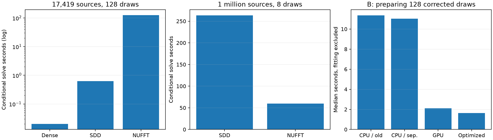

# Conditional solves and faster corrected posterior preparation

Two results change the practical picture:

- At one million observations, eight shared conditional RHS groups take **263.4 s with SDD** and **60.0 s with NUFFT**: **4.39×** for the solves, not the 27.2× mean-fit ratio.
- Optional fast preparation reduces 128 corrected draws at B from **11.36 s to 1.63 s (6.95×)** within this implementation. The complete small-scorpion computation through hitbox export improves **6.62×**.

The large-N experiment shares a truncated prior and uses only eight draws.
**It does not establish full-model posterior or application probability accuracy.**
The preparation improvement preserves the corrected full-analytic-vector /
finite-scalar posterior; it is a same-method optimization, not a speedup
against the untouched Holalkere stochastic API.



## Fairly batched conditional solves

SDD forms each analytic kernel-row block once and multiplies it by all sample
right-hand sides together. It preserves the compiled update sequence and
uses batch 512, eta=5, momentum 0.9 and Polyak 0.01. Counting one independent
SDD run per draw would greatly overstate its cost. Dense triangular solves
also combine all RHS. NUFFT reuses plans and solves three vector components
per draw at cutoff 200, CG rtol 1e-5; larger transform batches remain untested.

| Input | Draws | Cached dense solve (s) | Shared-row SDD updates (s) | NUFFT solves (s) |
| --- | ---: | ---: | ---: | ---: |
| B: 17,419 observations | 128 | 0.020 | 0.625 | 125.581 |
| 1,000,000 observations | 8 | not run | 263.354 | 59.987 |

These times exclude fitting, prior generation, plan/JIT setup, source
aggregation, validation and field queries; those stages are recorded separately.
Only the dense B solve has three repetitions. SDD/NUFFT figures are pilot
measurements, not runtime confidence intervals or complete application timings.
The GPU is an NVIDIA L40; jobs were serialized. Peak memory was not profiled.

**At B**, all methods receive the same corrected analytic-vector prior,
scalar prior, observation noise, RHS and mean offset. The reference is dense
analytic conditioning. Both candidates pass paired field/variance/covariance
and ray/collision/view gates. The NUFFT events agree exactly; SDD differs by
at most one of 128 outcomes at a ray location (0.78125 percentage points).
The cached dense solve is decisively preferable at this size.

**At one million**, the common vector prior stops at cutoff 200; the scalar
prior/cross spectrum stops at 50. Observation noise variance is 0.02.
SDD uses the full analytic training covariance; NUFFT uses the finite one.
The omitted analytic prior tail is **not** sampled here. This isolates the
conditional-solve difference, not the complete full-model posterior law.

SDD stops using 512 analytic rows and a per-draw residual threshold 0.0005.
Both methods are then checked on 1,024 independent analytic rows. The largest
per-draw bootstrap 95% upper residual endpoints are
**0.0675% for SDD** and **0.0472% for NUFFT**, below the 0.1% gate.
These are marginal empirical intervals, not simultaneous or global bounds.

Paired fields use 257 independent positions and a 32-query empirical
covariance. Gates declared before these runs: error/fluctuation norm <0.2%,
variance and covariance relative errors <0.02%; ray RMS <1 percentage point,
ray/collision maximum <2 points, and next-view regret ≤two ray steps.
The million-point paired fields and events pass, including uncertain spheres.
Eight draws still have a worst-case marginal probability standard error of
**17.7 percentage points**; zero observed event disagreements is not a
probability-convergence result. Reference input hashes and seeds are recorded.

## Faster preparation of the corrected exact sampler

The default CPU RNG preserves historical seeded realizations. The optional
GPU RNG has the same Gaussian law but a different random sequence. Three
changes provide the fast path: GPU randomness, one shared triangular solve
for all sample RHS, and source FFT oversampling 1.25 instead of 2.0. The
finite vector covariance is evaluated by direct separable cosine sums.
The previous NUFFT covariance construction remains available for comparison.

| B, 128 corrected draws | Median preparation (s) |
| --- | ---: |
| CPU RNG, previous covariance construction | 11.358 |
| CPU RNG, separable covariance | 11.034 |
| GPU RNG, streamed solves, FFT oversampling 2.0 | 2.096 |
| GPU RNG, shared solve, FFT oversampling 1.25 | 1.634 |

Medians use three repeats after a first call. Times include covariance
preparation, all prior/noise draws, conditional solves and scalar aggregation;
they exclude the initial analytic fit. Stage profiling identifies CPU vector
Gaussian generation as the main bottleneck (about nine seconds); synchronized
profiling adds overhead and is kept separate from these timing measurements.

Paired CPU checks validate the covariance-construction substitution. Separate
paired **GPU** checks validate the optimized transforms/solve with common
randomness: ray/collision events and view decisions are identical, and field,
variance and covariance gates pass. CPU and GPU realizations are not paired.
An independent 4,096-draw moment test checks the GPU path against the analytic
posterior mean/covariance. The full test suite has 28 passing tests.

## Full application computation, same-method comparison

The released 691-point scorpion is used with 128 coherent draws, cached queries
and a 48³ hitbox grid. Each number is one run from fitting through hitbox mesh
export: it includes queries/reductions, geometry, a slice-array write and mesh
extraction/export; process/data startup and plotting are excluded.

| Preparation | Computation wall time (s) |
| --- | ---: |
| cpu | 11.693 |
| gpu | 2.749 |
| optimized | 1.767 |

CPU versus GPU uses the same posterior law and sample count, with different
realizations. The common-GPU-randomness control (GPU versus optimized) has
identical transmittance, scores and collision outputs. All three meshes have
identical connectivity; maximum vertex displacement is **0.000048** normalized units.
Domain clipping is unchanged. This checks preservation of the existing demo,
not hitbox resolution/sample convergence or the unreleased paper scenes.

## Reproduce and continue

```bash
./reproduction/run_env.sh reproduction/benchmark_sampler_setup.py
./reproduction/run_env.sh reproduction/benchmark_conditional_solves.py --dataset B --samples 128
./reproduction/run_env.sh reproduction/benchmark_conditional_solves.py --dataset 1000000 --samples 8 --chunk 512
./reproduction/run_env.sh reproduction/applications.py --cache-queries --output reproduction/results/conditional_solves/applications-cpu
./reproduction/run_env.sh reproduction/applications.py --cache-queries --gpu-rng --output reproduction/results/conditional_solves/applications-gpu
./reproduction/run_env.sh reproduction/applications.py --cache-queries --fast-sampling --output reproduction/results/conditional_solves/applications-optimized
./reproduction/run_env.sh reproduction/compare_application_cache.py --root reproduction/results/conditional_solves --reference applications-gpu --candidate applications-optimized --output application_sampling_check.json
./reproduction/run_env.sh reproduction/summarize_conditional_solves.py
```

Generate the matched/million-point inputs using the earlier reproduction
scripts first. `paired_applications.py --fast-sampling` exposes the same
preparation path for matched-kernel query comparisons. Profiling is available
with `benchmark_sampler_setup.py --profile`.

The preparation work is tracked in [#16](https://github.com/alecjacobson/fast-stochastic-psr/issues/16).
Method selection remains in [#15](https://github.com/alecjacobson/fast-stochastic-psr/issues/15).
Still needed: full-model covariance/prior validation at massive N, larger
draw counts with fair batching and bounded memory, sample/geometry convergence,
multi-seed acquisition and complete massive application comparisons.
