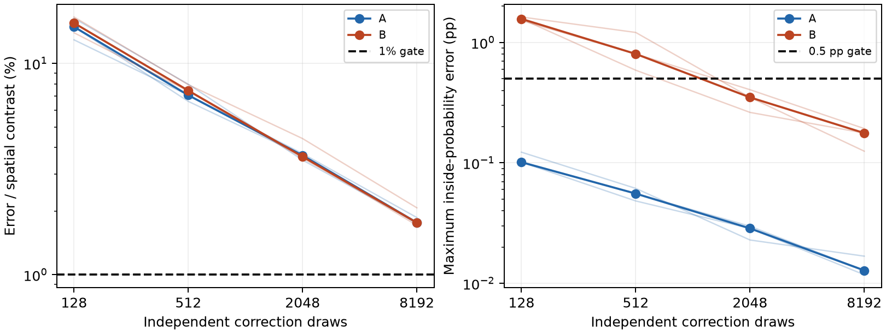

# Correction sampling at matched spatial-contrast quality

**Neither A nor B reaches the 1% spatial-contrast gate at any tested count through 8,192 draws.**
The deterministic streamed cross-factor baseline passes on both. No matched-quality
speedup follows from this study. [Protocol](PROTOCOL.md) · [Raw summary](summary.json).

## Method and scope

For `A = L Lᵀ`, independent Gaussian vectors `xi` give `alpha = L⁻ᵀ xi` with
covariance `A⁻¹`. Fourier aggregation and evaluation give correction fields
`c = C alpha` with covariance `C A⁻¹ Cᵀ`. Estimate marginal variance with
`V0 − mean(c²)`, using the known zero correction mean. This avoids constructing
the full Fourier prior. It does **not** produce posterior samples for correlated
ray or collision queries. The Cholesky factor still requires quadratic storage.

Source plans are reused within each stream; the fixed-query plan is shared
across batches. Only eight coefficient fields and query-count-sized running
second moments are required, apart from transient blocks and transform workspaces.
Retaining yielded blocks defeats this bound. Negative estimates are preserved.
No antithetic partners, pilot fitting or query points are counted as extra draws.

The experiment uses every one of the 20,000 slice queries in each committed A/B
input, full analytic training covariance, scalar/cross cutoff 50 and noise .02.
It evaluates the direct Fourier model, not the released interpolant. These
results do not replace the existing matched teaser images. Probabilities use a
shared fitted mean, so their error isolates the variance estimator.

## Fixed prospective quality checks

Three new seeds (401, 503, 607) each run through 128, 512, 2,048 and 8,192 draws.
All seeds and failures are retained. A pass requires variance error below 1%
of the reference's centered spatial contrast, inside-probability RMS below
.05 pp and maximum below .5 pp, with positive variance estimates everywhere.
These marginal gates do not establish downstream action rankings or event quality.
The reference uses dense float64 factorization and epsilon-1e-12 cross sums.



Thin curves are individual seeds; thick curves are medians, not confidence bands.
The contrast gate remains stricter than the probability gates in this experiment.

| Case | Seed | Contrast error at 8,192 | Probability RMS / max (pp) | Combined gate |
| --- | ---: | ---: | ---: | --- |
| A | 401 | 1.744% | 0.0010 / 0.0128 | FAIL |
| A | 503 | 1.864% | 0.0011 / 0.0118 | FAIL |
| A | 607 | 1.764% | 0.0010 / 0.0168 | FAIL |
| B | 401 | 2.073% | 0.0068 / 0.1928 | FAIL |
| B | 503 | 1.763% | 0.0054 / 0.1769 | FAIL |
| B | 607 | 1.713% | 0.0056 / 0.1251 | FAIL |

All checkpoint estimates are retained in each `seed_*.npz`; the summarizer
recomputes their errors against the saved reference. Exact-law chi-square
interval diagnostics account for 20,000 queries and four fixed looks per seed.
They exclude model and numerical error and do not validate continuous geometry.

## Costs, including the stronger deterministic baseline

| Case | Common fit + mean queries (s) | Deterministic variance median (s) | Streamed 8,192 draws + queries + reduction (s) | Deterministic contrast error |
| --- | ---: | ---: | ---: | ---: |
| A | 0.587 | 1.607 | 23.595–24.027 | 0.000388% |
| B | 1.971 | 8.800 | 85.589–92.240 | 0.000231% |

Add common fit/mean cost to either method for first-use comparison. Stochastic
query-plan setup is also recorded separately and must be added. The stochastic
elapsed column includes generation, triangular solves, source aggregation,
queries, transfers, reductions and checkpoint-statistics overhead. The baseline
includes cross-sum query construction and triangular factor application, in
three fresh evaluations. Exact reference construction is diagnostic work and
is excluded from both application costs but retained in the raw stage records.
The `load` timer opens the archive; array materialization and hashing appear
only in total instrumented wall time. Disk artifact writes are diagnostic.

Whole-run process isolation fails for these runs. Combined with failed quality
gates, this rules out a timing-ratio claim. The displayed costs are diagnostics,
not a comparison with historical-machine timings or upstream applications.

## What this changes

The earlier low total-variance error concealed a more demanding contrast
requirement. Faster sample generation alone does not solve that statistical
problem. Dense deterministic variance remains the stronger option here.
Probability-only tasks may need fewer draws, but require their own independent
end-to-end comparison, including mean error and task decisions.

[Issue #34](https://github.com/alecjacobson/fast-stochastic-psr/issues/34) remains
open for stronger sample-efficiency methods and application validation.
[Issue #35](https://github.com/alecjacobson/fast-stochastic-psr/issues/35) tracks
matrix-free inverse-root sampling to remove the dense factor. It is unimplemented;
even a faster inverse-root action would not eliminate Monte Carlo contrast noise.

## Reproduce

```bash
./reproduction/run_env.sh -m reproduction.benchmark_correction_contrast \
  --case A --output /opt/geospsr-runtime/correction-contrast/A
./reproduction/run_env.sh -m reproduction.benchmark_correction_contrast \
  --case B --output /opt/geospsr-runtime/correction-contrast/B
./reproduction/run_env.sh -m pytest -q tests
./reproduction/run_env.sh -m reproduction.summarize_correction_contrast
```

Copy benchmark outputs into the report's A/B folders before summarizing. The
runtime was restored from the pinned lock on this VM. Setup now recovers a
missing upstream worktree registration left by an ephemeral runtime disk.
Independent tests verify explicit Fourier sums, full correction covariance,
partial batches and bounded moment accumulation. All **133 tests pass** ([log](tests.log)).
