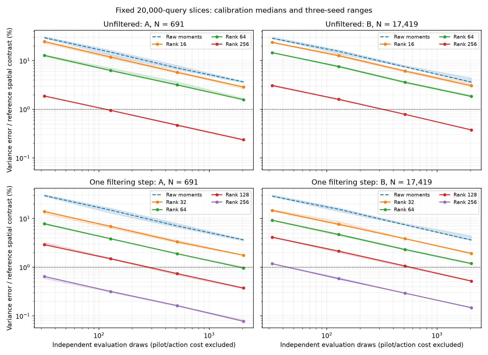

# Fixed-query covariance deflation for marginal variance

**Deflation passes the full-slice quality gates with far fewer evaluation draws,
but preparation makes it slower than deterministic variance on A and B.**
This uses the direct analytic-vector/scalar50 model, not the released
interpolant. The main README's matched teaser images and timings are unchanged.

[Protocol](PROTOCOL.md) · [Filtering protocol](FILTERED_PROTOCOL.md) ·
[Summary](summary.json) · [Issue #39](https://github.com/alecjacobson/fast-stochastic-psr/issues/39).

## Independent confirmation

All 20,000 committed slice queries, original observations/normals, noise
variance .02 and scalar/cross cutoff 50 are retained. Each variant's rank/count
was selected using three calibration seed pairs, then fixed for three new
pilot/evaluation pairs (1709/709, 1801/801, 1907/907). Every confirmation passes:
variance error relative to spatial contrast ≤1%, probability RMS ≤.05 percentage
points, maximum ≤.5 points, positive variances, and the double-precision control
check. Sampled GPU-isolation audits pass throughout all four confirmation runs.

| Variant / case | Pilot + evaluation draws | Covariance-action columns | Contrast error across seeds | First-estimate median (range), s | Deterministic median, s | Relative speed |
| --- | ---: | ---: | ---: | ---: | ---: | ---: |
| Unfiltered A, N=691 | 256 + 128 | 256 | 0.939–0.955% | 2.516 (2.495–2.562) | 1.668 | 0.663× |
| Unfiltered B, N=17,419 | 256 + 512 | 256 | 0.772–0.801% | 9.645 (9.357–9.788) | 6.488 | 0.673× |
| One filtering step, A | 128 + 512 | 256 | 0.703–0.772% | 3.134 (3.107–3.296) | 1.632 | 0.521× |
| One filtering step, B | 256 + 128 | 512 | 0.562–0.585% | 10.163 (10.031–10.197) | 6.417 | 0.631× |

Relative speed is deterministic time divided by candidate time: every ratio
below one means **slower**. Each deterministic median comes from three fresh
streamed cross-factor evaluations in that confirmation process. Candidate cost
sums measured stages: pilot generation/query, QR, every covariance action,
control construction, transform-plan setup, evaluation generation/query,
residual reduction and one final variance/probability output. It includes
setup, but is not process wall time. Pilot search, reference checks, artifact
export and rendering are excluded. Shared dense fit and mean evaluation are
separate (about 0.52 s on A and 1.94 s on B); including them also leaves every
variant slower. No upstream or complete-application speedup is claimed.

For unfiltered A/B, preparation alone takes about 2.15/5.53 s. Covariance actions
account for about 1.44/3.48 s of that. Filtering reduces B's evaluation count to
128, but increases preparation to about 9.09 s. The earlier
[raw-moment study](../correction_contrast/README.md) still missed the contrast
gate at 8,192 draws. Deflation improves statistical efficiency without yet
improving total latency.

## Estimator and controls

For correction covariance `B = C A^-1 C^T`, build an orthonormal query-space
basis `Q` from independent centered correction pilot fields and let `P=QQ^T`.
Then

```
diag(B) = 2 diag(PB) - diag(PBP) + diag((I-P) B (I-P)).
```

Compute `BQ` using NUFFT cross/transpose actions and the same dense inverse.
The first two terms are deterministic; estimate the final diagonal from second
moments of independent projected correction fields `(I-P)c`. Subtract the
combined correction diagonal from known scalar prior variance. The identity is
unbiased in exact arithmetic conditional on the independent basis; approximate
actions introduce separate numerical error. Negative deterministic terms and
negative final estimates are retained, never clipped to pass quality checks.
Correction fields are **not** coherent posterior samples for ray/collision events.

Filtering uses `Q0=orth(pilot)` and `Q1=orth(BQ0)`, then computes `BQ1`.
Both QR and covariance passes are charged. It never uses evaluation draws or
reference variance. Its protocol was declared after the unfiltered pilots
completed, before filtered execution.



Curves show calibration medians and min/max across all three seeds. The dotted
line is the 1% contrast gate. Horizontal positions count evaluation draws only;
the table includes pilot and covariance preparation. All ranks, looks, successes
and failures remain in the JSON/NPZ records. The cost-based calibration selection
was confirmed without tuning to confirmation outputs.

Seven targeted tests pass: independent explicit Fourier/dense covariance actions
at two precisions, generic complex coefficients, periodic seams, partial batches,
projection identities, Monte Carlo moments, rank-zero/full-rank limits and
retained negative estimates. Each benchmark basis/action control is checked
against double analytic factorization and double NUFFT evaluation. Its discrepancy
must stay below 0.1% of reference spatial contrast.

The [verification log](verification.log) covers eight complete executions:
216 archived arrays pass hashes, 240 saved variance/probability estimates replay
exactly, and NumPy recomputation of deterministic controls differs by less than
1e-15 of reference contrast. Input/reference hashes, quality gates, cost sums and
candidate selection are checked. Replay uses saved basis/action arrays and
residual moments; it does **not** regenerate raw draws or independently rerun
large covariance actions. Public results include references, all checkpoint
fields, metrics, timings, audits and verification records. Larger basis/action
arrays remain in the local runtime archive and are regenerated by the commands
below. Process memory audits include reference validation and calibration state;
they are not isolated candidate-memory measurements.

## Reproduce

Run GPU jobs sequentially. `run_env.sh` invokes Python. This recreates the pilot
and fixed-setting confirmation in new directories. Confirmation reads the
pilot's selected configuration and uses the predeclared independent seeds.

```bash
./reproduction/run_env.sh -m pytest -q tests/test_deflated_variance.py \
  tests/test_deflated_variance_gpu.py tests/test_correction_sampling.py

for case in A B; do
  ./reproduction/run_env.sh -m reproduction.benchmark_deflated_variance \
    --case "$case" --output "/tmp/deflated/pilot/$case" \
    --archive "/opt/geospsr-runtime/deflated-rerun/pilot/$case"
  ./reproduction/run_env.sh -m reproduction.benchmark_deflated_variance \
    --case "$case" --confirm "/tmp/deflated/pilot/$case/results.json" \
    --output "/tmp/deflated/confirmation/$case" \
    --archive "/opt/geospsr-runtime/deflated-rerun/confirmation/$case"
done
```

For filtering, add `--power-steps 1` to the pilot and use separate output/archive
paths; confirmation inherits the variant. Replay each complete result with:

```bash
./reproduction/run_env.sh -m reproduction.verify_deflated_variance \
  --output /tmp/deflated/confirmation/A \
  --archive /opt/geospsr-runtime/deflated-rerun/confirmation/A
./reproduction/run_env.sh -m reproduction.summarize_deflated_variance
./reproduction/run_env.sh -m reproduction.plot_deflated_variance
```

The last two commands read the committed result tree. Source manifests and
environment versions accompany the protocols. The first unfiltered attempt
exited with a JSON serialization error after its first seed in each case.
Public failure logs/manifests are retained under `pilot-serialization-failed`;
partial field arrays remain local. Casting the normalization to a Python float
fixed reporting without changing arithmetic, ranks, seeds, counts or gates.
Failed-attempt timings are excluded.

The next preparation experiment is [factor-space deflation (#40)](https://github.com/alecjacobson/fast-stochastic-psr/issues/40),
which projects the whitened correction factor and may avoid the separate pilot
generation plus full-inverse covariance action. It has no measured result yet.

Remaining work: cheaper preparation, independent query geometry, moving-query
basis reuse, massive-scale inverse actions, and absolute application convergence.
The dense factor remains quadratic in N. This establishes neither a
million-point variance speedup nor improved ContactFusion action quality.
