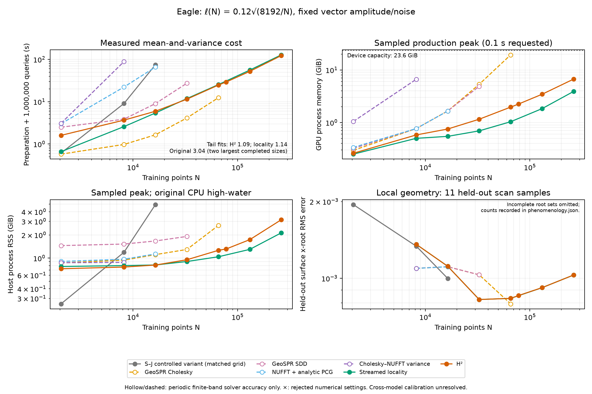
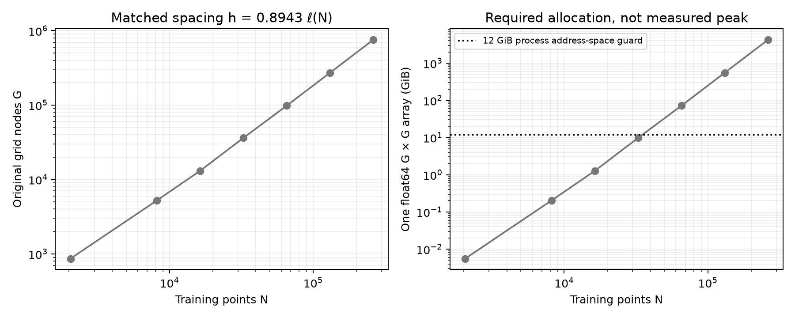
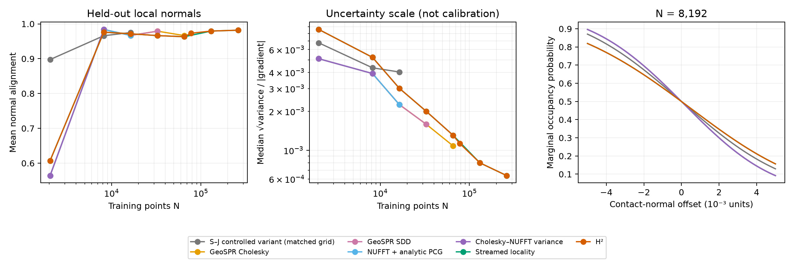

# Density-dependent Eagle mean-and-variance sweep

The workload follows **ℓ(N) = 0.12√(8192/N)**, with exactly **1,000,000 marginal
mean-and-variance queries** (five batches of 200,000), including model preparation,
conditioning, variance-cache construction, query evaluation and marginal decision
scores. This is a contact-region workload, not a global reconstruction or joint
collision-probability benchmark.



**The result is mixed:** H² has a clear advantage over the growing original grid,
but H² and locality have similar measured scaling under this density law. Dense
GeoSPR remains faster until this implementation's device-memory limit; its
periodic scalar/cross bandwidth still fails the unchanged convergence gate.
There is no measured, fully accuracy-matched dense/H² runtime crossover.

| Training N | ℓ | Controlled S–J | GeoSPR Cholesky* | GeoSPR SDD* | NUFFT + PCG* | Cholesky–NUFFT* | Locality | H² |
|---:|---:|---:|---:|---:|---:|---:|---:|---:|
| 2,048 | .24000 | .609 | .576 | 2.494 | 3.015 | 3.083 | .659 | 1.601 |
| 8,192 | .12000 | 9.061 | .976 | 3.864 | 22.195 | 88.508 | 2.577 | 3.665 |
| 16,384 | .08485 | 74.633 | 1.650 | 9.022 | 65.858 | — | 5.405 | 5.942 |
| 32,768 | .06000 | memory guard | 4.128 | 27.329 | budget exhausted | — | 11.847 | 11.465 |
| 65,536 | .04243 | — | 12.400 | — | — | — | 25.339 | 24.708 |
| 77,824 | .03893 | — | device allocation fails | — | — | — | — | 29.171 |
| 131,072 | .03000 | — | — | — | — | — | 55.925 | 52.091 |
| 262,144 | .02121 | — | — | — | — | — | 127.793 | 123.033 |

All numeric timings are **seconds including preparation and all 1,000,000
mean-and-variance queries**. `—` means not attempted, not zero. Asterisks mark
periodic methods whose finite-band solver checks pass but whose bandwidth is not
established converged. The original is the controlled variant defined below;
it is not a calibration-matched ground truth for the other models.

- H² is **12.56× faster** than the controlled original at 16k. Original runtime
  grows 8.24× on the last completed doubling (8k→16k), a fitted exponent **3.04**
  on those two points. Including the query-dominated 2k point gives **2.26**.
  Its grid has G proportional to N^(3/2), hence a dense G-by-G covariance grows
  like N³. The 32k trial needs 9.81 GiB for one such array and fails the 12 GiB
  process guard before completing the solve; finer grids are preflight exclusions.
- H² and locality total-time fits over 16k→262k are **1.09 and 1.14**. At 262k,
  H² is only **1.04× faster**, and locality uses less sampled GPU memory:
  **3.90 versus 6.70 GiB**. Decreasing ℓ with point spacing also limits locality's
  neighborhood growth. This is not the strong H²/locality separation seen in
  the earlier fixed-ℓ sweep.
- Dense total/factorization fits over 16k→65k are **1.45/2.43**. At 77,824 points,
  the initial three-transform FFT planner fails. A separately recorded control
  evaluates the same three components one at a time and gets past that failure,
  then fails to allocate the **22.56 GiB matrix** while **1.82 GiB** is retained.
  This is an observed implementation/device limit, not a fundamental impossibility
  of a more memory-efficient dense implementation. At 65k its production timing
  is accepted after a lower-memory offline audit recovers from a reference-only
  FFT planner failure.
- All eight H² runs pass with the initial tolerance 1e-5 and eight variance
  iterations. Maximum mean iterations stay between 11 and 16. SDD at 2k needs
  step parameter .03 instead of the divergent .1 trial; the gate is unchanged.
  The 32k NUFFT-PCG run exhausts its 120-second conditioning budget before all
  right-hand sides, so its partial time is not plotted as a completed workload.
- At 262k, replacing the varying posterior variance by its contact value causes
  maximum CDF error **.00352**, above the .001 gate; using prior variance gives
  **.0924**. This workload does require spatially varying posterior variance.

Validation: **37 tests passed** (36 regression/normalization tests plus the
single-transform equivalence test), **16 full-million-query comparisons passed**,
and **32 accepted production records** comprise 29 accelerated results passing
own-model numerical gates and three controlled-original reference runs.
All six successive-band tests fail the probability gate: for example 71→100
modes at 16k changes CDF by **.09481**, and 100→150 at 32k by **.08910**. The
latter uses the same single-transform control to bypass the FFT planning limit.
None of these failed bandwidth checks is relabeled as acceptable accuracy.

## Comparison contract

Seven routes are included: the original Sellan–Jacobson grid solver with the
explicit parameter control below, GeoSPR Cholesky, GeoSPR SDD, NUFFT with analytic
PCG refinement, Cholesky–NUFFT global variance, streamed locality and H². The
original code is gpytoolbox 0.3.8 on CPU; the other implementations use the GPU.
Both NUFFT and H² implementations remain available.

The full Eagle scan is deterministically shuffled once (seed 12). Training sets
are nested prefixes. All methods at a given N use identical points, normals,
query locations and the mean level at the contact (1,0,0). The contact cube has
halfwidth .005. That level choice does not condition the scalar variance.
Vector-prior pointwise variance is fixed at **A = .0025**, and vector-observation
noise variance at **η = .000025**. No parameters are selected against the
held-out geometry samples.

The unchanged numerical gates are maximum marginal-CDF error **≤ .001**, maximum
variance error divided by the method's scalar prior **≤ .0001**, and positive
finite variance. Independent full-kernel probes assess accelerated free-space
fits; periodic methods use uncompressed own-model references. Additional
same-model comparisons cover all one million queries. Offline references,
accuracy tuning and plotting are excluded from production timings. Rejected
settings and failed/resource-censored jobs remain in the raw records and summary.
These are sampled numerical checks, not an error certificate at every point in
the region.

Periodic cutoffs grow as **ceil(50 × .12 / ℓ)**, rather than holding the spectrum
fixed as physical detail increases. This is a bandwidth scaling rule, not a
convergence guarantee. `bandwidth_checks.json` compares successive finite bands
using uncompressed moments on 73 identical probes. Equivalent reference data at
N=8192 are reused with their original hashes; their old workload timings are not
reused. Hollow, dashed plot curves denote finite-band solver-accurate results;
they do not assert a converged periodic posterior. Cross-model calibration remains
unestablished even when every own-model numerical check passes.

## Original grid and parameter control

The original grid uses isotropic **h = .8942957229 ℓ**, matching normalized
axis-wise vector-kernel half correlation with Matérn-3/2. The full-scan bounding
box, padded by .1, stays fixed; the grid is rounded outward symmetrically. This
is the explicit matching convention introduced in #108, motivated by GeoSPR
Appendix C, not a claim that the paper prescribes this exact constant.



The tensor cubic B-spline kernel has peak
`k0 = (2/3)^3 / (1.5 h)^3`. Keeping native `sigma=.05` while refining h would
change the physical vector-prior amplitude. This experiment instead uses
`c = A/k0`, native `sigma = sqrt(c)` and native `sigma_n = sqrt(η/c)`.
Within the original density-lumped inverse approximation this gives

```
mean       = (c K2)^T (c rho + η)^-1 y
           = K2^T (rho + η/c)^-1 y
covariance = c K1 - (c K2)^T (c rho + η)^-1 (c K2)
           = c [K1 - K2^T (rho + η/c)^-1 K2].
```

The native routine separately shifts the final scalar variance to have minimum
`sigma_n² + eps`, with `eps=1e-6`. To prevent this numerical floor from changing
with h, the wrapper subtracts the native `sigma_n²` contribution and adds fixed
η, retaining the global-minimum shift and a floor of **.000026**. This is an
explicit convention for the control, not a probabilistic identity between vector
noise and scalar variance. The original minimum shift can alter all marginal
variances, and this scalar floor can exceed the free-space scalar prior at fine
scales. Matching vector amplitude/noise therefore does **not** match scalar
priors, boundary conditions, density approximations or calibration.

This is labeled **“S–J controlled variant”**, not unmodified published output.
The default benchmark mode and historical published-default records are retained.
Unit tests check the kernel peak, likelihood scaling and algebra; a small native
gpytoolbox integration check verifies mean invariance and centered covariance
scaling under a common amplitude/noise rescaling. Issue #107 remains open for
ground-truth calibration.

## Reconstruction and uncertainty diagnostics



Eleven contact-region scan samples after index 262144 are excluded from every
training set, as is the anchoring sample. `phenomenology.json` records their exact
indices, coordinates and source checksum. Surface error is the RMS x-displacement
of the predicted isosurface from each sample, with missing roots counted explicitly.
Normal alignment and linearized spatial uncertainty `sqrt(variance)/|gradient|`
are also reported. These are small local geometry diagnostics, not global mesh
accuracy or probability calibration. The plotted N=8192 marginal probability
profiles help expose differences that a surface-error number alone misses.

At 2k, H²/locality miss two of eleven bracketed roots and periodic methods miss
five; their incomplete RMS points are omitted from the overview. The original
finds all eleven. At all larger completed sizes every method finds all roots.
At 8k, original/H² RMS error is **.001336/.001359** and median spatial uncertainty
is **.004336/.005222**. At 16k, original/H² RMS is **.000999/.001115**. H² RMS
falls to **.000826** at 32k, then rises to **.001030** at 262k while its spatial
uncertainty keeps shrinking. More points and a shorter lengthscale do not by
themselves establish better reconstruction or calibrated confidence.

## Timing, memory and provenance

Hardware: one RTX PRO 6000 Blackwell MIG compute instance with about 23.6 GiB
usable device memory; four host CPU cores and 16 GiB host memory. Original jobs
have a 12 GiB process address-space guard, and individual production/reference
subprocesses have a 600-second timeout. Failure is not extrapolated into a timing
point. Stop rules retain slower measured competitors while avoiding repeated
larger jobs after their useful overlap or resource endpoint.

GPU and host memory are separate process measurements. GPU routes request NVML
and `/proc` RSS samples every .1 seconds, stopping before offline validation.
Actual sampling gaps can be longer during native code; these are sampled peaks,
not exact allocation maxima. Original CPU memory uses process high-water RSS.
SDD releases its independent reference factor before production iteration and
combines samples from before and after the excluded reference interval; host
allocator residue from that reference can remain. Process/runtime overhead is
included. Reference construction and its device-memory peak are excluded.

Raw JSON, logs and status files retain commands, source hashes, parameter
settings, stage timings, checkpoints, memory samples and failure reasons.
`manifest.json` describes the primary sweep; `refined/` retains offline-selected
settings; `summary.json` separates accepted records from failed or unattempted
ones. Original grid fields are included as NPZ files. Fits describe this finite
range of a **changing-lengthscale workload**; they are not fixed-kernel complexity
proofs. A fixed number of local queries can be served cheaply once cached.

Reproduce sequentially on an otherwise idle device:

```bash
./reproduction/run_env.sh -m reproduction.run_density_sweep
./reproduction/run_env.sh -m reproduction.finish_density_sweep
./reproduction/run_env.sh -m reproduction.report_density_sweep
./reproduction/run_env.sh -m pytest tests/test_density_protocol.py tests/test_matched_lengthscale.py tests/test_eagle_comparison.py tests/test_scaling_reference.py tests/test_variance_series_gpu.py tests/test_reference_bounds.py tests/test_targeted_reference.py tests/test_gpu_audit.py -q
./reproduction/run_env.sh -m pytest tests/test_single_transform_control.py -q
```

The benchmark runner refuses to reuse records whose pinned production sources
changed. Plotting verifies record and audit hashes before using the saved fields.
