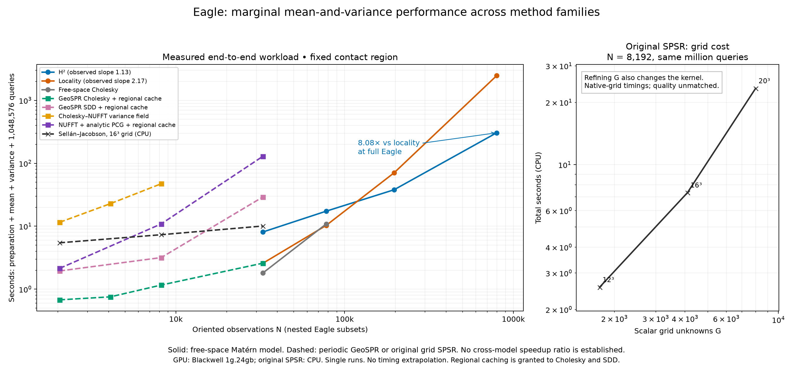

# Eagle mean-and-variance comparison across method families

This comparison uses the scenario with the strongest demonstrated H² result:
a fixed Eagle scan, a small contact region, and **16 changing batches of 65,536
queries**. Every completed timing includes preparation, mean, marginal variance,
inside probability and ambiguity-score evaluation. The existing full-Eagle
H²/locality measurements are reused without rerunning their expensive solves.



**This is a workload comparison across different instantiated models, not an
equal-reconstruction-quality leaderboard.** The solid free-space curves share
one model. The periodic curves share a second model and are checked against
their own dense reference. Original Sellán–Jacobson uses its native grid model;
its coarse-grid timings are explicitly not resolution-matched. No cross-model
speedup ratio is claimed.

The plot includes:

- Original Sellán–Jacobson full-covariance SPSR through unmodified gpytoolbox
  0.3.8, on CPU. Its observation-count curve holds a 16³ grid fixed. The separate
  grid-cost panel prevents mistaking weak dependence on observation count for
  low cost at adequate spatial resolution.
- Periodic GeoSPR-style dense Cholesky and compiled original SDD updates, both
  strengthened with the same regional query cache used by H².
- The established dense-Cholesky/NUFFT global variance-field hybrid, restricted
  to the contact region after construction.
- Matrix-free NUFFT warm starts followed by full-analytic PCG correction and a
  regional cache. Spectral truncation in the training solve is not silently
  accepted as a replacement covariance.
- Free-space radius locality and H², plus a free-space Cholesky control.

Selected total seconds (a dash means not measured, not a failure):

| Method | N=2,048 | N=8,192 | N=32,768 | N=796,825 |
|---|---:|---:|---:|---:|
| Original SPSR, fixed 16³ grid, CPU; resolution unvalidated | 5.456 | 7.333 | 10.081 | — |
| GeoSPR Cholesky + regional cache | .677 | 1.163 | 2.587 | — |
| GeoSPR SDD + regional cache | 1.947 | 3.177 | 29.110 | — |
| Cholesky–NUFFT global variance field | 11.542 | 47.318 | — | — |
| NUFFT + analytic PCG + regional cache | 2.138 | 10.889 | 128.951 | — |
| Free-space Cholesky + regional cache | — | — | 1.804 | — |
| Free-space locality + regional cache | — | — | 2.574 | 2,465.468 |
| Free-space H² + regional cache | — | — | 8.092 | 305.044 |

The periodic rows are algorithmic GeoSPR controls with stronger GPU preparation
and regional reuse, not timings of the unmodified release's Python pipeline.

The H²/locality full-Eagle result remains **305.04 versus 2,465.47 seconds,
8.08×**, for 796,825 observations and 1,048,576 marginal queries. Smaller
Cholesky systems benefit substantially from regional reuse. The global NUFFT
variance field computes much more spatial information than this tiny contact
box requires; the matrix-free regional route is therefore included separately.
The observed log-log slopes over the reused 32,768–796,825-point runs are
**1.13 for H² and 2.17 for locality**. Accuracy settings adapt with size, so
these describe the measured range rather than proving asymptotic exponents.

See [summary.json](summary.json) for selected measured values, source hashes
and descriptive finite-range slopes. Curves stop at measured points; no missing
runtime is filled by extrapolation. Slopes are not asymptotic proofs.
In particular, the small periodic Cholesky timings include substantial regional
cache work and fixed overhead; their fitted slope is not evidence against its
cubic factorization cost. The original fixed-grid observation curve likewise
does not describe the cost of improving its spatial resolution.

## Protocol and limitations

All methods receive the same checksum-pinned Eagle points/normals and nested
subsets, contact at (1,0,0), box halfwidth .005, query seed 12 and 16 batches.
The mean level is its value at the contact; this does not condition the scalar
field on contact or alter its variance. Query generation, common runtime
initialization and offline accuracy verification are outside production time.
Numerical method setup, compression, conditioning, final cache construction and
all million queries are included. Runs are single sequential measurements on
the same Blackwell MIG 1g.24gb device; the original code is a CPU baseline, not
a GPU port. Host allocation is limited to 16 GiB and four CPU cores.

The free-space model has isotropic vector Matérn lengthscale .03, amplitude
.0025 and observation-noise variance .000025. The periodic model uses a product
Matérn covariance with matching per-axis physical lengthscale .03
(`ell=.03/(2*pi)` in the released convention), component variance .0025 and
noise .000025. Its scalar/cross spectrum uses the released cutoff of 50 and
analytic normalization. These choices do not equate the isotropic/product
kernels, boundaries or scalar spectra. Cutoff convergence is not established
by this plot. H² is a numerical accelerator for a free-space Matérn formulation
of the original stochastic Poisson framework, not the source of a new
nonperiodicity assumption.

Periodic regional interpolation uses order five and cross SVD tolerance 1e-8.
Each candidate is checked at 73 uncompressed query locations, including eight
corners and the contact, against float64 Cholesky. Required errors are maximum
CDF difference <= .001 and maximum variance difference / prior variance
<= 1e-4, with positive variances. [Full-query checks](full_query_checks.json)
also compare each selected approximate field with the corresponding passing
dense field over all million queries. These checks validate numerical output
within a model; they do not establish calibrated uncertainty on real scans.

SDD uses batch 512, momentum .9 and Polyak weight .01. Step multipliers .03 and
.1 are tested; the best passing measured configuration is selected, with all
checkpoints retained. A step multiplier of 1 diverged in a small pilot.
Compilation and preparation are charged; offline reference construction,
checkpoint inspection and tuning are excluded. This is limited tuning, not an
optimality claim. The tuned matrix-free route uses 128-point spatial block
preconditioning, variance residual tolerance .001 with a residual-corrected
Gram matrix, and mean tolerance 1e-6. All remain subject to the same output
gates. Stricter unpreconditioned pilots are retained, including an incomplete
32,768-point conditioning run; its budget endpoint is not a completion time.

Original SPSR retains density lumping, its compact kernel, Neumann grid solve
and native variance shift. Its kernel width is `1.5*min(grid spacing)` and
therefore changes when the grid is refined. Even the 20³ grid has substantially
broader smoothing than the .03 lengthscale used by the other formulations.
The full grid covariance is computed, not replaced by its optional eigenspace
approximation. That published approximation remains an additional baseline
to evaluate at controlled grid/subspace accuracy. The tested coarse grids do
not resolve fine Eagle geometry or establish a converged original reference.
The 8³ pilot fails the released staggered-grid indexing with the fixed padding;
it contributes no plotted time.

The periodic dense baseline uses float32 production factorization and an
independent float64 reference. An early 32,768-point run completed production
but its allocating reference factorization ran out of memory. It is retained
as a **reference failure**, not a dense-method capacity result. In-place GPU
Cholesky removes redundant full-matrix copies in the final benchmark.

Global NUFFT moment accumulation uses measured mixed precision; its total
includes dense conditioning and therefore retains cubic setup asymptotics.
The separate matrix-free route has no full observation factor in production.
The prior and all regional off-diagonal information are not retained in the
final polynomial field: these timings concern marginal outputs, not coherent
sampling or joint collision events. That next task is [issue 102](https://github.com/alecjacobson/fast-stochastic-psr/issues/102).

## Reproduction

Reuse the pinned scan and existing [H²/locality selection](../poissonrecon_large/selection.json).
The additional baselines and report are generated with:

```bash
./reproduction/run_env.sh -m reproduction.run_eagle_comparison
./reproduction/run_env.sh -m reproduction.verify_eagle_comparison
./reproduction/run_env.sh -m reproduction.plot_eagle_comparison
```

The runner executes methods sequentially and skips completed records. It has
an explicit per-process 600-second wall limit; solver-budget and divergence
records are not completion times. Raw JSON includes arguments, source/input
hashes, stage times, quality checks, hardware and GPU process-isolation audits.
Common source files and the final runner are versioned with this report.

Validation: all **17** complete periodic candidate/full-query comparisons pass,
including retained slower configurations. The selected reused H²/locality
comparisons have their existing passing audit and full-query hashes checked.
The three new numerical tests pass; see [tests.log](tests.log).
