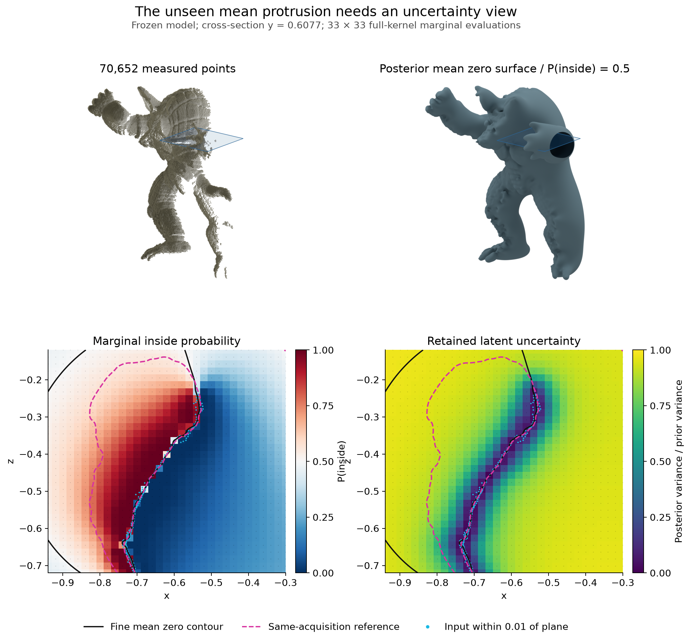
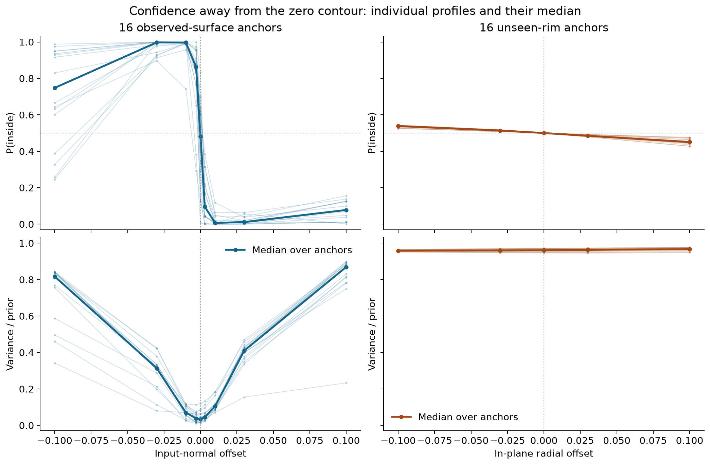
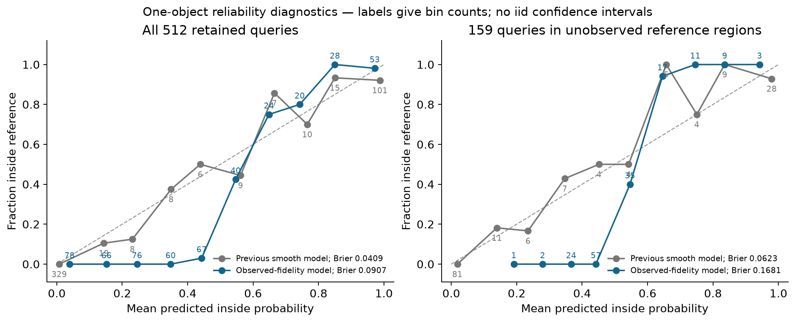

# An uncertain unseen mean is not a confidently wrong reconstruction

This revision corrects the interpretation of [PR127's observed-fidelity experiment](../observed_fidelity/README.md). The visible unseen-side protrusion belongs to the posterior mean zero level set. For positive variance, that is also the **marginal P(inside)=.5 contour**, not a confident completed object. Its disagreement with the same-acquisition reference does not by itself establish a failure of the posterior.

The model and data stay fixed: **70,652 actual range observations, ℓ=.015, normal σ=.02, 2,048 scalar contacts, scalar variance 7.5e−9, vector amplitude 1/3**. No noise, exterior observations, smoothing, clipping or mesh repair is added. The improved observed-surface fit and the worse retained-panel Brier score both remain as measured. Every previous numerical artifact and timing is preserved; only its report's interpretation is corrected.



The top row uses the same camera and scale for all measured points and the existing full-kernel mean mesh. The blue rectangle locates the lower cross-section through the protrusion. Black lines show the finely evaluated mean zero contour; dashed magenta lines show the reference cross-section when it intersects the rectangle; cyan points are measured inputs within .01 of the plane. Colored cells show actual **33×33 full-kernel marginal evaluations**, with small dots at their locations. The fine mean contour uses a separate 257×257 direct evaluation. There is no inferred variance texture over the 3D mesh, and neither sampling grid is a uniform spatial-accuracy certificate.

## What the posterior says near the protrusion

The [protocol](PROTOCOL.md) was fixed before evaluating new variances. The plane goes through the center of the existing mesh's 192-vertex open rim, at y=.607675. The diagnostic also includes 16 rim anchors with radial profiles, 16 observed non-contact anchors with input-normal profiles, and 32 retained queries for an independent reference check: **1,345 mean-and-variance evaluations** in total. Locations were selected after seeing the mean protrusion, so this is an explicitly **post-hoc diagnostic**, not a new held-out model-selection experiment.

The unseen rim is broadly uncertain **even away from its zero contour**. Across all 80 rim-profile evaluations, including offsets as large as ±.10, inside probability stays between **.428 and .544**. Every one retains **94.51–97.67%** of prior variance, with median **96.16%**. At the rim anchors themselves the median is **96.15%**; at the 16 observed anchors it is **3.49%**.

| Profile diagnostic | Observed anchors | Unseen-rim anchors |
|---|---:|---:|
| Median variance / prior at anchor | **.0349** | .9615 |
| Median P(inside) at offset −.03 | .9975 | .5140 |
| Median P(inside) at offset +.03 | .0113 | .4850 |
| Median P(inside) at offset −.10 | .7479 | .5386 |
| Median P(inside) at offset +.10 | .0779 | .4507 |

The observed profiles rapidly distinguish the two sides near the measured surface: at offsets −.01 and +.01 their median inside probabilities are **.9965 and .0072**. At larger offsets some profiles encounter other geometry or move beyond the observed region; monotonicity or confidently correct labels along an entire normal ray is not assumed.

The cross-section also contains **222 nodes where the mean predicts inside but the reference says outside**, excluding points within .005 of the reference surface. Their inside probabilities range **.5001–.8109**, with median **.5563**; none is a 95%-confident error. They retain median **94.74%** of prior variance. The attachment is not uniformly near probability .5, so the rim result should not be generalized to every location. This subset is selected by its disagreement and cannot provide an unbiased predictive-score estimate. The .005 exclusion is a diagnostic sensitivity margin, not a registration-error certificate.



Thin lines show individual profiles; thick lines show their median across anchors. Their spread is spatial variation across the selected anchors, not a posterior credible interval. Input profiles follow observed normals; rim profiles follow radial directions in the extraction-box boundary plane. Distances use the normalization in which reference height is 2.0.

Probability .5 exactly on a zero-mean contour is true at *any* positive variance. The evidence for uncertainty therefore comes from retained variance and probabilities **away from** that contour. These are conditional latent uncertainties under fixed likelihood, kernel and hyperparameters; they do not include uncertainty about those modeling choices. Marginal probabilities do not supply a simultaneous credible surface or coherent posterior samples.

## Keep the predictive-score disadvantage visible

Replaying the unchanged 512-query panel gives:

| Diagnostic | Previous smooth setting | Observed-fidelity setting |
|---|---:|---:|
| All-query Brier, lower is better | **.04090** | .09070 |
| All-query incorrect classifications | **27 / 512** | 36 / 512 |
| All-query 95%-confident mistakes | 7 / 512 | **0 / 512** |
| Unobserved-region Brier | **.06231** | .16809 |
| Unobserved-region incorrect classifications | **13 / 159** | 22 / 159 |
| Unobserved-region 95%-confident mistakes | 1 / 159 | **0 / 159** |

“95%-confident mistake” means the assigned probability of the reference label is below .05. On the new model's 22 unobserved-region mistakes, the true-label probability ranges from **.388 to .490**. These are uncertain mistakes, even though the Brier score is worse. The new unobserved panel retains median **96.01%** of its prior variance; **91.82%** of its probabilities lie between .2 and .8.

The coverage-defined observed/unobserved masks classify the nearby **reference surface**, not the query's distance to actual data. Using that latter distance directly, the 20 queries within .02 of the scan retain median **14.28%** of prior variance; the 354 queries beyond .10 retain **96.74%**. These selected spatial samples are descriptive, not representative population estimates. The old and new prior variances differ (**.0768 versus .000075**), so retained-prior fractions must not be read as absolute variance comparisons across models.



These reliability diagrams retain bin counts but omit independence-based confidence intervals. Correlated queries from one object and a reference reconstructed from the same acquisition do not establish population calibration. Being uncertain about a wrong mean completion is consistent with epistemic uncertainty; it does not erase the measured predictive-score disadvantage or demonstrate a better probability predictor.

## Consequences for the H² experiment

The observed-fidelity setting already passes the declared input-fit gates: median/p95 all-input-to-mean distances **.001071/.004790**, with median normal error **5.35°**. We should retain those gates and the numerical mean/variance/CDF gates when comparing methods. We should **not require accurate unseen mean completion before proceeding to computational comparisons** when the posterior is uncertain there.

This revision supplies full-kernel uncertainty evidence, **not a new H² runtime win**. The earlier 1.30× H²/Cholesky result used the smoother model; the shorter length scale, smaller regularizer and increased contact count need new matched-accuracy timings. The cheap contact-only variance still has almost identical retained-panel Brier (.090755 versus .090698 for full variance). Demonstrating that expensive full variance improves a useful application decision remains [#85](https://github.com/alecjacobson/fast-stochastic-psr/issues/85), while scalable coupled conditioning remains [#128](https://github.com/alecjacobson/fast-stochastic-psr/issues/128). Both NUFFT and H² remain available.

[Issue #117](https://github.com/alecjacobson/fast-stochastic-psr/issues/117) asks whether physical exterior information or a different prior mean is useful. Returning to probability .5 far from data is a separate modeling question where an application supplies exterior knowledge; the unseen mean protrusion alone does not prove that this assumption must change. Sensor-ray signs must remain distinct from exact distance observations. Joint-event applications still require coherent covariance or posterior samples, tracked separately in [#102](https://github.com/alecjacobson/fast-stochastic-psr/issues/102).

## Numerical checks and reproduction

New reference fields use the existing streamed dense reference, refining a float32 factor against **every float64 kernel entry** to relative RHS residual ≤1e−10. The scalar update uses the same declared contact noise. No H² action is used. The 32 retained mean/variance values and the independently folded direct mean are checked before accepting the new fields. Sampled GPU isolation, solve histories, hashes, measured source snapshots and raw moments are retained in [reference.json](reference.json); all variances must be finite and strictly positive without clipping.

All reference solves pass, with worst final relative residual **8.81e−11**. On the 32 reused queries, maximum absolute mean difference is **8.67e−19** and the saved variances agree exactly at stored precision. The folded direct mean differs by at most **5.95e−16** over all 1,345 queries. Sampled GPU isolation passes. Five focused diagnostic tests cover zero-contour probability, uncertain versus confident mistakes, and rejection of invalid variances.

The numerical and Blender environments and scan cache are the same as in the [previous experiment](../observed_fidelity/README.md). CPU replay of the new diagnostics and plots, using the retained renderings:

```bash
./reproduction/run_env.sh -m reproduction.report_epistemic_revision report
./reproduction/run_env.sh -m reproduction.report_epistemic_revision plots
./reproduction/run_env.sh -m pytest -q tests/test_epistemic_revision.py
```

For a fresh run, preserve the protocol and use a new output directory or move the retained evidence aside. Run the actions `prepare`, `panel`, `reference`, then `mean-context` with `python -m reproduction.epistemic_revision` through `run_env.sh`. Reference and query preparation refuse to overwrite retained records. After the numerical job has finished, the matched context renderings use the separate Blender environment:

```bash
PYTHONPATH="$PWD" OPENBLAS_NUM_THREADS=1 OMP_NUM_THREADS=2 \
  /opt/geospsr-runtime/render-venv/bin/python -m reproduction.render_epistemic_revision
```

Then run the CPU replay above. PNGs have exportable PDF counterparts. The new manifest binds final sources and artifacts; measured numerical sources are separately snapshotted. The old manifest's README entry alone is updated to reflect its interpretive correction, with all previous numerical hashes preserved.
