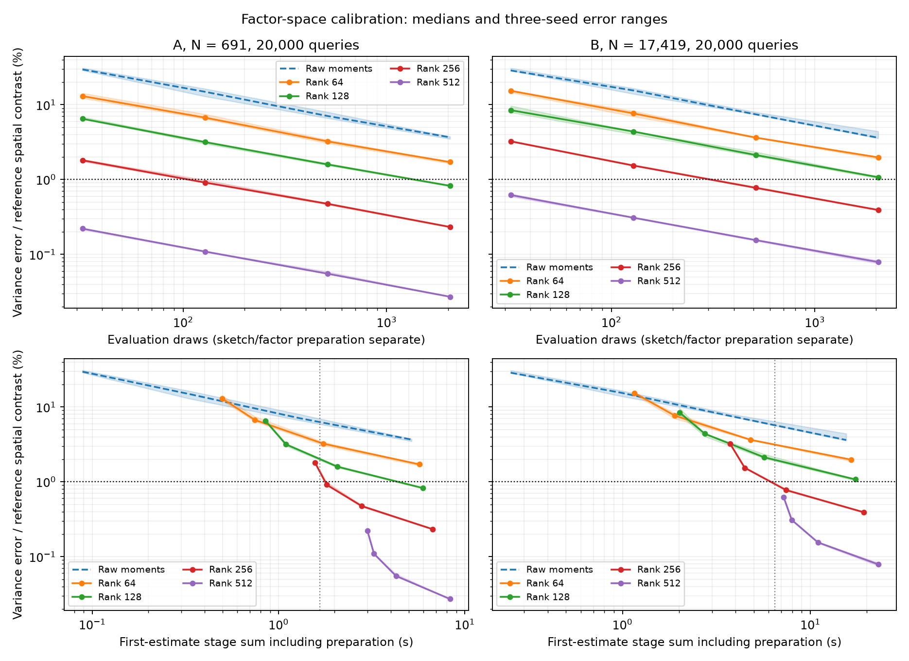

# Whitened-factor deflation for marginal variance

**B achieves a modest 1.05× variance-stage gain at the fixed full-slice quality
requirements, including preparation. A remains slower than deterministic variance.**
This is one independent three-seed confirmation per implementation variant on
an NVIDIA L40. It targets the direct analytic-vector/scalar50 model, not the
released interpolant or a complete application. It does not change the main
README's original-code teaser comparison.

[Protocol](PROTOCOL.md) · [Wider-batch protocol](BATCH_PROTOCOL.md) ·
[Batch4 summary](summary.json) · [Batch16 summary](batch16/summary.json) ·
[Issue #40](https://github.com/alecjacobson/fast-stochastic-psr/issues/40).

## Independent confirmation

The same 20,000 A/B slice queries, observations/normals, analytic vector covariance,
noise variance .02 and direct scalar/cross cutoff 50 are retained. Calibration
selects rank256/count128 on A and rank512/count32 on B. Three prospectively fixed
independent sketch/evaluation pairs confirm those settings. A separately declared
batch16 variant uses the same settings and streams, without reselecting rank or
count. All confirmation seeds pass contrast relative L2 ≤1%, inside-probability
RMS ≤.05 percentage points, maximum ≤.5 points, positivity and double-control
precision gates. Whole-run sampled GPU isolation passes in all four confirmations.

| Factor batch / case | Sketch rank | Evaluation draws | Contrast error across seeds | First-estimate median (range), s | Fresh deterministic median, s | Relative speed |
| --- | ---: | ---: | ---: | ---: | ---: | ---: |
| 4 / A, N=691 | 256 | 128 | 0.948–0.970% | 1.783 (1.728–1.832) | 1.617 | 0.907× |
| 4 / B, N=17,419 | 512 | 32 | 0.588–0.642% | 7.383 (7.378–7.415) | 6.440 | 0.872× |
| 16 / A | 256 | 128 | 0.948–0.970% | 1.776 (1.776–1.796) | 1.631 | 0.919× |
| 16 / B | 512 | 32 | 0.588–0.642% | 6.146 (6.145–6.151) | 6.437 | **1.047×** |

Relative speed is deterministic median divided by candidate median; values below
one mean slower. Each fresh deterministic median uses three streamed cross-factor
evaluations in the corresponding confirmation process. Candidate time sums
sketch generation, both factor actions, QR, control/storage construction,
transform-plan setup, evaluation generation/query, projection/reduction and one
final variance/probability output. Reference validation, calibration search,
export, rendering and process startup are excluded. This is a measured stage
sum, not application wall time. Shared dense fit and mean cost about 0.52 s on A
and 1.90 s on B; adding them leaves B's batch16 stage-sum ratio at **1.036×**.
The gain is small and its generality remains unestablished.

Batch16 B spends about **5.88 s of 6.15 s in preparation**, including roughly
1.76 s in the adjoint factor action, 3.91 s in the forward action and .125 s in QR.
Thirty-two evaluation draws alone would greatly understate the cost: the sketch
requires **512 adjoint and 512 forward factor columns**. Projection state retains
about 43.4 MiB on A and 282.6 MiB on B, in addition to the dense factor and NUFFT
workspace. Whole-process memory audits also include double reference validation;
they are not isolated candidate-memory measurements.

The previous [query-space deflation study](../deflated_variance/README.md) cost
2.52/9.65 s on A/B including preparation. The new measurements are descriptive
comparisons across separate executions, not fresh paired timing ratios against
that earlier implementation. All reported speed ratios use current deterministic
baselines.

## Factor projection

Write `H=C L3^-T`, where `L3` applies the same training Cholesky factor to each
of three independent vector components. The correction covariance is `B=H H^T`.
From an independent Gaussian query sketch `Omega`, form `V=orth(H^T Omega)` and
`U=H V`. For independent standard Gaussian `xi`,

```
diag(B) = row_sum(U^2) + E[(H xi - U(V^T xi))^2].
```

The same `xi` must generate the evaluated field and the subtracted projection.
`DenseCorrectionSampler` now optionally retains those standard normals in
observation/component/draw layout. The default API retains its original behavior.
Each factor direction uses one triangular solve per component. This removes the
separate pilot-field generation needed by the previous query-space estimator.
The exact-arithmetic identity assumes independent sketches and evaluation draws;
finite action/precision errors are checked separately. The deterministic
correction term is nonnegative, but the resulting posterior variance after
subtraction can be negative. Such failures are retained without clipping.
Correction draws are **not coherent posterior samples** for ray/collision events.



Lines are calibration medians; bands show all three seeds' error ranges. Top
panels count evaluation draws only; bottom panels include full preparation.
Horizontal dotted lines mark the 1% contrast gate; vertical grey lines mark the
fresh deterministic baseline. Every predeclared rank/count and failure is retained.
Independent confirmation, not these calibration times, supplies the reported ratios.

## Validation and provenance

Eight targeted tests pass: independent explicit Fourier/factor comparisons at
two precisions, complex coefficients, seams, partial batches, adjoint inner
products, rank-zero/full-rank identities, Monte Carlo moments, retained Gaussian
pairing and invalid inputs. An initial test demanded bitwise-identical NUFFT
output and failed at roundoff (maximum relative difference about 8e-16). The
corrected test verifies identical solved weights and bounds transform error;
[failure evidence](tests-initial-failure.log) and the [passing run](tests.log) remain.

Every selected and calibration factor control is checked with double analytic
Cholesky and double NUFFT evaluation. Required control discrepancy is ≤0.1% of
reference spatial contrast. The [paired batch comparison](batch_comparison.json)
also requires ≤0.1% contrast discrepancy: observed differences are below 1.6e-7
as a fraction of contrast, or **0.000016%**, far below that threshold.

[Archive replay](verification.log) checks **144 arrays and 144 saved estimates**
across six complete executions. All saved variance/probability fields reproduce
exactly from retained controls and residual moments. NumPy control recomputation,
basis orthogonality, input/reference hashes, quality gates, cost accounting and
selection also pass. This replay does not regenerate raw sketches/draws or
independently rerun large factor actions. Public NPZ files contain references
and all checkpoint fields; larger basis/factor arrays remain in the local
runtime archive and can be regenerated below.

The initial benchmark source is preserved in commit `1692a98` and the root
source manifest; the batch16 manifest records the later optional batch-width
argument. Both protocols precede their respective full-slice executions.

## Reproduce

Run GPU jobs sequentially. The wrapper already invokes Python. These commands
use fresh output paths and regenerate the larger runtime archives.

```bash
./reproduction/run_env.sh -m pytest -q tests/test_factor_deflation.py \
  tests/test_factor_deflation_gpu.py tests/test_correction_sampling.py
for case in A B; do
  ./reproduction/run_env.sh -m reproduction.benchmark_factor_deflation \
    --case "$case" --output "/tmp/factor/pilot/$case" \
    --archive "/opt/geospsr-runtime/factor-rerun/pilot/$case"
  ./reproduction/run_env.sh -m reproduction.benchmark_factor_deflation \
    --case "$case" --confirm "/tmp/factor/pilot/$case/results.json" \
    --output "/tmp/factor/confirmation/$case" \
    --archive "/opt/geospsr-runtime/factor-rerun/confirmation/$case"
done
```

Repeat confirmation with `--factor-batch 16` and distinct paths. Replay any
complete output with matching archive paths:

```bash
./reproduction/run_env.sh -m reproduction.verify_factor_deflation \
  --output /tmp/factor/confirmation/A \
  --archive /opt/geospsr-runtime/factor-rerun/confirmation/A
```

`reproduction.compare_factor_batches`, `reproduction.summarize_factor_deflation`
and `reproduction.plot_factor_deflation` regenerate summaries/plots from the
committed result tree. For the wider-batch summary, supply
`--confirmation-root reproduction/results/factor_deflation/batch16 --output reproduction/results/factor_deflation/batch16/summary.json`.

Remaining work includes profiling the forward factor cost, independent query
geometry, [planar Fourier contraction (#41)](https://github.com/alecjacobson/fast-stochastic-psr/issues/41),
validated matrix-free factor actions and full application convergence. Dense
Cholesky is quadratic in N, and the retained basis has 3N rows. This experiment
establishes no million-point variance, moving-query or ContactFusion speedup.
