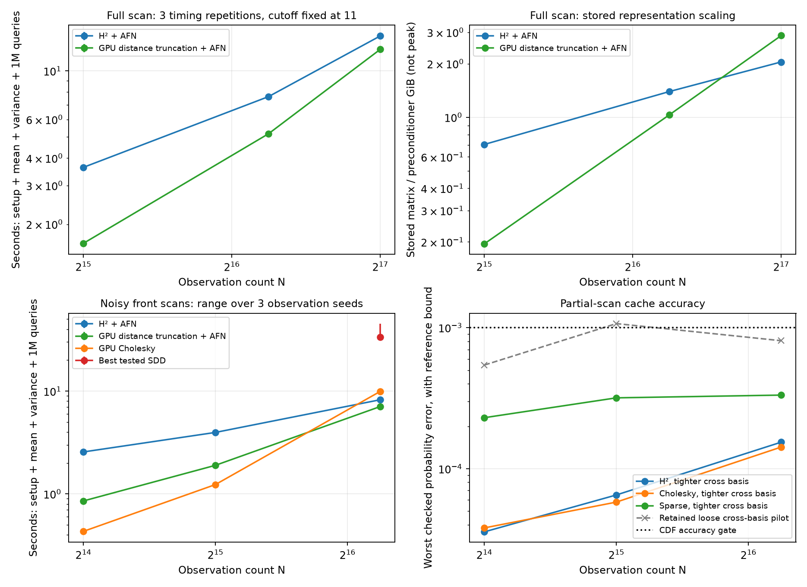
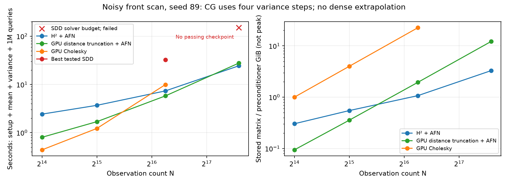

# Robustness and a stronger locality control

This continues the [nonperiodic variance-inclusive study](../hierarchical_variance/short/README.md).
The NUFFT and H² implementations remain separate, explicitly selected routes;
the preceding PRs #65, #67 and #76 are merged. The new experiments test noisy
partial scans and a faster distance-truncated kernel control. They retain the
same free-space model, posterior variance gate and full-workload timing scope.

## What the controls changed

The first CPU-built sparse control took 9.39 s at N=77,824 and passed the same
full-kernel audit as H². That was an implementation penalty, not a useful limit
on locality methods: a GPU uniform-cell builder reduced graph preparation from
4.23 s to .069 s, and total workload time to 5.24 s. This is faster than the
earlier H² median of 7.74 s. The earlier H²/Cholesky/SDD crossover remains real,
but does not establish that H² is the fastest method in this short-range regime.
The repeated measurements below use the stronger GPU control.

The GPU builder sorts points by cell, counts exact radius neighbors, and emits
sorted unique CSR columns directly. It requires neither Python neighbor lists
nor a global COO sort. Independent tests compare both GPU and CPU builders to
the dense distance-truncated matrix, including symmetry, actual canonical
ordering, cell-boundary points and duplicates. Both use the same AFN
preconditioner, cross compression, residual-corrected variance moments and
polynomial query field as H². Both H² blocks and sparse values use float64;
the dense Cholesky control uses float32 with audited posterior outputs.

Hard distance truncation is a numerical approximation to the full Matérn kernel,
not a PSD-preserving covariance taper. CG curvature failures remain explicit;
the full-kernel posterior audit, not the truncated operator itself, determines
acceptance. No noise inflation or variance clipping is used. This differs from
positive-definite covariance tapering as studied by
[Furrer, Genton and Nychka](https://marcgenton.github.io/2006.FGN.JCGS.pdf).

## Fixed contract and retained failures

The full-scan locality comparison keeps the original seed 12, length scale .03,
amplitude .0025, observation-noise variance .000025, contact halfwidth .005,
polynomial order 4 and cross threshold 1e-4. The sparse radius is 11/kappa,
about .1905 in the ellipsoid's units. Cutoff 10 fails the variance/prior gate
(1.11e-4) despite passing the CDF gate, and is retained as a failed pilot.

The partial scans keep only the front hemisphere by reflecting sampled x
directions to nonnegative x. This preserves nested input sets and creates an
open scan boundary. Independent Gaussian noise with component standard deviation
.005 is added to the true unit normals, matching the declared observation-noise
variance. No renormalization is applied. Query boxes remain near the observed
known contact (1,0,0), not near the missing scan boundary; this is an initial
partial-scan test, not a test of uncertainty in holes or unseen surfaces.

The earlier cache settings were not robust across these inputs. Both H² and
Cholesky narrowly failed the CDF gate at seed21/N32,768. Increasing polynomial
order to five without tightening the cross SVD still failed variance checks on
seeds34/55. Tightening cross compression from 1e-4 to 1e-6 at the original order
four passes the diagnostic cases; retained rank increases from about20 to41–42.
A small relative cross-kernel error does not directly bound posterior variance
error, because the inverse covariance weights discarded directions differently.

Confirmation uses new seeds **89, 144 and 233**, fixed order4/cross1e-6, and the
same settings for all solvers. Seeds21/34/55 and all failed caches remain under
`pilot/`. This is a conservative experimentally selected basis tolerance, not
an output-error certificate; [#83](https://github.com/alecjacobson/fast-stochastic-psr/issues/83)
tracks that distinction.

The 17-point independent probe audit also missed errors in provisional SDD
fields: all three first passing checkpoints exceeded the CDF tolerance elsewhere
in the full million-query replay. Those runs are archived under
`pilot/sdd-probe-only/`, not accepted as final timings. SDD now checks both the
independent probes and every actual query against the audited dense moment cache.
Rejected checkpoints and projection alternatives are offline verification costs;
the final selected projection and query replay are timed. This favors SDD through
offline stopping selection and does not claim an inexpensive certified stopper.

A new optional SDD projection corrects only the mean while retaining its
standard variance. For approximate solutions Zu and Zy, it uses
`UᵀZy + Zuᵀ(y−AZy)`, whose error is `RuᵀA⁻¹Ry`. This needs a full-kernel action
on only three mean columns. It avoids forcing the conservative full variance
correction on stochastic iterates. The selected correction cost is included.

All reported complete workloads include tree/preconditioner/graph construction,
regional SVD, mean and variance preparation, and 16 changing batches totaling
1,048,576 marginal probability queries. Every method gets the same scalar cache.
Common synthetic input generation and common CUDA/query initialization are
outside timing. Independent full-float64-kernel verification is also outside
timing, with reference solve-error allowances included in accuracy gates.
The device is the same 23.625 GiB RTX PRO6000 Blackwell MIG slice with a four-CPU
quota and 16 GiB host limit. See [the shared method](../hierarchical_variance/METHOD.md).

## Measured results

All times below include setup, regional mean and variance preparation, and the
full probability workload. Full-scan entries are medians of three process runs:

| Full-scan observations | H² + AFN | GPU distance truncation + AFN | Stored H² / sparse GiB |
|---:|---:|---:|---:|
| 32,768 | 3.632 s | **1.636 s** | .705 / .195 |
| 77,824 | 7.632 s | **5.170 s** | 1.397 / 1.035 |
| 131,072 | 14.415 s | **12.522 s** | 2.047 / 2.877 |

All 18 repetitions pass the independent posterior audit. Over this finite range,
log-log runtime slopes are .98 for H² and 1.45 for the sparse control; stored
representation slopes are .77 and 1.94. Variance uses eight steps at the first
two sizes and twelve at the last, so these runtime fits include that change.
The faster sparse control is essential context for the earlier H² speedup.

The following partial-scan entries are medians across **three different noisy
scan seeds**, not three timing repetitions of one input. The plotted range shows
seed variation. H² and sparse use eight variance steps in this confirmation:

| Partial-scan observations | H² + AFN | GPU Cholesky | GPU distance truncation + AFN |
|---:|---:|---:|---:|
| 16,384 | 2.561 s | **.433 s** | .855 s |
| 32,768 | 3.964 s | **1.234 s** | 1.899 s |
| 77,824 | 8.235 s | 9.921 s | **7.073 s** |

All 27 independently audited runs pass. At 77,824, H² takes 8.038–8.309 s across
seeds and stays ahead of Cholesky, but behind the GPU locality control. Paired
million-query comparisons against Cholesky also pass. Known-shape Brier scores
are about .0267 in this local box; they do not establish calibration.

At N=77,824, the best tested SDD checkpoint for each confirmation scan is:

| Seed | Complete SDD workload | Iterations | Eta | Selected projection | Full-query CDF difference |
|---:|---:|---:|---:|---|---:|
| 89 | 32.419 s | 49,152 | .15 | Standard | .000402 |
| 144 | 45.266 s | 65,536 | .15 | Mean corrected | .000516 |
| 233 | 33.390 s | 49,152 | .10 | Standard | .000813 |

All pass both independent probe gates and the additional full-query comparison.
The seed-144 mean correction costs about 2.15 s and is included. Other tested
learning rates and failed checkpoints remain in each seed's `sdd/77824.json`.
These are best observed checkpoints from two learning rates, not minimum-time
SDD solutions. The stronger full-query gate rejects the earlier provisional
22 s, 23 s and 7 s results. The median accepted SDD time is **33.390 s**, versus
**8.235 s H²**, **9.921 s Cholesky**, and **7.073 s sparse** across these scans.

The earlier [long-correlation SDD counterexample](../hierarchical_variance/README.md)
still passes a full-query recheck: maximum CDF difference .000137 and
variance/prior difference 3.06e-5. Its original 2.35 s timing remains a valid
negative control against a universal H² speed claim; see
[`pilot/long-sdd-application.json`](pilot/long-sdd-application.json).

## A measured density crossover with variance

The seed-89 partial scan is extended to N=196,608, retaining the same domain,
length scale, observation noise, contact box, cross basis, and query workload.
Both hierarchical and sparse representations fit on the GPU. Testing variance
budgets 2, 4, 8 and 12 finds that **two steps fail** the variance target for both
methods; **four pass**. The table uses four steps throughout, so the stronger
sparse comparison does not pay for unnecessary variance iterations.

| Observations | H² + AFN | GPU distance truncation + AFN | GPU Cholesky |
|---:|---:|---:|---:|
| 16,384 | 2.429 s | .804 s | **.441 s** |
| 32,768 | 3.698 s | 1.695 s | **1.228 s** |
| 77,824 | 7.363 s | **5.802 s** | 9.958 s |
| 196,608 | **24.399 s** | 27.761 s | Factor cannot fit |

Only N=196,608 has three timing repetitions in this extension; smaller sizes
are single runs on the same nested scan. Cholesky entries reuse that seed's
measurements and have no variance iteration budget. The largest ranges are
24.393–24.484 s for H² and 27.699–27.772 s for the sparse control: **1.14×**
measured speedup, or about **12% less total time**. This is not yet a large
asymptotic speed ratio. A final shorter-cutoff check retains both failures:
cutoff **9** triggers nonpositive CG curvature, and cutoff **10** takes 26.156 s
and passes the probes but fails the million-query CDF gate (**.001263**).
Cutoff **11** is the shortest tested passing choice for this largest workload;
this is a discrete parameter check, not a globally optimized radius search. A float32 dense factor alone would take **144 GiB** at
this size. There is no measured Cholesky runtime or extrapolated speed ratio.

The largest production hierarchy needs tolerance **1e-4**; the original 1e-3
setting fails both the independent variance gate and full-query CDF comparison,
and remains in `extension/pilot/h2-tol1e-3/`. Tightening increases maximum H²
rank to **103**. Its stored matrix/preconditioner footprint is **3.296 GiB**
versus **12.216 GiB** for the sparse control, which stores about **1.082 billion**
entries at mean degree about **5,505**. These are stored representations, not
peak process memory. The common AFN construction remains a substantial cost.
At four steps, regional mean/variance preparation takes about **5.55 s for H²
versus 12.13 s for sparse**; the end-to-end result includes H²'s higher setup cost.

All 12 extension runs pass the independent full-kernel probe audit. At N=196,608,
H²'s maximum variance error/prior is **3.02e-5** and CDF error **2.22e-4**;
sparse gives **2.24e-5** and **4.08e-4**, including reference-solve allowances.
The independent large reference uses direct cross kernels and full float64
covariance actions at 17 probes. A separate, tighter H² field (hierarchy tolerance
1e-7, solve tolerance 1e-10, converged variance basis solves) also passes that
audit and supplies the larger full-query comparison beyond dense-factor capacity.
This tighter regional cache is **not a uniform exact-GP reference**.

Across all 1,048,576 queries, production H² and sparse differ from that tighter
field in CDF by at most **.000223** and **.000814**, respectively, and in
variance/prior by **4.70e-6** and **5.23e-6**. Both select the same ray in all
16 batches. Validation-only reference preparation is excluded from production
timing and has its own recorded cost. Neither finite probes nor agreement with
an approximate regional reference proves a uniform bound against the exact GP.

The large SDD control uses the smaller seed-89 run's eta .15 and batch 128,
with the same tighter cross basis and optional projection alternatives. It finds
**no passing observed checkpoint within 150 solver seconds**. The last iterate
at **95,488 updates / 150.22 solver seconds** passes the independent probes
(CDF .000603, variance/prior 4.80e-5), but fails the full-query comparison
(CDF **.001616**). Neither mean-only nor joint residual correction repairs this
within the tested budget. The plot marks the solver budget with a failed-run
cross; it is not a complete workload time or a claimed speedup denominator.
This is one tested large-size learning rate, not evidence that all SDD settings
require this time or that its iteration count obeys an asymptotic growth law.

Using prior variance instead changes CDF values by up to .0641. A constant
contact variance has CDF error .000300, which passes the probability gate,
but variance/prior error .00644, which fails the spatial-variance gate. Thus the
reported workload requires accurate spatial variance; its current CDF or ray
metric alone does not prove that the full spatial-variance computation is needed.

## Interpretation and next work

For approximately uniform sampling on a fixed two-dimensional surface, a fixed
physical cutoff covers a fixed fraction of the domain. Expected degree then
grows proportionally to N, and the stored sparse graph grows proportionally to
N². Calling it sparse does not make its fixed-domain asymptotics linear. In an
expanding domain with bounded density, that conclusion changes. H²'s advantages
remain conditional on rank and iteration growth; finite-range fits establish
neither an asymptotic theorem nor an unmeasured runtime crossover.

The next optimization target is construction cost, including common CPU AFN
preparation ([#84](https://github.com/alecjacobson/fast-stochastic-psr/issues/84))
and proxy/tree setup. The locality control should also remain in
future comparisons, including bounded-memory variants when its graph no longer
fits. Mixed-precision H² and sparse controls are still untested and could change
the modest runtime crossover ([#87](https://github.com/alecjacobson/fast-stochastic-psr/issues/87));
the current comparison uses the same float64 storage precision for these two methods. Broader regions, multiple shared boxes, acquisition updates and a range
of length scales/noise levels remain open. More SDD learning-rate, batch and
stopping tuning is warranted; reported checkpoints are not minimum runtimes.

Known-shape Brier scores and paired ray choices are local application checks.
Three noisy scans and an anchored surface contact do not establish calibrated
uncertainty, reconstruction topology, behavior at missing surfaces, or real-robot
benefits. Coherent scalar-contact conditioning and a decision that demands
spatial variance are tracked in [#85](https://github.com/alecjacobson/fast-stochastic-psr/issues/85);
whole-region polynomial comparison bounds are tracked in
[#86](https://github.com/alecjacobson/fast-stochastic-psr/issues/86). The new model remains distinct from both periodic GeoSPSR and the
original nonperiodic Sellán–Jacobson implementation. No pointwise cross-model
equivalence is required, and this study makes no new cross-model speed claim.

## Reproduction

With the optional pinned HiGP extension built as in the preceding study, run
`bash reproduction/results/hierarchical_robustness/reproduce.sh`. The timing
driver skips completed files; relocate output subdirectories to obtain fresh
measurements. Raw results preserve source hashes, solver information, graph
sizes, errors and timing components. Archived pilots retain their original
recorded paths, while their reference JSONs now live beside them under `pilot/`.

Track [#82](https://github.com/alecjacobson/fast-stochastic-psr/issues/82),
[basis-error control #83](https://github.com/alecjacobson/fast-stochastic-psr/issues/83),
[construction/locality #80](https://github.com/alecjacobson/fast-stochastic-psr/issues/80),
and [the broader nonperiodic work #68](https://github.com/alecjacobson/fast-stochastic-psr/issues/68).
