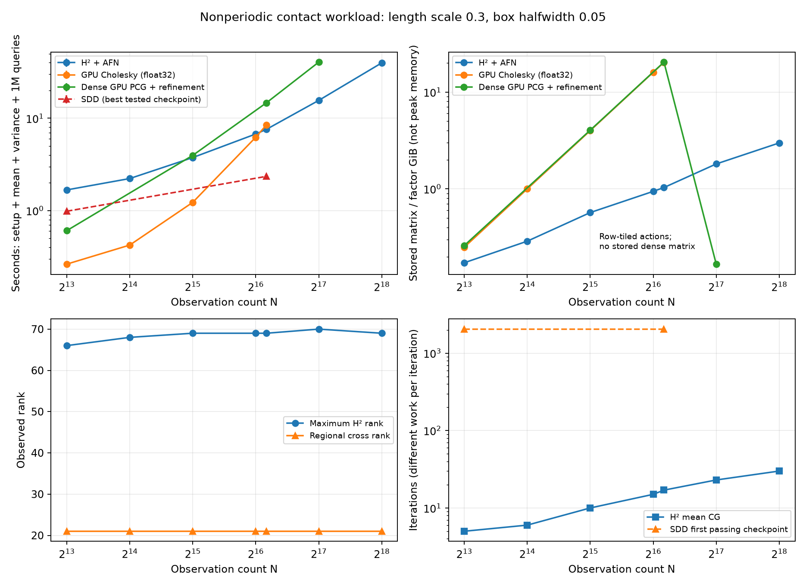
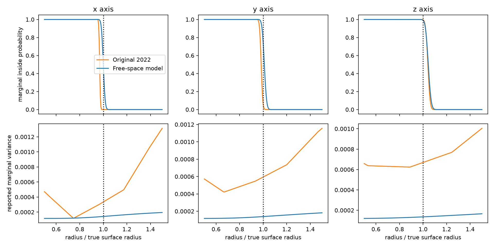

# First nonperiodic H² mean-and-variance crossover

**A subsequent [short-correlation experiment](short/README.md) beats both
Cholesky and the tested SDD control.** This report preserves the earlier
long-correlation case, where SDD wins. Its H² timings precede the CSR construction
fix in `f12c134`; raw records retain source hashes. They are historical
measurements, not a rerun of the latest backend. The short-case curve uses the fix.

The new path prepares both mean and variance **without a full dense Cholesky
factor**. In a synthetic contact-region workload with 73,728 observations and
1,048,576 probability queries, three repetitions give **7.589 s for GPU H²
versus 8.478 s for in-place GPU Cholesky: 1.12× faster**. This includes tree,
preconditioner, GPU representation, regional compression, mean and variance
preparation, and every query batch. Cholesky remains faster at smaller N.

This is an initial controlled numerical win in a useful workload shape, not a
ContactFusion reproduction or a demonstrated real-robot benefit. Both methods
use the same nonperiodic model and the same regional query cache. Removing
periodicity changes the GeoSPSR model; original Sellán–Jacobson 2022 SPSR is also
nonperiodic. Cross-model quality is assessed separately below.

**This smooth long-correlation case does not beat SDD.** The standard SDD
moment formula passes at 2,048 iterations and completes the same workload in
2.351 s at N=73,728, faster than H². Its optional residual correction is much
more conservative and would give a misleadingly weak baseline if imposed.
The Cholesky/H² crossover is real, but the broader goal of beating both
methodologies requires another regime. The shorter-correlation result is
reported separately; this negative result is retained.

## Measured workload

An ellipsoid scan supplies oriented points. A small box around a known contact
point receives 16 new batches of 1,024 candidate approach rays, each with 64
samples. Each sample needs posterior mean, variance and marginal inside
probability. Each batch ranks rays by mean Bernoulli ambiguity. This is a
contact-style probability workload, not a joint collision calculation.

All methods compress the same regional cross kernel to 21 columns, then prepare
a 343-coefficient scalar variance field. Online queries take about 0.014 s in
total; the measured crossover comes from conditioning and variance preparation.
It is not obtained by withholding a reusable cache from Cholesky.

| Observations | H² + AFN, seconds | GPU Cholesky, seconds |
|---:|---:|---:|
| 8,192 | 1.677 | 0.264 |
| 16,384 | 2.226 | 0.424 |
| 32,768 | 3.756 | 1.230 |
| 65,536 | 6.756 | 6.230 |
| 73,728 | 7.589 | 8.478 |
| 131,072 | 15.606 | Not run: factor does not fit |
| 262,144 | 39.741 | Not run: factor does not fit |

Times are medians of three isolated-process repetitions. The 73,728-point
ranges are 7.572–7.711 s for H² and 8.436–8.560 s for Cholesky. The large
extension uses twelve variance iterations instead of eight; its accuracy
results and all settings are in the raw records. No dense runtime is extrapolated
beyond the device's capacity. A memory limit is not a runtime lower bound.

Hardware: one NVIDIA RTX PRO 6000 Blackwell Server Edition **MIG 1g.24gb**, with
23.625 GiB visible, a four-core CPU quota, and 16 GiB host-memory limit. These
are not full-device or 192-core CPU timings. Common CUDA/query-kernel startup
is reported separately. Synthetic observation and query generation are common
inputs outside solver timing. All algorithm-specific setup is included.

## Why the scaling can improve

The observation covariance uses a nested H² hierarchy, an algebraic FMM-style
method. AFN preconditioning uses only a fixed-size coarse factor and sparse
local factors. GPU actions reuse near/far blocks and nested transfers. Variance
uses residual-corrected quadratic forms on a compressed regional cross basis.
Mean and variance are then collapsed into scalar polynomial fields.

For a fixed region and accuracy, bounded hierarchy/cross ranks and controlled
iteration growth replace dense O(N³) factorization and O(N²r) variance
preparation with tree/preconditioner construction and near-linear actions on
r right-hand sides. These conditions matter: mean iterations increase from
five in the smallest case to 30 at N=262,144. The measured maximum H² rank stays around
66–70 and regional rank stays 21. See [METHOD.md](METHOD.md) for costs, formulas,
error bounds and the limits of this local-region result.

Over the common N=32,768–73,728 range, the measured log–log slopes are 0.86
for H² and 2.37 for Cholesky. These finite-range fits illustrate the crossover;
they are not asymptotic proofs or predictions beyond the measured range.

The Cholesky control uses float32 in-place factorization in Fortran order and
one triangular solve for the combined mean/variance preparation. The dense GPU
PCG control receives the same AFN preconditioner and cross compression; its
mixed-precision refinement is timed. SDD receives the same compression, standard
mean/variance moments, and an optional full-kernel residual correction. Failed SDD
checkpoint budgets are not extrapolated into completion times.

The dense GPU PCG control starts with the same variance-step budget, then uses
one reliable correction sweep to compensate float32 action error. Only its
three mean right-hand sides are subsequently refined tightly. Its cached dense
matrix, preconditioner and query cache make it a stronger control than
unpreconditioned or uncached direct CG. Beyond dense-matrix capacity it switches
to bounded row tiles. Earlier measurements that fully refined variance columns
are retained separately and are not used as the final control.

This stronger control passes and takes a median **14.705 s at N=73,728**, versus
7.589 s for H² (1.94×). At N=131,072 its row-tiled implementation takes
**40.499 s** in one run, versus the H² median of 15.606 s (2.60×). The single
large control needs further repetitions for a precise speedup estimate.

## Numerical accuracy

The gates are maximum variance error / prior variance ≤10⁻⁴, maximum inside
probability error ≤10⁻³, and positive variances. The reference uses direct
cross kernels and full float64 covariance actions. Reference solve errors are
bounded using residuals and the declared noise lower bound; these allowances
are included in reported errors. The dense factor's precision or a tighter
H² solve alone is not taken as proof of reference accuracy.

At N=73,728, the hierarchical maximum checked variance error / prior is
4.18×10⁻⁵ and the conservative probability error is 3.17×10⁻⁴. Numerical
audits use 41 queries through N=73,728 and 17 in the large extension, including
all corners and the contact point. They establish sampled accuracy, not a
uniform theorem for every point in a box. Reference construction is excluded
from the performance workload and saved with its own provenance and timing.

All 36 main repetitions pass their audits, including N=262,144 (variance error
/ prior 5.11×10⁻⁵, probability error 1.53×10⁻⁴). The largest independent
reference takes about 348 s to construct; that cost is explicit verification,
not a hidden dependency of the 39.7 s accelerated computation.

Across all 1,048,576 queries at N=73,728, the hierarchical and Cholesky fields
differ in probability by at most 1.95×10⁻⁶ and choose identical winning rays
in all 16 batches. Replacing posterior variance by prior variance changes
probabilities by up to 0.0570; even freezing posterior variance at the contact
point changes them by up to 0.00168, above the 0.001 gate. Thus a mean-only
answer or constant-variance shortcut does not satisfy this workload's accuracy
contract. See [application.json](application.json).

The measured crossover is dominated by avoiding factorization. At N=73,728,
median initial system setup is 5.43 s for H² versus 7.44 s for Cholesky;
subsequent regional mean/variance preparation is 2.14 s versus 1.01 s.
If a suitable Cholesky factor already exists, this experiment does not show
a variance-preparation-only win over it.

The `pilot/` directory retains exploratory failures, including a four-step
variance solve that passes the probability gate but fails the variance gate.
Those records are excluded from accepted timing comparisons. Loose H² accuracy
can also cause nonpositive CG curvature; noise is not silently changed to fix it.

## Original SPSR and known geometry

An independent 512-observation ellipsoid check runs the unmodified gpytoolbox
0.3.8 implementation of original SPSR, full covariance, on a 16³ grid. Its
published mean centering and variance shift are preserved. The new model uses
a deterministic level at the known x-axis contact and unshifted variance.
Inputs, settings, source hashes and raw profiles are in
[geometry/comparison.json](geometry/comparison.json).

The normalized surface crossings on the y and z axes are 1.010 and 1.044 for
the new model, versus 0.983 and 1.041 for original SPSR; truth is 1. The new
x-axis crossing is anchored by construction, so it is not an independent
geometry success. Both models show a surface transition and rising variance
outside the object, but their interior profiles and variance magnitudes differ markedly.
This is a coarse phenomenological comparison, not fixed-model convergence,
pointwise equivalence, or evidence of calibrated uncertainty. Grid refinement
also changes the original implementation's normal kernel.

## Reproduction and remaining work

The optional native backend is pinned to HiGP commit
`da44859a4dd8d6d12483c1161f54705dd8e33b9a`. The isolated `psr_higp_cext` extension
does not replace the installed HiGP module. Build with
`./reproduction/run_env.sh reproduction/setup_higp.py`; it needs a C++ compiler,
OpenMP, setuptools, NumPy and LP64 OpenBLAS. The script can use the OpenBLAS
bundled with SCS or an explicit `--blas` path. Experiments additionally use
SciPy, CuPy, JAX, matplotlib, pytest and gpytoolbox 0.3.8.

Run `bash reproduction/results/hierarchical_variance/reproduce.sh`. The driver
skips already completed timing files, preserves logs/status, and runs methods
sequentially. Remove or relocate a previous results directory before a fresh
reproduction. Raw `scaling/`, `large/`, `controls/`, `references/`, `sdd/` and
`geometry/` records, [summary.json](summary.json), and the [PDF plot](scaling.pdf)
separate timing, correctness, and model-quality evidence.

The implementation has 28 passing targeted tests. They include independent
dense kernel/solve comparisons, clustered-tree GPU actions, native versus GPU
preconditioning, quadratic residual identities, polynomial collapse, in-place
Cholesky, and mixed-precision dense CG controls.

Open work: partial/noisy scans and repeated-scan calibration; larger contact
regions and multiple regions; observation updates; certified variance stopping;
stronger SDD tuning; and preconditioner/iteration growth. The current result
does not establish superiority for global reconstruction or every solver.
Tracking [#68](https://github.com/alecjacobson/fast-stochastic-psr/issues/68),
[variance stopping #79](https://github.com/alecjacobson/fast-stochastic-psr/issues/79),
and [draft PR #76](https://github.com/alecjacobson/fast-stochastic-psr/pull/76).
