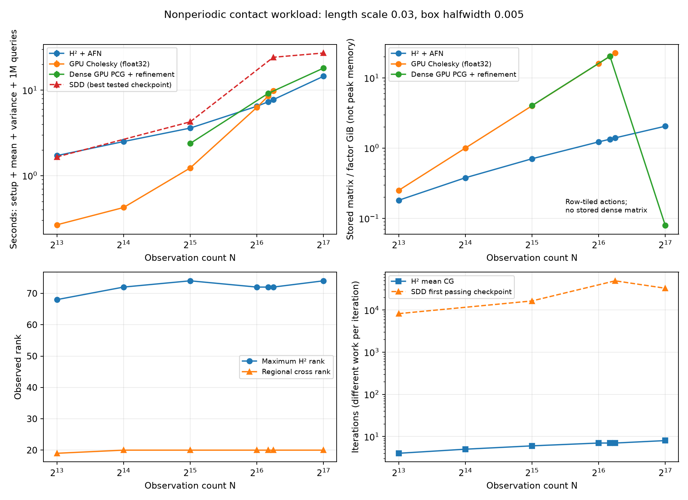
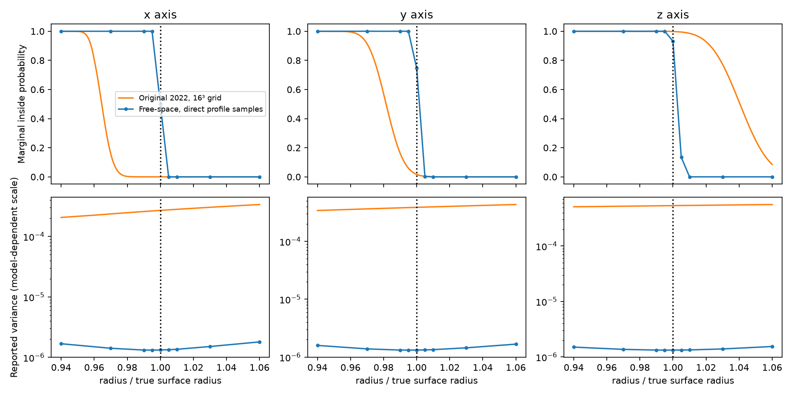

# A variance-inclusive win for nonperiodic H² conditioning

A dense, short-correlation scan with repeated local contact queries is the first
tested regime where the FMM-style path beats **both GPU Cholesky and the tested
SDD solver**. At 77,824 observations, setup plus posterior mean, spatially varying
variance and 1,048,576 probability queries takes **7.736 s with H², 9.776 s with
Cholesky, and 24.191 s with SDD**: 1.26× and 3.13× speedups respectively.
There is **no full dense factor** in the H² path. All producers receive the same
regional compression and scalar query cache.

This is a synthetic contact-style numerical demonstration, not a ContactFusion
reproduction or a calibrated robotics result. Cholesky wins at smaller sizes.
[The long-correlation case](../README.md) is retained as a counterexample:
SDD completes it in 2.35 s, faster than either hierarchical or dense preparation.

## Complete workload and results

Nested scans sample an ellipsoid with axes (1,.8,.6), exact outward unit normals,
and seed 12. The free-space vector Matérn–Poisson model has length scale .03,
amplitude .0025 and observation noise variance .000025. These settings remain
fixed as N increases. A box of halfwidth .005 surrounds a known contact at
(1,0,0). Sixteen batches each score 1,024 approach rays with 64 samples using
marginal inside probabilities and Bernoulli ambiguity. These are not joint
collision probabilities. The known contact selects a deterministic mean level;
posterior variance is unshifted and unclipped.

| Observations | H² + AFN | GPU Cholesky | Dense GPU PCG | SDD |
|---:|---:|---:|---:|---:|
| 8,192 | 1.714 s | **0.266 s** | — | 1.655 s |
| 16,384 | 2.501 s | **0.424 s** | — | — |
| 32,768 | 3.594 s | **1.228 s** | 2.377 s | 4.253 s |
| 65,536 | 6.463 s | **6.269 s** | — | — |
| 73,728 | **7.293 s** | 8.497 s | 9.143 s | — |
| 77,824 | **7.736 s** | 9.776 s | — | 24.191 s |
| 131,072 | **14.499 s** | Factor cannot fit | 18.065 s | 27.129 s |

H² and Cholesky use three isolated-process repetitions. Dense PCG also uses
three except its largest case, which has one run. SDD reports the best observed
passing checkpoint among the tested learning rates, one run per configuration;
it is not a fully optimized or repeated timing. Unmeasured entries are dashes.
At 77,824 points, H² ranges from 7.673–7.796 s and Cholesky from 9.775–9.803 s.
All setup, regional SVD, mean and variance preparation, and online batches are
included. Common input generation and CUDA/query-kernel initialization are
excluded equally; initialization is recorded separately. Queries alone cost
roughly .014 s, so avoiding conditioning cost drives the win.

Hardware is one NVIDIA RTX PRO 6000 Blackwell Server Edition **MIG 1g.24gb**,
23.625 GiB visible, four CPU cores by quota, and 16 GiB host memory. At 77,824
points the actual float32 Cholesky factor fits: 22.56 GiB versus 1.40 GiB for
stored H² matrices. At 131,072 points a dense factor alone requires 64 GiB;
its runtime is not extrapolated. The dense CG control instead uses bounded row
tiles there. Plotted matrix storage is not peak process memory.

## What changes algorithmically

The new covariance model lives on R³ and has no periodic wrap. A nested H²
representation supplies FMM-style matrix actions; AFN supplies a small coarse
factor and sparse local preconditioner. The GPU implementation caches interaction
blocks and nested transfers. A regional cross-kernel SVD compresses variance to
19–20 right-hand sides. Residual-corrected quadratic forms obtain its covariance
reduction without solving each column to mean-level accuracy. Polynomial collapse
produces 343 scalar variance coefficients for all later queries.

At fixed region, precision and bounded ranks, conditioning plus regional variance
replaces dense O(N³ + N²r) work with hierarchy/preconditioner construction,
O(I T_H(N,t) r) iterative work, and a thin O(N(3p³)²) SVD. T_H is near-linear
under bounded ranks and interaction lists. Mean right-hand sides add a constant
three columns. All methods share the O(Mp³) query field. This is a conditional
complexity advantage, not an unconditional linear-time theorem; see
[the derivation and comparison contract](../METHOD.md).

Measured log-log slopes over N=32,768–73,728 are **0.86 for H² versus 2.37 for
Cholesky**. They describe this finite range, not asymptotic limits. Maximum H²
rank stays 68–74, regional rank 19–20, and mean CG iterations 4–8 across the
short-case series. Fixed variance iterations are eight through N=77,824 and
twelve at N=131,072. H² tolerance is .001, leaf size 40, AFN coarse rank 8,
and neighbor count 24. The AFN factor size does not grow with N.

## Strong controls and numerical accuracy

Cholesky uses an in-place float32 GPU factor and one shared triangular solve
for mean/variance moments. Dense PCG receives the same AFN and regional basis,
cached float32 matrix when it fits, and float64 residual accumulation for
refinement. Only the mean is refined tightly in this short-correlation case;
extra variance refinement was unnecessary and is disabled. H² is 1.25× faster
than this control at N=73,728 and 1.25× at N=131,072.

SDD uses the original update structure adapted to the same nonperiodic kernel,
with batch 128, momentum .9, Polyak averaging .01, and tested eta .1/.15
(only .15 at N=131,072). It receives both the standard moment formula and an
optional residual correction; forcing the latter gives a misleadingly weak
baseline. Final projection and field construction are timed. Earlier checkpoint
quality checks are excluded, favoring SDD through offline stopping selection.
Best passing checkpoints are 8,192, 16,384, 49,152 and 32,768 iterations as N
increases. They are not monotonically increasing, and no SDD iteration-growth
law is established. More learning-rate, batching and stopping tuning may help.

All **46** H², Cholesky and dense-CG repetitions pass independent audits. Gates
are maximum variance error / prior variance ≤10⁻⁴, maximum marginal CDF error
≤10⁻³, and positive variance. Audits use direct cross kernels and full float64
covariance actions, with solve-error allowances derived from residuals and the
declared noise lower bound. A tighter H² initializer is not itself the accuracy
authority. Sampled queries include the center and all corners: 41 queries
through N=73,728 and 17 thereafter. This is not a uniform error certificate.

At N=77,824, the worst H² audit across repetitions gives variance error / prior
**7.25×10⁻⁵** and CDF error **3.16×10⁻⁴**, including reference allowances.
At N=131,072 these are 8.57×10⁻⁵ and 1.90×10⁻⁴. All reported SDD runs pass the
same gates. Reference construction is an excluded verification step, saved with
its own costs and source provenance, not a hidden production dependency.

Over **all 1,048,576 queries** at N=77,824, H² and Cholesky differ in probability
by at most 1.35×10⁻⁶ and select identical rays in all 16 batches. SDD differs by
at most 1.20×10⁻⁴, selects the same ray in 14 batches, and has maximum ambiguity
score regret 3.80×10⁻⁷. See [application.json](application.json) and
[application_sdd.json](application_sdd.json).

Replacing posterior variance with prior variance changes probabilities by up
to .0639. Freezing variance at the contact changes variance / prior by .00638,
which fails the spatial-variance gate, although its CDF error .000325 passes
the looser probability gate. Thus this result requires accurate spatial variance;
a task requiring only the present CDF tolerance might admit a cheaper constant
variance approximation. We do not claim that the ray-choice metric alone proves
the need for the full variance accuracy budget.

At N=77,824, H² initial setup takes 5.50 s versus Cholesky's 8.68 s; regional
mean/variance preparation takes 2.22 s versus 1.08 s. If the dense factor already
exists, this experiment does not demonstrate a variance-preparation-only win.
The practical target is a newly conditioned high-resolution scan followed by
local probability queries, not reuse of an already-paid-for Cholesky factor.

## Original Sellán–Jacobson and geometry truth

The unmodified gpytoolbox 0.3.8 original SPSR full-covariance path also processes
the same 77,824 observations, on a 16³ grid. Its published mean and variance
postprocessing is preserved. Original SPSR is nonperiodic; removing periodicity
from GeoSPSR does not imply exact equivalence to this original method. Its grid
kernel, density approximation and Poisson discretization differ from the new
model. [Raw profiles and provenance](geometry/comparison.json) record both.

Against the exact ellipsoid, normalized y/z surface crossings are **1.00096 /
1.00287** for the new model and **0.98152 / 1.04051** for the coarse original run
(truth: 1). The new x crossing is anchored by construction and is not an
independent success. Both models produce surface transitions, but uncertainty
magnitudes differ strongly. This is a phenomenological check on the winning
input, not a grid-converged original comparison, calibration result, or cross-model
speedup. Sparse profile samples also do not establish whole-surface geometry.

## Reproduction and next experiments

Build the optional pinned native backend as described in [the parent report](../README.md),
then run `bash reproduction/results/hierarchical_variance/short/reproduce.sh`.
The timing driver skips existing records; relocate previous output before a fresh
measurement. [summary.json](summary.json), the [PDF figure](scaling.pdf), raw
timings, independent references, SDD checkpoint histories and pilot failures
are retained. The H² curve here includes the sorted-CSR fix in `f12c134`; earlier
timings and the reference's former COO-sort allocation failure are in `pilot/`.
Twenty-eight targeted numerical tests pass.

Next priorities are held-out noisy/partial scans and repeated-scan calibration;
more SDD tuning; larger/multiple contact regions; output-controlled stopping;
and a distance-truncated sparse-kernel control for this short-correlation regime.
The latter may exploit locality even more cheaply than general H². No unique
optimality of FMM is claimed. Track [#68](https://github.com/alecjacobson/fast-stochastic-psr/issues/68),
[#73](https://github.com/alecjacobson/fast-stochastic-psr/issues/73),
[#79](https://github.com/alecjacobson/fast-stochastic-psr/issues/79), and
[#80](https://github.com/alecjacobson/fast-stochastic-psr/issues/80).
