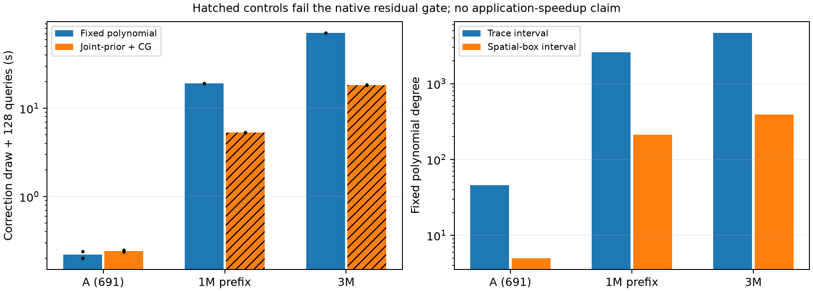
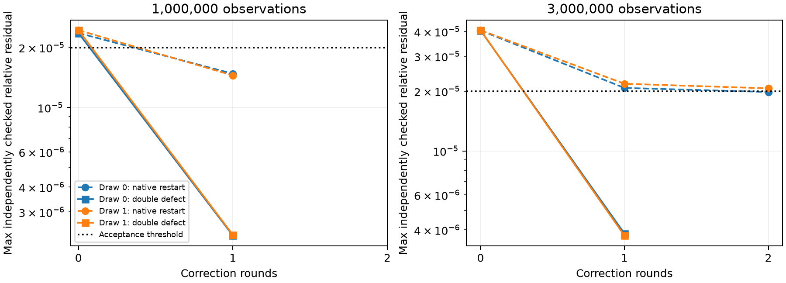

# Matrix-free fixed-polynomial correction sampling

A fixed Chebyshev inverse-root correction sampler is implemented and exercised
through three million observations. The spatial-box spectral envelope keeps
the polynomial degree manageable. This is a control for future rational/Krylov
sampling, not a replacement for coherent posterior samples or a demonstrated
marginal-variance/application speedup.

Recorded polynomial draw costs exceed the initial joint-prior/CG control for the million-point prefix, the three-million-point input. Failed controls are not matched-quality timing baselines.
Two draws per method are insufficient for robust timing statistics.
The current evidence does not support replacing the existing
pathwise sampler with this polynomial control.

[Protocol](PROTOCOL.md) · [Summary](summary.json) ·
[Issue #35](https://github.com/alecjacobson/fast-stochastic-psr/issues/35).

## Measured correction preparation

Both methods target correction covariance C A^-1 Cᵀ for the **same finite
training cube 200**, scalar/cross cube 50 and noise variance .02. All selected
observations enter each covariance action. Each correction draw contains three
independent Gaussian normal components. There are two draws per method and
size, with batch1; the table retains their ranges, not confidence intervals.

| Input | N | Degree | Polynomial draw + query (s) | Joint-prior + CG draw + query (s) | Worst round-trip error | Polynomial checks | Native CG checks |
| --- | ---: | ---: | ---: | ---: | ---: | ---: | ---: |
| A | 691 | 5 | 0.201–0.240 | 0.237–0.249 | 0.000098% | pass | pass |
| million | 1,000,000 | 211 | 19.195–19.237 | 5.305–5.323 | 0.001209% | pass | FAIL |
| three_million | 3,000,000 | 390 | 71.893–71.911 | 18.255–18.419 | 0.005183% | pass | FAIL |

The million-point input is the **first million points of the published
three-million-point source**, not the earlier million-point scan. Source hashes
and prefix provenance are retained. A uses the released 691 observations.



Dots on the timing bars show both measurements; hatching marks failed native
CG controls. Their costs are **not matched-quality baseline timings**.
Shared operator/plan setup,
polynomial setup and validation are excluded from these draw costs and reported
below or in raw records. The pathwise control includes full joint-prior
generation, noise, CG, source aggregation and the same query evaluation. Its
existing routine also creates an unused scalar prior; it is not claimed to be
a minimal vector-only implementation. Different Gaussian couplings are compared
as distributions, not as identical individual realizations.

## Spectral envelope and fixed polynomial

| Input | Trace upper bound | Spatial-box upper bound | Trace → box degree | Polynomial setup (s) | Shared operators/plans (s) | Sampled process peak (GiB) |
| --- | ---: | ---: | ---: | ---: | ---: | ---: |
| A | 0.711 | 0.0306646 | 46 → 5 | 0.061 | 0.120 | 5.38 |
| million | 1000.02 | 10.6346 | 2582 → 211 | 0.144 | 0.183 | 5.59 |
| three_million | 3000.02 | 32.1577 | 4696 → 390 | 0.315 | 0.158 | 6.19 |

The lower bound is the noise variance. Partition the periodic domain into
128-cubed boxes and count observations. The positive analytic circle Matérn
decreases with shortest angular distance, so minimum box-to-box distances give
entrywise upper envelopes. A separable FFT convolution computes box row sums;
their maximum over occupied boxes bounds the analytic spectral radius in exact
arithmetic. The finite analytically normalized Fourier kernel is below the
analytic kernel in PSD order, so it inherits the upper bound. This is a
**spectral bound**, not an FMM implementation or a change to the covariance.

For the monotonicity used here, set a=sqrt(3)/(2*ell) and t=a*(1-d/pi).
The derivative with respect to t has the sign of
a*coth(a)*sinh(t)-t*cosh(t), which is nonnegative on 0<=t<=a because
t*coth(t) is increasing. Thus the kernel decreases with shortest distance d.

The convolution and kernel formula use float64 and a relative 1e-8 pad. This is
an analytic enclosure evaluated numerically, **not directed-rounding interval
certification**. Neither the envelope nor the polynomial theory includes NUFFT
operator error. The source-independent trace bound is also recorded.

For f(t)=1/sqrt(c+h*t), select a Bernstein ellipse whose mapped leftmost real
part is positive. If that part is a, then |f|<=1/sqrt(a) on the ellipse. The
Chebyshev-Lobatto interpolation bound is 4 M rho^-degree/(rho-1); multiplying
by sqrt(upper) bounds relative inverse-root error. Degree is selected for a
bound <=1e-4. See [Trefethen, Theorem 8.2](https://people.maths.ox.ac.uk/trefethen/trefethen_sample.pdf).
Coefficient rounding, recurrence roundoff and approximate matrix actions are
outside this exact-arithmetic bound.

The interval, coefficients and degree are fixed before Gaussian draws. In exact
arithmetic, p(A) xi is consequently Gaussian with covariance p(A)^2. If the
relative scalar error is <=delta throughout the spectrum, then
(1-delta)^2 A^-1 <= p(A)^2 <= (1+delta)^2 A^-1 in PSD order. Congruence by C
gives the corresponding correction-covariance bounds. This conditional
statement is not a proved numerical covariance guarantee for the GPU code.

## Validation and limitations

All polynomial numerical checks pass: **True**. On A, the dense symmetric
inverse root of the SAME finite kernel gives worst relative weight error
**0.000049%** and correction-field error **0.000255%**.
Every polynomial draw also checks A p(A)^2 xi against xi, requiring relative
L2 <=.001 separately for each of its three RHS. These six random-direction
checks per size are **not** an operator norm, covariance or Monte Carlo accuracy
certificate. Dense reference and round-trip validation costs are separate.

The [15 targeted tests](tests.log) cover dense full covariance, fixed-map
linearity, periodic seams, duplicated points, short length scales, low noise,
float32 high-condition roundoff, streamed partial batches and correction-field
agreement. The [seven GPU/stream tests](stream-tests.log) were repeated after
factoring out shared aggregation. GPU fields replay from saved coefficients;
artifact hashes and accounting are checked in each verification record. The
large round-trip numbers are from the original runs, not a separate replay.

All whole-run sampled GPU isolation audits pass: **True**. Per-case
ratio eligibility is retained in JSON; no complete-application ratio follows.
The sampled memory peak covers the whole instrumented process, including
validation/baseline workspace of the initial pilot, and can miss brief peaks.
The separate double-verification follow-up has higher memory use. Sources, full Gaussian
RHS, weights and coefficients remain outside Git; compact query fields are
published in [A](A), [million](million) and [three million](three_million).

This does **not** resolve the [contrast-sensitive variance convergence failure](../correction_contrast/README.md).
Even instantaneous correction draws would retain Monte Carlo noise. Approximate
inverse roots also require an error allowance before applying intervals for the
exact target covariance. Correction fields must not be used as posterior draws
for ray/collision events. Training truncation, scalar bandwidth and full
application quality remain separate, open checks. Rational multi-shift CIQ is
still unimplemented; fixed-polynomial validation is a baseline for that work.

## Residual follow-up and mixed-precision correction

The original large-N native CG flags remain **failed**. A [separate follow-up](RESIDUAL_FOLLOWUP.md)
checks a float64 action of the same finite cube at epsilon1e-10, not an analytic
kernel with a different truncation. The first batched double plan failed with
CUFFT_INTERNAL_ERROR ([retained failure](residual-batched-failed)); checking one
RHS column at a time avoids that plan failure. Its exact cause is unestablished.

Fresh seeded RHS are archived for each large input, then held fixed between
native-restart and mixed-precision studies. Native restarts reduce the native
residual but one three-million-point draw still misses the independent
double-precision threshold after two restarts. Mixed-precision correction instead
forms the defect using the double action, solves that smaller defect with
native CG at rtol .1, accumulates in double, and stores the result in float32.
Only the independent residual of those stored weights controls acceptance.

| N | Draw | Initial double residual | After capped native restarts | After double-defect correction | Mixed corrections | Initial solve + mixed correction + checks (s) |
| --- | ---: | ---: | ---: | ---: | ---: | ---: |
| 1,000,000 | 0 | 2.36e-05 | 1.48e-05 | 2.28e-06 | 1 | 8.161 |
| 1,000,000 | 1 | 2.44e-05 | 1.45e-05 | 2.3e-06 | 1 | 8.052 |
| 3,000,000 | 0 | 4.06e-05 | 1.98e-05 | 3.83e-06 | 1 | 24.527 |
| 3,000,000 | 1 | 4.07e-05 | 2.07e-05 | 3.74e-06 | 1 | 24.721 |



Both strategies use identical archived RHS, with fresh initial solves. Native
restarts and mixed correction have a cap of two. The acceptance threshold stays
2e-5. Table times include initial solving and independent checks, exclude common
operator setup and RHS generation, and do not include field aggregation/querying.
These runs are separate from the initial preparation pilot; do not combine their
times into an end-to-end or isolated speedup. The independent double action is
stronger numerical evidence, not exact arithmetic or a covariance/event guarantee.
The mixed-precision runs have sampled process peaks of
21.33 GiB
and 22.17 GiB,
respectively. Sampled GPU isolation passes for both mixed-precision runs:
**True**.
The initial pilot's per-case audits are recorded separately in the summary;
the preparation and mixed-solve tables remain different measurement scopes.

`geospsr.refinement.refine_solution` is an explicit opt-in helper; existing solver
defaults are unchanged. [19 targeted tests pass](all-tests.log), including a
biased native action, an independently constructed dense target and GPU storage
precision. Adoption in full posterior applications, preconditioned solves and
mixed-band configurations remains open in [issue #37](https://github.com/alecjacobson/fast-stochastic-psr/issues/37).

## Reproduce

```bash
./reproduction/run_env.sh -m reproduction.benchmark_inverse_root \
  --case A --output /opt/geospsr-runtime/inverse-root/A
# Repeat with --case million and --case three_million in fresh serial processes.
./reproduction/run_env.sh -m reproduction.verify_inverse_root \
  --run /opt/geospsr-runtime/inverse-root/A
# Verify each large run too; publish results/verification JSON and fields.npz.
./reproduction/run_env.sh -m reproduction.diagnose_inverse_root_residuals \
  --count 1000000 --output /opt/geospsr-runtime/inverse-root/residual-1000000
./reproduction/run_env.sh -m reproduction.refine_inverse_root_residuals \
  --source /opt/geospsr-runtime/inverse-root/residual-1000000 \
  --output /opt/geospsr-runtime/inverse-root/mixed-1000000
# Repeat both for 3000000; publish the follow-up JSON before summarizing.
./reproduction/run_env.sh -m reproduction.summarize_inverse_root
```

Large cases require the regenerated source from `../large_inputs`. Normals are
not used for zero-mean correction sampling. This is preparation work, not a
mean fitting or posterior-conditioning benchmark.
