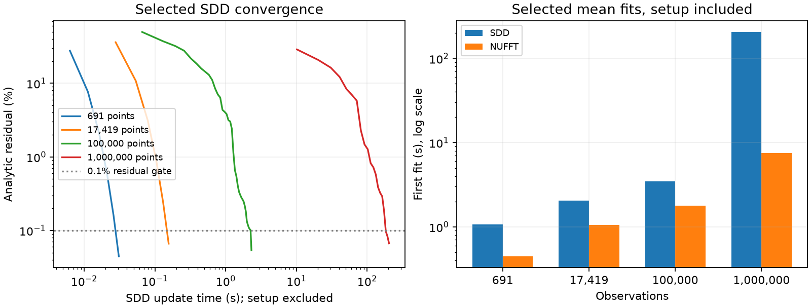

# A converged iterative conditioning reference

The released stochastic dual descent (SDD) method **can fit the million-point
input** within the tested time budget. Its use avoids a dense N×N matrix.
Dense-factorization memory alone would give the wrong feasibility conclusion.
Wider-band NUFFT reduces fitting time at large N; the compiled SDD reference
wins repeated mean fitting on the smaller A/B inputs. Neither conclusion is
a complete-application or full-posterior scaling result.

The million-point first fit takes **205.7 s for compiled SDD** versus
**7.58 s for NUFFT**, a **27.2× fitting ratio** in one confirmation run.
The table below records the independent accuracy checks and timing limitations.



## Reference and noise convention

- Pinned upstream: `2352f1ef98aab20e0303611c1fa2b0948acd2a05`.
- Training reference: analytic product Matérn, length scale 0.01, per-axis variance 0.1, noise variance 0.02.
- The untouched SDD function squares `sigma`; it receives `sqrt(0.02)` to match the dense covariance. The local API consistently accepts the variance.
- A compiled `jax.lax.fori_loop` preserves the released gradient, momentum 0.9, Polyak averaging 0.01, sequential key folding and sampling without replacement.
- Tests compare against the untouched Python-loop routine and verify chunked resumption and `jit(vmap(...))` through the public SDD API.
- Tune effective coordinate step `eta = lr * N / batch` and batch size. The reference is not restricted to the poorly tuned default learning rate.

A/B reuse the matched camera-raster inputs; larger inputs are nested subsets
of the distinct area-uniform visible scorpion cloud. Both methods use the
same scalar/cross cutoff 50 and centering convention. NUFFT uses vector
training cutoff 200, previously validated in the
[bandwidth audit](../training_bandwidth/README.md). The finite training
approximation remains explicit.

## Selection and independent confirmation

SDD stops when the analytic training residual is <0.1%: all rows for A/B,
or the upper endpoint of a 512-row empirical bootstrap 95% interval at
larger N. A/B additionally require mean error <0.2% across 20,000 queries.
The fastest passing configuration is selected from the documented pilot.

Confirmation reruns its selected iteration count and checks **1,024 new
analytic rows** at large N, independent of the rows used for tuning/stopping.
Both methods use that same holdout. Such intervals describe sampled rows;
they are not full-system bounds, posterior-error guarantees, or evidence
that rare difficult observations are absent.

| Input | Method | First fit incl. setup (s) | Warm fit median (s) | Analytic residual % | Confirmation gate |
| --- | --- | ---: | ---: | ---: | :---: |
| A (691) | SDD | 1.060 | 0.041 | 0.0444 | yes |
| A (691) | NUFFT | 0.446 | 0.400 | 0.0151 | yes |
| B (17,419) | SDD | 2.053 | 0.170 | 0.0662 | yes |
| B (17,419) | NUFFT | 1.049 | 0.997 | 0.0124 | yes |
| 100,000 | SDD | 3.462 | 2.325 | 0.0448 | yes |
| 100,000 | NUFFT | 1.793 | 1.746 | 0.0147 | yes |
| 1,000,000 | SDD | 205.707 | not repeated | 0.0760 | yes |
| 1,000,000 | NUFFT | 7.575 | not repeated | 0.0372 | yes |

First fit includes JIT/spectrum/plan setup, solving from zero, scalar source
aggregation and centering. Process/CUDA initialization, data generation,
parameter search, validation and output queries are excluded. Method order
in the confirmation harness is SDD then NUFFT. Each large first-fit number
is one measurement, not a statistical estimate of runtime.

Warm medians use three repetitions on A/B/100k, resetting the solution and
random sequence while reusing compiled code or GPU plans. These repeats
measure the solver workload, **not an application refit speedup**: identical
inputs could cache the answer. The million-point confirmation is not repeated.
An NVIDIA L40 executes the GPU workloads serially. Peak memory was not
instrumented in this series; no memory-limit claim is made.

For A/B, both confirmed fits pass mean and probability gates. Probability
checks use the shared exact analytic variance at the 256 prior audit probes
(RMS <0.1 percentage points, maximum <2 points). They isolate mean-fit
error and do not benchmark each method computing a posterior variance.
At large N, reported mean differences use the cutoff-200 solution as a
diagnostic, **not analytic ground truth**.

## Pilot configurations, including failures

Budgets count update time, excluding compilation and validation, and may
overshoot by one checkpoint chunk. A: 10 s / 10,000 iterations; B: 20 s /
20,000 iterations; 100k: 30 s / 100,000 iterations; 1m: 240 s / 200,000
iterations per configuration. Stopping at a budget is not a claim that
the configuration cannot converge. Tuning/selection results use seed 0;
broader seed, geometry and parameter coverage remains open.

| Input | Batch | eta | Iterations | Updates (s) | Final analytic residual % | Status |
| --- | ---: | ---: | ---: | ---: | ---: | --- |
| A | 128 | 0.005398 | 10,000 | 0.486 | 11.9428 | iteration_budget |
| A | 128 | 0.5 | 768 | 0.034 | 0.0821 | residual_gate_pass |
| A | 128 | 2 | 768 | 0.035 | 0.0498 | residual_gate_pass |
| A | 128 | 5 | 768 | 0.034 | 0.0463 | residual_gate_pass |
| A | 128 | 8 | 768 | 0.033 | 0.0456 | residual_gate_pass |
| A | 512 | 0.00135 | 10,000 | 0.386 | 11.9346 | iteration_budget |
| A | 512 | 0.5 | 768 | 0.031 | 0.0496 | residual_gate_pass |
| A | 512 | 2 | 768 | 0.032 | 0.0452 | residual_gate_pass |
| A | 512 | 5 | 768 | 0.031 | 0.0444 | residual_gate_pass |
| A | 512 | 8 | 768 | 0.032 | 0.0442 | residual_gate_pass |
| B | 128 | 0.1361 | 20,000 | 3.094 | 0.6972 | iteration_budget |
| B | 128 | 0.5 | 8,576 | 1.300 | 0.0967 | residual_gate_pass |
| B | 128 | 2 | 2,816 | 0.428 | 0.0690 | residual_gate_pass |
| B | 128 | 5 | 2,048 | 0.311 | 0.0488 | residual_gate_pass |
| B | 128 | 8 | 3,712 | 0.563 | 0.0973 | residual_gate_pass |
| B | 512 | 0.03402 | 20,000 | 4.018 | 0.6481 | iteration_budget |
| B | 512 | 0.5 | 2,304 | 0.464 | 0.0709 | residual_gate_pass |
| B | 512 | 2 | 896 | 0.182 | 0.0441 | residual_gate_pass |
| B | 512 | 5 | 768 | 0.156 | 0.0662 | residual_gate_pass |
| B | 512 | 8 | 1,152 | 0.233 | 0.0800 | residual_gate_pass |
| 100000 | 128 | 0.7812 | 32,256 | 8.191 | 0.0800 | residual_gate_pass |
| 100000 | 128 | 2 | 15,616 | 3.938 | 0.0540 | residual_gate_pass |
| 100000 | 128 | 5 | 9,216 | 2.315 | 0.0535 | residual_gate_pass |
| 100000 | 512 | 0.1953 | 30,464 | 25.755 | 0.0887 | residual_gate_pass |
| 100000 | 512 | 2 | 4,352 | 3.733 | 0.0441 | residual_gate_pass |
| 100000 | 512 | 5 | 2,816 | 2.402 | 0.0187 | residual_gate_pass |
| 100000 | 2048 | 0.04883 | 8,704 | 30.811 | 6.6396 | time_budget |
| 100000 | 2048 | 2 | 1,280 | 4.600 | 0.0133 | residual_gate_pass |
| 100000 | 2048 | 5 | 1,024 | 3.637 | 0.0094 | residual_gate_pass |
| 1000000 | 128 | 5 | 84,992 | 211.079 | 0.0584 | residual_gate_pass |
| 1000000 | 512 | 5 | 20,480 | 204.456 | 0.0667 | residual_gate_pass |

The paper’s solver example uses visual comparisons; these numerical gates
and reconstructed workloads do not reproduce its unpublished Figure 13 scene.

## Use and next work

The accelerated loop is optional in the existing API:

```python
alpha = sdd_solve(x, normals, kernel, noise_variance, key,
                  bs=512, lr=chosen_rate, iterations=chosen_iterations,
                  compiled_loop=True)
```

Existing GP entry points can pass `compiled_loop=True` inside `sdd_params`.
The default Python loop remains available. Learning rate and iteration count
must be checked for the particular data; the scorpion tuning is not a default
accuracy guarantee. Compiled mode has no per-iteration progress bar.

[#15](https://github.com/alecjacobson/fast-stochastic-psr/issues/15) tracks
method selection by workload, memory and expected reuse. Dense Cholesky may
win when reused across many draws, even where SDD wins a single mean fit.
Next: equal-quality conditional-sampling and complete-application comparisons,
held-out seeds/parameters and larger scans, including the short-scale/low-noise
failure in [#14](https://github.com/alecjacobson/fast-stochastic-psr/issues/14).
The full objective remains open in [#1](https://github.com/alecjacobson/fast-stochastic-psr/issues/1).

```bash
./reproduction/run_env.sh reproduction/benchmark_iterative_reference.py --dataset A --include-default --time-budget 10 --iterations 10000
./reproduction/run_env.sh reproduction/benchmark_iterative_reference.py --dataset B --include-default --time-budget 20 --iterations 20000
./reproduction/run_env.sh reproduction/benchmark_iterative_reference.py --dataset 100000 --batches 128 512 2048 --etas 2 5 --include-default --time-budget 30 --iterations 100000 --chunk 256
./reproduction/run_env.sh reproduction/benchmark_iterative_reference.py --dataset 1000000 --batches 128 512 --etas 5 --time-budget 240 --iterations 200000 --chunk 1024
./reproduction/run_env.sh reproduction/compare_iterative_fits.py --dataset A
./reproduction/run_env.sh reproduction/compare_iterative_fits.py --dataset B
./reproduction/run_env.sh reproduction/compare_iterative_fits.py --dataset 100000
./reproduction/run_env.sh reproduction/compare_iterative_fits.py --dataset 1000000 --repeats 0
./reproduction/run_env.sh reproduction/summarize_iterative_reference.py
```

Run the matched and training-bandwidth inputs first. Raw configuration
histories, compact fields and confirmation records accompany this report.
