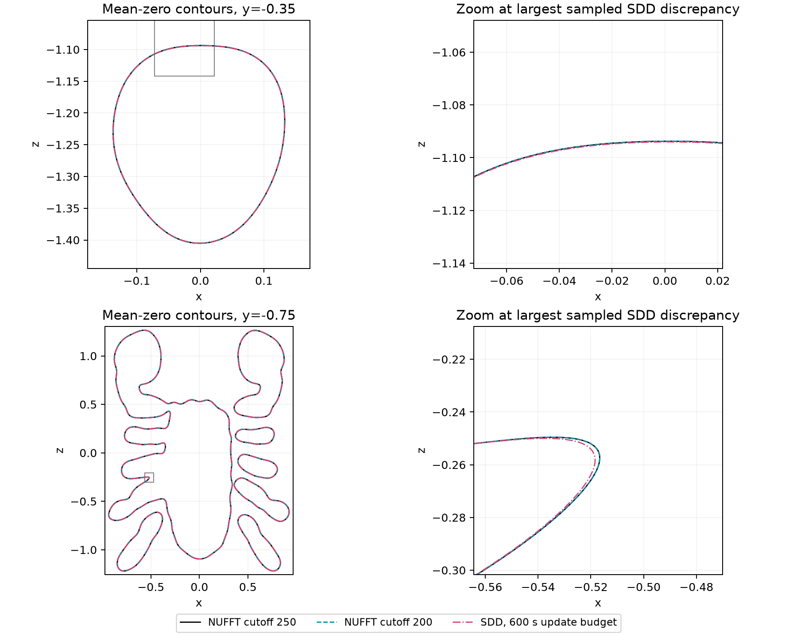

# Three-million-point mean-zero slice contours

The frozen [mean fits](../large_fit/README.md) are now checked on progressively
finer slice grids. This separates small global field error from displacement of
the displayed zero boundary. It does not introduce a new application pass/fail
threshold or a solver timing ratio.

[Protocol](PROTOCOL.md) · [Raw measurements](results.json) ·
[All refinement and comparison distances](summary.json) ·
[All extracted contour vertices](contours.npz).

## Final-grid comparison

All three million observations, saved weights and original centering constants
are reused; the weights and source hashes are verified. The old 20,000-query
panel is replayed before evaluating the new grids. Scalar/cross cutoff stays 50.
Training cutoff 250 is an internal reference, not a full analytic solution.

| Method versus cutoff 250 | Slice y | Hausdorff bracket (model units) | Bracket / domain width |
| --- | ---: | ---: | ---: |
| half200 | -0.35 | 0–9.957e-05 | 0.00000–0.00317% |
| half200 | -0.75 | 0–9.9957e-05 | 0.00000–0.00318% |
| sdd | -0.35 | 0.000217211–0.000317172 | 0.00691–0.01010% |
| sdd | -0.75 | 0.00192878–0.00202878 | 0.06139–0.06458% |



Every connected curve is retained. These are actual extracted 2049-square
contours; the right panels magnify the neighborhood of the largest sampled SDD
discrepancy on each plane. The full-plane panels crop to the contour extents;
the evaluation domain remains [-pi/2, pi/2] squared. No displacement is amplified.
Colors/line patterns distinguish the models and do not encode uncertainty.

## Numerical refinement

Each method is evaluated directly on nested 257, 513, 1025 and 2049 square grids
at y=-.35 and -.75. The final 1025-to-2049 comparison is:

| Method | Slice y | Hausdorff bracket (model units) | Final components | Refinement check |
| --- | ---: | ---: | ---: | ---: |
| half200 | -0.35 | 2.31909e-06–0.000102307 | 1 | pass |
| half200 | -0.75 | 0.000199076–0.000299076 | 7 | pass |
| half250 | -0.35 | 2.40775e-06–0.00010238 | 1 | pass |
| half250 | -0.75 | 0.000199331–0.00029933 | 7 | pass |
| sdd | -0.35 | 2.6241e-06–0.000102601 | 1 | pass |
| sdd | -0.75 | 0.00018403–0.000284028 | 7 | pass |

The predeclared refinement check requires unchanged component/open-component
counts and upper distance <=0.0003142, or 0.01% of
the domain width. All final checks pass: **True**.
All earlier grids are retained in the summary, including any failed checks.
This is an empirical refinement check, not a proof of continuous zero-set or
topology convergence. Marching squares can miss components between samples.

Distances refer to the **extracted polylines**. Each segment is sampled at gaps
<=1e-4; exact nearest-neighbor distances between sample sets are converted to
lower and upper Hausdorff bounds using both sample-cover radii. The brackets
exclude floating-point roundoff, field-evaluation error and error between a
polyline and the continuous zero set. They are not statistical confidence
intervals. Unit tests cover known distances, alternative tessellations, missing
components and open endpoints.

## Interpretation and scope

A passing global mean norm alone cannot supply a task-specific tolerance on
boundary displacement. Conversely, the training residual does not tell us how
much displacement a downstream application can tolerate. These measurements
provide model-coordinate distances for selecting a prospective, meaningful
geometry criterion in [issue #36](https://github.com/alecjacobson/fast-stochastic-psr/issues/36).
The historical residual and mean gates are unchanged.

These are the same two display planes, with new grid discretizations. They are
not held-out slice geometry, a full 3D surface, posterior variance, a calibrated
probability or a correlated event. SDD's single saved budget endpoint does not
establish its earliest time to a given contour tolerance. No baseline is shown
intractable. Query timings and sampled GPU occupancy are retained for audit;
this saved-fit check does not include solver fitting and makes no speedup claim.

## Reproduce

First reproduce the three frozen fits in `../large_fit`. Then run:

```bash
./reproduction/run_env.sh -m reproduction.benchmark_large_contours \
  --source /opt/geospsr-runtime/large-cloud-3000000 \
  --fits /opt/geospsr-runtime/large-fit \
  --output /opt/geospsr-runtime/large-contours
./reproduction/run_env.sh -m reproduction.summarize_large_contours \
  --results /opt/geospsr-runtime/large-contours
./reproduction/run_env.sh -m pytest -q tests/test_contour_distance.py
```

The mean grids stay outside Git; their hashes are in the raw record. Compact
contours and the report are published. The summarizer can reproduce distances
and figures using only the committed JSON and contour archive.
