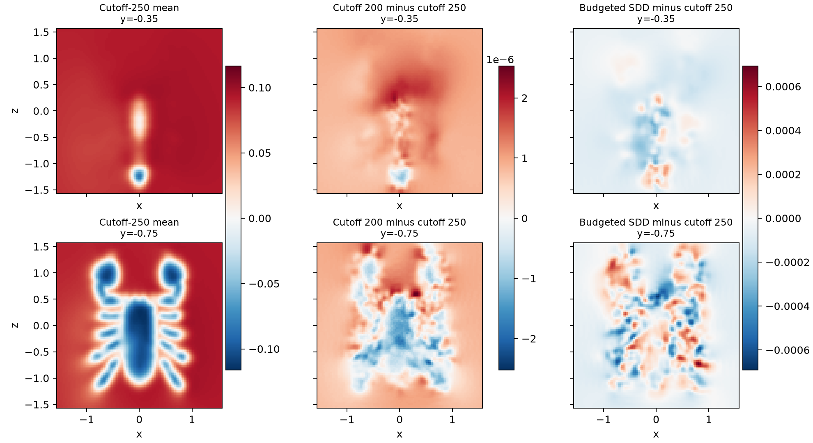
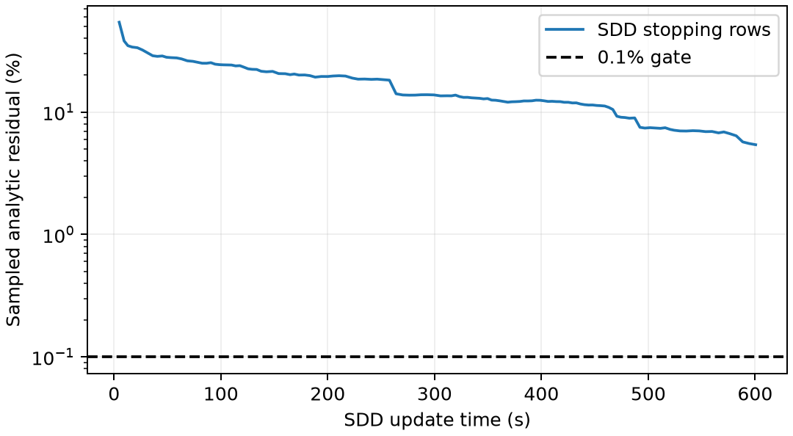

# Three-million-point full mean fitting

The restored input now has **full mean fits**, beyond the earlier preconditioner-action
profile. Both complete finite training cubes (cutoffs 200 and 250) pass the
independent sampled analytic residual gate. This is mean-fit evidence, not
covariance, coherent-sampling or complete-application validation.

[Protocol](PROTOCOL.md) · [Summary](summary.json) ·
[Source provenance](../large_inputs/README.md).

## Measured quality and cost

All three million distinct observations enter each solve. The methods share
noise variance .02, length scale .01, scalar/cross cutoff 50, centering on all
observations and 20,000 fixed slice queries. NUFFT conjugacy folding preserves
every mode of the stated finite training cube. SDD uses the full analytic kernel.

| Method | Fit through mean queries (s) | Holdout analytic residual 95% bootstrap interval | Residual gate | Sampled process GPU peak (GiB) |
| --- | ---: | ---: | ---: | ---: |
| half200 | 27.700 | 0.0592–0.0665% | pass | 5.11 |
| half250 | 29.745 | 0.0273–0.0310% | pass | 8.85 |
| sdd | 609.977 | 6.0046–10.2527% | FAIL | 12.02 |

The gate is an upper interval endpoint below .1%. The same 1,024 holdout rows
are independent of, and disjoint from, the 128 SDD stopping rows. Double
analytic covariance rows and matrix products are streamed in batches of 16.
The summarizer recomputes the bootstrap intervals from saved residuals/targets.
This empirical row-sampling interval is not a full-system norm bound.

- half200 versus cutoff 250: **0.001112%** relative L2 mean difference.
- sdd versus cutoff 250: **0.144699%** relative L2 mean difference.

SDD **already passes the displayed-mean gate** in this run despite failing the
training-residual gate. Its budget outcome must not be described as failure to
reconstruct the mean at the declared query accuracy. A fair mean/application
comparison should investigate earlier stopping based on the relevant output,
with independent confirmation; covariance and event tasks need their own checks.
[Issue #36](https://github.com/alecjacobson/fast-stochastic-psr/issues/36) tracks this distinction.



The difference columns use separate color scales, shared between their two slices.
These show direct mean fields only and do not replace the matched mean/variance
teaser. The scalar bandwidth and query geometry remain fixed.

The prospective paired-mean gate is .2%. Mean agreement alone does not replace
the analytic residual gate or establish covariance/application agreement.

### Post-hoc near-surface diagnostics

The global mean gate can also conceal local errors near the zero level set.
After inspecting the fit, we checked the 164 queries where the
cutoff-250 mean lies within two scalar-prior standard deviations of zero.
That prior standard deviation is 0.00169531 for the same stationary
cutoff-50 kernel; it is **not** the posterior uncertainty. These diagnostics
were not used to change the prospective gates or select a timing comparison.

| Method | Error / centered mean contrast | Sign differences over 20,000 queries | Near-zero RMS error / prior std | Near-zero max error / prior std |
| --- | ---: | ---: | ---: | ---: |
| half200 | 0.001850% | 0 | 0.000359 | 0.001107 |
| sdd | 0.240805% | 6 | 0.122578 | 0.325458 |

The six SDD sign changes and larger near-zero errors motivate independent
surface/probability checks before treating its global mean agreement as
application equivalence. Pointwise signs on this grid are not a continuous
surface or topology certificate; these numbers do not measure probability error.

NUFFT uses a requested CG tolerance of 1e-5; the actual recomputed finite-system
residuals are retained in each raw record and can exceed that requested value
within the existing solver's floating-point acceptance criterion of twice the
requested tolerance. The actual finite residuals here are about 1.38–1.79e-5.

## The bounded SDD comparison

SDD stopped with status `update_time_budget` after 16,640 iterations and 600.517s of updates. Compilation, stopping-row setup/checks, aggregation, centering and querying are included in its table cost; the update budget excludes those costs and can overshoot by one 128-step chunk.

The configuration transfers the best selected million-point setting: batch 512,
eta 5, learning rate `5*512/N`, seed 0, momentum .9 and Polyak .01. It compiles
the released update algebra, with existing upstream-equivalence tests; it is
not the untouched Python loop or a new three-million-point tuning sweep.
Its noise parameter is interpreted consistently as variance .02.



No timing ratio is eligible unless all three residual checks, both paired mean
checks and all whole-run isolation audits pass. For these records that combined
eligibility is **False**. GPU contention is retained in the process logs.
The measured budget outcome does **not** show that SDD is intractable: another
configuration or more update time could converge. It also does not establish
an upstream resource limit for posterior sampling or any downstream application.

## Timing and memory scope

Each method runs in a fresh process. Table costs include model/plan preparation,
solver work, centering and mean queries. Source loading/hash verification and
independent final validation are timed separately. SDD stopping machinery is
included in its fitting cost. Process imports/CUDA initialization are excluded;
on-disk compiler caches may already be warm. No historical-machine timing ratio
is used. There is only one fit per declared configuration, not repeated statistics.

GPU memory is sampled per process through nvidia-smi, including native allocations;
it can miss short-lived peaks and is not an exact peak-memory measurement.
Full source arrays and final weights live under `/opt/geospsr-runtime`, outside
Git. Their hashes are recorded; compact mean/residual panels are published.

## Reproduce

```bash
./reproduction/run_env.sh -m reproduction.prepare_large_cloud \
  --points 3000000 --output /opt/geospsr-runtime/large-cloud-3000000
./reproduction/run_env.sh -m reproduction.benchmark_large_fit \
  --source /opt/geospsr-runtime/large-cloud-3000000 --method half --cutoff 200 \
  --output /opt/geospsr-runtime/large-fit/half200
```

Preparation refuses to overwrite an existing input. Run cutoff 250 in a separate
output/process, then `--method sdd --time-budget 600` in another. Copy results.json
and fields.npz from all three outputs into the corresponding report folders and
run `reproduction.summarize_large_fit`. Do not substitute the much larger saved
weights for the compact published field panels.

Next: larger-scale coherent sampling, covariance/tail checks, downstream
application quality, and a stronger or extended SDD confirmation if needed.
[Issue #8](https://github.com/alecjacobson/fast-stochastic-psr/issues/8) remains open.
The **13 targeted tests pass** ([log](tests.log)), including compiled SDD equivalence to the pinned upstream loop and folded-spectrum covariance checks.
