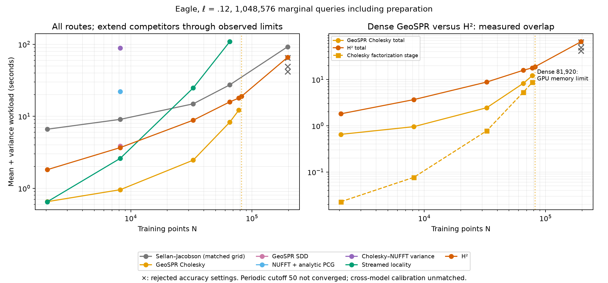

# Extending the matched-width sweep through the dense limit

The [first matched-lengthscale report](../matched_lengthscales/README.md)
stopped its coarse-scale N sweep at 32,768. That showed an H²/locality runtime
crossover but did **not** test a dense-GeoSPR/H² crossover. This follow-up
extends the same physical lengthscale (.12), nested Eagle
points and 1,048,576-query workload. Totals include preparation, mean, marginal
variance, CDF and ambiguity evaluation. Common runtime warmup and independent
accuracy audits are excluded consistently. Production settings are retained
except for explicitly reported changes to the variance iteration budget and
hierarchy tolerance where the initial settings fail the output gates.



**No dense-GeoSPR/H² runtime crossover was observed before dense GPU memory
ran out.** At N=65,536 the totals are 8.274 s for dense and 15.848 s for H²;
at N=77,824 they are 12.164 s and 17.888 s. At N=81,920, dense fails allocating
its 25 GiB matrix while H² completes in 18.913 s and passes its accuracy gate.
This is an observed capacity advantage, not a measured wall-clock win against
a completed dense run at that N.

| N | H² seconds | Dense GeoSPR seconds | Original SPSR seconds | Locality seconds |
|---:|---:|---:|---:|---:|
| 32,768 | 8.832 | 2.460 | 14.900 | 24.783 |
| 65,536 | 15.848 | 8.274 | 27.315 | 108.820 |
| 77,824 | 17.888 | 12.164 | — | — |
| 81,920 | 18.913 | allocation failure | — | — |
| 196,608 | **65.898** | — | **92.480** | — |

The accepted 196k H² result uses 16 variance iterations and hierarchy tolerance
1e-6; the smaller H² points use eight iterations and 1e-5. See the rejected
trials below. H² is **6.87× faster than same-model locality at 65k**. The
locality crossover is bracketed by 8,192 (locality faster) and 32,768 (H²
faster). At 196k the original matched-grid workload takes 1.40× the accepted
H² time, but cross-model calibration is still unmatched.

Dense factorization alone grows from .780 s at 32,768 to 5.307 s at 65,536
and 8.670 s at 77,824. Its increasing cost is visible, but the GPU reaches
its capacity boundary before that cost overtakes the complete H² workload.
Measuring the runtime crossover requires a larger-memory GPU or a separately
labeled out-of-core dense implementation; it cannot be manufactured by
counting a failed allocation as an infinite runtime.

The measured factorization slope is **2.78** over 32k–78k. Over the accepted
32k–196k points, H²'s total-time fit is **1.13**, including the stricter 196k
settings. Original fixed-grid SPSR's fit is **1.03**: with grid resolution held
fixed it is also roughly linear in N here, so this is not evidence of an
N-asymptotic H² advantage over that coarse original model. Locality's adjacent
32k→65k slope is **2.13**. These finite-range fits have few points and are not
limiting complexity proofs.

These remain matched-vector-kernel-width comparisons. The original grid is
14 × 22 × 17 at every N; the periodic methods retain finite cutoff 50; the
free-space methods retain their radial Matérn model. Same-model numerical
accuracy is checked, but probability calibration is not matched across models.
The earlier bandwidth and original normalization findings remain in force.

## Numerical checks and resources

The existing gates are unchanged: CDF error ≤ .001 and variance error / prior
≤ 1e-4. H²/locality use independent uncompressed cross kernels and full-float64
kernel residual bounds. Dense GeoSPR uses a separate tiled full-kernel audit
near device capacity. A failure of the convenient *offline reference* after
production queries finish is not treated as a production memory failure:
the raw failure is retained and the independent audit must pass before the
production timing enters the plot.

This machine provides a 24 GB GPU partition, 16 GiB host memory and four CPU
cores. Original-method runs retain the 12 GiB virtual-address guard. Memory
failure is reported separately from runtime crossover; unsuccessful jobs have
no invented completion time. All runs are sequential.

## Reproduction

```bash
./reproduction/run_env.sh -m reproduction.run_matched_crossover
./reproduction/run_env.sh -m reproduction.run_matched_crossover --sizes 65536 --methods original sparse-streamed
./reproduction/run_env.sh -m reproduction.run_matched_crossover --sizes 196608 --methods h2-streamed original
./reproduction/run_env.sh -m reproduction.refine_matched_crossover
./reproduction/run_env.sh -m reproduction.report_matched_crossover
```

The runner copies every production parameter from the earlier coarse-scale
records, changing only N and output path. The separate refinement script tries
16 and then 32 variance iterations after an eight-iteration audit fails,
then repeats those budgets with hierarchy tolerance 1e-6 if needed, retaining
each attempt. This is offline benchmark tuning, not a certified
production stopping rule; the failed pilot and reference work are not included
in the final configured run's timing. Each status records its command,
source hashes, return code and wall time. Original NPZ grids are preserved.
`summary.json` pins accepted records, separate audits and original fields;
it reports observed paired speed ratios, finite-range slopes and rejected or
resource-limited results. The original coarse records and small-N SDD/NUFFT
measurements are reused rather than rerun.

## Accuracy at the larger endpoint

At N=196,608 the original eight-iteration H² run completes in 41.654 s but
fails both numerical gates. Merely increasing the variance solve budget is
insufficient:

| H² tolerance | Variance iterations | Total seconds | Max CDF error | Max variance error / prior | Accepted |
|---:|---:|---:|---:|---:|---|
| 1e-5 | 8 | 41.654 | .001640 | .001221 | no |
| 1e-5 | 16 | 49.107 | .001958 | 8.815e-6 | no |
| 1e-5 | 32 | 64.806 | .001960 | 1.170e-6 | no |
| 1e-6 | 16 | **65.898** | **.000160** | **7.966e-6** | **yes** |

The variance error falls, but probability error reaches a floor. These
completed-but-inaccurate timings are retained as crosses, excluded from fits
and speed ratios. This reinforces the need to control both solve error and
hierarchical operator error as N grows, tracked in
[#79](https://github.com/alecjacobson/fast-stochastic-psr/issues/79) and
[#80](https://github.com/alecjacobson/fast-stochastic-psr/issues/80).

Tightening the hierarchy resolves the probability error floor in this case.
The largest hierarchy rank increases from 210 to 285; mean conditioning takes
62 iterations in both trials. Thus neither iteration count nor rank is assumed
constant in the accepted timing curve. No noise level or output gate changed.

Validation: all seven newly accepted accelerated results pass independent
own-model audits. The full-million-query H²/locality comparison at 65k passes
(max CDF difference .0002058, variance difference/prior 7.318e-8). All 28
numerical regression tests pass. `summary.json` contains 24 accepted records
(15 reused) and four excluded records: the dense allocation failure and three
completed but inaccurate H² trials. Reference bounds at 196k contribute less
than 1e-11 to the CDF audit. These sampled checks do not certify uniform error
over the entire query box.
