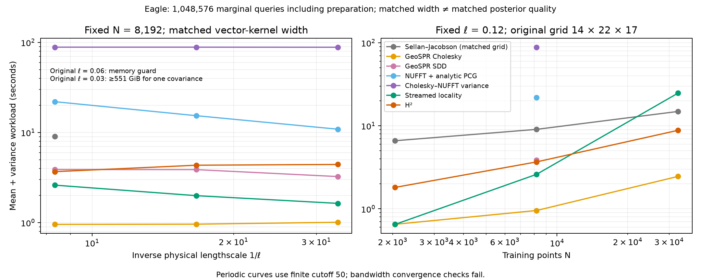
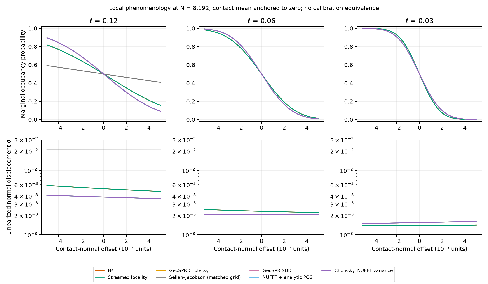

# Eagle with matched interpolation widths (follow-up to PR #106)

The [larger-N continuation](../matched_crossover/README.md) now extends this
coarse-scale sweep through the dense GPU memory boundary and to N=196,608.
Dense remains faster at the largest completed overlap; H² continues beyond
the allocation limit. The continuation retains failed H² accuracy trials
and includes the stricter settings needed at the largest point.

This comparison chooses the original Sellán–Jacobson grid from a physical
kernel width rather than fixing it arbitrarily at 16³. All production times
include preparation, **mean and marginal variance**, CDF and ambiguity scores
for 1,048,576 queries (16 × 65,536), using the existing Eagle contact region.
Joint collision probabilities are not measured.

**Matching vector-kernel width does not establish equal posterior quality.**
The original density-lumped, finite-domain PDE model, periodic GeoSPR model,
and free-space Matérn model retain their different conditioning, boundaries,
normalizations and uncertainty conventions. We report numerical accuracy
within each model separately from cross-model surface/uncertainty diagnostics.

## Relation to GeoSPR

[GeoSPR Appendix C / Figure 16](https://arxiv.org/pdf/2503.19136#page=15)
approximately matches interpolation lengthscales despite the different
kernels, then halves the scale between rows. Appendix C also describes
oversmoothing at 25³ in its original-SPSR sampling example and the memory
obstacle to a 100³ covariance. We follow the matched-scale strategy, not an
assumed universal grid size. The half-correlation matching formula below is
our explicit convention, not a formula reported in that paper.

The paper reports Matérn parameters κ between .01 and .04. In the
[released example](https://github.com/sholalkere/GeoSPSR/blob/2352f1ef98aab20e0303611c1fa2b0948acd2a05/experiments/example.py),
the longest object dimension is π, while the kernel uses coordinates divided
by 2π. Our longest object dimension before rotation is 2. Matching relative
physical scales therefore maps our ℓ to κ = ℓ/4 in that example's coordinates:
.12 → .03, .06 → .015, .03 → .0075. The two coarse cases lie in the paper's
reported range; our existing fine case is slightly below it. This does not
claim an exact reproduction of Figure 16's unreported grid settings.

## Grid selection

The unmodified gpytoolbox 0.3.8 implementation uses a tensor-product cubic
B-spline vector kernel with width **s = 1.5 min(h)**. Its `sigma=.05` argument
controls covariance amplitude, not this width.
[Source and API](https://gpytoolbox.org/latest/stochastic_poisson_surface_reconstruction/)

On a coordinate axis, normalized correlation reaches 1/2 at:

- cubic B-spline: r = 0.7223517245 s;
- Matérn-3/2: r = 0.9689940865 ℓ.

Equating these gives **s = 1.3414435844 ℓ** and **h = 0.8942957229 ℓ**.
The test evaluates the actual installed original kernel, not just a second
copy of the matching expression. Periodic Matérn uses ℓ/(2π) as its parameter;
its periodic correction at these short scales is negligible for this width
convention. Product and radial kernels still differ off the coordinate axes.

Bounds come from the full scan plus .1 padding, independently of training N.
Use isotropic spacing, `gs = ceil((upper-lower)/h)+1`, and symmetric outward
rounding of the box. This adds less than half a cell on each side. Keeping
these grids fixed while varying N measures fixed-detail observation scaling;
the separate ℓ sweep measures increasing spatial detail.

| Physical ℓ | Isotropic grid | h | Grid points G | One float64 G × G array |
|---:|---:|---:|---:|---:|
| .12 | 14 × 22 × 17 | .10731549 | 5,236 | .204 GiB |
| .06 | 27 × 42 × 32 | .05365774 | 36,288 | 9.811 GiB |
| .03 | 52 × 83 × 63 | .02682887 | 271,908 | 550.851 GiB |

The original 16³ Eagle baseline has half-correlation radius .0982932, compared
with .0290698 for ℓ=.03: **3.381× broader**. The old data remain unchanged in
the historical report; they are not substituted into this matched-width plot.

The middle grid was actually attempted and failed allocating its 9.81 GiB
dense covariance under the existing 12 GiB address-space guard (the VM has
16 GiB host RAM). Other structures already occupy memory. The finest grid
was not attempted because one covariance alone exceeds the cap. This is a
limit of the full-covariance implementation on this VM, not an impossibility
result for all SPSR implementations or its subspace route. Subspace accuracy
remains open in [#70](https://github.com/alecjacobson/fast-stochastic-psr/issues/70).

## Results and diagnostics



At N=8,192, total seconds are:

| Method | ℓ=.12 | ℓ=.06 | ℓ=.03 |
|---|---:|---:|---:|
| Original full-covariance SPSR | 9.068 | memory guard | not attempted: covariance lower bound |
| GeoSPR dense Cholesky | .956 | .961 | 1.009 |
| GeoSPR SDD | 3.882 | 3.875 | 3.245 |
| NUFFT + analytic PCG | 21.988 | 15.370 | 10.887 |
| Cholesky–NUFFT variance | 88.550 | 88.545 | 88.371 |
| Streamed locality | 2.606 | 1.991 | 1.635 |
| H² | 3.676 | 4.337 | 4.422 |

The coarse fixed-detail N sweep gives:

| N | Original SPSR | GeoSPR Cholesky | Locality | H² |
|---:|---:|---:|---:|---:|
| 2,048 | 6.613 | .652 | .650 | 1.813 |
| 8,192 | 9.068 | .956 | 2.606 | 3.676 |
| 32,768 | 14.900 | 2.460 | 24.783 | 8.832 |

At 32k, H² is **2.81× faster than locality within the same model** and takes
less time than the original matched-grid route. Dense GeoSPR is still faster
where it fits. This small-N sweep includes appreciable setup overhead and
does not establish limiting asymptotic slopes; the large-N comparison remains
in the earlier report. We do not claim an equivalent-calibration H²/original
speedup from these timings.



The diagnostic uses surface samples after index 32,768, excluded from every
training set in this sweep, within the .005 contact halfwidth. It also excludes
the anchor used to set the mean isovalue. Root displacement and normal alignment
measure local surface agreement. These few local samples are not a global
reconstruction benchmark or a ground-truth probability distribution.
Variance divided by squared field gradient gives a local spatial uncertainty
scale; raw implicit-field variances have model-dependent units.

At N=8,192 there are **15 held-out local samples**, with no missing surface
roots in any of the reported fields:

| Physical ℓ | Model | RMS x-direction surface-root error | Median linearized spatial σ |
|---:|---|---:|---:|
| .12 | Original SPSR | .001381 | .021028 |
| .12 | Free-space H² | .001377 | .005314 |
| .12 | Periodic GeoSPR Cholesky | .001072 | .003916 |
| .06 | Free-space H² | .001254 | .002345 |
| .06 | Periodic GeoSPR Cholesky | .000991 | .002042 |
| .03 | Free-space H² | .001133 | .001380 |
| .03 | Periodic GeoSPR Cholesky | .000945 | .001520 |

The matched coarse original and H² fields have almost identical local surface
error, but the original's spatial uncertainty is about **3.96× wider**. This
supports comparable local geometry, not equivalent uncertainty calibration.
One additional confound is the original kernel's density normalization:
with `sigma=.05`, its vector-prior diagonal is `.05² (2/3)³ / s³`, approximately
.177585 at ℓ=.12, versus .0025 for our Matérn model. Halving ℓ multiplies that
original diagonal by eight. The mean, density-lumped conditioning, scalar
variance floor and boundary conditions also differ. We retain the original
defaults here and do not tune them to the 15 diagnostic samples.
[Issue #107](https://github.com/alecjacobson/fast-stochastic-psr/issues/107)
tracks a separately labeled normalization-aware control and calibration checks.

**Periodic bandwidth is still not converged at the coarser scales.** Direct,
uncompressed 73-probe comparisons at N=8,192 give:

| ℓ | Cutoff change | Max CDF difference | Max variance difference / higher-band prior |
|---:|---|---:|---:|
| .12 | 50 → 75 | .114836 | .0007721 |
| .12 | 75 → 100 | .035976 | .0001272 |
| .06 | 50 → 75 | .173246 | .0049143 |
| .06 | 75 → 100 | .062116 | .0009993 |

All fail the .001 CDF / 1e-4 variance/prior thresholds. Smaller prior-normalized
variance changes can still substantially affect CDFs when posterior variance
is small. The timing curves retain cutoff 50 consistently and describe that
finite-band model, not a converged periodic reconstruction. These results
extend [#105](https://github.com/alecjacobson/fast-stochastic-psr/issues/105).

Validation: **28 numerical tests pass; all 14 full-million-query comparisons
pass.** Every completed accelerated run also passes its own-model probe gate;
free-space references use bounded full-kernel residual checks. There are 27
completed main-sweep records (six reused), one actual original memory failure,
and one original preflight resource exclusion. The bandwidth failures are
model-convergence diagnostics, not passing accuracy checks.

## Reproduction and provenance

```bash
./reproduction/run_env.sh -m reproduction.run_matched_lengthscales
./reproduction/run_env.sh -m reproduction.check_matched_bandwidth
./reproduction/run_env.sh -m reproduction.report_matched_lengthscales
./reproduction/run_env.sh -m pytest tests/test_matched_lengthscale.py tests/test_eagle_comparison.py tests/test_scaling_reference.py tests/test_variance_series_gpu.py tests/test_reference_bounds.py tests/test_targeted_reference.py -q
```

Run benchmarks sequentially on an otherwise idle device. The runner enforces
600-second limits and records original-method memory failures separately from
completion times. Original gpytoolbox, solver parameters and noise settings are
unchanged; only its grid selection changes. Other methods retain the previous
production settings, varying physical lengthscale and, in the coarse N sweep,
training count. No numerical acceptance threshold is relaxed.

`manifest.json` pins job settings, source hashes, calculated grids and raw result
hashes. Six existing ℓ=.03 accelerated results are reused with exact hashes:
the new original-grid branch does not execute on those routes. `summary.json`
also pins original NPZ grid fields and the analysis sources. `checks/` contains
full-query comparisons; free-space raw records include independent bounded
full-kernel reference audits. `bandwidth_checks.json` compares direct periodic
moments between cutoffs, outside production timings. `phenomenology.json`
contains the held-out sample indices, cloud hash, geometry metrics and profiles.

The separate [large-N report](../asymptotic_regimes/README.md) continues to
support the same-model H²/locality asymptotic comparison. This smaller matched
width experiment does not replace its large-N evidence.
