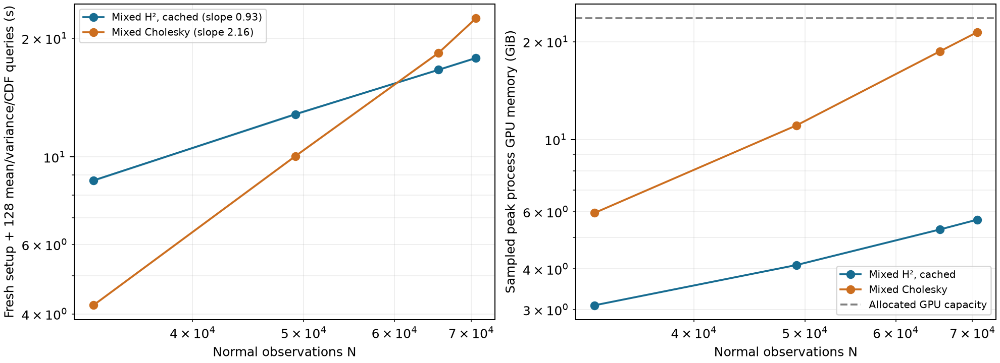

# Mixed H² crosses mixed Cholesky before the memory limit

On the fixed real Armadillo partial-scan mean-and-variance task, mixed H² now beats the stronger mixed-precision Cholesky baseline while **both fit in GPU memory**. Three independent runs per method and size bracket the runtime crossover between **49,152 and 65,536 normal observations**. At all **70,652** available observations, H² takes **17.82 s** versus **22.46 s**, a **1.26× speedup**, with sampled peaks **5.67 versus 21.38 GiB** on a 23.63 GiB GPU allocation. All primary runs pass the unchanged full-kernel output gates. This addresses [#121](https://github.com/alecjacobson/fast-stochastic-psr/issues/121) and advances the H² part of [#87](https://github.com/alecjacobson/fast-stochastic-psr/issues/87).



## Fixed task, timed work and repetitions

The inputs are actual Stanford Armadillo laser scans, using the same nested `test_side` group (views 60/90/120) as [PR118](../real_partial/README.md) and [PR120](../partial_competitors/README.md). There are no duplicated observations or synthetic size extensions. Every method conditions on N normal observations and the same 32 scalar contacts, then evaluates **128 fixed held-out marginal means, variances and inside probabilities**. Contact locations come from the full group, independent of N. The query indices are unchanged, evenly spaced through the retained 6,074-query panel.

The free-space GP, lengthscale .48, vector amplitude 1/3, normal noise variance .04, scalar noise variance .0001, zero scalar targets and validation-fitted probability calibration are fixed. Gates require finite means, positive finite variances, maximum variance/prior error ≤1e-4, raw CDF error ≤1e-3 and calibrated CDF error ≤1e-3. These are numerical-agreement gates on this panel, not a certificate of real-world calibration. No variance clipping, noise inflation, spatial interpolation or physical-model retuning is used.

Times include **fresh hierarchy/factor setup, all mean/contact solves, all query variance work, residual corrections, scalar conditioning and raw CDF evaluation**. Common scan loading/preparation and CUDA initialization are excluded. The calibrated CDF is an additional accuracy check outside the timer. Independent reference construction and configuration trials are validation work, not included in production timing for either method.

| Normal observations | Mixed Cholesky median (range), s | Mixed H² median (range), s | Cholesky / H² |
|---:|---:|---:|---:|
| 32,768 | 4.206 (4.205–4.206) | 8.715 (8.693–8.717) | 0.48× |
| 49,152 | 10.042 (10.038–10.042) | 12.827 (12.806–12.893) | 0.78× |
| 65,536 | 18.352 (18.335–18.456) | 16.630 (16.626–16.635) | 1.10× |
| 70,652 | 22.460 (22.456–22.489) | 17.819 (17.781–17.845) | 1.26× |

All H² entries use the same final recipe: float32 cached hierarchy/AFN actions, float64 refinement, H² tolerance 1e-6, **ten variance iterations**, mean/contact tolerance 1e-9, AFN rank 100 and 80 neighbors, leaf size 40, solve RHS blocks 72 and query batches 96. Cholesky uses PR120's float32 factor plus full float64-kernel residual-corrected joint moments, charging both triangular solves and the exact residual action. The three 32k dense controls are reused from PR120 on the same GPU instance; all other primary measurements are new, with H² and dense interleaved within each repeat at 49k–70k.

The four-size log–log fits give **0.93 for H² and 2.16 for mixed Cholesky**. These are empirical trends over about a factor of two in N. They are consistent with the intended scaling advantage but are not asymptotic proofs: ranks and iteration counts can change in other regimes. Mixed precision changes practical constants, not the hierarchical algorithm's complexity class. Dense still has cubic factorization and quadratic storage, with additional quadratic full-kernel residual work for this fixed RHS count. The observed crossover does not require an out-of-memory event or host paging.

## Accuracy, memory and probability quality

Errors below are worst across the three repeats; memory is the median sampled process peak. Peaks include workspaces and the float64 correction path and may miss allocations shorter than the 0.1-second sampling interval.

| N | Method | GPU GiB | Host RSS GiB | Max raw CDF error | Max calibrated CDF error | Max variance/prior error |
|---:|---|---:|---:|---:|---:|---:|
| 49,152 | Mixed H² | 4.11 | 1.04 | 3.82e-4 | 5.63e-4 | 3.44e-7 |
| 49,152 | Mixed Cholesky | 11.05 | 1.19 | 1.79e-5 | 2.29e-5 | 1.29e-6 |
| 65,536 | Mixed H² | 5.29 | 1.07 | 4.04e-4 | 3.87e-4 | 7.08e-7 |
| 65,536 | Mixed Cholesky | 18.66 | 1.25 | 3.17e-5 | 3.53e-5 | 1.75e-6 |
| 70,652 | Mixed H² | 5.67 | 1.08 | 2.98e-4 | 6.88e-4 | 1.03e-6 |
| 70,652 | Mixed Cholesky | 21.38 | 1.52 | 3.97e-5 | 4.22e-5 | 1.95e-6 |

Both methods meet the same tolerances; Cholesky's CDF errors are smaller. At 70k, H² uses **3.77× less GPU memory**. This is an advantage of the whole hierarchical representation, not a claim that mixed precision always reduces total H² memory: at 49k, cached float64 H² peaks at 3.99 GiB and mixed H² at 4.11 GiB because the latter retains a float64 correction path.

On the fixed 128 labeled queries, raw/calibrated Brier scores at 70k are **.120668/.116605 for H²** and **.120679/.116615 for dense**. At 32k they are approximately .08577/.09325 for both. Numerical agreement is strong, but adding observations does not monotonically improve this model's held-out probability quality. These scores inherit the original study's uncertain mesh labels, scan correlations and calibration limitations. They do not establish that full posterior variance is necessary for the application: the earlier cheap contact-only variance control captured much of its benefit, and that question remains open.

## Separating precision from caching

A single-process-run factorial control at N=49,152 uses eight variance iterations in all four cells. All four pass the full-kernel gates.

| H² actions/storage | Streamed interactions (256 MiB workspace), s | Cached interactions, s |
|---|---:|---:|
| Float64 | 25.567 | 24.118 |
| Mixed float32 | 14.017 | 12.163 |

Caching alone gives only about 1.06× here. Mixed actions give 1.82× in streamed mode and 1.98× in cached mode; both changes together give 2.10×. The final primary curve uses ten iterations at every N and should not be mixed with these eight-iteration ablation timings when fitting a slope.

The optional `GPUHierarchicalSystem(..., dtype='float32')` stores/applies transfers, interaction values and AFN factors in float32. Geometry and kernel entries are computed in float64 before storage rounding. PCG state, dot products, solution updates and moment accumulation remain float64. Mean/contact solves use iterative refinement with residuals from a float64 action of the **same represented hierarchy**. Variance uses fixed-budget mixed PCG followed by a fresh float64 hierarchy residual for the residual-corrected reduction.

The correction action keeps float64 transfers and streams interaction values within a bounded workspace; it does not duplicate a full cached interaction matrix. It does not remove hierarchy approximation error. Independent full-kernel output checks remain necessary. Default H² behavior stays float64, and the NUFFT route remains available.

## Failed pilots and independent large references

The eight-iteration mixed recipe passes at 49k but fails the calibrated CDF gate at 65k/70k (errors .001461/.001510). Tightening the hierarchy tolerance to 1e-7 with the same eight iterations still fails (.001466/.001604), while increasing cost. Ten variance iterations at the original hierarchy tolerance 1e-6 passes at both sizes. All four failed trials are retained and excluded from the accepted curve. Configuration selection used independent reference outputs, so the result establishes a validated recipe for this workload, not an automatic stopping rule for arbitrary scans.

The larger references are independent of H². They factor the full normal covariance in float32, solve all 483 RHS columns (three components at 160 contact/query locations, plus three normal-data columns), and refine with **full float64-kernel actions**. Each stage constructs residual-corrected joint moments before scalar conditioning. Acceptance requires maximum relative residual ≤1e-9 and raw/calibrated CDF changes ≤1e-6. No float64 N-by-N matrix is allocated.

| Reference N | Validation time, s | Final max relative residual | Final joint-reduction entry diagnostic |
|---:|---:|---:|---:|
| 49,152 | 33.09 | 5.59e-10 | 6.07e-14 |
| 65,536 | 57.97 | 9.20e-10 | 2.20e-13 |
| 70,652 | 83.82 | 1.32e-11 | 4.85e-17 |

At 49k this procedure agrees with the retained independent float64-factor oracle within **5.2e-12 in calibrated CDF** and 1.2e-14 in variance/prior. The final raw/calibrated probability changes at the larger sizes are about 6e-12. The recorded residual-based entry diagnostic concerns the joint reduction **before scalar conditioning**; it is not asserted as a rigorous bound on the final CDF. Reference times above are validation costs, not the dense competitor timings in the primary table.

## Scope and remaining comparisons

This is a practical **fresh-posterior, sparse-query, variance-involved runtime crossover** against the strongest dense recipe tested so far. It also provides a better empirical trend over the measured interval. It is not yet the broader all-alternatives demonstration: mixed locality/sparse controls remain in #87, while original Sellán–Jacobson and periodic GeoSPR/NUFFT require application-quality comparisons across their differing models/discretizations. The previously tested same-kernel SDD takes 98.92 s at 49k; it was not rerun at 65k/70k, and untested SDD configurations are not ruled out. This report does not concern one million queries, a whole-object regional variance cache, or joint collision probabilities/coherent samples.

## Reproduction and audit

Use the pinned runtime and prefix-kd extension described in [PR120's report](../partial_competitors/README.md). The hardware is an RTX PRO 6000 Blackwell Server MIG 1g.24gb with 23.625 GiB available, CPU quota four cores, and a 16 GiB host limit; see [environment.json](environment.json). GPU jobs ran sequentially, and every trial passed sampled process isolation.

Representative commands follow. Use new output paths: the driver refuses to overwrite records. The retained reference files are already included. To regenerate a reference, first move its matching JSON/NPZ pair aside and write the new pair at the canonical `reproduction/results/mixed_h2/reference-N.json` path before running dependent competitors.

```bash
./reproduction/run_env.sh -m reproduction.partial_mixed_h2 --method reference --n 49152 --output /tmp/reference-check-49152.json
./reproduction/run_env.sh -m reproduction.partial_mixed_h2 --method h2 --n 70652 --dtype float32 --storage cached --iterations 10 --output /tmp/h2-70652.json
./reproduction/run_env.sh -m reproduction.partial_mixed_h2 --method dense --n 70652 --dtype float32 --output /tmp/dense-70652.json
./reproduction/run_env.sh -m reproduction.report_mixed_h2
```

[summary.csv](summary.csv) audits **36 new trials: 32 accepted, four rejected**, plus three reused accepted 32k dense controls. It recomputes final field gates and Brier scores, checks data/reference/source hashes, reference convergence, uniform primary H² settings and sampled GPU isolation. [primary.json](primary.json) supplies the plotted medians, ranges, memory and worst errors; both PNG and PDF plots are retained. Each raw trial binds its exact measured source snapshots and its input/reference contract. Historical PR118/PR120 artifacts are unchanged.

Regression checks passed **27 distinct tests**, including mixed cached/streamed actions, refined solves, dense augmented-Gaussian probability agreement, default H²/locality behavior, scalar conditioning and NUFFT evaluation. The two mixed tests were rerun after extending the blocked float32-basis projection checks; both passed. Native tests here use the installed prefix-kd extension, not the unavailable default native extension. Development failures and successful test logs are retained. Final source changes after benchmarking add invalid-moment guards and ensure float64 accumulation for caller-supplied float32 projection bases; the measured direct-query inputs/algorithms are unchanged. The manifest records final sources separately from each trial's measured sources.
