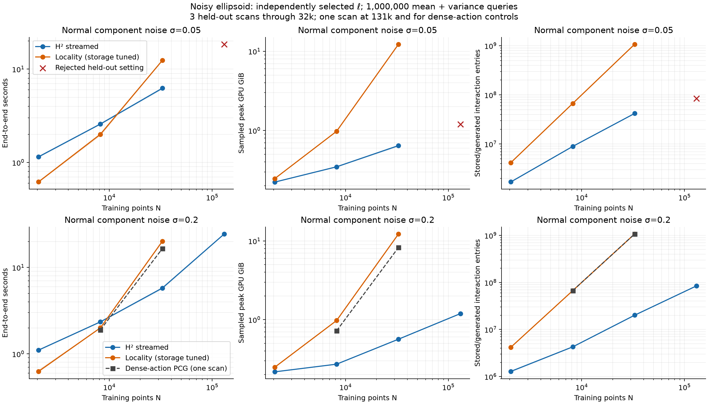
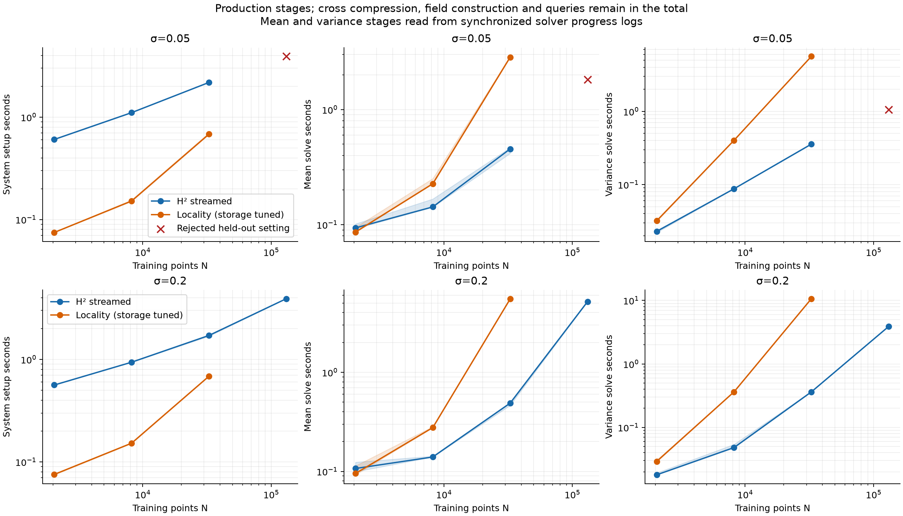
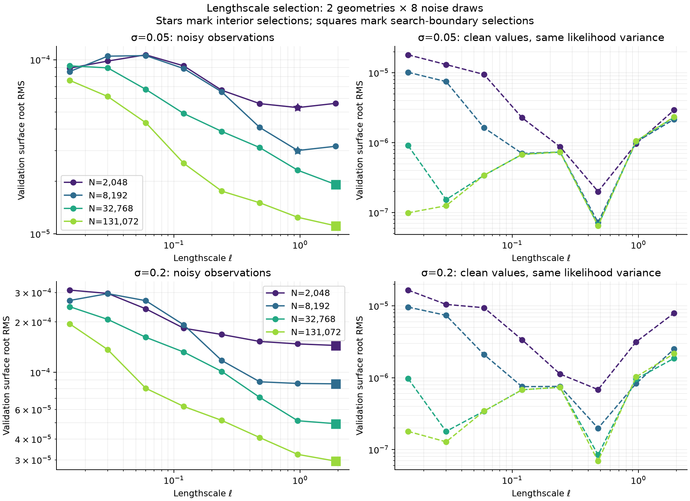
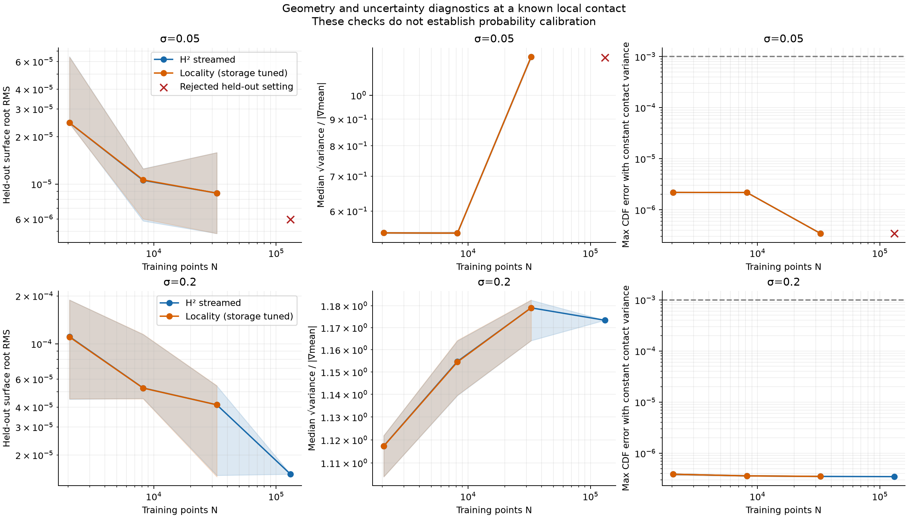

# Noise-selected smoothing: H² versus locality

This experiment asks whether noisy normals lead to a useful smoothing regime
where locality must retain growing neighborhoods and H² can separate from it.
The task includes model preparation, mean conditioning, marginal variance-cache
construction and **1,000,000 mean-and-variance queries** in five new batches.
It is a local contact-region experiment, not a global reconstruction or a joint
collision-probability benchmark.

**There is a measured computational crossover, but the application still does
not require posterior variance at the tested CDF resolution.** At 32k, H² is
**1.99× faster at σ=.05 and 3.47× faster at σ=.2** than tuned cached locality.
Its variance-solve stage is **15.8× / 29.4× faster**, respectively. A stronger
float64 dense-action control also loses to H² at 32k, by **2.91×** on the same
held-out high-noise scan. Locality and dense actions win at the smaller sizes.



| N | ℓ at σ=.05 / .2 | H², σ=.05 | Locality, σ=.05 | H², σ=.2 | Locality, σ=.2 | Dense actions, σ=.2 |
|---:|---:|---:|---:|---:|---:|---:|
| 2,048 | .96 / 1.92 | 1.150 | .619 | 1.106 | .627 | — |
| 8,192 | .96 / 1.92 | 2.581 | 2.005 | 2.349 | 2.002 | 1.897 |
| 32,768 | 1.92 / 1.92 | 6.240 | 12.400 | 5.784 | 20.099 | 16.510 |
| 131,072 | 1.92 / 1.92 | 18.492† | — | 24.440‡ | — | stopped |

All numbers are **seconds including mean and variance**, not mean-only times.
H²/locality values through 32k are medians of three independent scans; dense
controls and 131k H² are single-scan results. The dense/H² ratio uses the same
seed's H² time of 5.678 seconds, rather than the three-scan median.

† The largest low-noise H² run passes the original CDF/variance gates but fails
the additional mean-geometry diagnostic: 1.79e-6 versus a 1.11e-6 budget. It
is a red cross in the plots and is **excluded from accepted fits and speedups**.
No post-test retuning replaces that failure. Overall, 37 of 38 primary records
pass the full acceptance policy.

‡ The largest high-noise H² run passes its independent full-kernel probe audit
and mean diagnostic. Its dense opponent was stopped, so it has **no full-million
query numerical comparison with a completed opponent**. Its full-query shape,
positivity and constant/prior-variance diagnostics are single-field evaluations,
not an accuracy comparison against itself. The 18 completed H²/locality scan
pairs and two dense/H² pairs do have full-million-query comparisons.

The dense control confirmed a crossover at 32k; larger jobs were stopped under
the user's competitor stopping rule. The low-noise 131k attempt was terminated
after 366.7 seconds of worker wall time, and the next high-noise job before
substantive work. Neither produced an accepted result. These are intentional
stops, **not 600-second timeouts or completed timing lower bounds at verified
accuracy**. They are not plotted or used to claim a larger speedup.

At 32k the median sampled GPU peak is **.645 / .564 GiB for H²** at low/high
noise, versus **12.291 GiB for cached locality**. Dense actions use 8.277 GiB
on the high-noise control. Thus locality's memory advantage from the shrinking-ℓ
Eagle experiment does not carry over to this broad-kernel regime.

## Measured growth and variance work



The shortest tested accepted radius retains **every pair** at every completed
locality size. Its interaction count is exactly N². At σ=.2, the H² interaction
count grows from 1.29 million at 2k to 84.68 million at 131k, a fitted exponent
**1.02** (or **1.08** over 8k→131k). This is the expected near-linear versus
quadratic work separation in this regime. Entry counts exclude H² transfer
operations and are not an exact FLOP count; total timings include those costs.

For σ=.2, the end-to-end H² fit is **0.73** over 2k→131k and **0.85** over
8k→131k. Locality's fit is **1.25** over its completed 2k→32k range; dense actions
give **1.56** over 8k→32k (only two points). Setup and shared regional compression
flatten the total-time slopes, so these do not prove sublinear H² complexity or
show a fully quadratic total runtime yet. The variance-only solve fit over the
**common 2k→32k range** is **1.09 for H² versus 2.13 for locality**. For σ=.05
the corresponding variance fits are .99 versus 1.87. These are finite-range
empirical fits with tuned tolerances, not fixed-rank asymptotic proofs.

At high-noise 32k, the median variance solve is .363 seconds for H² versus
10.645 seconds for locality; both spend about 3.2 seconds in cross compression.
At 131k, H² spends 3.91 seconds in setup, 11.41 in cross compression, 5.16 in the
mean solve, 3.90 in the variance solve, and .052 across the million queries.
The high-noise mean iteration count grows from 13 to 140 and the variance budget
from 8 to 32. Increasing input noise does not automatically reduce iteration
counts for the chosen preconditioner. Variance work is measured explicitly and
is not assumed constant with N.

## Model selection and application quality



The noisy scans select ℓ=.96–1.92, while clean values with the **same positive
likelihood variance** prefer ℓ=.48. At 131k, the original selection scores improve
by 5.53× / 4.64× relative to ℓ=.12√(8192/N), for low/high noise. Refinement retains
the winning lengthscale; the final 1e-9→1e-11 hierarchy check changes these scores
by less than .005%. The primary 1e-7 curves remain in the figure, including the
earlier 1.44% score discrepancy. Six of eight choices are at the upper search
boundary and are **best tested values**, not established optima. Clean data
already favor broad smoothing on this simple shape; noise is not the only cause.
The clean curves' tiny high-N errors are diagnostic: the extra precision check
targets the noisy winners and runners-up, not a certified clean-data optimum.



At high-noise 32k, median surface RMS is 4.135e-5 for both H² and locality; at
low-noise 32k it is about 8.75e-6. All evaluated surface roots are found. The
largest accepted H² scan has RMS 1.515e-5. These are local, anchored surface
diagnostics, not a global mesh evaluation.

**The variance-necessity negative control fails.** Across all measured H² fields,
replacing posterior variance with the prior changes marginal CDF values by at
most **5.29e-4**, below the .001 application threshold. Using constant contact
variance changes them by at most **2.24e-6**. This does not meet the much stricter
variance/prior numerical gate, but it shows that the application's CDF accuracy
does not require accurate posterior variance here. Brier scores are .2481–.2491,
close to the uninformative .25 score, and the linearized spatial uncertainty is
roughly .54–1.19 in a box of halfwidth .005. Broader smoothing improves surface
mean accuracy without establishing useful calibrated uncertainty.

The result therefore supports a broad-kernel H² **computational** win, including
variance preparation, while the practical variance-essential application remains
open in #85. Coherent scalar-contact conditioning, larger regions, realistic
partial/noisy-position scans and joint-event tests remain separate work. This is
a float64 control study; mixed-precision competitors remain part of #87.

## Protocol

The known surface is a full ellipsoid with axes (1, .8, .6). Positions are exact.
Observed unit normals receive independent Gaussian noise of standard deviation
.05 or .2 in each component, without renormalization. The likelihood variance
is exactly the square of that standard deviation. Vector-component prior
amplitude is fixed at **1/3** for all N and both noise levels; this is a natural
component scale for unit normals, not an estimate from test data. It differs
from the earlier Eagle experiment's .0025 amplitude. Raw quality/timing changes
between those experiments cannot be attributed solely to noise.

Training sizes are 2,048, 8,192, 32,768 and 131,072, nested within each scan seed.
The contact cube is centered at (1,0,0) with halfwidth .005. Its level is the
posterior mean at that known contact; the scalar variance is left unchanged.
The region and level convention are fixed across methods and N.

Lengthscales are selected before timing from .015, .03, .06, .12, .24 and .48,
with upper extensions .96 and 1.92 when the current upper endpoint wins, and a
possible lower extension .0075. Validation uses two independent point sets
(seeds 3101 and 3102), each with eight independent normal-noise realizations.
The score pools squared local surface-root displacement on 256 known surface
points (seed 6101); missing roots receive a full-box-width penalty. Repeated
noise realizations share their solve matrix. Clean observations under the same
positive likelihood variance provide a counterfactual diagnostic, not a third
noise-free production model.

Selection uses float64 dense solves through 8k and H² tolerance 1e-7 with mean
solve tolerance 1e-10 above that. Direct cross-kernel probes verify interpolation.
A separate largest-N check tightens H² tolerance to 1e-9 for the selected and
runner-up candidates on both validation geometries. This preserved the winner
but changed one RMS score by 1.44%, exceeding the predefined 1% stability check.
The failed check is retained in `precision-primary.json`; a further comparison
between tolerances 1e-9 and 1e-11 resolves the check before timing. The requested
mean residual stays at 1e-10. One primary solve narrowly missed its final residual check; its
failure is retained and an isolated wrapper retries with stricter internal
stopping, without relaxing acceptance (#112).

Solver/cutoff tuning uses a third scan (seed 4101). The H² candidates are
hierarchy tolerances 1e-5 through 1e-9 and variance iteration budgets 8, 16, 32.
The two strictest hierarchy tolerances were added after the 32k tuning scan
failed the mean-geometry diagnostic, before any 32k/131k test runs. Earlier
rejected tuning records remain intact; already-frozen small-N settings stay fixed.
Locality tests dimensionless cutoffs 1, 2, 3, 4, 6, 8, 10, 12, 14, 16, 20 with
the same iteration budgets. Cutoffs 1–3 were added after validation revealed
broad kernels and before tuning or test timings, to avoid forcing an
unnecessarily long locality radius. The physical radius is cutoff × ℓ/√3.
Hard truncation may destroy positive definiteness; failures are recorded.
The shortest tested passing radius is selected. Cached sparse storage is also
tested when its graph fits a conservative device-memory preflight; whichever
passing storage mode is faster on the tuning scan is frozen for test scans.
This storage choice uses one tuning timing, not repeated timing trials.

The existing numerical gates stay **max CDF error ≤ .001**, **max variance error
/ scalar prior ≤ .0001**, with positive finite variance. Tuning requires 0.3×
these thresholds as headroom; this does not alter test acceptance. Independent
full-kernel, float64 residual-certified references use 17 probes (8 random,
8 corners, contact). H²/locality comparisons additionally cover all one million
queries. These are sampled checks, not a uniform certificate over the cube.
Broad posterior variance can hide mean errors in a CDF-only check. Before any
timings, we therefore added a stricter mean diagnostic for both methods: the
maximum anchored-mean error on the independent reference probes, divided by the
minimum predicted gradient magnitude there, must be no more than 10% of the
selected validation surface RMS. This is a linearized diagnostic, not a root
error certificate. It preserves the existing CDF/variance gates and also keeps
numerical mean error small relative to the geometry error being studied.
For the large-N trials, the offline references additionally require an absolute
mean-error bound of 1e-9. A new optional audit flag requests this extra refinement;
default audit behavior is unchanged. Earlier references and their audits remain
available, and stricter references are saved separately.

All choices are frozen before evaluation on new scans (seeds 5101–5103 through
32k; seed 5101 at 131k).
Geometry diagnostics use a separate 256-point set (seed 6102). Curves show the
median and range across the available independent scans, not repeated timing trials.
After locality was slower on all three accepted 32k scans at each noise level,
we used the user's stopping rule for slower competitors: its curve ends at 32k.
We then tested a stronger float64 dense-action control, with the same prefix-kd
AFN and independent mean/residual-corrected variance PCG. The dense matrix is
cached where it fits and regenerated in 1024-row blocks otherwise. The 8k and
32k high-noise controls complete; the 131k attempts are stopped as described
above. This is not a three-scan timing statistic (#113).

## Timing and reproducibility

One RTX PRO 6000 Blackwell MIG 1g.24gb device (~23.6 GiB usable), four host CPU
cores, 16 GiB host memory. GPU jobs run sequentially. Every production case uses
regional order 7, cross tolerance 1e-8, mean tolerance 1e-8, AFN rank 50 and 40
neighbors with the prefix-kd builder, RHS blocks 72, and a 256 MiB streamed
interaction budget. Memory figures are sampled process peaks; native calls can
cause gaps between samples. GPU and host memory are reported separately.
At 131k, tuning exposed a mean/cross precision floor even with a tighter H²
hierarchy. Both competitors therefore use cross and mean tolerances 1e-10 at
that size, selected before its held-out runs. The old rejected tuning attempts
remain available. Output acceptance was not relaxed.

Production time excludes common runtime warmup, hyperparameter selection,
solver/cutoff tuning, independent reference construction, comparisons and
plotting. It includes each method's hierarchy/graph/preconditioner preparation,
cross compression, mean and variance conditioning, field construction, and the
five query/decision batches. A failed or 600-second-censored job is not an
accepted timing point. Source hashes, settings, raw failures and frozen choices
are retained. `pilot/` is excluded exploratory work with its own provenance note.
Recorded offline worker costs are 15.38 minutes for the 129 validation attempts,
10.46 minutes for the two levels of precision checking, 6.53 minutes for solver
tuning and 6.27 minutes for unique references. These exclude pilot work,
orchestration, full-query comparisons and plotting; they are not production times.

```bash
./reproduction/run_env.sh -m reproduction.select_noise_lengthscales
./reproduction/run_env.sh -m reproduction.refine_noise_selection
./reproduction/run_env.sh -m reproduction.run_noise_comparison
./reproduction/run_env.sh -m reproduction.noise_dense_control
./reproduction/run_env.sh -m reproduction.diagnose_noise_fields
./reproduction/run_env.sh -m reproduction.report_noise_comparison
./reproduction/run_env.sh -m pytest tests/test_noise_selection.py tests/test_reference_mean_target.py tests/test_reference_bounds.py tests/test_targeted_reference.py -q
```

These commands reuse and verify the retained completed/stopped records. Fresh
largest dense-control jobs require the same explicit stopping decision; no
stopped job is silently treated as completed. Nine tests pass. No production
H², locality or NUFFT implementation was changed; the only shared audit change
is the optional absolute reference-mean target.

## Interpretation limits

The ellipsoid is smooth and this anchored local patch is small. Search-boundary
lengthscales are the best tested values, not established optima. Normal noise,
likelihood noise and geometric detail are separate variables. This study does
not include uncertain positions, normal outliers, partial scans or complex
surface detail. Fits describe a finite range of independently selected kernels,
not a fixed-rank complexity proof or a universal advantage for H².
Hyperparameter selection uses known validation geometry; it is an experimental
control rather than a complete deployment procedure for an unknown object.

Numerical agreement with the same free-space posterior does not establish
calibrated uncertainty. We report known-shape Brier scores, spatial uncertainty
and prior/constant-contact-variance negative controls. A workload that computes
variance need not require spatially varying variance for its decision. That
application distinction remains part of issue #85.
