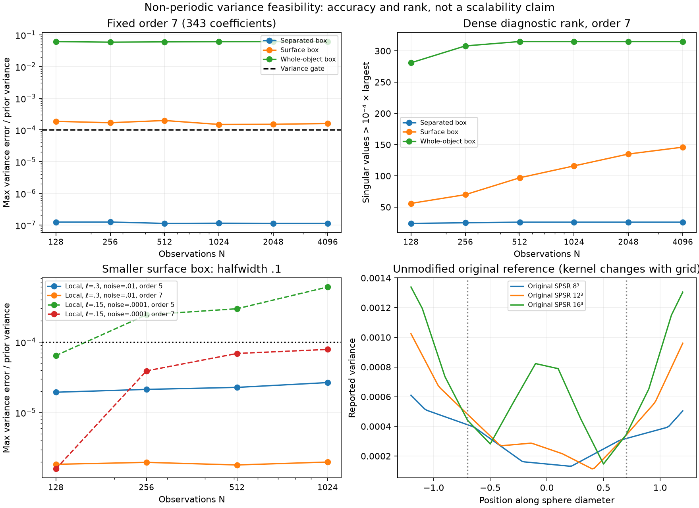

# Non-periodic variance: first implementation and feasibility pilot

Tracking: [#68](https://github.com/alecjacobson/fast-stochastic-psr/issues/68).

Implemented a free-space vector Matérn → Poisson scalar GP, a dense numerical
oracle, and a reusable regional mean/variance cache. **Local compression is
promising; a whole-object cache fails the current accuracy gates.** Dense
conditioning remains in this prototype. There is no FMM backend or demonstrated
end-to-end asymptotic speedup yet.

The original Sellán–Jacobson 2022 method is non-periodic. The new model is
validated numerically against its own dense oracle, while future modeling
comparisons will use original SPSR, known geometry, uncertainty behavior and
application quality. Pointwise agreement with periodic GeoSPSR is not required.
See [the derivation and comparison contract](METHOD.md).

## Implemented and checked

- [Free-space kernels, posterior and regional cache](../../../geospsr/nonperiodic.py).
- [12 passing tests](../../../tests/test_nonperiodic.py): independent Green-function
  quadrature, Poisson/cross-derivative identities, joint/posterior PSD, block
  conditioning, rigid-motion invariance, no periodic wrapping, coincident data,
  cache convergence and the whitened variance-error bound.
- [Pilot runner](../../../reproduction/nonperiodic_pilot.py): 126 regional
  configurations and three unmodified full-covariance original SPSR runs.
- [Plot script](../../../reproduction/plot_nonperiodic_pilot.py),
  [execution log](run.log), per-study environment manifests and raw JSONL.

## What the experiment says

Inputs are nested uniform samples on the unit sphere, with fixed domain and
outward normals. Each region has 256 held-out random queries plus eight corners
and six face centers. Tensor interpolation orders 3, 5 and 7 give 27, 125 and
343 coefficients. Gates require maximum variance error ≤10⁻⁴ times prior
variance, positive predicted variance, and maximum zero-threshold CDF error
≤10⁻³. These are numerical gates, not established application requirements.
Relative posterior-variance errors are also recorded.

| Query region / model | N tested | Smallest passing tested basis |
|---|---:|---:|
| Separated box, halfwidth .25, ℓ=.3, noise variance .01 | 128–4,096 | 125 throughout |
| Surface box, halfwidth .25, same model | 128–4,096 | None through 343 |
| Surface box, halfwidth .1, same model | 128–1,024 | 125 throughout |
| Surface box, halfwidth .1, ℓ=.15, noise variance .0001, second seed | 128–1,024 | 125 at 128; 343 thereafter |
| Whole-object box, halfwidth 1.25, base model | 128–4,096 | None through 343 |

At N=4,096, the 125-coefficient separated cache has maximum variance error
7.29×10⁻⁶ of prior variance. The 343-coefficient wide surface and whole-object
caches have errors 1.60×10⁻⁴ and 6.15×10⁻² respectively, both failing. For small
surface boxes, the worst variance errors across tested N are 2.67×10⁻⁵ for the
base model with 125 coefficients and 7.86×10⁻⁵ for the stress model with 343.
All recorded whitened error bounds hold on the tested queries.

The whitened node-matrix diagnostic at order 7 shows nearly constant separated
rank, increasing surface rank, and much higher whole-object rank. This supports
testing adaptive local boxes and shared hierarchical summaries. It does not
establish bounded rank as N→∞, a uniform-in-region error bound, or broad
application accuracy. The stress experiment changes both the model parameters
and seed; it does not isolate their individual effects.

Online cache work is O(Mr²), independent of N at fixed basis size r. However,
the current implementation still needs O(N³) dense conditioning and
O(N²r+Nr²) cache preparation. Timings are exploratory single runs, with online
times reported as the best of three warmed calls. They are not an end-to-end
comparison against SDD, NUFFT or original SPSR. `cache_bytes` in the raw data
counts H and b coefficients only; it excludes interpolation nodes, temporary
workspace and the dense oracle. No peak-memory measurement is claimed.

## Original Sellán–Jacobson reference

[The manifest](pilot/original_reference.json) records gpytoolbox 0.3.8, hashes
of its Python sources, inputs, parameters and diameter-ray mean/variance/CDF
outputs for 128 sphere samples on 8³, 12³ and 16³ grids. These use the slow
full-covariance path, not the subspace approximation.

The original code couples kernel width to grid spacing and applies its own
mean and variance shifts. The three runs establish that the reference works;
they do not establish fixed-model convergence or calibration. No new-versus-
original reconstruction quality claim has been made. The benchmark must fix
the comparison's level/normalization policy and characterize grid, kernel and
boundary effects before that comparison is meaningful.

## Next implementation steps

1. [#71](https://github.com/alecjacobson/fast-stochastic-psr/issues/71): adaptive
   regional accuracy/rank study on partial and nonuniform scans, including
   smaller boxes and error-driven refinement near observations.
2. [#72](https://github.com/alecjacobson/fast-stochastic-psr/issues/72) and
   [#73](https://github.com/alecjacobson/fast-stochastic-psr/issues/73): fast
   non-periodic actions/preconditioning plus shared hierarchical variance
   preparation. Avoid independent global solves for every box.
3. [#70](https://github.com/alecjacobson/fast-stochastic-psr/issues/70) and
   [#75](https://github.com/alecjacobson/fast-stochastic-psr/issues/75): original
   SPSR and geometry-based quality comparisons, then controlled mean-and-variance
   log-log timing plots at matched application accuracy.
4. [#74](https://github.com/alecjacobson/fast-stochastic-psr/issues/74): derive
   the augmented Poisson/SPDE selected-inverse alternative in parallel as a
   research option; it has no implementation yet.

Run `bash reproduction/results/nonperiodic/reproduce.sh` from this checkout.
The CPU study requires NumPy, SciPy and Matplotlib; the optional original
reference uses gpytoolbox 0.3.8. The script uses the existing runtime by default;
set `PYTHON` to another interpreter if needed. It runs the studies sequentially.
