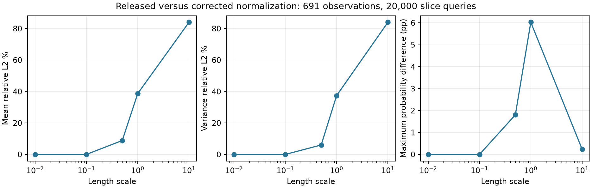
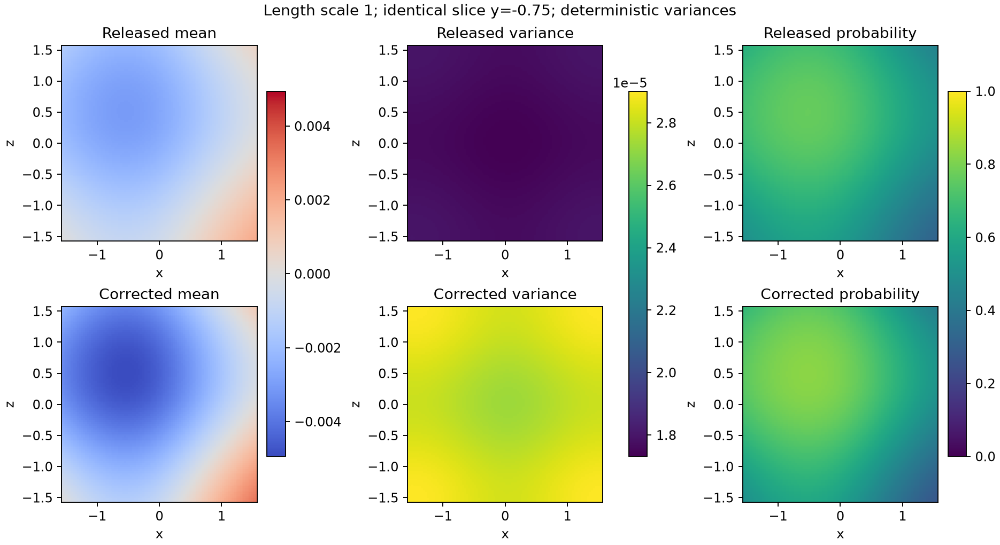

# Corrected long-scale Matérn normalization

The default JAX and NUFFT Fourier coefficients now integrate to the variance
of the analytic periodic Matérn kernel. `normalization='released'` preserves the
inherited coefficients explicitly. This corrects a model inconsistency; it is
not a speed optimization or an increase in spectral bandwidth.

At the flagship length scales **.01 and .005**, old and corrected NumPy
coefficients are **bitwise identical**. The earlier scorpion/million-point
results and the short-scale failure remain applicable. The earlier FMM rank
diagnostic used .01/.04, also bitwise identical. At length scale 1, however,
the released spectrum has a **38.66% three-dimensional prior-diagonal deficit**.
Increasing the Fourier cutoff does not remove it.

## Independent references and compatibility

For `a = sqrt(3)/(2*pi*ell)`, the infinite discrete sum is

```
Z = pi*coth(pi*a)/(2*a^3) + pi^2*csch(pi*a)^2/(2*a^2)
rho(n) = variance / (Z*(n^2+a^2)^2).
```

This independent normalization and an explicit one-dimensional Fourier sum
reconstruct the analytic covariance. The inherited stable real-space helper
and its Fourier numerator use inconsistent scaling. Multiplying each axis's
released spectrum by `1+exp(-sqrt(3)/ell)` fixes it. The analytic vector kernel,
noise variance and observed points/normals are unchanged.

Across .005, .01, .04, .1, .5, 1 and 10, corrected JAX/NumPy coefficients agree
with the independent formula to within 2e-15 relative error in this audit.
The released JAX option is bitwise equal to the pinned upstream implementation;
NumPy agrees within 3e-15. Upstream commit:
`2352f1ef98aab20e0303611c1fa2b0948acd2a05`; the kernel-file hash is recorded in `results.json`.

The option is propagated through `Matern32Kernel`, `spectral_axis`,
`FourierPoisson`, `FourierCovariance`, `Posterior`, `SpectralPosterior`, and
the latter's narrower centered inverse. Compatibility here refers to **Fourier
coefficients**, not every behavior of the untouched upstream GP code: the
repository's earlier covariance, noise and coherent-sampling fixes remain.
The normalized dense training kernel itself is the same in both modes.

## Full scorpion slice sensitivity

Both modes receive the released A input: **691 observations and all 20,000
queries on the same two slices as our matched comparison** (released `y=-.75`,
visually inferred `y=-.35`), scalar/cross cutoff 50, analytic
training covariance and noise variance .02. Variances are deterministic;
inside probability is the Gaussian CDF. Values below measure how the old
normalization differs from the corrected model, with the corrected quantity
as denominator. This is an added parameter-sensitivity study, not an attempt
to reconstruct an unpublished paper scene.

| Length scale | Mean relative L2 % | Variance relative L2 % | Probability RMS pp | Probability max pp |
| --- | ---: | ---: | ---: | ---: |
| 0.01 | 0.000000 | 0.000000 | 0.000000 | 0.000000 |
| 0.1 | 0.000009 | 0.000006 | 0.000001 | 0.000002 |
| 0.5 | 8.831766 | 5.993415 | 1.111159 | 1.803717 |
| 1.0 | 38.658014 | 37.378260 | 3.712651 | 6.024204 |
| 10.0 | 83.972591 | 83.972502 | 0.129960 | 0.243654 |





The scalar prior and cross covariance scale by the same factor `g`. With the
analytic inverse held fixed, means scale by `g`, while variances transform as
`g*prior_old - g^2*conditioning_old`. The audit computes every query's corrected
cross/conditioning term, then uses this identity for the old mode. A separate
17-query evaluation through the released operator checks both identities at
each length scale. Color scales and slice heights are shared between rows.
With this fixed analytic inverse, the means differ by a positive constant,
so their mean zero sets coincide. Variance does not scale by the square of
that constant, which is why inside probabilities change.
These comparisons quantify the bug's effect; they do not establish improved
ground-truth reconstruction for a particular length-scale choice.

## Coherent samples and the omitted tail

Independent small dense-model tests check long-scale posterior means, sample
covariances and held-mean centered hybrid weights in **both** modes. Tail
frequency/feature estimates are checked against the analytic-minus-finite
covariance at length scales .04, 1 and 10. The outside-cube tail sampler accepts
only analytic normalization: released coefficients also have an in-band
defect, so silently applying an outside-only estimator would be incorrect.

On the released A geometry, the follow-up tail audit uses a fixed **32-query
panel**, cutoff 50 and three independent sets of 16,384 tail frequencies.
Relative covariance gaps and bounds below are dimensionless, not percentages.
The last statistical column is the largest diagonal discrepancy divided by
its estimated Monte Carlo standard error, across seeds/queries.

| Length scale | Dense covariance difference | Tail-bound norm / covariance norm | Max diagonal discrepancy / SE | Subtraction resolution |
| --- | ---: | ---: | ---: | --- |
| 1.0 | 4.23e-10 | 4.23e-10 | 2.118 | resolved |
| 10.0 | 5.81e-17 | 5.75e-18 | 2.031 | unresolved at roundoff |

At length scale 10, covariance subtraction is dominated by floating-point
roundoff; its apparent difference exceeds the much smaller bound. This is not
a refutation of the exact PSD theorem or a resolved numerical certificate.
The audit now distinguishes passing its numerical tolerance from resolving
the gap above a roundoff indicator. Frequency estimates remain empirical,
not rigorous simultaneous bounds; this panel does not certify full events,
geometry, Monte Carlo convergence or massive-scale application fidelity.

## Reproduce

```bash
./reproduction/run_env.sh -m reproduction.audit_kernel_normalization
./reproduction/run_env.sh -m reproduction.audit_spectral_tail --dataset A --cutoff 50 --lengthscale 1 --probes 32 --output reproduction/results/normalization/tail-1
./reproduction/run_env.sh -m reproduction.audit_spectral_tail --dataset A --cutoff 50 --lengthscale 10 --probes 32 --output reproduction/results/normalization/tail-10
./reproduction/run_env.sh -m reproduction.summarize_normalization
./reproduction/run_env.sh -m pytest -q tests
```

[Raw audit](results.json) · [Test output](tests.log) ·
[Issue #24](https://github.com/alecjacobson/fast-stochastic-psr/issues/24).
