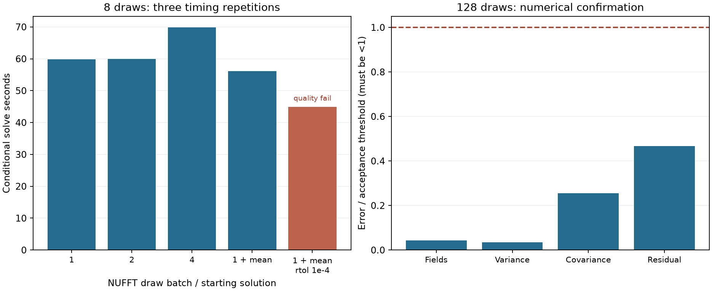
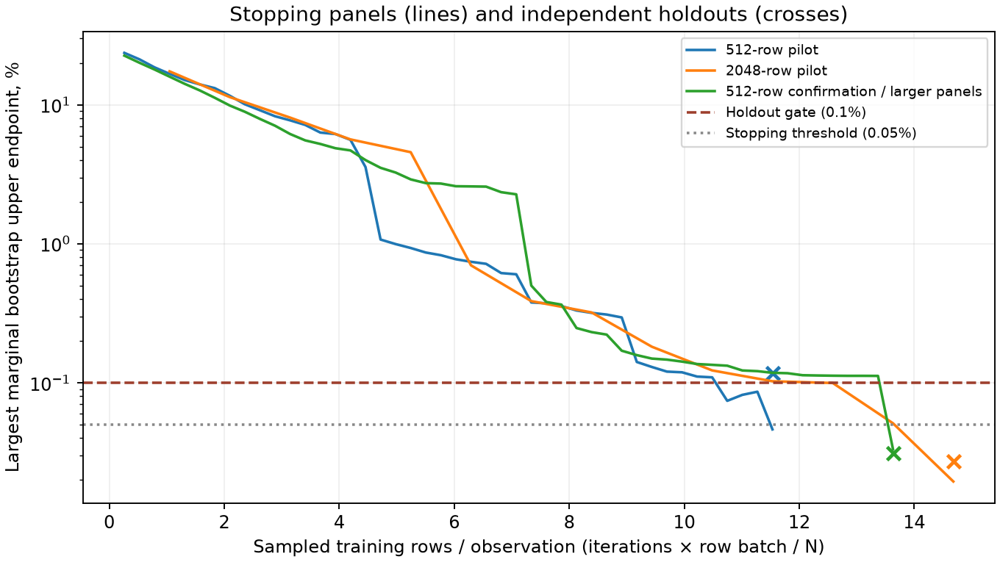

# Conditioning at practical posterior sample counts

At one million observations and **128 shared draws**, numerical validation
**passes**. **No new 128-draw speed ratio is established: GPU isolation failed or was not established**. The run extends
numerical validation to the larger workload; it does not extrapolate the earlier
eight-draw 4.39× ratio.
SDD shares analytic kernel rows across all 384 scalar RHS. Both methods start
from the same already-available finite posterior mean weights.

These are conditioning comparisons with a common **truncated** vector prior,
not full-analytic posterior sampling or complete application speedups. The
quality bridge and probability/geometry convergence remain open.



## What changed

`FourierKernel.solve` accepts an optional starting solution. Its tolerance
remains relative to the **original RHS**, not the smaller initial residual.
`SpectralPosterior.draw(initial_mean=True)` uses the fitted mean weights;
the default remains unchanged. Compiled SDD also accepts an initial solution,
initializing both its iterate and Polyak average while keeping zero velocity.
Tests compare that update to solving the explicitly shifted residual equation.

The staged prior generator preserves the existing one-draw sampler's random
sequence. All variants replay the same RHS, scalar priors and offset; changing
batch size cannot silently change the samples. Source and geometry hashes,
seed 42 and all individual timings are recorded. A/B dense sampler improvements
from the earlier report are separate.

The first staging script omitted saving mean weights. They were regenerated
from the identical dataset/model; that scratch repair is recorded in
`prepare/mean-alpha-regeneration.json` and is not counted as another production
mean-fit stage. Every initialized solver records the same mean-weight hash.
The current preparation script saves those weights directly.

All **35 tests pass**, including independent dense solver checks, preservation
of staged random draws and hybrid covariance/mean identities. A CLI smoke check
also rejects the failed-holdout reference before transferring its RHS.

## Eight-draw sweep

All runs use the first eight draws of a prepared 128-draw ensemble, vector
cutoff 200, scalar/cross cutoff 50, length scale .01, per-axis variance .1 and
observation-noise variance .02. GPU: NVIDIA L40. Plan creation, source aggregation
and validation are outside solve times, with separate records. Ranges span
three repetitions; they are not confidence intervals.

| Variant | Solve median [min, max], s | Largest stage device usage, GiB | Paired covariance error % | Quality |
| --- | ---: | ---: | ---: | --- |
| Batch 1 | 59.81 [59.81, 66.39] | 11.30 | — | reference |
| Batch 2 | 59.92 [59.89, 59.96] | 21.71 | 0.000171 | pass |
| Batch 4 | 69.85 [69.51, 76.31] | 34.49 | 0.000205 | pass |
| Mean start | 56.12 [53.80, 57.32] | 11.28 | 0.006766 | pass |
| Mean start / loose tolerance | 44.88 [41.34, 46.47] | 11.30 | 0.055374 | fail |

Memory values are synchronized observations of total device usage, **not
guaranteed peaks or process-only allocations**.
Batches of two and four do not improve this workload. Mean initialization at
rtol 1e-5 provides a modest improvement; it preserves the checked ray/collision
events and view decision. The looser rtol 1e-4 trial is retained as a failure:
it passes sampled analytic residual and event checks but fails variance and
covariance checks. It is not selected for the larger run.

Same-kernel gates: field error/fluctuation norm <0.05%, empirical
variance/covariance errors <0.01%, and the existing local ray/collision/view
gates. These assess paired numerical differences, not absolute MC accuracy.

## 128-draw confirmation and the failed stopping pilot

The complete ensemble was generated before either solve. Eight draws tuned
NUFFT batching; the remaining 120 extend that numerical check. SDD uses eta 5,
momentum .9, Polyak .01 and seed 0. Both pilots used 512 stopping rows, a
maximum per-draw bootstrap upper endpoint <0.05%, and 1,024 independently
selected holdout rows. **The 512-row-batch pilot passed stopping but failed its
holdout: 0.118% against the 0.1% gate.** Its 813.92 s result is retained and
cannot serve as a matching-quality reference. Comparing the 2048-row pilot
against it is only diagnostic.

The final SDD confirmation uses **512 rows per update**,
**2,048 stopping rows** and the unchanged stopping threshold of
**0.050%**. Both final solvers are checked on the same
**4,096 fresh holdout rows**, seed 2711, excluding
stopping rows. This is an empirical check, not a full-system or simultaneous
probability bound. The configurations tested here do not establish globally
optimal tuning. The stricter validation was chosen after the initial failure;
that adaptive history is part of the report.

| Solver | Conditional solves / updates, s | Holdout rows | Largest holdout upper endpoint % | Residual gate |
| --- | ---: | ---: | ---: | --- |
| SDD 512-row pilot | 813.92 | 1,024 | 0.11777 | fail |
| SDD 2048-row pilot | 943.96 | 1,024 | 0.02734 | pass |
| SDD stricter confirmation | 1086.92 | 4,096 | 0.03121 | pass |
| NUFFT confirmation | 905.36 | 4,096 | 0.04669 | pass |

Against the larger-panel SDD reference, the earlier 512-row pilot also fails
the same-kernel covariance gate: **0.011554%**
versus the **0.01%** limit. The 2048-row pilot passes, at
**0.006292%**.
Both pilots preserve every checked ray/collision event. Event agreement alone
would therefore have accepted the failed reference.



**Timing caveat:** other GPU compute processes overlapped both final
confirmations. SDD's recorded **1086.92 s** and NUFFT's **905.36 s**
are retained for provenance and cannot support a speed ratio. NUFFT's
`gpu_process_audit` records **309** samples
with a foreign process. Earlier pilots were not continuously monitored.
The new monitor samples GPU process ownership once per second, records foreign
PIDs/errors and rejects contaminated timing comparisons. It can miss short-lived
work and is not proof of exclusive access. Numerical comparisons remain useful.

These large runs are **single confirmations**, not repeated timing distributions.
NUFFT uses one draw per batch, mean initialization and rtol 1e-5. Cross-method
field gates remain error/fluctuation norm <0.2%, empirical variance/covariance
errors <0.02%, plus the existing local event/view checks. Measured field error:
**0.008602%**; variance error:
**0.000679%**; covariance error:
**0.005092%**. Field gates:
**True**; local event gates:
**True**.

Common mean fitting costs **7.68 s**; GPU prior/RHS
generation for 128 draws costs **7.39 s**,
excluding transfers and scratch-file writes. Query reductions, scalar aggregation,
plans/JIT and validation have separate timings in raw JSON. The headline ratio
would exclude those stages and would not be fit-through-application time.
`benchmark_work_wall_seconds`, where present, includes benchmark I/O and adaptive
validation; it is also not a production application timing.

## Statistical scope

SDD solves the full analytic training covariance, but the **shared prior is
finite**. That reference does not itself generate full-model posterior samples.
The [covariance bracket](../spectral_tail/METHOD.md) now covers this
shared-prior/full-inverse case too. Limited-panel evidence does not prove full
ray/collision or hitbox accuracy.
The derivation also adds separate mean-error and unequal-prior/solve-band bounds,
checked with noncommuting dense matrices. Their usefulness for large application
panels remains to be measured; no speedup is attributed to those identities.

128 draws still have worst-case marginal binomial standard error of about
**4.4 percentage points**. Passing paired numerical gates does not establish
absolute probability convergence. Queries use direct cutoff-50 Fourier fields;
this is not the released 50³ cross-kernel interpolant. Checks cover 257 probes,
a 32-query covariance panel, 24 rays × 256 steps, 17 uncertain spheres × 256
surface points and associated view scores.

A prefix diagnostic illustrates the sampling limitation. On the same geometry,
the first eight draws differ from the 128-draw ensemble by up to
**20.31 percentage points** for rays and
**21.88 points** for collisions.
The selected views are listed below. **128 draws are not ground truth**, and these nested prefixes
of one ensemble are not an independent convergence study. Differences need not
decrease monotonically as more samples are added.

| Prefix draws | Maximum ray difference vs 128, pp | Maximum collision difference vs 128, pp | Selected view |
| ---: | ---: | ---: | ---: |
| 8 | 20.31 | 21.88 | 14 |
| 16 | 14.06 | 5.47 | 14 |
| 32 | 7.81 | 14.84 | 14 |
| 64 | 6.25 | 5.47 | 14 |

## Reproduce

The prior arrays and RHS use several GB, so keep scratch storage outside the
repository. The generated million-point visible-surface cloud is required.
Run all GPU jobs serially for comparable timings.

```bash
./reproduction/run_env.sh -m reproduction.benchmark_nufft_batches prepare --samples 128 --scratch /opt/geospsr-runtime/common-rhs-128 --output reproduction/results/nufft_batches/prepare
./reproduction/run_env.sh -m reproduction.benchmark_nufft_batches solve --samples 8 --batch 1 --repeats 3 --scratch /opt/geospsr-runtime/common-rhs-128 --output reproduction/results/nufft_batches/batch1
# Repeat with --batch 2 and 4; --reference .../batch1 and distinct outputs.
# Mean-start trials add --initial-mean, optionally --rtol 1e-4 --audit-analytic.
./reproduction/run_env.sh -m reproduction.benchmark_nufft_batches sdd --samples 128 --repeats 1 --initial-mean --sdd-row-batch 512 --stop-rows 2048 --stop-tolerance 0.0005 --holdout-rows 4096 --holdout-seed 2711 --retain-weights --scratch /opt/geospsr-runtime/common-rhs-128 --output reproduction/results/nufft_batches/sdd128-validated
./reproduction/run_env.sh -m reproduction.benchmark_nufft_batches solve --samples 128 --batch 1 --repeats 1 --initial-mean --audit-analytic --stop-rows 2048 --holdout-rows 4096 --holdout-seed 2711 --retain-weights --scratch /opt/geospsr-runtime/common-rhs-128 --reference reproduction/results/nufft_batches/sdd128-validated --output reproduction/results/nufft_batches/nufft128
./reproduction/run_env.sh -m reproduction.summarize_nufft_batches
```

Raw pilot commands are recorded in their JSON files. The final harness rejects
a reference with failed analytic holdout before running a candidate. Earlier
pilots predate that guard and the disjoint holdout selector. Compact field/event
arrays and raw JSON/logs are published; multi-GB RHS, priors and weights remain
regenerable scratch data.
