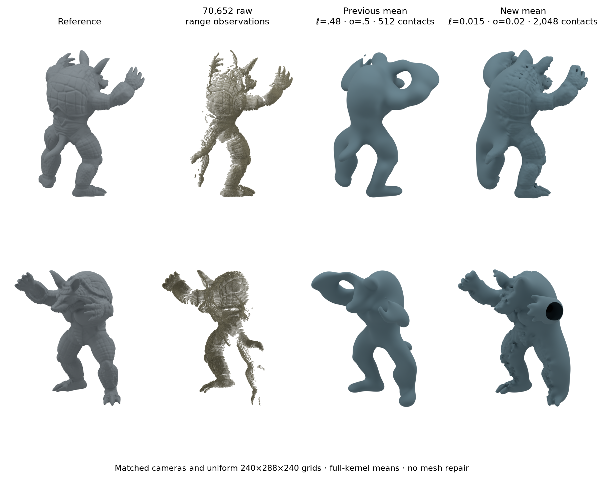
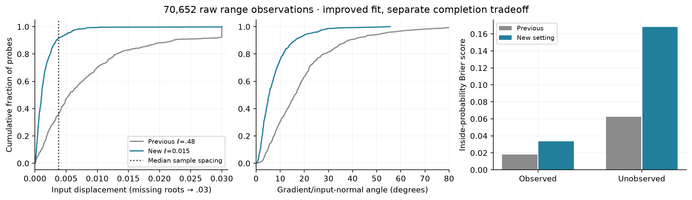
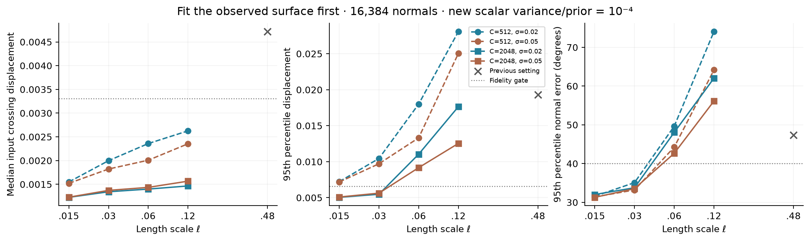

# Resolve observed detail in the dense partial scan

The previous [quality/crossover setting](../quality_controls/README.md) remains too smooth for the dense observations. Its selector averaged observed and unobserved reconstruction errors, allowing inferred completion to outweigh observed detail. This follow-up to [#124](https://github.com/alecjacobson/fast-stochastic-psr/issues/124) makes sample-resolution fidelity to the measured surface a requirement before considering completion or speed.

The validation-selected replacement is **ℓ=.015, normal σ=.02, 2,048 scalar contacts**, with scalar noise variance **7.5e−9**. On the primary **70,652-point** scan, median input crossing displacement improves **80.5%**, from **.00553 to .00108**; median gradient/input-normal error falls from **16.09° to 5.35°**. The new setting passes every declared observed-fidelity gate on both large validation and primary test views. No noise is added to the input, and no surface repair or post-extraction smoothing is applied.

**This improves observed geometry, not every application metric.** The unseen mean surface is less accurate against the reference, and primary raw inside-probability Brier worsens from **.04090 to .09070**. However, an inaccurate mean surface in an uncertain region does not establish a failure of the posterior. The [uncertainty revision](../epistemic_revision/README.md) corrects that interpretation using this unchanged model and new full-kernel marginal evaluations. The earlier H²/Cholesky crossover still requires fresh measurements for this model; #124 remains open for those comparisons and application-quality evidence.



## What the observations support

The inputs are actual Stanford Armadillo range measurements with range-grid normals and a global registration, not mathematically noiseless samples drawn from the reference mesh. There is no synthetic noise. The previous σ=.5 was an effective model parameter, not an estimated scanner standard deviation. The smaller σ=.02 is also a declared regularizer, not a calibrated sensor likelihood.

With reference height normalized to 2, the full primary scan's median nearest-neighbor spacing is **.003817**. The previous ℓ=.48 spans approximately **126 spacings**; ℓ=.015 spans **3.9 spacings**. The input-to-reference median registration distances in the original dataset diagnostics are about .001–.0014, but those combine registration, acquisition and reference errors; they are not an independent noise measurement.

The new [protocol](PROTOCOL.md) uses 512 deterministic input positions excluding all potential scalar contacts. It measures the closest zero crossing along each input normal over [−.03,.03], using 65 samples, and the oriented field-gradient/input-normal angle using centered differences. The positions can supply normal observations, so these are **input-fit diagnostics**, not held-out acquisition accuracy. Missing roots receive a .03 censored error and are counted separately.

The gates are median displacement ≤ one median spacing; p95 ≤ two spacings; missing roots ≤1%; median normal error ≤15°; and p95 normal error ≤40°. These are explicit engineering requirements tied to sampling resolution, not a claim of exact scanner precision. Unobserved completion cannot compensate for failure.

| Primary input-fit diagnostic | Previous setting | Observed-fidelity setting | Gate |
|---|---:|---:|---:|
| Median crossing displacement | .005530 | **.001076** | ≤.003817 |
| p95 crossing displacement | .030000, censored | **.005209** | ≤.007634 |
| Missing crossings | 7.81% | **.20%** | ≤1% |
| Median normal error | 16.09° | **5.35°** | ≤15° |
| p95 normal error | 52.34° | **22.05°** | ≤40° |

The previous p95 is at the censoring limit, not an exact measurement of its tail. The two means are evaluated on identical input probes. Displacement and normal agreement are both checked so that merely placing some zero surface near the points cannot pass by itself.

The renderings recover visible shell, hand and leg detail where observations support it. The tube-like protrusion on the unseen side is a feature of the mean zero level set, unsupported by observed anatomy. It remains visible and reaches the extraction-box boundary; it has not been removed or capped. This surface is also the marginal P(inside)=.5 contour. Calling its shape a posterior failure without checking uncertainty was too strong; see the [probability/variance revision](../epistemic_revision/README.md).



## Selection and independent checks

The full float64 screening experiment has 32 configurations at 16,384 validation normals: ℓ=.015/.03/.06/.12, normal σ=.02/.05, 512/2,048 nested farthest-point contacts, and scalar noise variance/prior variance 1e−6/1e−4. Contacts come only from the input scan. Vector amplitude stays 1/3 and scalar targets stay zero. The scalar prior variance is ℓ²/3, so the scalar noise is explicitly scaled with that prior rather than accidentally becoming stronger relative noise as ℓ decreases.

Eight configurations pass. All use 2,048 contacts and ℓ=.015 or .03. No 512-contact setting passes the tail-error gate. Among passing configurations, the predeclared selector minimizes p95 displacement, then median normal angle. It selects ℓ=.015, σ=.02 and scalar variance/prior=1e−4; ℓ is at the lower boundary of the search, so this is not a globally optimal bandwidth claim. Shorter scales and additional constraints both matter in this experiment.



At 70,652 validation normals, that candidate passes again: median/p95 displacement **.001111/.005018**, missing roots **.39%**, and median/p95 normal error **5.82°/23.40°**. [selected.json](selected.json) freezes the configuration using validation evidence before the new primary test fields. The original PR122/125/126 fields, selectors and timings remain unchanged.

Large references use a float32 dense factor with refinement against **all float64 kernel entries**, requiring relative RHS residual ≤1e−10. Contact inverse actions are streamed to host memory while the factor is resident. This is a correctness oracle, not an asymptotic production method. At 16,384 observations it agrees with the independent full float64 screening factor within **3.32e−16 in mean** and **1.97e−19 in variance**. No H² operator is used in these reference fields.

## Display accuracy and scope

The two camera rows show observed-side and opposite-side views. The point-cloud column shows every input position, without contact markers obscuring detail. Both rendered means use the same **240×288×240 uniform grid**, with a separate **160×192×160** check. Every grid node receives an all-pairs mean evaluation; there is no narrow-band exclusion, spatial cutoff, mesh repair, or capping.

| Fine-grid surface distance | Previous median / p95 | New median / p95 |
|---|---:|---:|
| All input points → mean mesh | .005705 / .026372 | **.001071 / .004790** |
| Observed reference → mean mesh | .006808 / .033300 | **.001781 / .010754** |
| Unobserved reference → mean mesh | **.034141 / .116855** | .045846 / .131790 |

All-input mesh distance improves approximately **81%** at both median and p95. The unobserved reference distances worsen; the observed fit is not purchased by silently calling the unseen side accurate.

The display helper fuses the float64 kernel sum to avoid a large observation-by-query temporary matrix. It retains the full algebraic tails of both kernels. At κr≥50, their exponentially small subtractions round to the same constant 8 in float64, so that arithmetic can be skipped without truncating the kernel. Independent coincident/near/far-point tests and agreement with retained posterior means check the evaluator. On the primary new field, its maximum mean difference over the 512 saved query locations is **8.19e−16**.

Mesh distances, boundary-edge counts, and directional coarse/fine vertex-to-triangle distances are retained in the display records and [summary.json](summary.json). The reference mesh is reconstructed from the same acquisition; it is context and a separate comparison, not independent physical ground truth. Reference “observed” masks based on proximity to the scan are broader than the exact measured positions. The old 33-sample reference-normal probes are retained for continuity but are coarser than the new input-fit probes and are not the main fine-detail metric.

For the new mean, all-input-to-mesh median/p95 distances change from **.001142/.004957** on the coarse grid to **.001071/.004790** on the fine grid. Observed reference-to-mean median distances are **.001798/.001781**. The larger directional coarse/fine p95 mesh distance is **.000973**; its maximum is **.008745**, so this is empirical display stability, not a uniform surface certificate. The new fine-grid extraction has **192 boundary edges where the mean surface reaches the display box**. It is an uncapped partial-scan prediction, not a watertight completed object. This is a further reason to keep unseen-side completion separate from observed accuracy.

These figures show the zero level set of the full-kernel posterior mean, not posterior samples or directly rendered H² fields. Reference construction, geometry screening and display time are excluded from every earlier performance claim. All numerical/display GPU runs retain sampled process-isolation audits; no external job was stopped.

## Probability scores and uncertainty need separate interpretation

| Primary probability score | Previous full variance | New full variance | New contact-only variance |
|---|---:|---:|---:|
| All-query Brier | .04090 | .09070 | .09075 |
| Observed-query Brier | .01793 | .03348 | .03348 |
| Unobserved-query Brier | .06231 | .16809 | .16821 |

The primary query panel and labels are unchanged. The cheap control uses the same full-posterior mean, with scalar-contact-only variance at the **new** contact count and scalar noise. It remains competitive on Brier; this experiment does not establish the practical necessity of the expensive full variance. Better geometric fit is not a probability-calibration result.

The unchanged panel's 159 queries in unobserved reference regions retain median **96.01% of prior variance**. Its 22 incorrect classifications assign the true label probabilities **.388–.490**; none is a 95%-confident mistake. This supports retained epistemic uncertainty under the fixed model, without establishing calibration. The worse Brier scores above remain a predictive-score disadvantage on this specific panel. A single object's correlated spatial queries cannot establish population calibration.

The next computational comparison must preserve the observed-fidelity requirements and check probabilistic numerical accuracy. It need not require an accurate unseen mean completion before measuring runtime. New H², locality, dense, SDD and other-model timings require the new contact/noise/bandwidth contract and independent accuracy checks; the earlier 1.30× speedup is evidence for the previous smoother setting only. Both NUFFT and H² implementations remain available.

The existing [exterior-level issue #117](https://github.com/alecjacobson/fast-stochastic-psr/issues/117) asks a separate physical modeling question: this zero-mean scalar prior returns to probability .5 far from all observations. Declared exterior information or an appropriate prior mean deserves testing where the application supplies that knowledge. The unseen mean protrusion alone is not evidence that such a change is required. Sensor-ray free-space signs must not be silently converted into exact signed-distance observations. The increased number of needed scalar constraints independently motivates accelerating the coupled scalar/vector conditioning operator itself, rather than assuming its scalar Schur complement will always remain small.

## Reproduction

Use the pinned numerical and Blender environments and scan cache from the [real partial-scan study](../real_partial/README.md) and [visual companion](../partial_renderings/README.md). Numerical drivers refuse to overwrite retained records. Replay scores and checks without rerunning the GPU references:

```bash
./reproduction/run_env.sh -m reproduction.report_observed_fidelity
./reproduction/run_env.sh -m reproduction.plot_observed_fidelity validation
./reproduction/run_env.sh -m reproduction.plot_observed_fidelity final
./reproduction/run_env.sh -m pytest -q tests/test_observed_fidelity.py tests/test_partial_quality.py tests/test_scalar_contacts.py
```

For a fresh experiment, retain the protocol in a new result directory (or move the existing evidence aside), run `observed_fidelity prepare`, then `screen` for every declared ℓ/σ pair, plus `--ell .48 --sigma .5 --control`, then `select`. Run `observed_fidelity_large run --tag validation-candidate1` and the 16k independent refinement check before `freeze`. Only then evaluate `--group test_side`. All commands are modules under `reproduction` through `run_env.sh`; driver defaults and retained JSON arguments specify the exact settings. `display_observed_fidelity` creates both resolutions from saved mean coefficients; `render_observed_fidelity` uses the separate Blender environment.

The manifest binds final sources and retained artifacts; numerical records separately bind the exact measured source snapshots. Exportable figures accompany each PNG as a PDF.

Validation: **18 targeted tests pass**, including independent Gaussian conditioning with different scalar noise levels, streamed reference solves, displacement/normal failure cases, the fused evaluator at coincident/near/far locations and its float64 tail branch, and the previous H²/dense-CG compatibility controls. The artifact replay checks all 32 screening candidates, the selection order, large references, score calculations, field hashes, sampled GPU isolation and display records.
