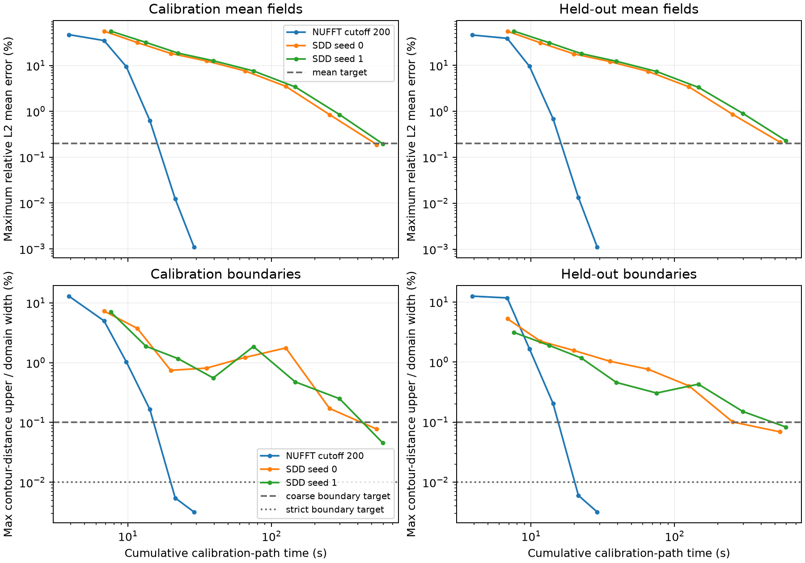

# Three-million-point output-aware checkpoint study

This measures when fixed solver checkpoints meet joint mean and 2D boundary
targets on new slice geometry. Checkpoint selection uses calibration planes;
held-out planes confirm the same selected endpoint. It is an **oracle study**
using a saved higher-bandwidth mean, not a deployable stopping rule or full
application-speedup demonstration.

[Protocol](PROTOCOL.md) · [Selections and eligibility](summary.json) ·
[Tracking issue #36](https://github.com/alecjacobson/fast-stochastic-psr/issues/36).

## First calibration pass, then held-out confirmation

Calibration planes are y=-.4 and -.7; held-out planes are y=-.5 and -.8. All
methods use the same three-million-point scan. The reference uses training
cutoff 250, while NUFFT-CG uses cutoff 200 and SDD uses the full analytic kernel.
Scalar/cross cutoff remains 50. Source and saved-reference hashes are verified.

Both targets require <=0.2% relative mean error on each 2049-square grid,
matching component/open-component counts, and stable counts between the 1025
and 2049 grids. Coarse/strict contour Hausdorff upper limits are 0.1%/0.01% of
domain width; both candidate and reference must also meet that respective
limit in their grid-refinement comparison. These are numerical benchmark
targets, not physically justified tolerances for a particular application.

| Target | Method | First calibration iteration | Calibration path (s) | With selected held-out check (s) | Held-out confirmation |
| --- | --- | ---: | ---: | ---: | ---: |
| coarse | half200 | 64 | 21.370 | 22.589 | pass |
| coarse | sdd0 | 16,384 | 541.205 | 542.461 | FAIL |
| coarse | sdd1 | 16,384 | 596.213 | 597.612 | FAIL |
| strict | half200 | 64 | 21.370 | 22.589 | pass |
| strict | sdd0 | none | — | — | — |
| strict | sdd1 | none | — | — | — |

`none` means no scheduled checkpoint passed both calibration planes. A failed
held-out result is retained at the selected endpoint; a later passing result
does not replace it. Every checkpoint remains in the raw records.
The schedule always runs to its end: selected costs are sums of measured
components, not fresh wall-time measurements of early-terminated runs.



Component and refinement checks also affect the table. Distances are between **extracted
polylines**, with sample-cover brackets, not bounds on continuous zero sets.
These new planes are held out from checkpoint selection, but share the same
scene; this is not independent-scene validation or a 3D surface guarantee.

To distinguish field-amplitude failures from boundary failures, the maxima
over each pair of planes at the **last scheduled endpoint** are:

| Method | Final iteration | Calibration mean error | Held-out mean error | Calibration boundary / width | Held-out boundary / width |
| --- | ---: | ---: | ---: | ---: | ---: |
| half200 | 97 | 0.00110% | 0.00112% | 0.00318% | 0.00318% |
| sdd0 | 16,384 | 0.18830% | 0.21396% | 0.07743% | 0.06871% |
| sdd1 | 16,384 | 0.19549% | 0.23063% | 0.04548% | 0.08262% |

A joint-target failure is not necessarily a boundary failure. These final
diagnostics do not change the first-calibration-pass selection or its gates.

## Costs and timing eligibility

| Method | Setup (s) | All solver updates (s) | Final calibration path (s) | Saved-reference preparation (s) | Instrumented wall (s) | Sampled isolated |
| --- | ---: | ---: | ---: | ---: | ---: | ---: |
| half200 | 0.052 | 18.515 | 28.881 | 1.724 | 42.057 | False |
| sdd0 | 1.678 | 528.762 | 541.205 | 1.786 | 554.602 | False |
| sdd1 | 1.657 | 583.221 | 596.213 | 1.896 | 610.520 | False |

Calibration-path time includes setup, solver updates, aggregation, all-source
centering, and every calibration field/contour/metric check up to that endpoint.
Held-out checks, artifacts and saved-reference preparation are excluded and
reported separately. The selected held-out check is added in the first table.
GPU work is synchronized at timing boundaries. CPU contour/metric work is
included in calibration/confirmation costs. Process imports/CUDA initialization
and source loading/hash verification are excluded from these path costs.
Reference preparation precedes the measured solver path in each process, so
shared scalar-transform kernels and caches can already be warm. These are not
cold-start pipeline measurements. CPU verification of a completed run may
overlap later GPU runs on the shared host; timings remain instrumented diagnostics.

Saved-reference preparation includes verifying and aggregating its weights,
evaluating all four planes and storing its arrays. It **does not include fitting
the reference**: that fit is the earlier contended cutoff-250 solve, identified
in each record. Thus even the `with_saved_oracle_preparation_seconds` field
does not describe an end-to-end deployable stopping algorithm. A practical
criterion must avoid needing this fitted oracle, or count its full cost.

Timing ratio eligibility (both SDD seeds and NUFFT confirm; every whole-run
isolation audit passes): coarse **False**;
strict **False**. Any eligible
ratios in JSON apply only to the stated calibration path, not total pipeline
cost or deployment. One run per configuration limits timing statistics.
No historical-machine ratio or claim of upstream intractability is made.

## Validation and remaining work

The **21 targeted tests pass**: [15 solver/upstream checks](solver-tests.log)
and [six geometry/selection checks](selection-tests.log). Measured run records
and bound replay verifications are in [NUFFT](half200), [SDD seed 0](sdd0)
and [SDD seed 1](sdd1).

The production CG observer is checked against the same solve without an
observer, including intermediate/final iterates and convergence metadata.
Compiled SDD has pinned-upstream equivalence tests. Saved field hashes, mean
errors, contour metrics, all quality decisions and calibration-time accounting
are recomputed by `verify_output_stopping`; each run's verification record
binds its exact JSON and contour archive. Large fields/coefficients remain
outside Git; compact contours and metrics are published.

This does not establish posterior variance, correlated ray/collision events,
next-view decisions, ContactFusion semantics, or full analytic/scalar-bandwidth
convergence. Mean-only stopping cannot be transferred to those tasks without
their own accuracy measurements. Subsequent work should test an implementable
stopping rule and its failure modes, and repeat on independent scenes.
The joint mean-and-boundary target is also stricter than a boundary-only task:
a pure surface-extraction benchmark should assess geometry without imposing
an unrelated field-amplitude requirement.

## Reproduce

Recreate the three-million-point source and saved cutoff-250 fit as described in
`../large_fit`. Run fresh processes sequentially:

```bash
./reproduction/run_env.sh -m reproduction.benchmark_output_stopping \
  --source /opt/geospsr-runtime/large-cloud-3000000 \
  --reference /opt/geospsr-runtime/large-fit/half250 \
  --method half200 --output /opt/geospsr-runtime/output-stopping/half200
# Repeat with --method sdd --seed 0 and --seed 1 in separate outputs.
./reproduction/run_env.sh -m reproduction.verify_output_stopping \
  --run /opt/geospsr-runtime/output-stopping/half200
# Verify each SDD output, too. Then publish results/verification JSON and contours.
./reproduction/run_env.sh -m reproduction.summarize_output_stopping
```
