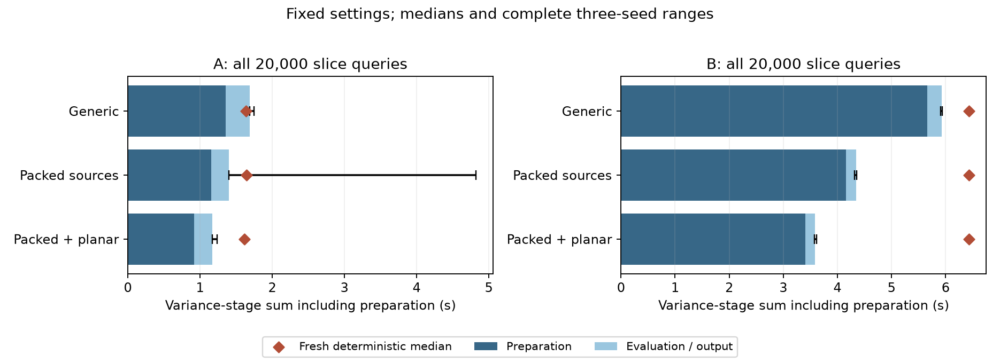

# Packed sources and exact planar queries

**At the fixed full-slice quality requirements, variance-stage medians are now
1.38× faster on A and 1.80× on B than fresh deterministic evaluation, including
estimator preparation.** Packing also preserves the tested three-million-point
coherent fields and improves repeated aggregation/query time, but its first pass
is slower. These are scoped stages, not complete-application or upstream speedups.

[Protocol](PROTOCOL.md) · [A/B summary](summary.json) ·
[Massive-scale protocol](MASSIVE_PROTOCOL.md) · [Massive summary](three_million/summary.json) ·
[Source packing #42](https://github.com/alecjacobson/fast-stochastic-psr/issues/42) ·
[Planar queries #41](https://github.com/alecjacobson/fast-stochastic-psr/issues/41).

## Fixed-setting A/B comparisons

All 20,000 committed A/B slice queries, heights, observations and normals are retained.
The model remains full analytic vector covariance, noise variance .02 and direct
scalar/cross cube 50. A uses the previously selected rank 256 sketch and 128 evaluation
draws; B uses rank 512 and 32 draws. Both factor directions use batch 16; correction
fields use batch 8. No rank, count or seed is reselected. Each variant is a fresh
process with three fixed independent sketch/evaluation pairs.

Every seed passes the existing contrast L2≤1%, probability RMS≤.05 percentage
points / maximum≤.5 points, positive variance and double-control precision gates.
Paired output differences from the fresh generic run also pass the .1%-of-contrast
limit. Maximum observed paired difference is below **0.000128% of contrast**.
Whole-run sampled GPU-isolation audits pass in all six runs.

| Method / case | First-estimate median (all-seed range), s | Fresh deterministic median, s | Speed vs deterministic | Speed vs fresh generic |
| --- | ---: | ---: | ---: | ---: |
| Generic A, N=691 | 1.688 (1.688–1.749) | 1.636 | 0.969× | 1.000× |
| Packed sources A | 1.398 (1.397–4.820) | 1.643 | 1.175× | 1.208× |
| Packed + planar A | **1.171 (1.170–1.239)** | **1.617** | **1.381×** | **1.442×** |
| Generic B, N=17,419 | 5.932 (5.912–5.934) | 6.432 | 1.084× | 1.000× |
| Packed sources B | 4.345 (4.319–4.360) | 6.431 | 1.480× | 1.365× |
| Packed + planar B | **3.581 (3.575–3.618)** | **6.428** | **1.795×** | **1.657×** |

Each estimate includes sketch generation, both factor actions, QR, control/state
construction, source/query plans, evaluation generation/query, projection/reduction
and one final variance/probability output. The source-only A first seed cost4.82 s;
its median must not be interpreted as guaranteed cold first-use latency. Processes
use the existing CuPy compilation cache; clean-cache startup was not measured.
All recorded repetitions, including the slow one, are retained.

Shared fit and mean are separate. Adding their measured stages gives combined
packed/planar ratios of **1.26× A / 1.51× B** against fit+mean+deterministic variance.
Validation references, export, rendering and process startup are excluded. These
stage sums do not replace the main README's released-interpolant teaser timings.
Contrast error remains 0.948–0.970% on A and 0.588–0.642% on B. Preparation still
accounts for roughly .918 s of A's 1.171 s and3.405 s of B's 3.581 s.



Bars show preparation and remaining cost for the median-time seed; whiskers retain
all three seed times. Diamonds are each process's fresh deterministic median.
The long source-only A whisker exposes its slower first seed.

## What changed

The [instrumented B forward action](../planar_queries/profile.json) spent about
3.74 s aggregating observation sources, .148 s solving the triangular system and
.130 s evaluating queries. Synchronization per component makes this a diagnostic,
not a separate timing-ratio baseline.

For two real source channels a,b, compute one complex transform F(a+i b). Recover
F(a) from `(F(k)+conj(F(-k)))/2` and F(b) from `(F(k)-conj(F(-k)))/(2i)`.
Independent maximum-absolute scaling protects smaller channels from their partners'
roundoff; zero channels remain zero. The complete odd centered cube is restored
before cross-kernel multiplication. Factor preparation and correction-field source
aggregation both use this optional backend. Generic defaults are unchanged.

For points on y=y_s, contract coefficients along y using exp(i ky y_s), then
perform a 2D type-2 NUFFT at the actual x,z coordinates. The adjoint uses 2D type1
and expansion with exp(-i ky y_s). Every mode and coordinate remains. Planar plans
support each coordinate axis, arbitrary in-plane positions, multiple heights,
original ordering and bounded field batches. They group only exact equal heights
after the normal precision cast; more than eight planes raises an error. The
caller must explicitly opt in; general queries retain generic 3D plans.

A [large-query precision failure and diagnosis](../planar_queries/PRECISION_FOLLOWUP.md)
are retained. The initial spectrum comparison to generic float32 failed. Selected
mode direct sums showed that this generic transform was itself less accurate than
the planar one on the unweighted high modes. The follow-up uses a full double
reference and planar oversampling 2, retaining the 1e-5 diagnostic limit. Planar
spectrum/field errors are 9.0e-6 /2.18e-6; generic type1 fails this **unweighted**
check at 1.81e-4. We claim no query-only speed ratio from that failed control.
The kernel-weighted posterior controls above pass independently; raw-spectrum
accuracy and posterior accuracy are different checks. No posterior gate was relaxed.

## Three million observations: limited carryover evidence

The [massive control](three_million/results.json) reuses all three million input
points and eight archived, verified coherent posterior weights/priors from the
strict fused-preconditioner study. Input, weight, prior and geometry hashes are
checked. Training cube 200, scalar/cross cube 50, original query oversampling 2,
offset and all tested field/ray/collision queries are retained. No fitting,
conditioning or prior generation is rerun. Both methods cache source plans and
use streaming batch 1; packing reduces three real source channels to two complex
transforms. Three passes of all eight fields are timed, with common resident inputs.

| Eight prepared fields | Generic, s | Packed, s | Relative speed |
| --- | ---: | ---: | ---: |
| Median aggregation | .3794 | .2625 | **1.445×** |
| Median aggregation + queries | .3963 | .2778 | **1.427×** |
| Source setup + first aggregation | .3846 | .4130 | **.931× (slower)** |
| Source/query setup + first aggregation + queries | .4734 | .4850 | **.976× (slower)** |

The packed aggregation passes cost .4099, .2625 and .2625 s; all are retained.
Shared transfer costs .0951 s and query setup .0550 s are reported separately.
Every pass satisfies the coupled-field numerical gates; all tested ray and
collision events and next-view choice are identical to the archived reference.
Worst packed empirical covariance discrepancy is **0.000257%**, within the .01%
gate. Sampled isolation passes. This establishes a repeated aggregation/query
benefit at massive N, not a faster full reconstruction: the previous verified
conditioning stage still takes about 136 s for these eight fields. Eight samples
also cannot establish absolute Monte Carlo or continuous-geometry convergence.

## Validation and reproduction

Eighteen tests pass, covering both precisions, direct Fourier sums, seams, axes,
complex coefficients, zero/unequal/odd channels, partial batches, adjoints,
coordinate ownership and paired Gaussian inputs. [A/B replay](verification.log)
checks 72 archived control arrays and reproduces 36 saved variance/probability
estimates exactly, including quality gates and timing accounting. The
[massive replay](three_million/verification.json) checks 33 arrays and 16 coherent
field blocks and reproduces every tested event. Replays do not rerun conditioning,
prior generation or all raw sketches. Larger basis/coefficient arrays remain in
`/opt/geospsr-runtime/packed-factor-sources`; public NPZs contain checkpoint fields.

```bash
./reproduction/run_env.sh -m pytest -q tests/test_planar_fourier.py \
  tests/test_packed_sources.py tests/test_factor_deflation.py \
  tests/test_factor_deflation_gpu.py tests/test_correction_sampling.py
./reproduction/run_env.sh -m reproduction.benchmark_factor_deflation \
  --case B --factor-batch 16 --pack-sources --planar \
  --confirm reproduction/results/factor_deflation/pilot/B/results.json \
  --output /tmp/packed-planar/B --archive /opt/geospsr-runtime/packed-planar-rerun/B
./reproduction/run_env.sh -m reproduction.verify_factor_deflation \
  --output /tmp/packed-planar/B --archive /opt/geospsr-runtime/packed-planar-rerun/B
```

Run A analogously. Omit `--planar` for source-only packing and both flags for the
generic control. Run jobs sequentially. `reproduction.benchmark_packed_massive_sources`
requires the existing three-million cloud and strict fused16 weights/prior archive;
see the [verified-preconditioning reproduction](../verified_preconditioning/README.md)
to regenerate that prerequisite. `reproduction.verify_packed_massive_sources` replays
its output. The summarizers and plotter named `packed_factor_sources` and
`packed_massive_sources` regenerate the committed summaries/figure.

Remaining work includes integrating packed aggregation into reusable posterior
APIs with matched application checks, independent query geometry and full model,
Monte Carlo and geometry convergence. The A/B variance estimator still requires
dense Cholesky and a 3N-row projection basis. No massive-scale variance estimator,
ContactFusion latency or previously intractable full application is established here.
