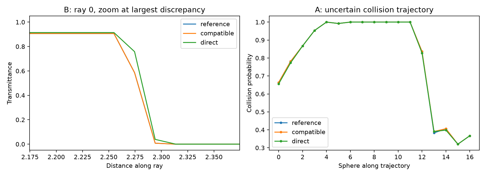

# Paired application evaluation

These runs compare **prepared coherent posterior functions**, with the same
random draws and analytic training covariance. They do not yet establish
complete-application or massive-scale speedups. Work: [#3](https://github.com/alecjacobson/fast-stochastic-psr/issues/3),
[#9](https://github.com/alecjacobson/fast-stochastic-psr/issues/9),
[#10](https://github.com/alecjacobson/fast-stochastic-psr/issues/10),
[#11](https://github.com/alecjacobson/fast-stochastic-psr/issues/11).

## Controlled workload

- A: 691 observations. B: 17,419. Same inputs as the matched scorpion figures.
- 128 coherent posterior draws, seed 42, full analytic vector covariance,
  finite 101³-mode scalar prior, observation noise variance 0.02.
- 24 candidate rays × 256 points; 17 collision spheres × 256 surface points.
- Every backend receives identical corrected pathwise weights and prior draws.
  Omitted vector spectrum and observation noise are sampled. This is **not**
  the unchanged upstream stochastic API, which uses different sampling choices.
- Reference: released 50³ interpolated cross kernel, each block shared across
  all 128 samples; the common prior already uses NUFFT for a stronger baseline.
- Direct: underlying finite Fourier kernel. Compatible: 201³-mode representation
  of the released interpolant. All use the same reference mean offset.
- Queries include field evaluation, joint events, probabilities and view scores.
  Warm times are medians of three synchronized GPU runs, including per-query
  plan construction. Sample preparation, aggregation and kernel setup are separate.
- Geometric scenarios are reconstructed on the released scorpion, not the
  unpublished paper scenes. One seed and fixed query discretization limit validation.

## Prepared-function query times after plan reuse

| Case | Backend | Rays + next-view scores | Collisions | Ray ratio vs reference |
| --- | --- | ---: | ---: | ---: |
| A | reference | 126.38 ms | 128.46 ms | 1.00× |
| A | direct | 113.47 ms | 111.62 ms | 1.11× |
| A | compatible | 217.05 ms | 205.36 ms | 0.58× |
| B | reference | 231.36 ms | 193.54 ms | 1.00× |
| B | direct | 124.36 ms | 111.52 ms | 1.86× |
| B | compatible | 219.90 ms | 204.61 ms | 1.05× |

Ratios above are timings, **not accepted application speedups**. In B, direct
Fourier fails the local probability gate, and collision probabilities all
saturate at 0 or 1. The compatible ray result passes paired numerical gates
but is close to the reference in speed. Model/Monte Carlo convergence and
uncertain collision trajectories remain open.

## Paired numerical quality

| Case | Backend | Ray RMS / max error (percentage points) | Collision max (points) | View-score regret | Gate v2 |
| --- | --- | ---: | ---: | ---: | --- |
| A | direct | 0.241 / 4.688 | 0.781 | 0.0000 | FAIL |
| A | compatible | 0.030 / 1.562 | 0.781 | 0.0000 | pass |
| B | direct | 0.639 / 17.188 | 0.000 | 0.0000 | FAIL |
| B | compatible | 0.036 / 1.562 | 0.000 | 0.0000 | pass |

Gate v2 requires ray RMS ≤1 percentage point, maximum ≤2 points, collision
maximum ≤2 points and next-view regret ≤two ray steps. Initial `A/` and `B/`
results used an RMS-only ray gate (v1); its passing flags are insufficient.
The local maximum gate was added after the B diagnostic exposed the problem.
A paired gate pass is not a posterior-distribution or sample-convergence proof.



## Plan reuse optimization

Previously each batch of four functions rebuilt the same query plan. A single
plan now handles all full batches in a query call, with a second plan for any
partial batch. New query geometry still builds new plans. This optimization
also applies to the reference prior evaluation.

| Case | Direct ray query before → after | Direct collision before → after |
| --- | ---: | ---: |
| A | 178.72 → 113.47 ms (1.57×) | 186.77 → 111.62 ms (1.67×) |
| B | 195.61 → 124.36 ms (1.57×) | 188.97 → 111.52 ms (1.69×) |

The retained before/after runs use the same input hashes and seed. Warm timing
variation remains; GPU clocks were not locked. This is an implementation
improvement, not the much larger application speedup the overall goal seeks.

## Preparation costs and exclusions

| Case | Shared fit/mean setup | Shared corrected draws + direct aggregation |
| --- | ---: | ---: |
| A | 0.57 s | 10.56 s |
| B | 1.92 s | 11.50 s |

The controlled harness computes direct aggregation during shared preparation,
even for the reference. Compatible aggregation is additional. Therefore these
stages are diagnostic costs, **not independently optimized end-to-end totals**.
The JSON records first query, setup, offset and all repeated query stages.
Peak GPU memory was not instrumented in these initial runs. Geometry generation,
file writes and rendering are excluded. Further preparation and memory profiling
are required before complete-application claims.

## Experimental compression of centered samples

Keep the full-resolution mean; truncate only the spectrum of each sample
minus that mean. Conditioning and generation still use the full spectrum.
Compare against the **full direct Fourier draws** to isolate this new error.
These are exploratory finite-sample checks, not a validated cutoff policy.

| Case | Fluctuation cutoff | Rays | Ray RMS / max error (points) | Paired gate vs full direct | Empirical variance relative error |
| --- | ---: | ---: | ---: | --- | ---: |
| A | 10 | 55.93 ms | 19.044 / 50.000 | FAIL | 44.66% |
| A | 20 | 43.23 ms | 7.753 / 22.656 | FAIL | 16.11% |
| A | 30 | 46.26 ms | 3.200 / 14.844 | FAIL | 6.11% |
| B | 10 | 60.12 ms | 0.603 / 15.625 | FAIL | 45.01% |
| B | 20 | 61.62 ms | 0.340 / 10.938 | FAIL | 16.87% |
| B | 30 | 56.10 ms | 0.132 / 3.125 | FAIL | 6.49% |

Passing against direct evaluation does not resolve direct-versus-interpolation
differences, population covariance error, or saturated collision coverage.

## Reproduce

```bash
./reproduction/run_env.sh reproduction/paired_applications.py --case A --rebuild-plans --output reproduction/results/paired_applications/A
./reproduction/run_env.sh reproduction/paired_applications.py --case B --rebuild-plans --output reproduction/results/paired_applications/B
./reproduction/run_env.sh reproduction/paired_applications.py --case A --output reproduction/results/paired_applications/A-plans
./reproduction/run_env.sh reproduction/paired_applications.py --case B --output reproduction/results/paired_applications/B-plans
./reproduction/run_env.sh reproduction/paired_applications.py --case B --backends direct --fluctuation-cutoffs 10 20 30 --output reproduction/results/paired_applications/B-spectrum
./reproduction/run_env.sh reproduction/paired_applications.py --case A --backends direct --fluctuation-cutoffs 10 20 30 --output reproduction/results/paired_applications/A-spectrum
./reproduction/run_env.sh reproduction/summarize_paired_applications.py
```

Run GPU jobs sequentially. Re-running overwrites the selected output directory.
The report generator uses only the saved JSON/event arrays and CPU plotting.
