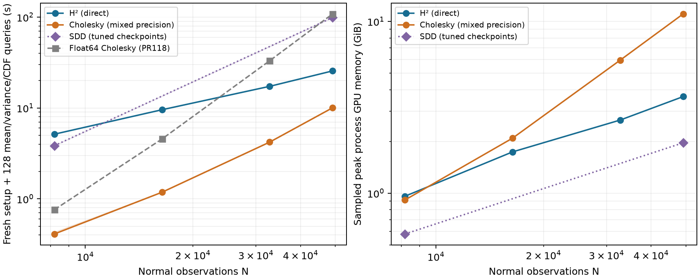
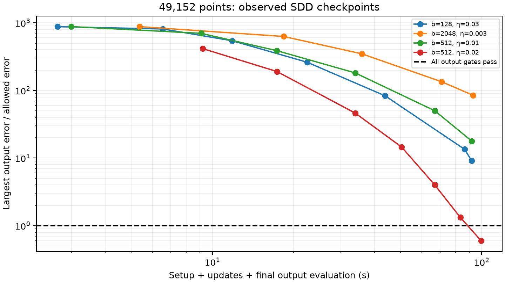

# Stronger controls overturn the PR118 dense/H² crossover

The real Armadillo partial-scan candidate does **not** currently establish an H² win over all alternatives. A float32 Cholesky factor with float64 full-kernel residual-corrected moments passes the unchanged mean-and-variance probability gates and beats the existing H² route. This follow-up addresses [#119](https://github.com/alecjacobson/fast-stochastic-psr/issues/119). PR118’s comparison against float64 Cholesky remains valid, but that was not the strongest dense implementation.

## Frozen task and acceptance

Every run conditions the same nonperiodic GP on a fresh nested set of normal observations and 32 noisy scalar surface observations, then computes **128 means, marginal variances and inside CDFs**. These are the same label-independent query indices and retained float64 reference fields as [PR118](../real_partial/README.md). There is no spatial interpolation or replacement of posterior variance by a cheap surrogate.

Lengthscale .48, component amplitude 1/3, normal noise variance .04, scalar noise variance .0001 and the validation-fitted calibration remain fixed. Acceptance requires finite moments, positive variances, maximum variance/prior error ≤1e-4, raw CDF error ≤1e-3 and calibrated CDF error ≤1e-3. These are numerical-equivalence gates on this finite panel, not population-calibration certificates. The prior report’s data/reference and application-quality limitations still apply.

Timings include factor/hierarchy construction, all normal/contact/query work, residual actions where used, scalar conditioning and CDF evaluation. The timed CDF is the raw GP probability; calibrated CDF agreement is an additional accuracy check outside the timer. Common scan preparation and CUDA initialization are excluded. SDD compilation is included; earlier oracle checkpoint checks and losing tuning trials are excluded from its selected completion time, favoring SDD. The full SDD wall time is also retained. Failed checkpoints do not supply accuracy-qualified completion times or a lower bound on the fastest possible SDD implementation.

## Why mixed precision changes the answer

Plain float32 Cholesky with float64 moment accumulation is fast, but fails the probability gates at 32k and 49k. Rejecting it does not establish that float64 factorization is necessary. Let A be the full normal-observation covariance including its noise, and let B contain all scalar cross-covariance columns and the three normal-data columns. With approximate solves Z and **full float64-kernel** residual R=B−AZ, the corrected joint reduction is

    BᵀZ + ZᵀR = BᵀA⁻¹B − RᵀA⁻¹R.

This cancels the first-order solve error. Contact conditioning uses the corrected mean, contact covariance, query/contact covariance and query variance together. The implementation pays for both triangular solves and a tiled full-kernel residual action. Moment accumulation and residual actions are float64; there is no clipping or physical-model retuning. This remains a dense factorization method with quadratic storage and cubic factor work; it changes the practical crossover, not those asymptotics.

The float64 version of the shared moment implementation independently matches the retained N=8192 reference to about 1e-12 in CDF. Unit tests compare whitening, solved moments, corrected moments and the compressed-basis algebra to an independently formed dense augmented-Gaussian posterior.

## Measurements

All entries below include fresh preparation and all 128 mean/variance/CDF outputs. Mixed-precision Cholesky has three independent process runs at every N; H² has one at each smaller N and three at 49k. SDD has three independent random seeds at both reported sizes. Values are medians, not best-of-repeat timings.

| Normal observations | Mixed Cholesky (s) | H² direct (s) | SDD (s) |
|---:|---:|---:|---:|
| 8,192 | 0.41 | 5.14 | 3.85 |
| 16,384 | 1.18 | 9.56 | — |
| 32,768 | 4.21 | 17.29 | — |
| 49,152 | 10.05 | 25.58 | 98.92 |

At 49,152 points, mixed Cholesky is **2.55× faster than H²**; H² is **3.87× faster than the best tested SDD configuration**. Three-run ranges are 10.035–10.047 s, 25.568–25.609 s and 98.531–99.593 s, respectively. This is a measured win over this tuned SDD implementation, not a global optimum over every possible SDD preconditioner, initialization or learning schedule.



The log–log fits over the four tested sizes give **0.89 for H²** and **1.78 for mixed Cholesky**. These are empirical slopes for these fixed recipes and this range, not complexity proofs. H²’s relative disadvantage shrinks from 12.5× at 8k to 2.55× at 49k, but **no runtime crossover against mixed Cholesky has been observed**. The dense residual action is quadratic in N for this fixed RHS count, while factorization remains cubic. Do not extrapolate a guaranteed crossover from these four points. SDD is measured at only two sizes; the dotted segment is a guide.

The mixed curve uses the same residual-corrected recipe at every N. Plain float32 passes at 8k in **0.165 s**, faster still, but fails at 16k, 32k and 49k. At 49k its 2.63-second result has raw/calibrated CDF errors .00287/.00277 and variance/prior error 1.13e-4, so it is excluded from accepted timings. At 16k it narrowly misses both CDF gates. Keeping these failures matters: a fast factor alone is insufficient, but a float64 factor is not required.

| Method at 49,152 | Peak GPU (GiB) | Peak host RSS (GiB) | Max raw CDF error | Max calibrated CDF error | Max variance/prior error |
|---|---:|---:|---:|---:|---:|
| H² (direct) | 3.65 | 0.95 | 3.00e-04 | 4.42e-04 | 2.61e-06 |
| Cholesky (mixed precision) | 11.05 | 1.19 | 1.79e-05 | 2.29e-05 | 1.29e-06 |
| SDD (tuned checkpoints) | 1.96 | 1.91 | 5.96e-04 | 5.55e-04 | 1.44e-06 |

Memory entries are medians of sampled per-process peaks; errors are worst across the three runs. H² uses about **one-third the GPU memory of mixed Cholesky** here. SDD uses less GPU memory than both, at higher runtime. This is a time/memory tradeoff, not universal H² superiority.

## SDD tuning and failed compression

Six initial 8k SDD batch/rate settings all pass, with different iteration costs. Large-case tuning retains three 90-second update-budget failures, two residual-correction pilots, two unstable higher-rate settings and the eventual passing configuration. The selected configuration uses batch 512, η=.02, momentum .9, Polyak .01, unit-amplitude kernel/noise normalization and uniform subset sampling. At 8k it passes at 4,096 updates; at 49k it passes at 24,576 updates, for each of three seeds. The learning rate passed to the solver is η·batch/N. This observed iteration growth is specific to this task and these settings.



The graph shows observed **standard-moment** checkpoints. Failed residual-corrected variants remain in the raw JSON, with their full-kernel action costs. None supplies a faster accepted result. Checking a reference field to choose a stopping checkpoint is an oracle advantage here; an automatic deployment stopping rule remains separate work. The nonpassing budget-limited trials are not reported as completion times, and their existence does not prove that no other SDD configuration can pass sooner.

Shared cross-SVD compression at the 160 discrete contact/query locations is also available to H², dense and SDD. At 49k, singular cutoff 1e-7 retains **451 of 480** columns. Eight H² variance iterations cost **21.06 s**, but raw CDF error **.001461** fails. Increasing to twelve iterations costs **27.52 s** and still fails at **.001463**: tightening the solve alone does not repair the basis error. Cutoff 1e-4 retains 123 columns and costs 12.04 s, but fails badly (raw CDF error .848). The relative cross-matrix Frobenius errors, 2.41e-7 and 3.33e-4, are not posterior-error guarantees after scalar conditioning. At 8k, tight compression passes for both H² (4.85 s) and SDD (7.19 s), without overturning the faster dense result. The direct H² curve above uses the unchanged recipe throughout, not a per-size lower envelope of these pilots.

See [summary.csv](summary.csv) for **all 52 trials**, including **39 accepted and 13 rejected** results; all 52 pass sampled GPU isolation. [primary.json](primary.json) records ranges, memory and worst errors for the plotted series. The audit recomputes all final field gates and every retained selected SDD checkpoint field, validates hashes/source snapshots, and verifies unchanged historical PR118 measurements. Seventeen CPU and three GPU tests passed; the two shared-moment/calibration checks were rerun after their final extension. Logs are retained.

## Scope and next experiment

The immediate candidate fails the stronger-dense-baseline test, so we do not label this an all-method win or spend a new original-grid/periodic sweep trying to rescue that claim. Original Sellán–Jacobson and periodic GeoSPR/NUFFT require matched application-quality comparisons; these runs instead compare Cholesky, H² and the compiled SDD update on the **same free-space kernel**. They are not a timing of untouched periodic GeoSPR SDD.

The next justified work is precision tuning of H² and locality ([#87](https://github.com/alecjacobson/fast-stochastic-psr/issues/87)), then larger real partial scans with the strong mixed-precision baseline. Query-basis truncation must be controlled after scalar conditioning ([#83](https://github.com/alecjacobson/fast-stochastic-psr/issues/83)). A better fitted growth rate or a memory limit is not yet a measured runtime win over all alternatives. Both the NUFFT and nonperiodic hierarchical routes remain available.

## Reproduction and retained evidence

Use `reproduction/setup.sh` and build the pinned prefix-kd extension with `./reproduction/run_env.sh reproduction/setup_higp.py --prefix-knn`. The restored runtime required an explicit setuptools dependency; this change pins it in the lock file. The earlier reference fields and public-scan cache are reused without regeneration. The current GPU is the same model and 24 GB MIG size as PR118, but a different host/instance; fresh H² controls make the comparison on the restored environment. CPU quota is four cores, host limit 16 GiB. See [environment.json](environment.json) and [build_environment.json](build_environment.json).

Representative commands (choose a new output path; drivers refuse overwriting existing trials):

```bash
./reproduction/run_env.sh -m reproduction.partial_precision --n 49152 --dtype float32 --correction residual --output /tmp/mixed-49152.json
./reproduction/run_env.sh -m reproduction.partial_sdd --n 49152 --batch 512 --eta .02 --budget 125 --checkpoints 24576 --output /tmp/sdd-49152.json
./reproduction/run_env.sh -m reproduction.partial_sparse_queries --method h2 --n 49152 --iterations 8 --query-batch 96 --query-limit 128 --rank 100 --neighbors 80 --h2-tolerance 1e-6 --solve-tolerance 1e-9 --output /tmp/h2-49152.json
./reproduction/run_env.sh -m reproduction.report_partial_competitors
```

The JSON argument blocks specify every trial, including failed pilots and stopping checkpoints. `sources/` retains hash-named source snapshots; contracts bind data, selection, calibration, query and reference checksums. The report independently recomputes all final output gates, checks recorded hashes, and includes sampled process GPU isolation and GPU/host peak memory. Peaks are sampled at 0.1 seconds and may miss short-lived allocations; they are not sums of persistent arrays. Old float64 timings are clearly marked as historical in the plot. The original raw PR118 measurements are unchanged. Its report now links this correction, and its manifest updates only that report hash plus the follow-up annotation. The original report and manifest are retained in `history/`.
