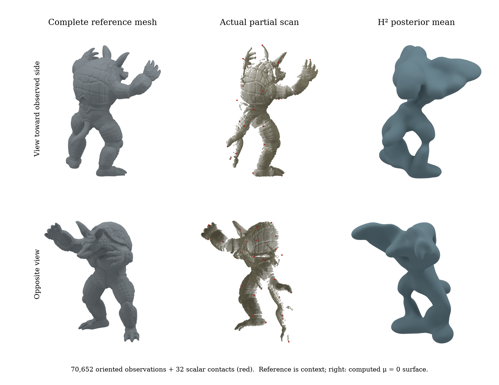
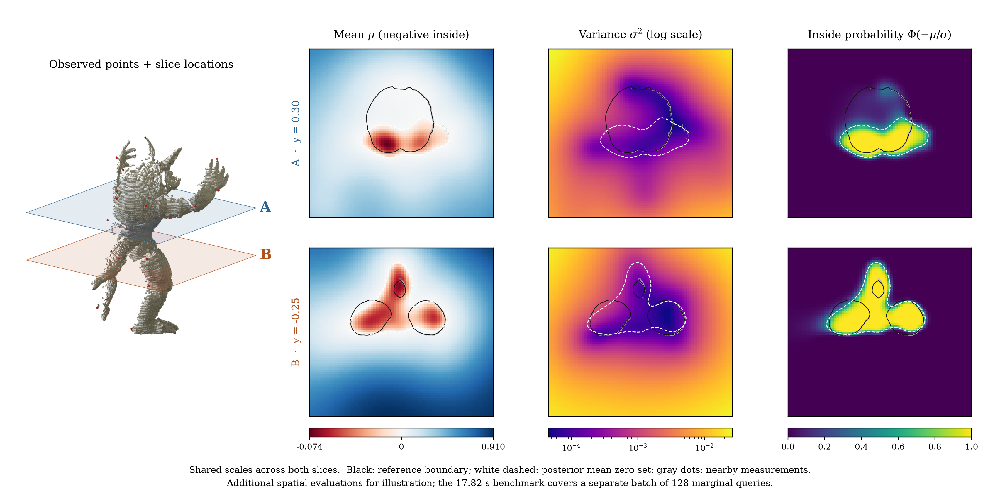
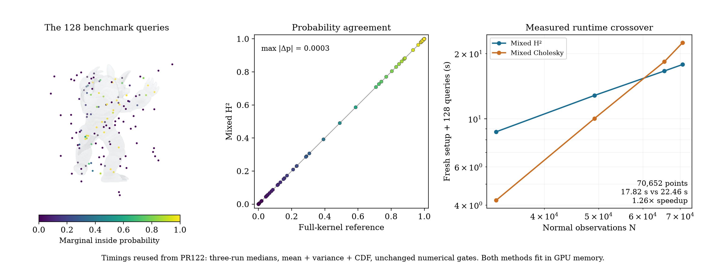

# Real partial scans: a visual companion to the H² crossover

These figures show the actual Armadillo data and posterior behind the [mixed-H² runtime crossover](../mixed_h2/README.md). Their composition follows GeoSPR's shaded point-cloud and statistical cross-section figures ([Figures 1 and 6](https://arxiv.org/pdf/2503.19136)). Geometry and colors come from measured data and computed fields; the figures do not use generated imagery.

The example conditions the same nonperiodic model on **70,652 actual range observations and 32 scalar surface contacts**, then asks for the marginal probability that a new query lies inside the object. Only three standing laser views are observed. Missing coverage and uncertainty are therefore part of the task, rather than a cosmetic perturbation of a complete clean mesh.



**Figure 1. Geometry and missing coverage.** The complete Stanford reconstructed mesh is reference context (left), the actual three-view input and 32 scalar contacts in red are shown in the middle, and the computed posterior mean zero level set is on the right. The two rows use matched orthographic cameras directed toward the observed side and the opposite side. Every input point is rendered; point radii are display glyph sizes. The reference comes from the same acquisition and was used for global registration and normalization. It is not independent physical ground truth. The mean surface is extracted without repair or capping from a declared display grid; it is not a posterior sample.



**Figure 2. From partial observations to marginal inside probability.** Two horizontal slices cross the chest (A, y=.30) and waist (B, y=−.25). Columns show the actual posterior mean μ, marginal variance σ², and raw inside probability Φ(−μ/σ), using this implementation's negative-inside convention. Black curves locate the reference mesh boundary, white dashed curves locate μ=0, and gray dots are nearby scan measurements. Color scales are shared between slices; variance uses a logarithmic color scale to resolve variation near the surface; the diverging mean scale is centered at zero with its actual shared negative/positive extrema marked. No variance clipping or probability calibration is applied to these images.



**Figure 3. The measured task.** The colored spheres are exactly the 128 queries used by PR122, shown against translucent reference geometry. Their positions are arbitrary spatial probes, not samples from a random surface. The agreement panel compares their inside probabilities with the independent full-kernel reference. The runtime graph reuses the original three-run medians: at 70,652 observations, fresh setup plus 128 mean/variance/CDF queries takes 17.82 s with mixed H² and 22.46 s with mixed Cholesky; both fit in GPU memory. The translucent figure background is reference context, not the input used for conditioning.

## What the pictures show

Near the reference boundary, the coverage-based unobserved region has **6.13× higher median variance in the chest slice** and **3.15× in the waist slice**. The comparison uses slice points within .06 of the reference surface, labeling the closest surface location as observed when its distance to the input is below .025 and unobserved when above .075. These are coverage proxies, not ray-visibility labels.

| Slice | Observed / unobserved points | Observed median variance | Unobserved median variance |
|---|---:|---:|---:|
| Chest (A) | 351 / 180 | 1.17e-4 | 7.19e-4 |
| Waist (B) | 312 / 208 | 1.25e-4 | 3.95e-4 |

The mean also misses some unseen geometry and overextends elsewhere. Reference-vertex-to-mean-surface median distance is **.0277 in observed regions and .0643 in unobserved regions**, in coordinates with object height 2.0. These are vertex-sampled distances to the displayed triangle mesh, not physical error measurements or a convergence study of the display grid. The extracted surface has 21,634 vertices, 43,268 faces and no boundary edges; no holes were capped or geometry repaired.

The raw probabilities still make confident mistakes relative to the reconstructed reference. Signed-distance and winding-number labels agree on all 10,368 slice locations. Excluding points within .005 of the reference boundary, the chest slice has 11 reference-inside points with P < .05 and 38 reference-outside points with P > .95; the waist has 5 and 153, respectively. The plots deliberately retain these discrepancies. Numerical agreement with the selected GP and useful calibrated shape completion are different questions; these observations motivate the focused [quality follow-up #124](https://github.com/alecjacobson/fast-stochastic-psr/issues/124) and extend the modeling diagnostics in [#117](https://github.com/alecjacobson/fast-stochastic-psr/issues/117).

## Computation and scope

The training set, 32 contact locations, ell = .48, component amplitude 1/3, normal noise variance .04 and scalar noise variance .0001 are unchanged. The illustration uses the cached mixed H² recipe from PR122 with hierarchy tolerance 1e-6, ten variance iterations, mean/contact tolerance 1e-9, AFN rank 100 and 80 neighbors. Raw probability is shown; validation also checks the previously fixed calibrated-probability gate.

The two 72×72 slices require **10,368 additional mean-and-variance queries**. Their locations span the complete reference x/z bounding rectangle plus .10 padding. The mean surface uses **614,400 mean-only evaluations** on an 80×96×80 grid over the reference box plus .10 padding. The scalar-contact update is algebraically folded into three normal-data coefficient vectors for these mean-only evaluations. This is tested against an independently assembled augmented Gaussian posterior and checked against the direct query path. The grid serves only marching-cubes display: it introduces no periodic boundary condition into the GP.

These extra evaluations, mesh extraction, rendering and figure composition are **outside the 17.82-second benchmark**. A dense raster is useful for communicating the result but is a different workload from 128 new queries. No large-query speedup follows from this visual companion.

Independent full-kernel checks use the 128 benchmark queries plus a fixed 8×8 lattice on each slice. The dense factor is refined with full float64 kernel actions until relative residual≤1e-9 and raw/calibrated probability changes≤1e-6. The existing variance/prior≤1e-4 and raw/calibrated CDF≤1e-3 gates are preserved. This 256-point check is not a uniform error certificate for the whole displayed field. The maximum checked errors are **8.99e-4 in raw CDF, 6.88e-4 in calibrated CDF and 1.06e-6 in variance/prior**. All pass the unchanged gates. The contact-folded mean matches the direct path within 1.67e-13 on the 128 benchmark queries. Field generation took 567.0 s for setup plus the benchmark and slice marginals, and another 44.25 s for the mean display volume; these single-run illustration costs are not a new competing-method benchmark. Convergence histories and sampled GPU isolation are retained in the JSON artifacts.

The figures expose the model as well as the computation. A posterior mean is a single estimate, and larger uncertainty does not guarantee geometrically correct completion. The zero-mean free-space prior with zero scalar targets tends toward inside probability .5 far from observations; the display box is finite and must not be read as a global solid guarantee. The existing calibration, correlated-scan-noise and cheap contact-only variance caveats remain. Marginal inside probabilities are not joint collision probabilities, and no coherent posterior surface samples are claimed.

Exportable figures: [geometry PDF](geometry.pdf), [posterior slices PDF](posterior-slices.pdf), [query agreement PDF](query-agreement.pdf).

## Reproduction

Install the ordinary numerical runtime and pinned prefix-kd extension as in PR122, then the separate Blender environment with `./reproduction/render_setup.sh`. The same public scan cache is reused; the compact scene file and numerical display fields are retained with this report.

```bash
./reproduction/run_env.sh -m reproduction.compute_partial_figures prepare
./reproduction/run_env.sh -m reproduction.compute_partial_figures h2
./reproduction/run_env.sh -m reproduction.compute_partial_figures check
./reproduction/run_env.sh -m reproduction.compute_partial_figures mesh
./reproduction/run_env.sh -m reproduction.compose_partial_figures prepare
```

Scene preparation reuses a matching retained contract without rewriting its provenance. Field-generation commands refuse to overwrite completed fields. Move the corresponding output pair aside before regenerating. Render each of `reference`, `input`, `mean` in both `observed` and `back` views, plus `input --planes` and `probes-h2` in the observed view:

```bash
/opt/geospsr-runtime/render-venv/bin/python reproduction/render_partial_figures.py --kind input --view observed --planes
./reproduction/run_env.sh -m reproduction.compose_partial_figures all
```

Each Cycles render records camera, glyph radii, Blender version, sample count and source/scene hashes. Quantitative emission colors are converted from sRGB to linear, then rendered with Blender's Standard/None color management to agree with the plotted colorbar. The renderer uses all 70,652 measured positions without subsampling. Figures are supplied as PNG and PDF; component renders and raw fields support alternative layouts. The new contact-folded mean test passes against an independent augmented Gaussian posterior. The audit also verifies the extracted mesh lies on the sampled zero level set, the plotted query colors match the retained CDFs, and render source/camera/scene provenance. The audit verifies all **640 retained historical benchmark artifacts** are unchanged. Run it with `./reproduction/run_env.sh -m reproduction.audit_partial_figures`.
