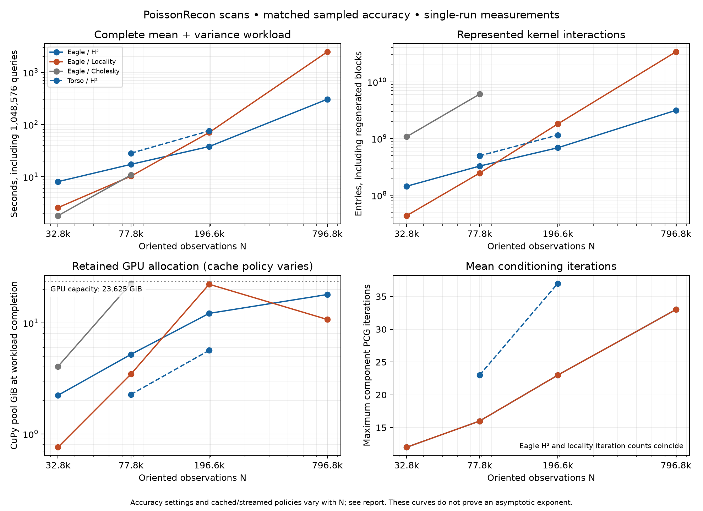
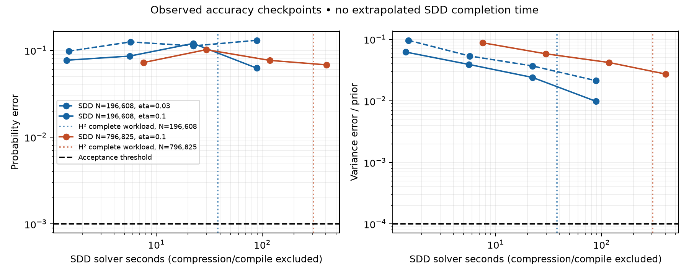

# PoissonRecon scans: H² accelerates mean and variance

On the **full Eagle scan (796,825 oriented points)**, H² completes setup, mean,
variance and **1,048,576 probability queries in 305.04 s**, versus **2,465.47 s**
for the improved streamed radius-kernel control: **8.08× faster**. Both methods
pass the independent numerical gates and their complete-query comparison.
The model is nonperiodic; there is no full Cholesky factor in H² preparation.

Both requested [PoissonRecon datasets](https://github.com/mkazhdan/PoissonRecon)
are downloaded and checksum-pinned: Eagle has 796,825 points and Torso has
3,488,432. Input binaries stay in an external cache; `data/*.json` records source
URLs, hashes and the fixed preprocessing/contact rule.


The display uses up to 80,000 points per scan; solver sizes below are exact.

## Measured crossover

These are single-run measurements on an **RTX PRO 6000 Blackwell MIG 1g.24gb**
(23.625 GiB visible), with four CPU cores and a 16 GiB host limit. Every completed
row includes both mean and variance preparation plus the same million-query
workload. Common runtime initialization, input preparation and offline accuracy
verification are excluded and disclosed in [METHOD.md](METHOD.md).

| Eagle observations | H² | Locality | Float32 Cholesky | Locality time / H² time |
|---:|---:|---:|---:|---:|
| 32,768 | 8.09 s | 2.57 s | 1.80 s | 0.32× |
| 77,824 | 17.35 s | 10.30 s | 10.85 s | 0.59× |
| 196,608 | 37.98 s | 70.60 s | allocation failure | **1.86×** |
| 796,825, full scan | **305.04 s** | **2,465.47 s** | 2.31 TiB for a full matrix alone | **8.08×** |

Locality and Cholesky win at smaller sizes. At 196,608 points, the locality
control still caches its graph; its relaxed allocation guard allows it to fit,
so the crossover is not created by an arbitrary memory refusal. At full Eagle,
both H² and locality stream their interactions through 256 MiB workspaces.



The interaction count explains the growing advantage. Across these four sizes,
H² represents **144m, 327m, 687m and 3,144m** entries; locality retains **43m,
245m, 1,808m and 33,802m**. At full size both mean solves take **33 iterations**
and both use eight variance steps. Conditioning takes **220.40 versus 2,381.40 s**
(**10.8×**); the complete-workload ratio charges H²'s additional setup costs.

This is a favorable empirical trend, not a fitted asymptotic theorem. H² uses
order five at the smaller sizes and order seven at full size; hierarchy tolerance,
preconditioner size and cache policy also adapt to meet accuracy and memory
requirements. All choices appear in the raw records and `selection.json`.
Streaming locality uses less GPU memory at full size: retained CuPy pools are
**10.75 GiB for locality versus 18.01 GiB for H²**. The demonstrated full-size
advantage is computation, not universally lower resident memory.

## Accuracy and variance involvement

At full Eagle, independent checked probability errors are **0.0003000 for H²**
and **0.0003945 for locality**, against a 0.001 threshold. Variance errors divided
by prior variance are **2.73e-6 and 2.40e-6**, against a 1e-4 threshold.
Across all 1,048,576 workload queries, the two fields differ by at most
**0.0009174 in probability** and **3.55e-7 of prior variance**; all 16 batch
choices agree. The 196,608-point pair also passes, with probability difference
0.0006607 and identical choices.

Replacing the selected H² field’s posterior variance with the prior changes
probabilities by up to **0.10253**; using constant contact variance changes them
by **0.002890**, also above the 0.001 target. These are full-workload shortcut
differences from the audited approximate field, not new independent truth checks.
The constant shortcut also incurs maximum decision regret 1.36e-5 in the ambiguity
score; the prior shortcut happens to preserve the winning rays in this workload.
The probability outputs, rather than a large decision-quality claim, establish
why spatially varying posterior variance is needed here.

Torso's order-six H² runs pass at **77,824 points in 28.37 s** and **196,608
points in 75.77 s**, with checked probability errors 0.0002466 and 0.0006512.
Those are numerical/scaling results on subsets; no full-Torso runtime is claimed.

## SDD controls

The compiled SDD control receives the same cross compression and query cache,
with batch 128, momentum 0.9, Polyak weight 0.01 and optional uniform rejection
sampling. At N=196,608, neither tested learning rate (0.03 or 0.1) passes its
observed checkpoints through 32,768 iterations / about 89 solver seconds; the
better final variance error/prior is 0.00979.

At full Eagle, rate 0.1 reaches **28,160 iterations in 403.77 solver seconds**
(the 400-second budget is checked in 256-step blocks). Its final probability
error is **0.06815** and variance error/prior **0.02722**, versus targets 0.001
and 0.0001. No observed checkpoint passes. Preparation including compression and
compilation is 474.57 s at that checkpoint; a passing million-query replay is
therefore not timed. These are censored convergence observations, not an SDD
completion time or a finite H²/SDD completion-speed ratio. Batch and learning-rate
tuning is limited; no universal superiority over SDD is claimed.



## What the comparison establishes

The useful regime is a dense scan of a fixed-size object, a fixed physical
lengthscale, and repeated probability queries in a small contact region. Radius
neighbors grow with point density; H² compresses distant interactions. All
methods receive the same regional cache, so the win must come from preparing
mean and variance, not denying a baseline query reuse.

The independent gates are positive variance, variance error/prior ≤ 1e-4, and
absolute probability error ≤ 1e-3. Reference uncertainty is included. Each audit
checks 17 direct-cross-kernel locations against full float64 covariance residuals;
full-million-query comparisons supplement those probes. These are sampled
numerical checks, not a uniform exact-GP error theorem. The full-Eagle offline
reference took 926.44 s and is excluded from production time; production needs
no full observation-matrix factor.

The faster Eagle pilots at 103.97 s (order four) and 233.67 s (looser order six)
fail accuracy and are excluded. Even two individually passing fields—order six
with 12 variance steps and order seven with eight—differ by 0.001492 over the
complete query workload. That comparison changes both order and iteration count
and is explicitly marked failed. The selected order-seven field has better
sampled error margin; adaptive interpolation remains open in issue 93.

A conventional full float32 Eagle matrix alone would occupy **2.31 TiB**. The
N=196,608 dense attempt actually fails allocation on this GPU. This establishes
a capacity limitation, not an extrapolated Cholesky runtime. Cached locality
allocation-guard refusals are distinguished from physical allocation failures;
the 85% headroom trial fits but fails accuracy at cutoff 14.

Torso's full 3,488,432-point file is downloaded and prepared, but validated runs
here reach only 196,608 points; full-size validation is tracked in
[issue 99](https://github.com/alecjacobson/fast-stochastic-psr/issues/99). Its higher-order runs establish numerical
feasibility on a second real scan, not a full-torso speedup.

This is a nonperiodic shared-model numerical study. It does not establish
calibrated robotics uncertainty, joint collision probabilities, or pointwise
agreement with periodic NUFFT or the original Sellán–Jacobson discretization.
The Torso envelope is not used as ground truth. Cross-model geometry and
uncertainty quality remain separate work.

## Changes required by the larger scans

- Exact predecessor k-nearest-neighbor search removes AFN's coarse-octree search
  bottleneck. The separate `psr_higp_kd_cext` module preserves the original backend.
- Prediction-only AFN omits unused derivative storage; a native zero-allocation
  destructor bug is fixed and regression tested.
- Streamed H² and radius interactions use bounded workspaces. H² preserves every
  represented near/far block; radius truncation still needs its own accuracy audit.
- Warp-parallel radius fill preserves exact columns and values. Its isolated
  first-chunk fill is about 8.2× faster, strengthening the locality baseline;
  that microbenchmark is not a whole-solve speedup.
- Stable streaming QR, blocked right-hand sides and optional CPU-state release
  control preparation memory without introducing a full Cholesky factor.
- Two-dimensional full-kernel tiles and corrected mean/variance residual bounds
  make independent verification practical at full Eagle size.
- Optional rejection sampling removes SDD's full-N permutation overhead while
  retaining uniform subsets. The original sampler remains the default.

The original native/cached H² routes and all NUFFT routes remain available.
Issues [89](https://github.com/alecjacobson/fast-stochastic-psr/issues/89),
[90](https://github.com/alecjacobson/fast-stochastic-psr/issues/90),
[91](https://github.com/alecjacobson/fast-stochastic-psr/issues/91),
[92](https://github.com/alecjacobson/fast-stochastic-psr/issues/92),
[93](https://github.com/alecjacobson/fast-stochastic-psr/issues/93),
[94](https://github.com/alecjacobson/fast-stochastic-psr/issues/94),
[96](https://github.com/alecjacobson/fast-stochastic-psr/issues/96),
[97](https://github.com/alecjacobson/fast-stochastic-psr/issues/97), and
[98](https://github.com/alecjacobson/fast-stochastic-psr/issues/98) track these
findings. Mixed-precision locality remains an open stronger control in
[87](https://github.com/alecjacobson/fast-stochastic-psr/issues/87); current radius
controls use float64. Tuning is not exhaustive, and timings are single-run
measurements rather than medians or confidence intervals.

## Validation

The final targeted regression run passed **66 tests in 38.92 s**, covering both
native hierarchy backends, streamed/cached/dense actions, full-kernel tiling,
residual bounds, data preparation, SDD sampling/update behavior, and NUFFT/Fourier
posterior regressions. Three warnings are upstream gpytoolbox deprecations. All
six selected full-query comparisons pass. A fresh 32,768-point H²/locality replay
also passes, including a newly constructed reference and full-query comparison.
See `validation.json`, `tests.log` and `pilot/replay-smoke/`; this is not a fresh
replay of the entire large timing suite.

## Reproduce

Use the GPU environment from the repository setup instructions. Build the
optional backend before starting any process that imports it:

```bash
./reproduction/run_env.sh -m reproduction.setup_higp --prefix-knn
./reproduction/run_env.sh -m reproduction.fetch_poissonrecon
./reproduction/run_env.sh -m reproduction.replay_poissonrecon \
  --output /tmp/poissonrecon-replay
```

`selection.json` enumerates every accepted plotted production record. The replay
checks dataset hashes, preserves all recorded solver/cache options, runs methods
sequentially, constructs fresh independent references, audits outputs and plots
only passing runs. Use a separate output directory; do not overwrite published
evidence. Reference construction can cost more than production.

The SDD controls are separate censored experiments. For the full scan:

```bash
./reproduction/run_env.sh -m reproduction.benchmark_hierarchical_sdd \
  --reference reproduction/results/poissonrecon_large/eagle/references/796825.json \
  --application-reference reproduction/results/poissonrecon_large/eagle/eight-large/h2-streamed-796825-0.json \
  --output /tmp/eagle-sdd.json --eta .1 --batch 128 --order 7 \
  --cross-tolerance 1e-8 --cross-block-size 4096 --budget 400 \
  --checkpoints 512 2048 8192 32768 131072 --sampling rejection \
  --correction-policy mean
```

On another machine, use the fresh replay's reference and application paths so
its data-location contract matches. Raw production records include arguments,
data/source hashes, timing components, ranks, iterations and memory; associated
status/log files preserve failures. `pilot/`, lower-order `scaling/` runs, and
unselected controls are retained negative or developmental evidence. Selection
is explicit; a short runtime alone never implies acceptance.
