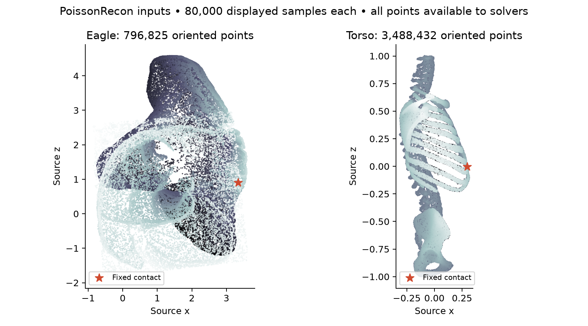

# Large PoissonRecon scans: mean and variance

This experiment uses the actual Eagle (796,825 oriented points) and Torso
(3,488,432 oriented points) from PoissonRecon. It extends the nonperiodic H²
route while keeping NUFFT and the original native backend available.

The complete-workload timings include preparation of **both mean and variance**
and 1,048,576 marginal probability queries. Every method gets the same reusable
regional cache. See [METHOD.md](METHOD.md) for the model, input preprocessing,
fixed contact rule, hardware, timing boundaries and independent accuracy gates.

## Evidence status

The lower-order pilots are retained rather than presented as accepted speedups.
At N=196,608 on Eagle, order-five / cross tolerance 1e-8 / twelve variance steps
passes with H² tolerance 1e-4: 50.03 s cached or 55.35 s streamed. Cached sparse
cutoff 12 takes 63.66 s but **fails probability accuracy**, so that pair is not an
accepted speedup comparison. Widening the local radius is necessary.

At full Eagle, the order-six streamed H² run takes 233.67 s and fits in the
24 GiB GPU partition; its independent audit is pending. The earlier order-four
103.97 s run is also provisional. Neither is accepted large-scale accuracy
or a demonstrated speedup until its audit and a valid baseline comparison pass.

Torso order-four dense and H² pilots fail probability accuracy, and order five
at N=77,824 narrowly fails. A float64 dense N=16,384 pilot identifies interpolation
as a material error source: increasing order from four to five reduces the
probability error from 0.001069 to 0.0000279. No failed row is a timing win.

## Changes needed at this scale

- Exact predecessor k-nearest-neighbor search removes AFN's coarse-octree search
  bottleneck. The separate `psr_higp_kd_cext` extension preserves the original.
- Prediction-only AFN omits unused derivative storage; a native zero-allocation
  destructor bug was fixed and regression tested.
- Streamed near/far H² interactions preserve the represented operator with a
  bounded workspace and no global 32-bit CSR-entry limit.
- Stable streaming QR compresses regional cross kernels without materializing
  the entire high-order matrix or forming squared-condition normal equations.
- Blocked right-hand sides and optional CPU-state release control peak memory.
- Corrected mean/variance output bounds reduce unnecessary independent-reference
  refinement while retaining full float64 all-pairs residual verification.

Issues [89](https://github.com/alecjacobson/fast-stochastic-psr/issues/89)–
[94](https://github.com/alecjacobson/fast-stochastic-psr/issues/94) track capacity,
neighbor search, derivative destruction, reference certification, interpolation,
and radius truncation. Raw timing files retain data/source hashes and failures.

This is a same-model numerical experiment on real geometry, not a ContactFusion
reproduction, calibrated robotics claim, or pointwise comparison to periodic
NUFFT or the original Sellán–Jacobson discretization. Torso's envelope is not used
as ground truth. A full float32 Eagle matrix would occupy 2.31 TiB; that is a
storage formula, not an extrapolated Cholesky runtime.
