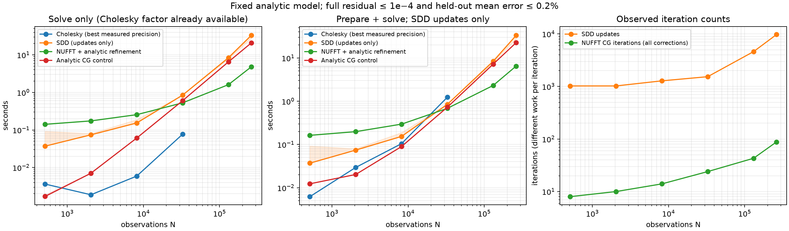
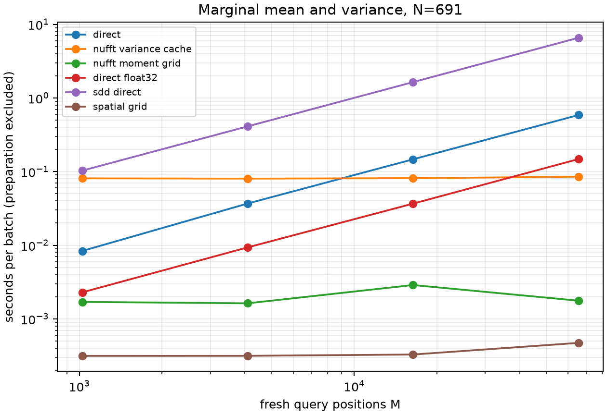
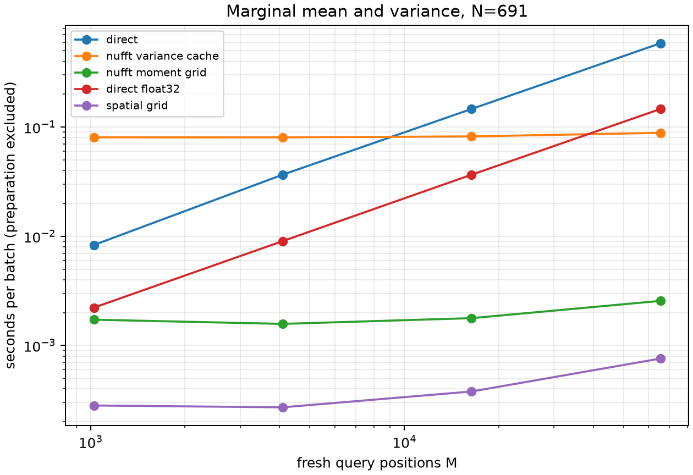

# A practical NUFFT win: fresh, dense scan reconstruction

**The strongest measured regime is fitting a new dense noisy scan, with an
accurate full analytic solve, before querying the resulting field.** At 32,768
observations, NUFFT plus analytic refinement beats both a float32 Cholesky
baseline and tuned SDD, including NUFFT's map-specific preparation. At 262,144
observations it is 5.1× faster than SDD updates alone. Small scans favor other
methods, and an existing Cholesky factor remains fast for new right-hand sides.

**Repeated marginal-variance queries on the small fixed scan are not the best
showcase.** The Fourier moment cache greatly accelerates direct Cholesky/SDD
queries, but a prepared Cholesky spatial moment grid is cheaper and faster at
matched accuracy. This counterexample changes the recommended problem selection.

[Protocol and accuracy gates](PROTOCOL.md) · [Algorithmic costs in the paper's
notation](METHODS.md) · [Raw-record verification](verification.json) ·
[Tracking issue #59](https://github.com/alecjacobson/fast-stochastic-psr/issues/59).

## Observation scaling

Synthetic, distinct visible-surface scorpion observations, with coordinate and
normal noise; nested subsets of the released geometry, not ContactFusion data.
Fixed domain, length scale .01, per-axis kernel variance .1, noise variance .02.
The target covariance is the full analytic periodic product Matérn32 kernel.
All methods must pass full relative residual <=1e-4 and held-out mean relative
L2 error <=0.2%. Each solver gets the same NUFFT mean evaluator, so the measured
differences here come from fitting, not different query implementations.

Times below are seconds. NUFFT and analytic-CG include their map-specific
geometry/plan preparation. Cholesky includes matrix construction, factorization,
and solve, using the best passing precision measured at each N. **SDD is given
compilation, residual verification, and verification geometry for free** in this
comparison; its update time is a favorable lower bound on the verified pipeline.

| Observations N | Cholesky prepare + solve | SDD updates only | NUFFT prepare + solve | Analytic-CG prepare + solve |
|---:|---:|---:|---:|---:|
| 512 | 0.0062 | 0.0370 | 0.1628 | 0.0124 |
| 2,048 | 0.0295 | 0.0742 | 0.1981 | 0.0203 |
| 8,192 | 0.1046 | 0.1537 | 0.2956 | 0.0897 |
| 32,768 | **1.2407** | **0.8487** | **0.6851** | 0.7297 |
| 131,072 | — | 8.3854 | **2.3183** | 7.2213 |
| 262,144 | — | 33.2027 | **6.5028** | 22.6042 |

Dense timings stop at the declared cap. At the last two sizes, one float32
matrix alone needs 64/256 GiB; this allocation is not attempted on the 24-GB
MIG instance. No extrapolated dense runtime appears in the table or plot.
The 32,768-point float32 solve independently passes with residual 1.15e-6 and
mean error 7.21e-7. A previous float64 attempt exceeded workspace memory and
is retained among the pilots.



[PDF figure](solver_scaling.pdf). Lines connect measured medians; shading shows
the minimum/maximum of three solves. Cholesky preparation is measured once per
precision, so it has no repeated-factorization error bar. The left panel gives
Cholesky an already-built factor; the middle panel charges fresh preparation.
Shared runtime/library caches can be warm. SDD compilation takes about 0.4–0.7s
and can be reused for matching shapes; it is excluded from both SDD time curves.

Over the three largest N, log-log fits of these preparation-inclusive times
(with the favorable SDD update-only convention) give empirical exponents
**1.05 for NUFFT**, **1.75 for SDD**, and **1.65 for analytic CG**. These are
finite-range observations on one scene, not proofs of asymptotic exponents.
In particular, SDD also has linear work per iteration at fixed batch size;
there is no unconditional asymptotic NUFFT advantage over SDD independent of
convergence, bandwidth, and the accuracy requirement.

The iteration-growth hypothesis is supported in this regime:

| N | SDD confirmed iterations, three seeds | NUFFT CG iterations, including corrections |
|---:|---|---:|
| 32,768 | 1,536 / 1,536 / 1,536 | 24 |
| 131,072 | 4,864 / 4,608 / 4,352 | 43 |
| 262,144 | 9,728 / 8,192 / 10,240 | 88 |

Iterations do different amounts of work and should not be compared as speed
ratios. SDD's frozen pilot budget failed independent seeds in earlier runs;
confirmation now continues until the full residual passes. At N=262,144 its
median update time is 33.20s, median update-plus-verification time 38.61s,
and verification geometry takes another 1.66s. The plot deliberately uses
the smaller update-only time. Reference construction and pilot tuning are
also recorded separately and excluded from production candidate costs.

NUFFT is materially responsible for the gain: the analytic-CG control uses
the same fast analytic action but needs 20.94s to solve at N=262,144, versus
4.83s for NUFFT plus refinement. The latter still needs three analytic actions
and two defect corrections at that size. Their costs and geometry are counted;
this is not a claim about a pure finite-spectrum solve matching the analytic
model without correction. Maximum NUFFT held-out mean error across promoted
runs is below 4.2e-6, much smaller than the declared 0.002 gate.

The practical choice is a **fresh dense reconstruction or independent map
snapshot**, followed by mean/implicit-surface queries. A 262k scan takes about
6.5s to prepare and solve here, rather than 33.2s of SDD updates. It is not a
real-time ContactFusion claim. Normal-only updates with a fixed covariance,
incremental Cholesky updates, solver warm starts, looser output-only accuracy,
other scenes and other kernels are outside this measured comparison. The full
residual gate may be stricter than a particular surface-only application needs.

## Marginal mean and variance query scaling

Scan A has N=691 observations. The same full analytic observation covariance
and finite cutoff-50 scalar/cross kernel define every method's target. A full
Cholesky correction factor is converted into one exact doubled-bandwidth
variance series, with no Monte Carlo or rank truncation. The implementation
then caches mean and variance in an interpolation-only NUFFT grid. This is a
**Cholesky–NUFFT hybrid**, not a scalable replacement for dense conditioning.

All methods pass mean <=0.2%, variance <=0.02%, centered variance contrast
<=1%, and marginal-probability RMS/max <=0.05/0.5 percentage points. Every
full batch is compared with the dense table-backed reference; independent
exact finite-cross-kernel panels also pass. Positive variances are required.

Median time for 65,536 fresh surface-query positions:

| Method | Query time | Additional moment-cache preparation |
|---|---:|---:|
| Direct Cholesky, float64 | 587.3 ms | none |
| Direct Cholesky, float32 | 148.0 ms | none |
| Direct SDD | 6,578.6 ms | none |
| Ordinary type-2 Fourier variance evaluation | 85.4 ms | 25.39 s |
| Prepared NUFFT moment grid | **1.765 ms** | **25.43 s** |
| Prepared Cholesky spatial moment grid | **0.472 ms** | **3.14 s** |

These are query/cache-construction components, not total cold-process costs.
Factorization, mean preparation, and the model-only cross-kernel table are
separate in the raw records. The table takes about 7.30s once per model and
can survive map changes; it is not charged repeatedly to favor NUFFT.
The Fourier cache occupies 531 MB, versus 33.6 MB for the local 128³ cubic
spatial grid. Its bounding box is the mesh box padded by .15 per coordinate.



[PDF figure](variance_A.pdf). The NUFFT cache is ~84× faster than direct float32
Cholesky and ~3,727× faster than direct SDD at the largest query batch. Those
ratios do **not** establish superiority over prepared Cholesky: the spatial
grid wins both preparation and queries. A modeled NUFFT break-even against
direct float32 Cholesky alone is around 174 batches of 65,536 queries, but the
spatial grid offers a better alternative first. This break-even is calculated
from measured components, not a measured 174-batch replay.

A second workload mixes surface queries with uniform probes across the full
periodic workspace. Its accurate periodic 256³ Cholesky moment grid takes
24.90s to build and 0.758ms per 65,536 queries; NUFFT takes 25.40s to prepare
and 2.559ms to query. Even this larger domain does not establish a variance
win. Smaller intermediate grid sizes were not exhaustively tuned; doing so
could only strengthen the spatial baseline. SDD was not rerun for this second
workload because NUFFT already loses to the competing Cholesky cache.



[PDF figure](variance_global-A.pdf). Both prepared caches have O(M) query work
at fixed accuracy; a flat-looking curve over these M values reflects overhead,
not constant-time evaluation for arbitrarily many queries. The next variance
candidate is larger N, where direct spatial-grid construction's O(HN²) work
may lose to Fourier construction's O(NL log L) term, or a cheaper reusable
correction-factor approximation with independently checked uncertainty error.
That crossover has not been established here. Marginal moments also do not
establish joint collision probabilities or correlated ray transmittance.

## Changes, validation, and limitations

- Added exact streamed Fourier-square accumulation, variance-series preparation,
  GPU interpolation of the original nonuniform cross-kernel table, and a strong
  local/periodic cubic spatial moment cache.
- Fixed unequal-field packing: remove constant modes and scale each real
  channel independently before packing, preserving small variance contrast.
  Product FFTs use smooth-size padding without dropping product frequencies.
  The original failed packing workload was rerun unchanged in N, bandwidth,
  queries and gates: all panels now pass ([regression record](regressions/packing/results.json)).
- Added a fused float32 analytic matrix builder and accuracy-gated dense
  precision selection; testing only double precision understated Cholesky.
- Fixed these benchmarks' isolation monitor to query the allocated MIG UUID.
  Parent-device queries lacked permission. Earlier audit failures stay archived.

**30 targeted tests pass** ([log](tests.log)), including independent Fourier
sums, dense variance, SciPy interpolation, float32 analytic covariance, channel
packing, GPU-audit failures, and pinned-upstream SDD update equivalence.
All eight promoted runs pass stored-gate verification and sampled GPU isolation.
The verifier binds the raw JSON bytes and rechecks recorded thresholds; it
does not recompute numerical errors from saved arrays. Reproduction reruns the
independent numerical checks. Periodic process sampling can miss brief overlap.

Hardware: allocated **1g.24gb MIG instance of an NVIDIA RTX PRO 6000 Blackwell
Server Edition**. Runtime is the pinned reproduction environment (JAX 0.6.2,
CuPy 14.2.0; versions, input hashes and Python-source hashes are in each record).
No comparison with timings from the paper's different GPU is made. Each
promoted solver run contains full-model residual checks, independent analytic rows,
three confirmations, and a passing allocated-device audit. This is one-scene
infill scaling at fixed bandwidth/model, not a benchmark suite over physical
sensor data or proof of infinite-bandwidth accuracy.

Raw records: [solver](solver), [variance](variance), [all exploratory pilots,
including failures](pilots), and [input manifest](input-manifest.json).
Tracked work: [#60 moment collapse](https://github.com/alecjacobson/fast-stochastic-psr/issues/60),
[#61 packing](https://github.com/alecjacobson/fast-stochastic-psr/issues/61),
[#62 spatial baseline](https://github.com/alecjacobson/fast-stochastic-psr/issues/62),
[#63 MIG auditing](https://github.com/alecjacobson/fast-stochastic-psr/issues/63),
[#64 dense precision](https://github.com/alecjacobson/fast-stochastic-psr/issues/64).

## Reproduce

Use `./reproduction/setup.sh` and `./reproduction/run_env.sh` as in the main
reproduction instructions. Run GPU jobs sequentially. Output directories must
be new. Generate the scan once:

```bash
./reproduction/run_env.sh -m reproduction.prepare_large_cloud \
  --points 524288 --output /opt/geospsr-runtime/scaling-cloud-524288
```

For each N in 512, 2048, 8192, 32768, 131072, 262144, run the solver benchmark:

```bash
./reproduction/run_env.sh -m reproduction.benchmark_solver_scaling \
  --source /opt/geospsr-runtime/scaling-cloud-524288 --n 32768 \
  --dense-max 32768 --adaptive-confirm \
  --selected-sdd reproduction/results/practical_scaling/pilots/solver-n32768/results.json \
  --output /opt/geospsr-runtime/recheck-32768
```

Omit `--selected-sdd` to rerun pilot tuning. For N=262144 use
`--analytic-cache-gib 8`; its selection record is
`pilots/solver-retuned-n262144/results.json`. Its tuning used `--batches 512
--etas 2 5 --chunk 1024 --budget 90`; final confirmations use the default
256-update check cadence after the selected initial budget.

```bash
./reproduction/run_env.sh -m reproduction.benchmark_variance_reuse \
  --case A --n 691 --cutoff 50 --grid 400 --query-batch 1024 \
  --dense-batch 4096 --queries 1024 4096 16384 65536 --repeats 3 \
  --sdd --spatial-grids 32 64 128 256 \
  --output /opt/geospsr-runtime/recheck-variance-A
```

For the global workload omit `--sdd`, use `--query-domain mixed
--spatial-domain periodic --spatial-grids 64 128 256 512`, and a new output.
Regenerate figures and verify the published records:

```bash
./reproduction/run_env.sh -m reproduction.summarize_practical_scaling \
  --results reproduction/results/practical_scaling
python3 -m reproduction.verify_practical_scaling \
  --results reproduction/results/practical_scaling
```
