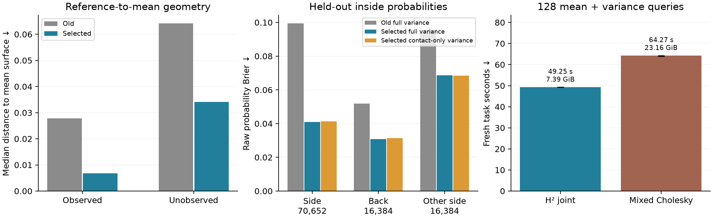
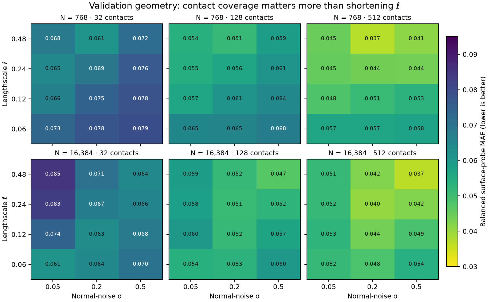
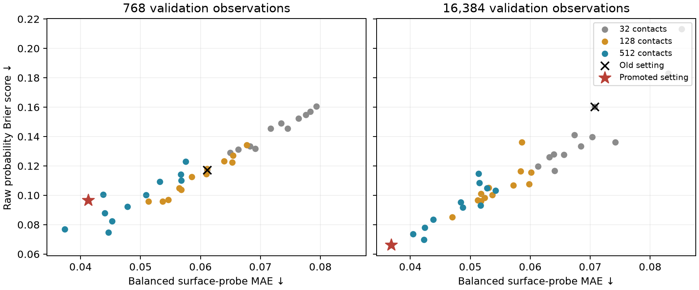
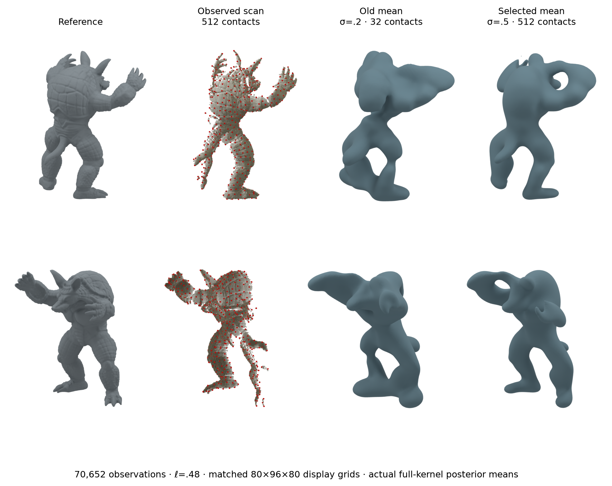
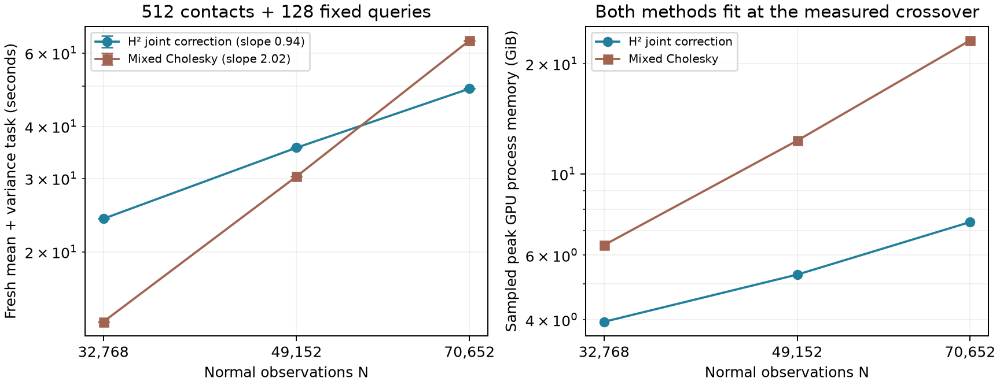

# Partial-scan quality controls and the H² crossover

This experiment addresses [#124](https://github.com/alecjacobson/fast-stochastic-psr/issues/124): improve the actual reconstruction, freeze the model using validation views, and retest the fresh mean-and-variance task against strong Cholesky implementations. [PR122's timing results](../mixed_h2/README.md) and [PR125's fields and figures](../partial_renderings/README.md) remain unchanged controls.

At 70,652 observations, the improved setting gives a repeated **1.30× runtime win**: **49.25 s H² versus 64.27 s mixed Cholesky**, with **7.39/23.16 GiB** sampled peaks and unchanged numerical gates. This requires residual correction of the contact moments; the previous H² contact-solve path loses. Geometry and inside-probability scores improve on all three held-out view groups.

The rendered mean remains visibly smooth and misses fine anatomical detail. These results establish a crossover under the declared relative quality controls, not a high-fidelity reconstruction or an all-alternatives application win. Contact-only variance also remains competitive on Brier score.



## Selection before test evaluation

The full factorial sweep has 72 configurations: ℓ=.06/.12/.24/.48, effective normal-noise standard deviation σ=.05/.2/.5, and 32/128/512 nested farthest-point scalar contacts, each at N=768 and 16,384. Every screening field uses full float64 Cholesky. Contacts come from the complete observed scan, never from the reference mesh; their locations and coverage strata stay fixed when N changes. Vector amplitude remains 1/3, scalar contact variance .0001, and scalar targets zero. The kernel's scalar prior variance changes with ℓ; there is no hidden amplitude rescaling. Effective noise is a working-model parameter, not a measured scanner-noise level.



Contact coverage has the strongest effect in this tested grid. Simply shortening the kernel does not produce the best quality. With 32 contacts, the best raw-Brier noise setting changes from σ=.2 at N=768 to σ=.5 at N=16,384. The old fixed setting deteriorates as more normal observations are added. This demonstrates a dependence on N in selection; it does not, by itself, identify correlated scanner error as the cause.



The retained [original protocol](PROTOCOL.md) declares the promotion gates before the sweep. Geometry screening uses 512 area-uniform reference surface probes, with 33 mean samples along each reference normal over [−.15,.15]. The closest interpolated zero crossing supplies the error; absent crossings receive a .15 penalty and are counted separately. This **censored normal-line loss is not nearest-surface distance**. Observed/unobserved strata use nearest-scan distance below .025/above .075. The balanced score weights those two strata equally.

A candidate must reduce balanced error by at least 25%, worsen neither stratum's error or missing-crossing rate, and worsen raw Brier by at most .005 on both all and unobserved occupancy queries. Among qualifiers, selection minimizes balanced geometry loss, then all-query Brier. These are relative quality gates, not an externally certified definition of acceptable geometry.

The winner is **ℓ=.48, σ=.5, 512 contacts**. It passes again at N=70,652 on validation views before being [frozen](selected.json) for any new test-view output. The original setting is ℓ=.48, σ=.2, 32 contacts.

| Validation normals | Old / selected balanced probe loss | Old / selected raw Brier |
|---:|---:|---:|
| 768 | .06112 / .04127 | .11713 / .09676 |
| 16,384 | .07072 / .03681 | .16034 / .06619 |
| 70,652 | .07304 / .03934 | .18678 / .06148 |

At 70,652, the selected setting reduces these losses by **46% and 67%**, respectively. Unobserved missing crossings fall from **56.3% to 16.9%**. At 768, the selected setting does **not** pass all promotion gates: its observed missing-crossing fraction rises from .34% to 1.69%. The best qualifier there instead uses σ=.2 with 512 contacts. All configurations and failures are retained in [screen-selection.json](screen-selection.json).

The selected noise and contact count lie at the tested grid's upper boundaries. This is the best qualifying setting in this declared search, not a claim of global hyperparameter optimality.

## Scope of the held-out check

The [execution scope](HELDOUT-SCOPE.md) was recorded before new test fields. The primary side view uses all 70,652 actual normal observations. The back and opposite-side groups use 16,384 normals each as cheaper generalization checks; those secondary results do not establish large-N performance. All groups compare the frozen old and selected settings without test-driven retuning.

The reference is the same-acquisition Stanford reconstructed Armadillo mesh. It supports controlled comparisons, not independent physical ground truth or generalization to other objects. Coverage strata are proximity proxies rather than visibility rays. These are marginal inside probabilities, not joint collision probabilities or coherent posterior samples.

## Matched geometry and display convergence



The two rows show matched observed-side and opposite-side cameras. Red dots are the 512 selected input contacts. Both mean surfaces come from independently refined full-kernel posteriors, extracted on identical 80×96×80 display grids. They are neither posterior samples nor directly rendered H² fields; H²'s moment agreement is checked separately on the timed query panels. The reference is context, not additional conditioning data. No mesh repair or capping is used.

| Display grid | Observed median distance, old / selected | Unobserved median distance, old / selected |
|---|---:|---:|
| 80×96×80 | .02766 / .00679 | .06426 / .03407 |
| 120×144×120 | .02776 / .00680 | .06418 / .03411 |

These are reference-vertex-to-mean-triangle distances in coordinates with reference height 2.0. On the finer grid, observed median error improves **75%**, and unobserved median error **47%**. Corresponding p95 distances improve from **.09344/.18199** to **.03323/.11694**. Reverse mean-vertex-to-reference median distance falls from .04576 to .01326.

All four extracted meshes have zero boundary edges. Between the two grids, the larger directional p95 vertex-to-mesh distance is .00119 for the old surface and .00130 for the selected surface; maxima are .00629/.00872. These sampled distances and stable reference-distance summaries support display convergence, not a continuous Hausdorff certificate. The visible smoothing, fused features, and missing detail therefore remain model/conditioning limitations rather than merely a coarse display grid. A relative metric improvement should not be read as faithful anatomical completion.

## Correcting contact moments recovers the runtime advantage

Increasing contact coverage exposes a solver cost that was small with 32 contacts. The existing H² path spends 111 seconds tightly solving the 512-contact cross right-hand sides, then evaluates queries. Its first 122.82-second trial narrowly passes raw probability accuracy but fails the legacy-transformed probability gate. Plain float32 Cholesky takes 8.64 seconds but also fails probability accuracy. Neither is an accepted competitor at those settings.

The new `h2-joint` path applies the same residual-corrected joint projection used by the dense baseline to **contacts as well as queries**. For the stacked cross-covariance and normal-data columns B, approximate inverse actions Z, and a fresh residual R=B−AZ, it evaluates

**G = BᵀZ + ZᵀR = BᵀZ + ZᵀB − ZᵀAZ.**

Contact covariance, query/contact covariance, mean and marginal variance come from this shared projection before scalar conditioning. The three normal-data solves remain tightly converged; contact/query blocks use 14 PCG iterations and float64 residuals of the represented hierarchy. Independent full-kernel checks still control hierarchy approximation error. This avoids tightly solving every contact column individually without relaxing the output gates. It is an implementation change to the moment calculation, not a different physical model or a change in the target posterior.

The dense competitors include plain float32 whitening, component-wise mixed correction, and a wider mixed correction with bounded workspace. The wider version is fastest among accuracy-passing dense trials. All reported task times include fresh hierarchy/factor setup, all contacts, all 128 marginal means/variances, corrections, scalar conditioning, and raw CDF evaluation. Data loading and shared CUDA initialization are excluded. Reference construction, quality screening, mesh extraction, and rendering are separate work.

Numerical gates remain finite means, positive finite variances, maximum variance/prior error ≤1e−4, raw CDF error ≤1e−3, and the fixed legacy probit transform's CDF error ≤1e−3. That old transform is retained only as an additional numerical sensitivity check for the new setting; it is **not** a new calibration claim. There is no variance clipping.

| Normals | Mixed Cholesky, s | H² joint correction, s | Cholesky / H² |
|---:|---:|---:|---:|
| 32,768 | 13.585 | 24.005 | .57× |
| 49,152 | 30.329 | 35.546 | .85× |
| 70,652 | 64.267 (63.998–64.310) | 49.252 (49.245–49.317) | **1.30×** |

The largest row uses three independent runs per method; smaller rows are single-run scaling checks. All pass the unchanged numerical gates. The crossover lies between **49,152 and 70,652**. Fitted log–log slopes are **.94 for H² and 2.02 for mixed Cholesky** over this short range, with C=512 and Q=128 fixed. They are empirical trends, not asymptotic proofs: ranks, iterations, and quality can change outside this regime.



Both methods fit at the primary point. Sampled GPU peaks are **7.39 GiB H² and 23.16 GiB Cholesky** on the 23.625 GiB allocation. There is no full N×N Cholesky factor in the H² path. Its small scalar-contact conditioning factor and every preparation cost are included. The new H² route's worst primary raw/transformed CDF errors are below 2.84e−5, and variance/prior error below 2.27e−7.

A further dense control assembles the kernel in float64 while retaining float32 factorization/whitening. It takes 9.49 seconds but still fails: raw CDF error .00323 and transformed error .00364. Thus assembly roundoff alone does not explain the need for correction. This option is retained as `GPUDenseMaternSystem(..., kernel_dtype='float64')`; default generated CUDA kernels remain byte-identical to the previous implementation.

## Probability quality and what remains open

| Held-out group | N | Old full-variance Brier | Selected full-variance Brier | Selected contact-only Brier |
|---|---:|---:|---:|---:|
| Side | 70,652 | .09945 | **.04090** | .04140 |
| Back | 16,384 | .05197 | **.03086** | .03142 |
| Opposite side | 16,384 | .09547 | .06859 | **.06836** |

The selected setting passes the same relative geometry/occupancy checks on all three held-out groups. On the primary group, balanced normal-line loss falls from .07139 to .03489 (**51%**), and Brier improves **59%**. Contact-only variance uses the same full-posterior mean and conditions scalar prior variance only on surface contacts; it skips normal-query variance solves.

**Full variance's application necessity is still not established by this example.** Its Brier advantage over the cheap control is small and reverses on one view group. The two probabilities are not pointwise equivalent: on the primary quality panel, the maximum difference is **.0631**, and the median full/contact-only variance ratio is **.713**. The cheap control therefore fails the strict numerical target even though its average application score is close. A decision task that benefits from those probability differences remains work for [#85](https://github.com/alecjacobson/fast-stochastic-psr/issues/85) and [#117](https://github.com/alecjacobson/fast-stochastic-psr/issues/117).

This is a quality-improved, variance-involved runtime win over the tested dense implementations of the same free-space GP. It does not yet establish a win over all alternatives. Mixed locality, SDD under the new settings, and original Sellán–Jacobson/periodic GeoSPR/NUFFT with matched application quality remain separate comparisons in [#87](https://github.com/alecjacobson/fast-stochastic-psr/issues/87) and [#75](https://github.com/alecjacobson/fast-stochastic-psr/issues/75).

## Validation, failures and reproduction

Large references refine a float32 dense factor against the full float64 kernel until each RHS block's relative residual is ≤1e−10. They do not use H² actions. At the selected 16,384-point validation setting, this path agrees with the independent full float64 factor within **1.10e−8 raw CDF**, **1.39e−8 transformed CDF**, and **1.64e−11 variance/prior**. Refinement histories and pre-conditioning residual diagnostics are retained; the latter are not asserted as bounds on the final conditioned probabilities.

Twelve distinct targeted tests pass, including independently assembled Gaussian conditioning, nested contacts, folded means, refinement, all dense precision variants, and joint H² projection. The kernel-assembly option also passes a translation-sensitive coordinate test with float32 factor storage. [summary.json](summary.json) is rebuilt from retained fields, checking hashes, score computations, numerical gates, refinement convergence, sampled GPU isolation, and preservation of PR122/125 artifacts.

An initial large reference query batch ran out of GPU workspace. The failed record is retained. Reducing reference batch/workspace and releasing completed inverse-action/residual buffers fixes it without changing the model or tolerances. This validation failure is not counted as a competitor capacity win. Failed plain-float32, double-assembly, and original H² trials are also retained. No external GPU process was stopped; every numerical trial passed the sampled process-isolation audit. Sampling can miss short-lived activity and instantaneous memory peaks.

Hardware remains the RTX PRO 6000 Blackwell Server MIG 1g.24gb allocation with 23.625 GiB available, four CPU cores and a 16 GiB host limit. The previous [environment record](../mixed_h2/environment.json) describes the runtime; every new GPU audit binds the CUDA device UUID. The timing experiment is a fresh posterior with 512 contacts and 128 marginal queries, not a million-query cache or a ContactFusion reproduction.

Replay retained results without rerunning GPU computations:

```bash
./reproduction/run_env.sh -m reproduction.report_partial_quality
./reproduction/run_env.sh -m reproduction.plot_partial_quality validation
./reproduction/run_env.sh -m reproduction.plot_partial_quality final
```

The scan cache and pinned runtime are prepared as in the [real partial-scan study](../real_partial/README.md). Drivers refuse to overwrite numerical records. Representative fresh trials can use new output paths:

```bash
./reproduction/run_env.sh -m reproduction.benchmark_partial_quality --method h2-joint --iterations 14 --reference reproduction/results/quality_controls/test_side-selected-70652-reference.json --output /tmp/quality-h2.json
./reproduction/run_env.sh -m reproduction.benchmark_partial_quality --method corrected-wide --reference reproduction/results/quality_controls/test_side-selected-70652-reference.json --output /tmp/quality-dense.json
./reproduction/run_env.sh -m pytest -q tests/test_partial_quality.py tests/test_scalar_contacts.py
```

For the full selection procedure, preserve/move the existing result directory first, retain PROTOCOL.md and HELDOUT-SCOPE.md, then run `partial_quality prepare` and `partial_quality screen` for each N/ℓ/σ combination. Each screen evaluates all three nested contact counts. `analyze_partial_quality screen` fixes the promotion order; run its candidates through `partial_quality_large` on validation at 70,652, then call `analyze_partial_quality promote` before any test fields. The [selection record](selected.json) binds the protocol, scope, validation evidence, and freeze time. Source snapshots retain the exact code measured by each trial; final source hashes are listed separately in the manifest.

`display_partial_quality` evaluates the saved mean coefficients at resolutions 80 and 120. `render_quality_comparison` uses the existing Cycles camera/material setup in the separate environment installed by `reproduction/render_setup.sh`. Display and rendering costs are excluded from both competing task times. Exportable figures: [geometry PDF](geometry-comparison.pdf), [quality/runtime PDF](quality-and-runtime.pdf), [log–log PDF](quality-crossover.pdf), and [validation grid PDF](validation-grid.pdf).
