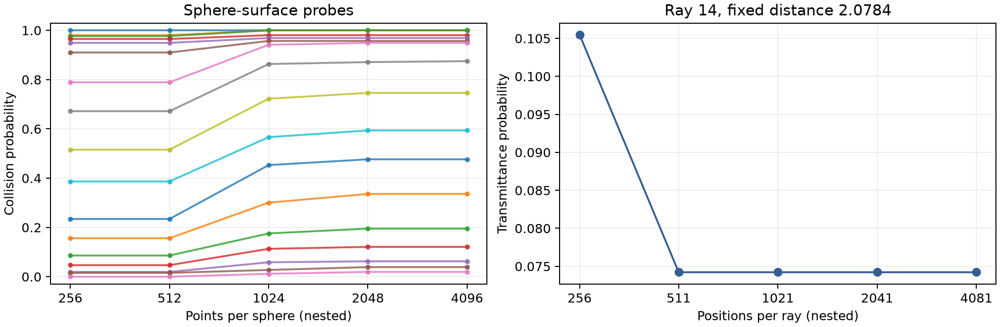

# Nested application geometry on a million-point posterior

**Collision discretization is a material unresolved error.** On the same 256
coherent draws, changing sphere-surface probes from 512 to 1,024 points changes
one object's collision estimate by **21.875 percentage points**. The earlier
256 → 512 agreement did not establish convergence. Rays show no further sampled
event changes after 511 positions in this test, but that is not a continuous-ray
or full-model certificate. No new matching-quality application speedup is claimed.



Left: all 17 sphere-surface collision proxies under increasing point counts.
Right: the ray and original distance position with the largest 256 → 511 change,
followed across the same fixed coordinates on every grid. All estimates use the
same 256 draws; the finest resolution is not ground truth. These are diagnostic
plots, not the paper's unreleased application scenes.

## Paired finite-geometry evidence

The [declared protocol](PROTOCOL.md) fixes four nested refinements for each task
and a single final statistical look. Each draw contributes one Bernoulli trial:
did **any** event change in that comparison? Its probability upper-bounds every
individual event-probability difference at the common coordinates. We use the
one-sided exact Clopper–Pearson bound at alpha = .05/8, giving simultaneous 95%
coverage over these eight comparisons via Bonferroni.
[SciPy's exact interval documentation](https://docs.scipy.org/doc/scipy/reference/generated/scipy.stats._result_classes.BinomTestResult.proportion_ci.html).
Spatial query events need not be independent; the posterior draws must be.
The bounds apply to this fixed numerical finite-band sampler and evaluator.

| Task | Refinement | Largest empirical change | Draws with any change | Simultaneous upper bound | ≤2 pp |
| --- | ---: | ---: | ---: | ---: | --- |
| rays | 256 → 511 | 3.1250 pp | 8/256 | 6.970 pp | fail |
| rays | 511 → 1021 | 0.0000 pp | 0/256 | 1.963 pp | pass |
| rays | 1021 → 2041 | 0.0000 pp | 0/256 | 1.963 pp | pass |
| rays | 2041 → 4081 | 0.0000 pp | 0/256 | 1.963 pp | pass |
| sphere | 256 → 512 | 0.0000 pp | 0/256 | 1.963 pp | pass |
| sphere | 512 → 1024 | 21.8750 pp | 254/256 | 99.955 pp | fail |
| sphere | 1024 → 2048 | 3.5156 pp | 45/256 | 24.274 pp | fail |
| sphere | 2048 → 4096 | 0.3906 pp | 1/256 | 2.770 pp | fail |

The any-event bound is conservative when different objects change in different
draws. Even the 2,048 → 4,096 sphere comparison fails the declared 2 pp bound:
one changed draw gives a 2.770 pp upper bound. Zero changes among 256 draws give
1.963 pp. Neither outcome bounds errors shared by both resolutions. Sphere
points test the surface of the probe, not solid-volume collision or continuous
intersection. Adaptive surface/ray refinement and held-out validation remain
necessary; see [#29](https://github.com/alecjacobson/fast-stochastic-psr/issues/29).

Next-view scores integrate the floating-point indicator of transmittance lying
between .025 and .975. The zero-based selected ray is 14 at all five resolutions:

| Ray positions | Selected ray | Selected score | Empirical regret at finest grid |
| ---: | ---: | ---: | ---: |
| 256 | 14 | 0.07843137 | 0.00000000 |
| 511 | 14 | 0.08823514 | 0.00000000 |
| 1021 | 14 | 0.08823502 | 0.00000000 |
| 2041 | 14 | 0.08823490 | 0.00000000 |
| 4081 | 14 | 0.08823490 | 0.00000000 |

This is empirical agreement at a fixed sample count, not confidence that the
action is optimal. The separate generation protocol's simultaneous absolute
Monte Carlo radius is **17.22 pp** at
256 draws, above the 2 pp target. That bound covers the producer's original and
first refined query sets and four declared checkpoints; it is not an absolute
accuracy bound for all later replay coordinates. Full analytic training-tail
and scalar/cross-band convergence also remain open.

## Numerical agreement and replay integrity

The mean, prior and conditioning use the same cube200 vector model, scalar/cross
cutoff50, length scale .01, variance .1 and noise variance .02. This run does not
use the narrower centered150 inverse. Packed solves and folded coherent priors
produce 256 fresh draws, seed51, in two-draw blocks. Independent finite-covariance
checks on 32 rows have maximum relative residual
**0.001102%**, below 0.002%.
These sampled rows do not certify the full analytic system.

All three replays load the identical sealed, hashed coefficient archive. They
reproduce the producer's coarse/fine ray and sphere counts exactly, and all
saved arrays agree across the three replays. Cached field error is at most
**0.004744%** of the fluctuation
norm, below 0.05%; maximum cached/direct event-probability difference is
**0.390625 pp**, below 2 pp.
The statistical refinement table uses cached events; numerical backend error
is a separate check and is not added into a continuous-geometry guarantee.

`PackedDirectEvaluator` is a stronger ordinary type-2 reference: it reuses plans,
projects each coefficient field onto its real component, independently scales
the fields, and packs pairs into one complex transform. Each call still performs
the ordinary NUFFT FFT. Tests compare against explicit Fourier sums, including
non-Hermitian inputs, zero channels, partial batches and 24 orders of magnitude
between channels. [All 93 tests pass](tests.log).

## Timing scope

Each replay evaluates the finest ray and sphere sets together, once per block;
all coarser levels are exact subsets/prefixes. Both backends therefore query
167,576 points per draw. Repeating separate evaluations for every coarser grid
would artificially disadvantage the ordinary type-2 baseline. Cached queries
include their point handling; the direct path reuses its fixed-point plans.
Direct-query timing includes coefficient projection, scaling and packing.

| Replay | Cached grid setup (s) | Cached queries (s) | Packed direct queries (s) | Archive read/hash (s) | Full replay work (s) | Sampled isolation |
| ---: | ---: | ---: | ---: | ---: | ---: | --- |
| 1 | 0.526 | 0.427 | 0.266 | 3.047 | 5.876 | True |
| 2 | 0.539 | 0.410 | 0.239 | 2.386 | 4.719 | False |
| 3 | 0.375 | 0.381 | 0.215 | 2.327 | 4.445 | True |

Replay 2 encountered another GPU process. The declared all-three isolation rule fails, so **no timing ratio is reported**. No run was discarded or repeated to improve timing.
The recorded direct times are lower than cached query times in this fixed-query,
two-field workload, even before charging cached grid setup. This does not
invalidate earlier measurements with different workloads, but it means their
large ratios cannot be transferred to this stronger reference without rerunning.
Prepared-query, setup-plus-query and full application costs must remain separate.

Full replay work additionally includes plan setup, mean evaluation, file checks,
transfers, numerical controls, reductions and output writing. The generation
took 1017.45 s including fitting,
conditioning, validation and archive export. Its audit also saw contention;
this is an execution diagnostic, not an application performance comparison.
Sample preparation is paid once per fitted map, before these replay timers.

## Archive and reproduction

The [manifest](archive_manifest.json) records complete ordered sample coverage,
model/seed/batch/offset, source and geometry hashes, and SHA-256 for every block,
mean and geometry file. The reader rejects incomplete archives, missing coverage
or failed hashes. A sealed archive supports bounded-memory query replay; it is
not a sampler checkpoint/resume mechanism. The approximately 2 GiB coefficient
archive stays outside git; compact raw counts, checkpoints and timings are
published here. Regeneration may change floating-point coefficients across GPU
environments; each replay must validate its own producer and source counts.

Starting from the existing common-RHS million-point dataset (see
[its preparation report](../nufft_batches/README.md)):

```bash
./reproduction/run_env.sh -m reproduction.stream_applications \
  --samples 256 --checkpoints 8 32 128 256 \
  --coefficient-dir /opt/geospsr-runtime/query-refinement/coefficients256 \
  --output /opt/geospsr-runtime/query-refinement/generate256
./reproduction/run_env.sh -m reproduction.replay_query_refinement \
  --archive /opt/geospsr-runtime/query-refinement/coefficients256 \
  --source-results /opt/geospsr-runtime/query-refinement/generate256 \
  --output /opt/geospsr-runtime/query-refinement/replay1
# Repeat in fresh processes for replay2 and replay3; keep every result.
./reproduction/run_env.sh -m reproduction.summarize_query_refinement
```

The summary command reads the compact published artifacts in this directory.
When replacing them with a new experiment, copy all three replay directories,
generation results/checkpoints and the matching manifest first. Keep the
coefficient directory empty before generation; never mix old and new draws.
