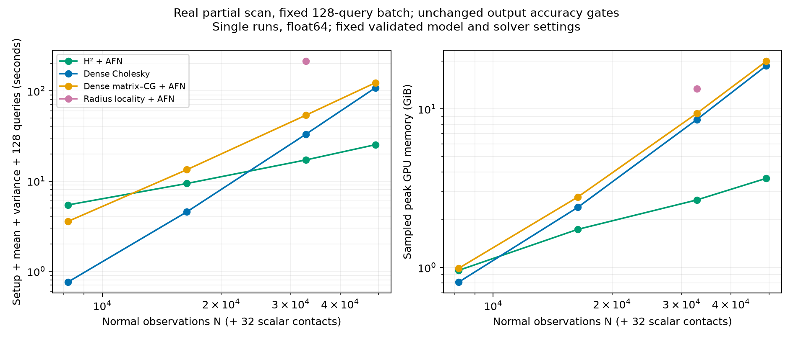
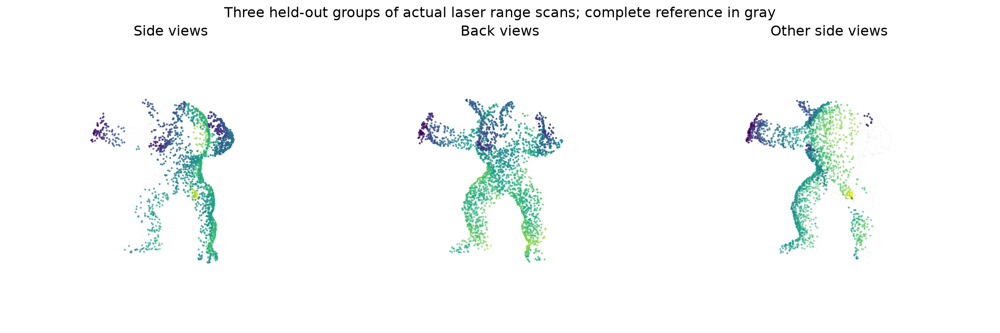
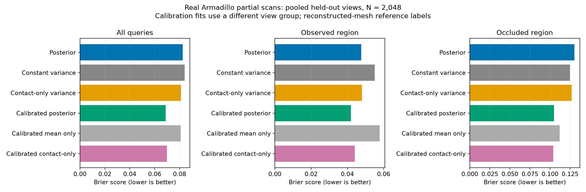
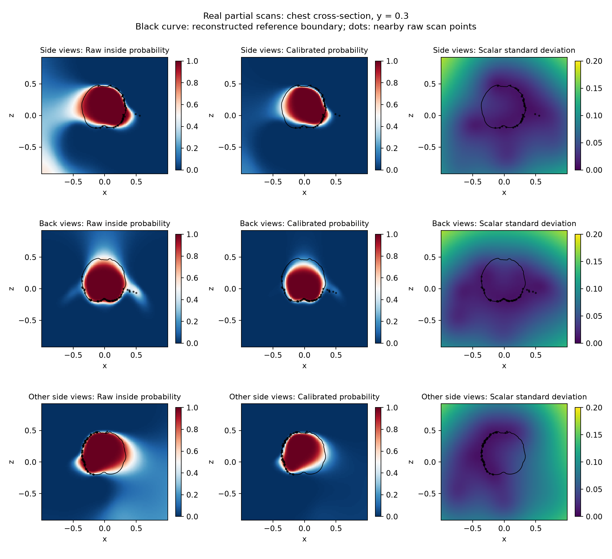
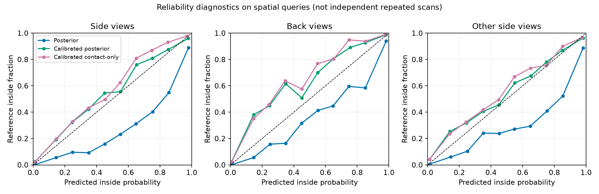

# Inside probability from real noisy partial scans

This study replaces the synthetic full ellipsoids of [#114](../noise_selected/README.md)
with **actual Stanford Armadillo laser range scans**, and evaluates pointwise
inside probabilities across observed and occluded parts of an object.

**Follow-up: this crossover is against float64 Cholesky.** The
[precision-tuned and SDD controls](../partial_competitors/README.md) find an
accuracy-passing mixed-precision Cholesky implementation faster than H² on
this workload. The original measurements below remain valid for their stated
baselines; they do not establish a win over the strongest dense alternative.

**Original PR118 result, retained for comparison:** At 49,152 normal
observations plus 32 scalar surface observations,
preparation and 128 mean-and-variance queries take **25.31 s with H²**, versus
**108.39 s with dense Cholesky** and **123.15 s with dense-matrix CG**: 4.28× and
4.87× faster, respectively. Sampled peak GPU memory is **3.65 GiB**, versus
**18.73 / 19.98 GiB**. All three use the same fixed nonperiodic model; the
iterative outputs pass the original numerical gates and an additional calibrated
probability gate against float64 dense Cholesky at every query.



**Computational superiority is clearer than the application need for full variance.**
At 2,048 normal observations, validation-calibrated posterior probabilities have
pooled held-out Brier score **0.06886**, versus **0.08098** for a calibrated
mean-only predictor (about 15% lower). However, a much cheaper spatial-variance
control scores **0.06990**, capturing most of that benefit. It uses the same full
posterior mean, but computes variance from the 32 scalar surface observations
alone. The uncalibrated contact-only control actually beats the uncalibrated full
posterior on two of the three held-out view groups.




## Data and reference limitations

Source: [Stanford Computer Graphics Laboratory, 3D Scanning Repository](https://graphics.stanford.edu/data/3Dscanrep/).
The Armadillo range archive contains real Cyberware 3030MS laser measurements.
Both archives are checksum-pinned in `stanford_partial_data.py` and [dataset.json](dataset.json).
The raw input is **not sampled from the reconstructed mesh**. Positions keep
their natural measurement noise. Normals are estimated from range-grid triangles,
with long edges across depth discontinuities rejected and orientation toward
the scanner. No synthetic normal or position noise is added.

The complete reference has 172,974 vertices and 345,944 triangles; every edge
has exactly two incident faces. It is a reconstructed estimate from the same
acquisition, **not independent physical ground truth**. A single similarity
registration using all twelve supplied aligned standing views puts scans and
reference in the same frame. There is no per-test-view fitting or projection of
raw points onto the reference. This reference-assisted global registration and
normalization are outside the prediction task and are not blind registration.
The reference supplies neither input normals nor scalar observation locations.

Four disjoint groups of three adjacent views each span 60 degrees of scanner
rotation. `[330,0,30]` selects parameters; `[60,90,120]`, `[150,180,210]`, and
`[240,270,300]` are held out from model/calibration selection. Groups contain
69,987–82,707 retained scan vertices. Normal inputs are nested deterministic
subsamples. Thirty-two farthest-point scalar observations are selected from the
full available partial group, independently of N; N counts normal observations,
not the additional 32 scalar observations. Estimating normals, registration and
common data preparation are excluded from solver timings.

Each group has its own query seed and approximately 6,000 retained queries:
half proposed uniformly in an expanded object bounding box, half near an
area-sampled reference surface. Distance signs must agree between pseudonormal
and fast winding evaluations. Points within .005 of the reference surface are
excluded. The longest reference bounding-box side is 2. Median scan/reference
distance is .0010–.0015; 99th-percentile distances reach .0065–.0102, so a .005
margin does not remove every possible reference ambiguity. Results with margins
.01 and .02 are retained in [controls.json](controls.json).

Observed and occluded strata use the distance from each query's closest reference
surface point to the full partial scan: `< .025` is observed and `> .075` is
occluded. Intermediate points remain in the all-query score. These are geometric
coverage strata, not a sensor ray-visibility certificate. Nearby spatial queries
and views of the same object are correlated; they do not provide independent
repeated-acquisition calibration trials.

## Probability model and validation

The model is the existing nonperiodic vector Matérn-to-Poisson scalar GP,
with component amplitude 1/3. No periodic domain is introduced. This is the
repository's free-space model, not an implementation of the original grid-based
Sellan–Jacobson algorithm. Normals are observed at measured positions; positional
measurement uncertainty is **not** integrated out.

Unlike #114's deterministic posterior-mean isovalue, this study conditions on
32 observations `f(c)=0`, each with scalar noise variance `.01²`. The contact
Schur complement updates both mean and variance coherently after normal
conditioning. No variance clipping, noise inflation, random-level subtraction,
or full 3N-by-3N factor is used. A positive finite noise variance is required.
Unit tests compare to explicitly conditioning the full augmented joint Gaussian.

The declared normal likelihood is an **effective working-model parameter**, not
a measured scanner noise standard deviation. On the validation group at N=768,
the best tested parameters are lengthscale `.48`, normal noise standard deviation
`.2`, selected from five lengthscales × three noise levels by Brier score.
Both choices are interior to their grids. Amplitude, scalar noise and contact
count are fixed before selection. The model treats normal and scalar observation
errors as independent although they come from the same noisy scan; this is a
modeling limitation. All model settings remain fixed across observation counts, through N=49,152.

For negative-inside convention, the raw probability is `Phi(-mean/sqrt(variance))`.
Two-parameter monotone probit calibration is fitted **only on the validation
group at N=768**, separately for the full posterior, mean-only, and contact-only
variance controls. Calibration transforms the predicted probabilities; these
are no longer the unmodified GP CDFs. Their held-out scores are reported
separately from raw GP predictions.

The controls retain the same posterior mean unless explicitly stated:

- Prior variance: discard all variance reduction.
- Constant variance: one variance selected on validation labels.
- Independently tuned constant: additionally choose kernel/noise from the same
  grid. Its best tested lengthscale (.96) and normal noise (.05) are grid-boundary
  choices, not established global optima.
- Contact-only variance: use `Kqq - Kqc (Kcc + tau² I)^-1 Kcq`, excluding normals
  from the variance. This is an approximate uncertainty predictor paired with
  the full normal-and-contact posterior mean, **not that full GP's covariance**.
- Hard sign-of-mean classification and a validation-fitted constant class
  probability are also retained.

The contact-only control still requires mean/contact preparation under the
normal model. At N=2,048 its largest probability differences from the full
posterior are 0.14–0.18 across the three held-out groups, far above the 1e-3
numerical gate even though its average prediction quality is competitive. It avoids the many additional normal-system solves for query
variance; its remaining scalar variance factor has size 32. Approximate
application quality must not be confused with passing the numerical posterior
variance/CDF gates.

## What improved, and what did not

Replacing posterior variance with prior variance changes some held-out
probabilities by about **0.46–0.47**. Thus this is materially different from
#114, whose prior-variance replacement stayed below .001.

At N=2,048 the unmodified full posterior beats the independently tuned constant
model in overall Brier score on each of the three held-out groups. Against
constant variance with the same mean, it wins on the back-view group and loses
slightly on both side-view groups. In occluded regions, the same-mean constant
control beats the raw posterior in all three groups. The model has not earned
a claim of reliably calibrated uncertainty on missing geometry.

Validation calibration improves the full posterior substantially. Its pooled
Brier advantage over calibrated contact-only variance is only **.00104**
(about 1.5%). Per-group differences have mixed signs. This modest advantage,
on one reconstructed-reference object, does not establish that the expensive
normal-conditioned variance is worthwhile for an application.




The visual cross-sections show raw and calibrated predictions separately.
Black contours are the reconstructed reference and nearby black dots are raw
scan observations. Missing-region uncertainty, class imbalance, and model bias
all contribute; broad uncertainty alone is not evidence of correctness.

## Numerical checks and performance scope

The successful workload uses a new set of training locations and **128 new
queries**, selected by evenly spaced indices of the fixed held-out side-view
query panel, without looking at labels. These include both near-surface and
volume queries. Training observations are nested subsamples. The number of
scalar contacts, physical lengthscale, amplitude and observation noise remain
fixed as N grows. A candidate use case is refreshing a model from a changing
partial scan and evaluating a small set of spatial decisions. This is a measured
pointwise-marginal workload, not yet a robotics replay or joint collision event.

The primary table below includes kernel/preconditioner or factor construction,
normal-mean and scalar-contact conditioning, and all query means, variances and
raw CDF evaluation. Common input processing and CUDA/kernel initialization are
outside the timer. All primary records are single runs with sampled GPU process
isolation; earlier overlapping runs are retained under `sparse_queries/superseded-audit/` and
excluded. Peak GPU memory includes temporary allocations, not only stored H²
interactions. The device is a 24 GB MIG partition of an RTX PRO 6000 Blackwell
Server GPU, with four CPU threads; see [environment.json](environment.json).
At 49k, sampled peak host RSS is 0.95 GiB for H², 0.69 GiB for Cholesky,
and 1.01 GiB for dense-matrix CG; host memory is separate from the GPU plot.

| Normal observations | H² total (s) | Dense Cholesky (s) | Dense-matrix CG (s) |
|---:|---:|---:|---:|
| 8,192 | 5.43 | 0.76 | 3.57 |
| 16,384 | 9.39 | 4.56 | 13.37 |
| 32,768 | 17.14 | 33.05 | 53.71 |
| 49,152 | 25.31 | 108.39 | 123.15 |

At 32,768 observations, the passing locality configuration takes **212.91 s**
and **13.37 GiB** peak GPU memory: H² is **12.42× faster**.

Fitted total-time log–log slopes over all four sizes: **H²: 0.86**, **Cholesky: 2.77**, **dense-matrix CG: 1.98**.

The fitted slopes describe this finite range and hardware utilization. A
sublinear fitted H² slope is not a claim of a sublinear algorithm. The plot
supports a near-linear H² trend against quadratic dense-matrix CG and cubic
factorization over the measured range; no larger-N extrapolation is claimed.

All iterative methods use AFN coarse rank 100, 80 neighbors, prefix-kd setup,
and float64 arithmetic. H²'s compression tolerance is 1e-6 and leaf size 40.
Normal-mean/contact solves use residual tolerance 1e-9. Query variance uses
eight PCG iterations with a residual-corrected quadratic estimate; the output
gates, rather than eight iterations alone, certify this finite panel. H² uses
no full N-by-N Cholesky factor: its dense factors are the fixed coarse
preconditioner and the 32-observation scalar Schur complement. Mean/contact
iteration counts grow from 27/23 at 32k to 31/26 at 49k. These settings are
fixed across all four sizes. The retained initial rank-50 / 40-neighbor 32k
trial narrowly failed the CDF gate (0.001019); increasing the preconditioner
strength passes without increasing the variance iteration budget. These are
selected numerical settings, not globally optimal settings for every method.

The accuracy gates remain maximum variance error / scalar prior variance
<= 1e-4 and raw inside-CDF error <= 1e-3. We additionally require the same
1e-3 limit after the fixed validation calibration. At 49k H² errors are
2.61e-6, 3.00e-4 and 4.42e-4, respectively. These checks cover every one of
the 128 queries, not a uniform spatial error bound. Dense Cholesky is the
larger-N reference and receives no independent accuracy credit for agreeing
with itself; GPU vs CPU dense and explicit augmented-Gaussian checks cover
the implementation at smaller sizes.

**Locality loses here because substantial global correlation remains.** At 32k,
cutoff 6 fails positive curvature, and cutoff 8 removes just 0.02184% of matrix
entries but produces maximum CDF error 0.19647. Cutoff 9 passes while retaining
all N² interactions. Its measured total is in the table. This is the smallest
passing tested integer cutoff, not a continuous-radius optimum. Dense-matrix
CG with the same AFN/PCG settings is the stronger all-pairs control, and H²
also beats that baseline. All failed trials and fields are retained in
`sparse_queries/tuning/`; their timings earn no accuracy-qualified speedup.

**This win depends on preparation being relevant.** At 49k, dense Cholesky
spends 104.14 s constructing its factor, while H² spends 3.71 s building its
backend. Dense query evaluation after preparation is faster. Reusing a fixed
scan's factor for enough new batches can amortize the factorization and change
the winner. The 128-query result does not establish a million-query cache win,
or a win for arbitrarily many batches against an already prepared dense factor.


The direct GPU evaluator avoids polynomial interpolation. At N=2,048, its dense
result agrees with the CPU dense oracle to about 2e-12 in probability. H² and
locality are compared at every point of the same finite query panel, using the
unchanged variance/prior <= 1e-4 and CDF <= 1e-3 gates. The all-pairs dense GPU
result supplies the larger-N numerical reference. Those additional diagnostic
records use a **roughly 6,000-query direct workload**, separate from the 128-query scaling plot and the million-query
regional benchmark in #114. Single-process timings and their configuration/provenance are in `direct/`; they are
diagnostic measurements with the earlier rank-50, 40-neighbor, H² tolerance
1e-8 configuration, rather than a best-backend scaling claim. They are not
pooled into the 128-query slope fit.

Whole-object polynomial-cache attempts are retained under `cache/`:

| Uniform regions | Order | Variance/prior max error | CDF max error | Outcome |
|---|---:|---:|---:|---|
| 4³ | 4 | — | — | Negative off-node variance; rejected |
| 4³ | 6 | 1.37e-4 | .05735 | Both gates fail |
| 8³ | 6 | 3.12e-6 | .00470 | CDF gate fails |

These pilots use the exact N=768 conditioner. The last requires about 51 seconds
of CPU cache preparation. A small variance/prior error does not protect CDFs
near well-constrained contacts, where the remaining variance is small. None of
these failed caches is counted as a speedup. [#116](https://github.com/alecjacobson/fast-stochastic-psr/issues/116)
tracks analytic contact terms, adaptive refinement and shared solves before
any whole-object million-query claim. [#115](https://github.com/alecjacobson/fast-stochastic-psr/issues/115)
tracks the real-data application and stronger uncertainty controls.
[#117](https://github.com/alecjacobson/fast-stochastic-psr/issues/117) tracks the
prior exterior level, correlated measurement errors and validation on another
object. A zero-mean free-space prior with zero scalar targets approaches inside
probability 0.5 far from data; empirical calibration is not a replacement for
resolving this modeling choice.

## Reproduction

Install the pinned runtime (`reproduction/setup.sh`, including `plyfile==1.1.5`)
and the repository's existing HiGP extension for H²/locality. Data downloads
remain outside Git in `~/.cache/fast-stochastic-psr/stanford-armadillo`.

```bash
./reproduction/run_env.sh -m reproduction.stanford_partial_data
./reproduction/run_env.sh -m reproduction.partial_occupancy select --n 768
```

For each of `test_side`, `test_back`, `test_other_side`, run the exact test at
N=768 and N=2048, then build the controls:

```bash
./reproduction/run_env.sh -m reproduction.partial_occupancy test --group test_side --n 2048
./reproduction/run_env.sh -m reproduction.evaluate_partial_controls
```

Run the scaling backends sequentially on an otherwise idle GPU. The following
loop reproduces the four-size curves; the additional locality point uses cutoff
9 at N=32768. The per-run JSON also records every argument:

```bash
for n in 8192 16384 32768 49152; do
  for method in dense h2 dense-cg; do
    ./reproduction/run_env.sh -m reproduction.partial_sparse_queries \
      --method "$method" --n "$n" --iterations 8 --query-batch 96 \
      --query-limit 128 --rank 100 --neighbors 80 \
      --h2-tolerance 1e-6 --solve-tolerance 1e-9 \
      --output "reproduction/results/real_partial/sparse_queries/$method-$n.json"
  done
done
./reproduction/run_env.sh -m reproduction.report_partial_occupancy
./reproduction/run_env.sh -m pytest tests/test_scalar_contacts.py tests/test_partial_scan_data.py tests/test_partial_gpu.py tests/test_nonperiodic.py tests/test_hierarchical_streamed.py tests/test_nufft_batches.py -q
```

Raw finite-panel means/variances, query labels, selection records and controls
are retained. Failed cache JSONs are gzip-compressed without changing their
contents. The first cache failure log precedes the fix to persist invalid
variance diagnostics. Pilot source hashes can differ from the final reporting
helpers; pilots are not accepted production timing records.

Validation: **24 tests pass**, including explicit augmented Gaussian equivalence,
off-node contact-cache convergence, range-grid normal construction, GPU/CPU
agreement, and existing nonperiodic, streamed-H² and NUFFT batch regressions.
Source snapshots, input checksums, final artifact hashes and GPU process audit
records are retained. The global `selected.json` was unchanged across these
runs. Input/query checksums are verified on loading; the final manifest records
these shared inputs and model settings without claiming per-run historical
checks that were not recorded.

Existing NUFFT, H² and locality interfaces remain available and unchanged.
This study compares matched nonperiodic backends. It does not newly benchmark
the original Sellan–Jacobson grid solver, GeoSPR SDD or the periodic NUFFT model.
