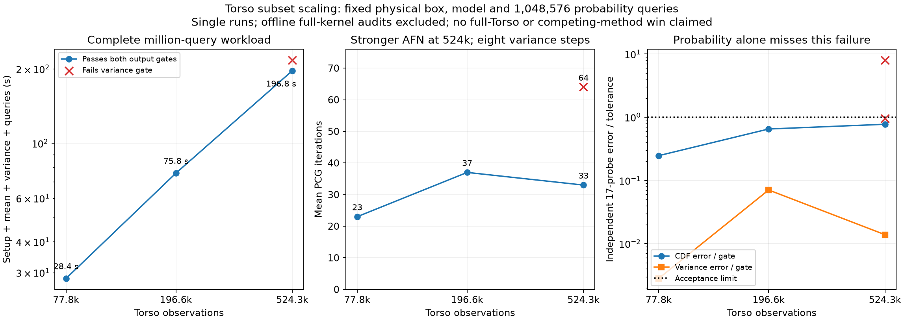

# Whole-box probability bounds and larger Torso validation

The six selected Eagle comparisons from the
[large-scan study](../poissonrecon_large/README.md) now have **whole-box bounds**
on the differences between their represented moment/probability fields. This
strengthens the accuracy comparison underlying the full-Eagle **8.08×**
mean-and-variance speedup: its stored H² and locality polynomials agree within
the 0.001 probability tolerance everywhere in the contact box.

| Eagle points / control | Observed million-query CDF difference | Whole-box upper bound | Sub-boxes |
|---|---:|---:|---:|
| 32,768 / locality | 0.00029027 | 0.00044117 | 1 |
| 32,768 / float32 Cholesky | 0.00000677 | 0.00000907 | 1 |
| 77,824 / locality | 0.00055331 | 0.00098172 | 4 |
| 77,824 / float32 Cholesky | 0.00014996 | 0.00023442 | 1 |
| 196,608 / locality | 0.00066066 | 0.00093671 | 4 |
| 796,825 / streamed locality | 0.00091743 | **0.00099935** | 25 |

Displayed upper bounds are rounded upward; raw values are in
[bounds/summary.json](bounds/summary.json). The full-Eagle bound takes **about 0.3 s
on the CPU**, independent of the number of subsequent queries. All six variance
difference bounds are also below the 1e-4 prior-normalized tolerance, and both
fields have positive variance lower bounds over the complete box.

The order-six/order-seven counterexample is retained: both fields pass their
17-point audits, but their observed full-query probability difference is
0.00149244. The whole-box comparison **does not accept it**: its upper bound is
0.00178102 after the 256-leaf budget. An upper bound above tolerance means
`inconclusive`; it is the independently observed query difference that proves
this pair fails the tolerance. This pair changes both interpolation order and
variance iterations, so it is not an isolated iteration experiment.

The bounds also locate a useful follow-up region. Evaluating a 3x3x3 grid in
the worst sub-box finds probability difference **0.00103032** at physical
coordinate **(1.000625, -0.005, -0.0025)**. This is a new 27-probe numerical
observation that catches the pair's failure without replaying a million queries;
it remains separate from the interval bound and from an exact-GP reference.

These bounds apply to the **real polynomials represented by the saved binary64
coefficients**. They do not include query-evaluation roundoff, construction or
interpolation error, or error to the exact GP. The direct full-kernel point
audits remain separate; neither form of numerical agreement establishes model
calibration or equivalence to original Sellán–Jacobson SPSR.

See [METHOD.md](METHOD.md) for derivation, outward-rounding assumptions,
subdivision, complexity, and CPU-only replay commands. Both the NUFFT and
nonperiodic H² routes remain available.

## Torso at 524,288 points

The next nested subset now passes the independent mean/variance/probability
audit in **196.84 s**, including setup and **1,048,576 probability queries**.
This is a measured subset result, not a full 3.49m-point Torso run or a new
speed ratio against locality, Cholesky or SDD.

| Torso points | Complete workload | Mean PCG iterations | Checked CDF error | Variance error / prior |
|---:|---:|---:|---:|---:|
| 77,824 | 28.37 s | 23 | 0.00024665 | 2.82e-7 |
| 196,608 | 75.77 s | 37 | 0.00065124 | 7.07e-6 |
| 524,288, initial trial | 217.37 s | 64 | 0.00095346 | **8.01e-4 — fails** |
| 524,288, stronger AFN | **196.84 s** | **33** | **0.00077326** | **1.39e-6** |

The initial trial passes the probability gate but fails the separate 1e-4
prior-normalized variance gate. Increasing AFN rank/neighbors from **8/24 to
50/40** fixes that failure. Both 524k trials use the same order-six interpolation,
cross tolerance 1e-8, hierarchy tolerance 1e-5, mean tolerance 1e-8, eight
residual-corrected variance steps, RHS blocks of 64 and a 256 MiB streamed
interaction workspace. Only preconditioner rank/neighbors change between them;
the failed trial remains in the raw records and plot.

The passing run retains **10.83 GiB** in the CuPy pool (not a peak measurement),
has a **4.50 GiB** peak host RSS, and represents **2.610 billion** interaction
entries. Cross rank is 119. Common runtime initialization, input preprocessing
and independent validation are excluded, as in the earlier study. Timings are
single sequential GPU runs on the same MIG device and four CPU cores; the
smaller subsets use unblocked RHS execution. These three selected points do
not establish an asymptotic theorem.



The two 524k caches themselves have whole-box probability difference at most
**0.00018840**, while their whole-box variance-difference bound is
**0.00079960** of the prior. The pair is therefore not accepted under both
gates. The independent full-kernel audit, rather than this upper bound alone,
establishes the initial trial's variance failure. This illustrates why the
probability and variance gates must both remain active.

The reusable 17-probe full-kernel reference takes **1,148.39 s** offline. Its
first residual check narrowly misses the reference probability uncertainty
target (1.81248e-5 versus 1e-5); one refinement reduces the allowance to
1.23235e-14. The same reference is reused for the second production trial.
[Issue #101](https://github.com/alecjacobson/fast-stochastic-psr/issues/101)
tracks output-aware reference refinement and more informative phase timings.
This audit certifies numerical bounds at its checked points; it is not a
whole-box exact-GP guarantee. The whole-box comparisons above concern stored
polynomials, and cannot fill that separate gap.

The raw commands are in each trial's `.status.json`; audit commands and
reference provenance are recorded alongside them. Rebuild the plot with:

```sh
./reproduction/run_env.sh -m reproduction.plot_regional_torso
```

Next under #99: the 1m and full 3.49m subsets, resident-memory limits,
independently checked transition regions, and competing-method controls.

## Validation

The CPU suite passes **33 tests**, covering the existing free-space posterior
and the new interval bounds: exact rational restriction checks, dense sampled
cross-checks, unequal orders/levels, positive-variance recovery by subdivision,
an interior tolerance violation, invalid inputs, overflow and very small
variances. A fresh replay into a separate directory reproduces the six bounded
comparisons and the unaccepted counterexample. Input and implementation SHA256
hashes accompany every bound result.
