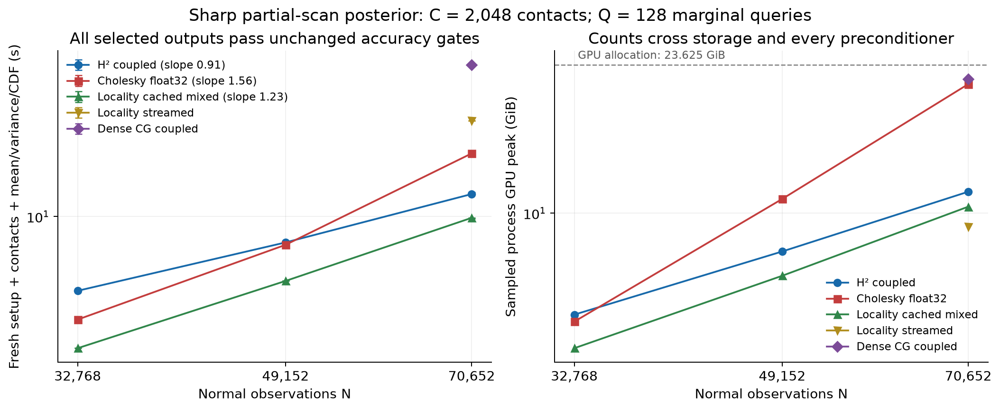

# Sharp partial-scan timings: H² crosses Cholesky, cached locality leads

The observed-fidelity model from PR127/129 retains a measurable **H²-over-Cholesky crossover**, after replacing the expensive contact-Schur preparation with a coupled Gaussian solve. At 70,652 real scan normals, **H² takes 11.76 s versus 15.78 s for plain float32 Cholesky: 1.34× faster**. The leading configurations pass both the original 128-query task and an additional 512-query numerical audit against independently refined full-kernel fields.

**Cached mixed-precision locality takes 9.91 s and is the fastest measured method.** This example supports a quality-qualified H²/Cholesky comparison, not the broader goal of an H² win over every alternative. H² also beats the measured streamed-locality and dense-CG controls. The earlier smoother-model 1.30× claim is separate evidence; none of its timings are reused here.



[PDF](performance.pdf) · [Exact curve/repeat selection](display-selection.json) · [Aggregated measurements](comparison.json) · [Every retained trial](summary.json)

## Task and accuracy

The frozen [protocol](PROTOCOL.md) uses the actual Stanford Armadillo `test_side` range scans: 70,652 oriented observations, length scale .015, vector amplitude 1/3, normal noise standard deviation .02, 2,048 zero-target scalar contacts, and scalar variance 7.500000000000001e-9. This preserves the [observed-fidelity selection](../observed_fidelity/README.md) and the [epistemic-uncertainty interpretation](../epistemic_revision/README.md). Model parameters and all old numerical artifacts are unchanged. The smaller 32,768/49,152 observation sets are computational scaling checks; subsampling does not automatically preserve the full scan's sample-resolution fidelity.

Each timing includes fresh matrix/factor/hierarchy/preconditioner setup, every scalar contact, 128 marginal means and variances, residual correction when used, scalar conditioning and raw inside-CDF evaluation. It excludes common data loading/CUDA initialization, independent reference construction, rendering and offline scoring. The 128 queries are exactly the old benchmark's evenly indexed queries, not the new 512 quality-panel queries. C and Q remain fixed as N changes. These are fresh posterior construction timings, not amortized cache lookup timings or joint collision probabilities.

The unchanged gates require finite means, positive finite **unclipped** variances, max absolute variance error divided by prior variance ≤ 1e-4, max raw CDF error ≤ 1e-3, and max legacy probit-transformed CDF error ≤ 1e-3. That old transform is a numerical sensitivity guard, not a calibration claim for this model. The leading configurations additionally pass all 512 retained PR127 quality queries; their audit durations are separate from the plotted 128-query timings. The [audit policy](ACCURACY-AUDIT.md) and the independent augmented-Gaussian tests are retained.

The 70,652-point reference uses full float64-kernel refinement with worst recorded relative RHS residual 9.20e-13, and agrees exactly with 32 previously retained query moments. Smaller-size references use full float64 factors. Reference generation took 626.32, 54.04 and 152.82 s for 70,652/32,768/49,152 normals; these are oracle costs, excluded from competitive timings. No competitor has to meet the reference solver's residual tolerance: its posterior output errors determine acceptance.

## Results

| Method | 32,768 normals (s) | 49,152 normals (s) | 70,652 normals (s; range) | Primary GPU / host peak (GiB) | Fitted time slope |
|---|---:|---:|---:|---:|---:|
| H² coupled | 5.85 | 8.29 | 11.76 (11.70–11.92) | 11.33 / 0.95 | 0.91 |
| Cholesky float32 | 4.75 | 8.15 | 15.78 (15.70–15.86) | 21.15 / 0.98 | 1.56 |
| Locality cached mixed | 3.86 | 6.28 | 9.91 (9.85–9.91) | 10.38 / 1.29 | 1.23 |
| Locality streamed | — | — | 19.95 (one run) | 9.24 / 1.29 | — |
| Dense CG coupled | — | — | 29.88 (one run) | 21.76 / 1.24 | — |

The separate 512-query audits retain these maximum errors:

| Method | Variance / prior | Raw CDF | Legacy transformed CDF |
|---|---:|---:|---:|
| H² coupled | 1.44e-05 | 0.000107 | 0.000251 |
| Cholesky float32 | 5.49e-07 | 1.9e-05 | 2.21e-05 |
| Locality cached mixed | 3.7e-06 | 0.000217 | 0.000284 |

Primary timing ranges come from three separate processes per leading configuration, with H²/Cholesky/locality interleaved for the last two rounds. Smaller-size points and secondary controls have one passing measurement each. The plots use medians and min/max bars; narrow repeat ranges may be hidden by the markers. GPU and host peaks are sampled process measurements, not analytical memory requirements or guaranteed instantaneous maxima. The GPU process audit sampled every .1 s. Two 49,152-point records detected another GPU process, were rejected, and remain retained; the plotted replacements passed isolation. All selected records passed their accuracy and sampled-isolation gates.

Hardware: RTX PRO 6000 Blackwell Server, MIG 1g.24gb with 23.625 GiB usable allocation, four CPU cores and 16 GiB host memory. The H² hierarchy is float32 with a float64 represented-hierarchy residual action; leaf size 320, tolerance .1, AFN rank 100/neighbors 80 and seven coupled iterations. Its maximum hierarchy rank at the primary size is 31. Locality uses the same normal AFN in float32, eight coupled iterations, cutoff 14/kappa ≈ .12124, and a float64 truncated-normal residual. It retains 96,944,100 normal entries (about 1,372 neighbors per observation), storing both float32 and float64 sparse actions for the cached variant. The scalar and cross kernels retain their full tails in every variant.

The fitted slopes are descriptive over only a 2.16× observation-count range. They show a useful empirical trend and an observed H²/Cholesky crossover between 49k and 70k; they do not establish an asymptotic exponent or a future crossover with cached locality. The short normal-kernel length scale makes a local sparse normal block competitive. H² currently accelerates that normal block, while the coupled scalar/cross blocks remain explicitly stored; their algebraic tails are a future hierarchical opportunity.

## What changed algorithmically

The original H² contact-Schur route solves 3(C+Q)+3 = 6,531 normal-block columns. On the 16,384-point validation task it took 57.67 s with eight iterations, or 27.18 s with one iteration, versus 2.50 s for accuracy-passing plain float32 Cholesky. More precise dense correction is unnecessary for this sharper model; comparing only to the old corrected dense baseline would overstate the win.

The new [coupled prototype](../../coupled_observation_gpu.py) solves the augmented Gaussian observation system directly. Its dimension is 3N+C, with three repeated normal blocks, the scalar prior-plus-noise block, and full scalar/vector cross blocks. The 128 queries and data need 129 augmented right-hand sides, corresponding to 387 normal-block columns. A symmetric triangular preconditioner combines normal AFN, full cross interactions, and a factor of the scalar **prior** covariance as an approximate Schur factor. Residual-corrected bilinear/quadratic forms provide both mean and variance. This changes the numerical solve methodology while preserving the frozen Gaussian model.

The coupled formulation is also supplied to locality and dense CG. Dense CG keeps its full float32 normal matrix cached and uses 32-query batches with a single float32 cross copy; float64 cross residual tiles are regenerated. That rerun fits and passes, so its initial unblocked out-of-memory trial is not counted as an H² victory. Plain Cholesky reuses one normal factor and processes vector components separately to avoid unnecessary workspace failures. The controls therefore share the conditioning improvement and use practical memory layouts.

This is still a finite-contact prototype: cross storage is O(NC), and the scalar prior uses a dense C-by-C factor with O(C³) setup. It does **not** solve [issue 128](https://github.com/alecjacobson/fast-stochastic-psr/issues/128)'s C proportional to N requirement. The [prototype notes](COUPLED-PROTOTYPE.md) describe the formulation, represented-operator residual limitation and failed preconditioner trial. NUFFT and the original contact-Schur implementations remain available.

## Controls, failed trials and scope

All numerical tuning records, slower trials, accuracy failures, capacity failures and isolation failures remain in [summary.json](summary.json), with hashes of the actual measured sources and saved moments. Examples include a diagonal-Schur preconditioner that fails probability accuracy, a six-iteration primary H² run that fails CDF gates, a leaf 160/tolerance .1 hierarchy that encounters nonpositive PCG curvature, and a cutoff 12 locality run that passes 128 queries but fails the 512-query audit. These are parameter-specific empirical qualifications, not general automatic error guarantees.

Other passing controls confirm that plain float32 Cholesky is the appropriate dense baseline: float64 kernel assembly with float32 factorization takes 16.73 s at 70,652; full float64 Cholesky takes 53.97 s at 32,768; residual-corrected mixed Cholesky takes 14.40 s at 16,384 validation normals. The float64 competitive timing includes CDF evaluation and is distinct from reference creation.

A compiled SDD check on the 16,384-normal validation task evaluates 128, 512, 2,048 and 2,816 updates, including both standard and full-kernel residual-corrected output moments. No observed checkpoint passes after 30.66 s of updates; at the last checkpoint corrected raw CDF error is .0115 and variance/prior error .0163. Its favorable selected-checkpoint total is 34.09 s for standard moments, excluding previous diagnostic checkpoints; actual wall time including every check is 93.81 s. This uses the existing normal-block/contact-Schur formulation and has not received the coupled reformulation. It therefore does not establish a best-possible SDD comparison at 70,652 or rule out a coupled SDD improvement. See [issue 58](https://github.com/alecjacobson/fast-stochastic-psr/issues/58).

No new matched-application-quality original Sellán–Jacobson, periodic GeoSPR or NUFFT comparison is established here. Existing timings for other models cannot supply those missing points. The cheap contact-only variance control remains competitive on retained Brier score; this timing study does not show that full variance is necessary for a downstream decision. Nor does it establish population calibration, an accurate mean completion of the unseen side, or scalable joint posterior sampling. Those are separate questions from numerical agreement with this posterior.

The appropriate current claim is: **a sharper, observed-fidelity-qualified partial scan still demonstrates a repeatable H²-over-Cholesky speed and memory advantage; cached locality remains the stronger runtime baseline on this instance.** Extending hierarchy acceleration to the coupled scalar/cross kernels and testing contact-count scaling is the next route to an H²-specific advantage, tracked in issue 128.

## Reproduction and retained evidence

Run from the repository root with the pinned runtime in `reproduction/run_env.sh`. Every result JSON contains exact arguments, selected-model/data/query hashes, measured source hashes, numerical errors, phase timings and sampled GPU/host observations. Source snapshots under `sources/` preserve earlier numerical trials even when the final driver evolves. The artifact manifest binds all retained files and final runner/test versions.

```bash
# Main H² task; use a new output name, existing results are never overwritten.
./reproduction/run_env.sh -m reproduction.benchmark_observed_fidelity \
  --method coupled-h2 --iterations 7 --tolerance .1 --leaf-size 320 \
  --coupled-preconditioner triangular-prior --output /tmp/sharp-h2.json

# Strongest locality control, same coupled formulation and model.
./reproduction/run_env.sh -m reproduction.benchmark_observed_fidelity \
  --method coupled-locality --iterations 8 --cutoff 14 \
  --coupled-preconditioner triangular-prior --locality-storage cached-mixed \
  --normal-preconditioner-dtype float32 --output /tmp/sharp-locality.json

# Plain float32 factor, all scalar contacts and marginal mean/variance queries.
./reproduction/run_env.sh -m reproduction.benchmark_observed_fidelity \
  --method plain --output /tmp/sharp-cholesky.json

# Add --validation-panel --query-count 512 for the separate broad primary audit.
# Add --n 32768 or --n 49152 for the saved-reference scaling tasks.

# Replay all retained fields and regenerate the log-log figure without GPU solves.
./reproduction/run_env.sh -m reproduction.report_sharp_performance
```

Validation: **39 passed, 8 skipped** across the coupled augmented-Gaussian, scalar-noise/component projection, dense/shared-kernel, mixed-H², iterative recurrence and SDD subset suites. The eight skips require the unavailable original `psr_higp_cext` extension; the measured prefix-kd backend and new coupled paths were exercised. See [test log](final-tests.log). The field replay audited 54 retained trials (45 accepted), including numerical and isolation failures. Prior numerical artifacts were checked unchanged against base commit `0bea1e7`.

```bash
./reproduction/run_env.sh -m pytest -q \
  tests/test_coupled_gpu.py tests/test_sharp_performance.py \
  tests/test_partial_quality.py tests/test_hierarchical.py \
  tests/test_hierarchical_mixed.py tests/test_iterative_reference.py \
  tests/test_sdd_subset.py
```

See [environment.json](environment.json) for package versions and resource limits, and the [native build record](../partial_competitors/build_environment.json) for the HiGP setup.

The [matched geometry and uncertainty renderings](../epistemic_revision/README.md) are reused without modification. They show observed detail and high variance around the unseen mean protrusion; this performance report adds no new geometry or calibration claim.
