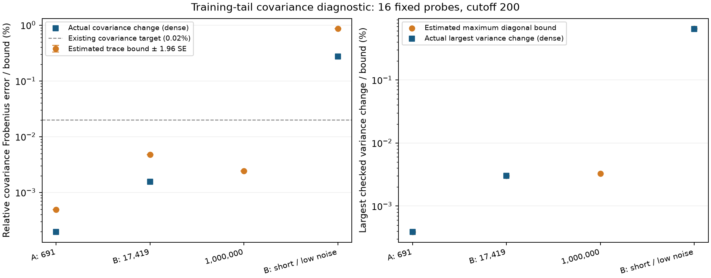

# Posterior covariance error from the omitted training spectrum

The million-point cutoff-200 pilot now has a **covariance diagnostic**, in
addition to sampled analytic solve residuals. At 16 fixed slice probes, the
estimated trace bound is **0.0024%** of the finite posterior
covariance's Frobenius norm. The largest checked variance bound is about
**0.0033%**. These estimates are comfortably below the
existing 0.02% covariance target on this panel. They do **not** establish
complete-application matching quality or a rigorous large-N certificate.



## Dense overlap and million-point estimates

All runs keep scalar/cross cutoff 50 and training cutoff 200. Default parameters
are length scale 0.01, per-axis variance 0.1 and noise variance 0.02. The stress
case changes length scale to 0.005 and noise variance to 0.0004. A/B use the
released-camera scorpion data; the million-point scan uses the previously
published area-uniform visible surface cloud. Input/query hashes are recorded.

Each panel has 16 queries, half selected among the 256 smallest absolute
default-parameter slice means and half from the remaining positions. Selection
seed 993 precedes tail sampling. Three independent seeds (71–73) each draw
16,384 frequencies from the **infinite** omitted spectrum. The table pools
49,152 frequencies; it does not count posterior samples.

| Input | Actual covariance change % | Estimated trace bound % ± 1.96 SE | Largest estimated variance bound % |
| --- | ---: | ---: | ---: |
| A: 691 | 0.000195 | 0.000492 ± 0.000001 | 0.000389 |
| B: 17,419 | 0.001559 | 0.004794 ± 0.000008 | 0.003025 |
| 1,000,000 | not computed | 0.002419 ± 0.000005 | 0.003270 |
| B: short / low noise | 0.276104 | 0.865647 ± 0.001385 | 0.649522 |

Covariance change uses relative Frobenius norm, with the finite posterior as
denominator. The trace bound is a conservative upper bound in exact arithmetic;
its **estimate and empirical interval are not themselves a certified bound**.
Diagonal bounds divide by each query's finite variance. Off-diagonal covariance
entries need not increase. See the [derivation, sampler and limitations](METHOD.md).

At A/B, float64 dense analytic and independently summed finite covariance
matrices verify the PSD bracket directly. The bound is tight in these overlap
cases; the independent frequency estimates agree with the dense calculation
within ordinary sampling variability. The stress case remains a clear failure,
consistent with the earlier training-bandwidth audit.

For a connection to joint probabilities, whitening the estimated H by the
finite covariance gives a largest eigenvalue of
**7.72134e-05** at the million-point panel.
The corresponding Gaussian KL/Pinsker calculation estimates a
**0.00477 percentage-point** bound on
any event using these 16 values **if the two means are held identical**.
This isolates covariance error; it is not a bound on actual application
probabilities, which also depend on mean/centering and many more query points.
It inherits the empirical tail estimator's uncertainty. See [the derivation](METHOD.md).

## Numerical control and cost

The million-point primary audit uses CG rtol 1e-6 and requests NUFFT eps 1e-7
(cuFINUFFT clamps this to float32 machine epsilon). A second run uses production
rtol 1e-5 / eps 1e-6 on identical probes and tail frequencies. Their finite
covariance matrices differ by **0.0005440%**;
the maximum diagonal difference is **0.0018543%**.
This controls observed sensitivity; it is not an exact-solve certificate.

A float64 check (eps 1e-9, CG rtol 1e-9) covers three of those same probes,
indices 0, 8 and 15. Compared with that control, the stricter float32 panel
differs by **0.0003759%**
in covariance Frobenius norm and at most
**0.0006707%**
on its three variances. Production float32 differs by
**0.0001374%**
and **0.0002439%**
respectively. These numerical differences remain separate from the tail bound.
On these three probes, production float32 is closer to float64 than the
stricter-tolerance float32 run; tighter tolerances do not guarantee monotonically
better float32 results.
The float64 check does not cover all 16 probes. An initial float64 configuration
with training oversampling 2 failed during cuFFT plan creation; its log is
retained under `1000000-double-oversampling2-failure`. The completed control
uses training oversampling 1.25.

The stricter million-point run spends **176.95 s**
solving the 48 cross-covariance RHS (16 probes × three vector components).
Each 16,384-frequency tail estimate then takes about
**1.15 s**.
This is validation cost on an NVIDIA L40, not an application speedup.
The feature diagnostic streams source/frequency blocks and never forms an
N-by-N matrix. Its work is O(N × frequencies × probes).

## What remains open

The theorem establishes `0 <= V_full - V_finite <= H`. The experiment estimates
H for a limited panel and checks feasible dense cases. It does not validate
the posterior mean or centering, complete ray/collision joint distributions,
sampling accuracy, hitbox geometry or sequential scans. Empirical intervals
are not simultaneous certificates. The original eight-draw timing pilot still
has insufficient samples to demonstrate probability convergence.

Simply adding the omitted prior to a finite solve produces covariance
`V_finite + H`, **not** the full posterior covariance. The derivation explains
why prior and inverse corrections must be considered together. No new
posterior sampling or FMM backend is claimed here.

## Reproduce

```bash
./reproduction/run_env.sh -m reproduction.audit_spectral_tail --dataset A
./reproduction/run_env.sh -m reproduction.audit_spectral_tail --dataset B
./reproduction/run_env.sh -m reproduction.audit_spectral_tail --dataset 1000000 --eps 1e-7
./reproduction/run_env.sh -m reproduction.audit_spectral_tail --dataset B --lengthscale .005 --noise .0004 --output reproduction/results/spectral_tail/B-short-low-noise
./reproduction/run_env.sh -m reproduction.audit_spectral_tail --dataset 1000000 --rtol 1e-5 --eps 1e-6 --output reproduction/results/spectral_tail/1000000-production
./reproduction/run_env.sh -m reproduction.audit_spectral_tail --dataset 1000000 --precision float64 --rtol 1e-9 --eps 1e-9 --probe-indices 0 8 15 --output reproduction/results/spectral_tail/1000000-double-control
./reproduction/run_env.sh -m reproduction.summarize_spectral_tail
```

The existing matched inputs, training-bandwidth fields and million-point cloud
are prerequisites; their generation is documented in the root reproduction
guide. Each directory includes results JSON and compact NPZ arrays with queries,
covariance matrices, frequencies, diagonal/trace samples and standard errors.
Full source weights and dense training matrices are deliberately not archived.
