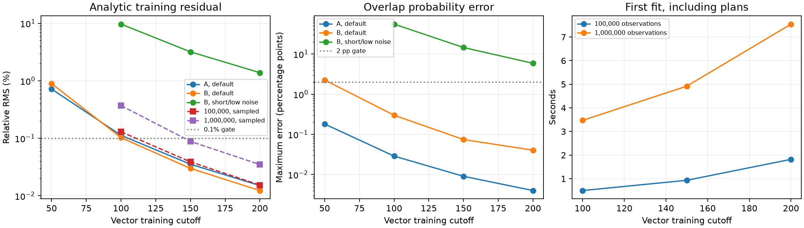

# Independent training bandwidth and massive-scale conditioning

The scalar/cross Fourier cutoff stays at **50** (101³ modes); the vector
training and prior cutoff increases independently. This reduces analytic-model
error without enlarging the scalar sample/query representation. It does not
make finite training identical to the analytic Matérn kernel.

On the released default parameters, cutoff **150** passes the declared overlap
gates at both 691 and 17,419 observations. A million-point mean fit takes
about **5 seconds** at this cutoff and passes the **sampled** analytic-residual
gate. The conditional-sampling pilot needs cutoff **200** to pass that gate
on all eight draws (about **61 seconds** for the draws). Shorter length
scales and lower noise remain a demonstrated failure
regime. These are conditioning/sampling experiments, **not measured massive-scale
application speedups**. No intractability claim for upstream SDD follows.



## Overlap with full analytic conditioning

A and B use the same released-camera scorpion inputs as the matched teaser.
The reference uses dense **analytic** vector covariance plus noise variance
0.02, with length scale 0.01 and per-axis variance 0.1. Scalar/cross kernels
use direct cutoff-50 Fourier evaluation, so this study isolates training
truncation rather than the released cross-kernel interpolant.

All 20,000 slice means are checked. Deterministic variance, the full 256×256
query covariance and inside probabilities use 256 probes: half selected
by smallest absolute analytic mean, half randomly selected from the remainder.
The analytic residual uses **every training row** at these feasible sizes.

Gates set before these runs: mean relative L2 ≤0.2%; variance and query
covariance relative L2 ≤0.02%; probability RMS ≤0.1 percentage points and
maximum ≤2 points; analytic training residual ≤0.1%. NUFFT-CG must also
converge at rtol 1e-5 and pass an independent finite-matrix residual check.

| Case | Training cutoff | Mean error % | Variance error % | Covariance error % | Probability RMS / max (pp) | Analytic residual % | Pass |
| --- | ---: | ---: | ---: | ---: | ---: | ---: | :---: |
| A | 50 | 0.6807 | 0.00812 | 0.00751 | 0.0949 / 0.1808 | 0.7202 | no |
| A | 100 | 0.1090 | 0.00128 | 0.00119 | 0.0150 / 0.0287 | 0.1127 | no |
| A | 150 | 0.0343 | 0.00041 | 0.00038 | 0.0047 / 0.0090 | 0.0355 | yes |
| A | 200 | 0.0148 | 0.00018 | 0.00016 | 0.0020 / 0.0040 | 0.0151 | yes |
| B | 50 | 0.4346 | 0.08059 | 0.08234 | 0.5797 / 2.2544 | 0.8949 | no |
| B | 100 | 0.0553 | 0.01096 | 0.01151 | 0.0490 / 0.2990 | 0.1027 | no |
| B | 150 | 0.0174 | 0.00343 | 0.00358 | 0.0161 / 0.0742 | 0.0300 | yes |
| B | 200 | 0.0076 | 0.00150 | 0.00156 | 0.0069 / 0.0404 | 0.0123 | yes |

The finite reference is independent of NUFFT: it evaluates the separable
product of one-dimensional cosine sums, accumulating in float64, then
uses dense Cholesky for probe covariance. This separates training-spectrum
truncation from NUFFT and iterative-solver errors. Fitting on these small
inputs is not necessarily faster than a cached dense factorization.

## Distinct large inputs

The 100,000 and 1,000,000 inputs are nested subsets of the previously generated
area-uniform visible scorpion surface cloud, with coordinate/normal perturbations
of standard deviation 0.02. This is **not** the camera-raster sampling used for
A/B. Inputs, validation indices and hashes are fixed across bandwidths.

512 randomly selected analytic covariance rows validate each fit. The empirical
bootstrap intervals below describe variability over those sampled rows;
they are **not global residual bounds or posterior-error guarantees**.
The sampled gate requires the interval upper endpoint to be below 0.1%.

| Observations | Training cutoff | Fit, first (s) | CG iterations | Analytic residual RMS % [bootstrap 95% interval] | Sampled gate |
| ---: | ---: | ---: | ---: | --- | :---: |
| 100,000 | 100 | 0.499 | 19 | 0.1298 [0.1223, 0.1369] | no |
| 100,000 | 150 | 0.934 | 19 | 0.0390 [0.0362, 0.0419] | yes |
| 100,000 | 200 | 1.820 | 19 | 0.0154 [0.0142, 0.0167] | yes |
| 1,000,000 | 100 | 3.472 | 57 | 0.3705 [0.3473, 0.3938] | no |
| 1,000,000 | 150 | 4.922 | 57 | 0.0884 [0.0824, 0.0943] | yes |
| 1,000,000 | 200 | 7.547 | 57 | 0.0350 [0.0325, 0.0376] | yes |

Fit time includes spectrum and GPU-plan creation, CG, scalar source aggregation
and centering at the observations. Data generation, process startup, validation
rows and query evaluation are excluded. First measurements are single runs;
the overlap report separately records three repeated solves. All GPU work was
serialized on an NVIDIA L40, using float32 and cuFINUFFT eps 1e-6. Training
plans use oversampling 1.25; scalar plans retain 2.0.

## Coherent large-N sampling pilot

Vector Gaussian coefficients cover the entire training spectrum. Scalar
prior samples use the same low-frequency coefficients, and independent
observation noise is included before the conditional solve. There is no
dense training matrix or dense omitted-spectrum Cholesky factor.

An independent small-system test compares 4,096 draws to the exact finite
conditional mean/covariance and checks retained conditional right-hand sides.
The million-point pilot uses only **8 draws per cutoff**; this is an execution
and cost check, not a Monte Carlo probability-accuracy result. Seeds alone
do not pair draws across bandwidths: the generated arrays have different shapes.

| Training cutoff | Fit (s) | All draws (s) | Worst sampled conditional residual RMS % | All sampled gates | Cached 20,000-query evaluation (ms) |
| ---: | ---: | ---: | ---: | :---: | ---: |
| 150 | 4.988 | 42.377 | 0.1114 | no | 1.604 |
| 200 | 7.574 | 60.682 | 0.0432 | yes | 1.592 |

**Cutoff 150 passes the mean-fit check but fails the conditional-sampling
check; cutoff 200 passes both for this pilot.** This is why observation
residuals alone are not enough for a sampling workload.

Conditional residuals use the actual generated sampling right-hand sides
and the same independent analytic rows as the mean-fit audit. The gate uses
the upper bootstrap endpoint for every draw. This tests the solve on those
right-hand sides; it does not validate the missing analytic prior tail or
replace deterministic posterior-covariance and application convergence checks.
Cached query times include all pilot draws, after separate cache preparation.
Repetitions use fixed queries and are kernel timings; an application could
cache a fixed answer. No cross-method speedup is inferred from this pilot.

The external 100 ms monitor observed a peak of **14.45 GiB**
during the sampler validation/pilot queue, including runtime allocations
and retained validation rows/components. This is a sampled device-wide
measurement, not an exact live-workspace bound or minimum memory requirement.

## Failure retained: shorter length scale and lower noise

With B unchanged, length scale 0.005 and noise variance 0.0004, every tested
bandwidth fails. Both parameters change in this stress case; separate sweeps
are still needed to attribute sensitivity.

| Training cutoff | Mean error % | Variance error % | Probability RMS / max (pp) | Analytic residual % |
| ---: | ---: | ---: | ---: | ---: |
| 100 | 4.174 | 1.803 | 7.474 / 55.520 | 9.688 |
| 150 | 1.433 | 0.629 | 2.711 / 14.520 | 3.192 |
| 200 | 0.646 | 0.283 | 1.126 / 5.871 | 1.386 |

This motivates [local/FMM omitted-spectrum correction (#14)](https://github.com/alecjacobson/fast-stochastic-psr/issues/14).
A correction must preserve the joint GP and coherent sampling; a successful
matvec alone is not sufficient. No FMM backend or speedup is claimed.

## Remaining quality bridge and reproduction

- Compare joint-event distributions, candidate-view decisions and hitboxes at converged sampling/geometric resolution.
- Validate full-model posterior covariance at increasing N and parameters, beyond sampled mean/conditional residuals.
- Benchmark the released iterative solver with documented convergence and time/memory budgets.
- Measure full preparation plus application cost, rebuilds, and scaling in observations, queries and draws independently.

Tracked by [#13](https://github.com/alecjacobson/fast-stochastic-psr/issues/13),
[#6](https://github.com/alecjacobson/fast-stochastic-psr/issues/6) and
[#8](https://github.com/alecjacobson/fast-stochastic-psr/issues/8).

```bash
./reproduction/run_env.sh reproduction/training_bandwidth.py --case A
./reproduction/run_env.sh reproduction/training_bandwidth.py --case B
./reproduction/run_env.sh reproduction/training_bandwidth.py --case B --lengthscale .005 --noise .0004 --cutoffs 100 150 200 --output reproduction/results/training_bandwidth/B-short-low-noise
./reproduction/run_env.sh reproduction/scale_training_bandwidth.py
./reproduction/run_env.sh reproduction/scale_spectral_sampling.py
./reproduction/run_env.sh reproduction/summarize_training_bandwidth.py
```

If absent, the scaling script generates the million-point cloud using the
released mesh and cameras. Raw measurements and compact field arrays are
included in the adjacent directories; the large source cloud is regenerated.
