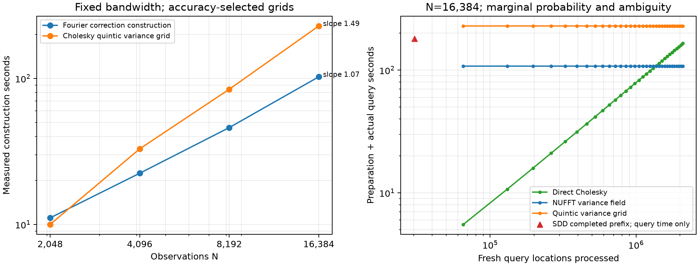

# A measured variance-dependent reuse win

**A fixed map with many fresh moving-query batches is a winning scenario under
the declared moment-accuracy contract.** This is a synthetic planning/inspection
proxy on the released scorpion, not a ContactFusion replay. Each batch computes
mean, marginal variance, positive-field probability and an ambiguity score. Query
positions change; the prepared posterior field is reused. The probability is
Phi(mu/sqrt(v)) = P[f>0]; ambiguity is invariant to sign convention. A physical
inside/outside interpretation requires the chosen normal/field orientation.

The main workload has **16,384 observations and 32 × 65,536 = 2,097,152 queries**.
All completed methods pass both full-batch and independent exact-double
held-out checks. GPU work ran sequentially on one 1g.24gb Blackwell MIG instance;
its sampled process-isolation audit passed.

| Method | Charged preparation (s) | Actual 32-batch query work (s) | Total (s) |
|---|---:|---:|---:|
| NUFFT variance field | 107.777 | 0.168 | 107.945 |
| Direct Cholesky | 0.366 | 165.190 | 165.557 |
| Quintic variance grid | 229.049 | 0.106 | 229.154 |

The NUFFT hybrid is **1.53× faster than direct Cholesky** and
**2.12× faster than the tested quintic spatial cache** for the complete workload.
The first measured direct-Cholesky crossover is batch **21**.
These totals include variance and the probability/ambiguity calculation. Baselines
receive the analytic observation matrix and reusable cross-kernel table free;
the candidate pays its own complete numerical preparation. See
[accounting and protocol](PROTOCOL.md) for the exact stage sums. Pilot tuning,
validation and logging are excluded from pipeline times, retained in raw records.

Direct SDD, given the same accurate prepared mean, used **180.909 s**
for **30,208 queries**, with passing accuracy. It hit the
180-second query budget before completing even the first 65,536-query batch.
This is a censored lower bound, not an extrapolated full SDD runtime. The selected
configuration was batch 512, step multiplier 5.0,
768 iterations from four recorded configurations.
At fixed minibatch 128 and step multiplier 5, the N=2048 and N=16384 pilots
need 768 and 1280 iterations respectively. The selected configurations both
use 768 iterations, increasing minibatch from 128 to 512. This is limited
evidence of iteration growth at a fixed batch, not a general scaling law.

## Variance and application output

Maximum independent-panel errors for the NUFFT result across the replay:
variance relative L2 **0.00301%**;
centered variance contrast relative L2 **0.0245%**;
probability RMS **0.00072 percentage points**;
probability maximum **0.00620 percentage points**.
The limits are 0.02%, 1%, 0.05 pp and 0.5 pp respectively; mean relative L2 must
also be <=0.2%, and all variances must be positive. Full-query comparisons also
pass; see [summary.json](summary.json) for every maximum and reference check.

NUFFT selects candidate **15** (zero-based), versus reference
candidate **15**. Its range-normalized ambiguity-score
regret is **0**. Replacing variance by the prior
causes probability errors up to **4.69 pp**;
even using the batch's exact average posterior variance causes errors up to
**3.45 pp**.
This workload actually uses spatially varying variance. These are marginal
probabilities/scores, not joint collision or ray probabilities.

## Scaling and the methodological change

| Observations | Fourier variance construction (s) | Cholesky variance-grid construction (s) | Selected quintic grid |
|---:|---:|---:|---:|
| 2,048 | 11.100 | 10.012 | 128³ |
| 4,096 | 22.425 | 32.938 | 144³ |
| 8,192 | 46.045 | 84.259 | 144³ |
| 16,384 | 102.563 | 228.682 | 144³ |

The log-log fitted construction slopes over these measurements are
**1.07** for Fourier and **1.49** for the spatial grid.
These are local empirical slopes, with an accuracy-selected grid at each N;
not asymptotic proofs or confidence intervals. Each is a single cold construction;
query timing/quality uses multiple changing geometries. The independent N=8192
paired-source pilot also measured 46.115 s, close to the 46.045 s repeated result.

The full correction factor is collapsed into one doubled-bandwidth Fourier
variance field. The gradient-product identity, packed real transforms and
batched inverse-factor solves reduce construction overhead. No Monte Carlo
sampling or rank truncation is used; mixed-precision transform error is measured.
In the original paper's N/M/L notation, the extra construction work is
O(N² + N L log L), versus O(H N²) for H direct spatial-grid sites; prepared
queries are O(M) for both. **Dense O(N³) conditioning remains.** This is a
Cholesky–NUFFT hybrid, not a matrix-free variance solver or an asymptotic M-only
win over an already-prepared spatial cache. [Derivation and costs](METHOD.md).

## Limits and retained failures

The result depends on the specified variance-accuracy contract and broad query
domain. Smaller spatial grids pass the probability gates alone while failing
the stricter variance gates. Adaptive/local grids and a probability-only accuracy
frontier remain [issue #66](https://github.com/alecjacobson/fast-stochastic-psr/issues/66).
The field caches must be rebuilt after covariance-changing map updates. Fixed
query coordinates can reuse values directly. The NUFFT retained mean/variance
cache is 506.8 MiB, versus
116.2 MiB for the tested spatial/mean caches;
this is retained cache storage, not peak memory.

The small-A gradient pilot did not win against its spatial cache. An early N=8192 cubic
160³ grid failed held-out probability checks. The first N=16384 replay was stopped
because the interpolated reference mean failed the full-batch maximum probability
limit despite passing smaller panels. The corrected comparison gives all direct
variance baselines the same accurate prepared mean. These unsuccessful records
are retained in [raw/](raw/), including failed-reference-B16384.json.

[30 targeted tests](tests.log) passed: independent Fourier derivative sums,
partial and paired source batches, double/single arithmetic against dense
variance, and cubic/quintic interpolation against SciPy. Reproduce with
[reproduce.sh](reproduce.sh); raw JSON stores exact arguments, hashes, timings,
accuracy panels and GPU audit. Regenerate this summary and plot with
`./reproduction/run_env.sh -m reproduction.summarize_variance_probability`.
