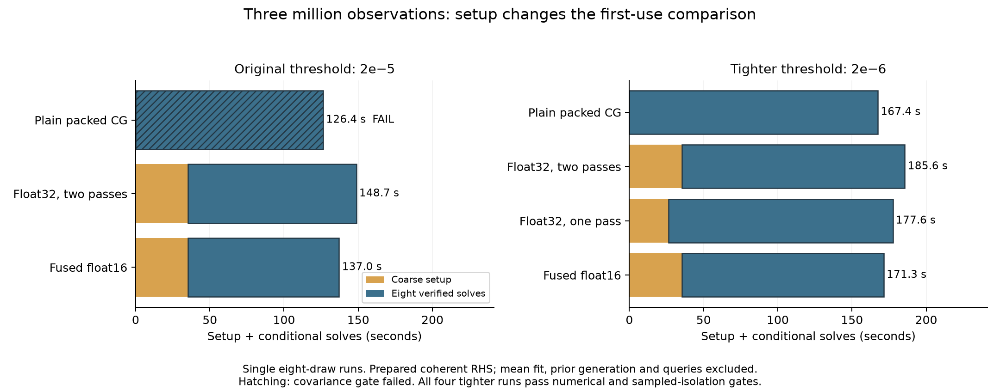

# Verified preconditioning at three million observations

With a tighter independently verified accuracy budget, fused compact Nyström
reduces eight three-million-point conditional solves from **167.35 to 136.05 s
(1.23×)** versus plain packed CG, and is about **1.1×** faster than float32
Nyström. These are single eight-draw pilots at the same numerical gates.
Its **35.30 s setup** makes the first eight **171.35 s**, still slower than plain
CG. A faster one-pass float32 baseline is included; no weaker setup policy is
used to hide that comparison.

The original residual budget passed residual checks but narrowly failed a
covariance gate. That entire experiment is retained below, without timing
ratios. The follow-up tightens verification for every method instead of relaxing
application gates. [Accuracy-budget issue #38](https://github.com/alecjacobson/fast-stochastic-psr/issues/38)
tracks generalization beyond this fixed panel.

[Initial protocol](PROTOCOL.md) · [Initial summary](summary.json) ·
[Tighter follow-up protocol](STRICT_PROTOCOL.md) ·
[One-pass setup protocol](ONE_PASS_PROTOCOL.md) ·
[Preconditioning issue #33](https://github.com/alecjacobson/fast-stochastic-psr/issues/33).

## Tighter actual residual threshold: 2e-6

| Method | Eight verified solves (s) | Coarse setup (s) | Setup + solves (s) | Empirical covariance difference | Sampled process peak (GiB) |
| --- | ---: | ---: | ---: | ---: | ---: |
| Plain packed CG | 167.353 | 0.000 | 167.353 | 0.001800% | 27.00 |
| Float32, two-pass construction | 150.337 | 35.287 | 185.624 | 0.001391% | 38.89 |
| Float32, one-pass construction | 151.176 | 26.393 | 177.570 | 0.001415% | 38.92 |
| Fused float16 | 136.050 | 35.298 | 171.348 | 0.001479% | 33.16 |

Every mean and sample solve passes its declared 2e-6 verification threshold.
All four methods pass the unchanged field/variance/covariance gates against
the archived tighter reference, and all six pairwise comparisons pass. Tested
ray/collision events and selected view are identical, with uncertain collision
probes present. All four whole-run sampled-isolation audits pass. Every sample
needs one correction; plain CG starts with 97 iterations and the coarse methods
with 69. Independent checks and correction work are included in the table.

Compared with the stronger one-pass float32 setup, fused setup + eight solves
is **177.57 → 171.35 s (1.036×)**. This small observed difference needs repeated
confirmation. Including separately timed mean fit, aggregation and queries
gives **203.28 → 197.13 s** for those two methods, while plain CG takes **193.10 s**.
Prior generation remains excluded: these are not complete-application speedups.

A linear model using these measured averages suggests fused setup amortizes
against plain CG at about ten draws. That crossover is an extrapolation from
eight draws, not a measured longer-ensemble result. No ratio uses the rejected
original-budget timings or the earlier folded-transform study.

[Tighter summary and scoped ratios](strict/summary.json) ·
[Latest 28 targeted tests](strict/one-pass-tests.log).



### Verification budget and memory lifetime

`HalfCubePosterior(..., refine_solves=True, verification_rtol=2e-6)` makes the
actual verification budget independent of native recurrence tolerance (still
1e-5 here). The default remains `2*rtol`; specifying a budget requires refinement.
The cap remains two corrections at native rtol .1. Both mean and sample solves
use this threshold; hybrid models retain their actual centered-inverse target.

The public `clear_verification_cache()` releases cached verification plans; the
next verified solve rebuilds them. It preserves the fitted mean and rejects
calls during active streaming. Trimming the CuPy allocator pool after release
allows the float32 one-pass feature construction to fit, reducing coarse setup
from **35.29 to 26.39 s**. First conditioning includes rebuilding the verifier.
The one-pass baseline retains a 24.6GB feature temporary, then frees it before
verification returns. Its sampled process peak is 38.92 GiB, versus 38.89 GiB
for two-pass float32 and 33.16 GiB for fused storage. Sampled peaks can miss
short-lived allocations.

The three initial strict implementations are preserved in `cb77576`; the
one-pass variant has its own [source manifest](strict/float32_onepass/source_manifest.json).
The original [strict manifest](strict/source_manifest.json) describes the code
at that earlier commit, not the later cache-release API.

## Initial residual threshold: 2e-5

| Method | Eight verified solves (s) | Coarse setup (s) | Setup + solves (s) | Empirical covariance difference | Numerical gates | Sampled process peak (GiB) |
| --- | ---: | ---: | ---: | ---: | --- | ---: |
| Plain packed CG | 126.363 | 0 | 126.363 | 0.010967% | **FAIL** | 27.00 |
| Float32 monolithic Nyström | 113.409 | 35.282 | 148.691 | 0.003596% | pass | 37.71 |
| Fused float16 Nyström | 101.772 | 35.277 | 137.050 | 0.002664% | pass | 31.98 |

All three runs pass sampled GPU isolation. All tested ray/collision events and
view choices match the archived tighter reference. The plain solver exceeds the
unchanged 0.01% covariance-difference limit, so the predeclared all-method
quality gate excludes **all timing ratios from this experiment**. Its pairwise
field checks against both preconditioned paths also fail. The methods are not
made comparable by ignoring this small failure.

Every packed conditional solve passes its independently recomputed residual
without a correction. In contrast, the earlier folded-transform controls on
these identical RHS needed one correction each. Their different costs are not
combined into a new cross-experiment timing ratio. Independently verified
residual tolerance still needs a downstream accuracy budget; it is not itself
a covariance guarantee.

## Scope

The published three-million source, eight seed701 RHS, scalar priors, geometry
and tighter reference come from the [verified posterior study](../verified_posterior/README.md).
All source and prior/RHS hashes match. Training cube200, scalar/cross cube50,
noise variance .02 and the underlying finite posterior are unchanged. All
coarse models use rank1024 and seed41. The initial experiment uses bounded
two-pass construction; the stricter follow-up also measures one-pass float32
with controlled verifier-cache lifetime, as described above.

These are conditional solves from **already prepared coherent RHS and priors**.
Verification, any corrections and first packed-plan/kernel use are included.
Mean fitting is separately reported (about 25.2 s per run), as are aggregation
and queries (about .5 s for all eight). Prior generation, input transfers,
geometry, validation, hashing/export and startup are excluded from table sums.
The CuPy disk compilation cache may be warm. Setup + solves is a measured stage
sum, not a separately measured end-to-end application time. Peak memory is
sampled process memory including model, verification and allocator caches.

One eight-draw experiment per method does not establish an absolute Monte Carlo
error, convergence to the analytic infinite-band model, continuous collision
geometry, robust timing statistics or an upstream speedup. The reference is a
stronger same-finite-cube numerical control, not an exact independent oracle.

## Reproduce

Regenerate the local archive from the linked verified-posterior study first.
Run methods sequentially on the GPU:

```bash
./reproduction/run_env.sh -m reproduction.benchmark_verified_preconditioning --method plain --output reproduction/results/verified_preconditioning/plain --archive /opt/geospsr-runtime/verified-preconditioning/plain
./reproduction/run_env.sh -m reproduction.benchmark_verified_preconditioning --method float32 --output reproduction/results/verified_preconditioning/float32 --archive /opt/geospsr-runtime/verified-preconditioning/float32
./reproduction/run_env.sh -m reproduction.benchmark_verified_preconditioning --method fused16 --output reproduction/results/verified_preconditioning/fused16 --archive /opt/geospsr-runtime/verified-preconditioning/fused16
./reproduction/run_env.sh -m reproduction.summarize_verified_preconditioning
./reproduction/run_env.sh -m reproduction.verify_verified_preconditioning --output reproduction/results/verified_preconditioning/plain --archive /opt/geospsr-runtime/verified-preconditioning/plain
```

Repeat the last command for float32 and fused16. Public field/event artifacts
are small; full weights and coefficients remain in a regenerable local runtime
archive, with public payload hashes. Verification replays coefficient fields and
events and checks archive hashes; it does not rerun original residual checks.

The initial implementation is preserved in commit `16c67c3`; the configurable
verification budget and predeclared strict implementation are in `cb77576`.

The initial archive replay checks 51 array payloads and reproduces all 24
field blocks exactly, with identical events. See each method’s `verification.json`.

To reproduce the tighter experiment (run sequentially):

```bash
for method in plain float32 fused16 float32_onepass; do
  ./reproduction/run_env.sh -m reproduction.benchmark_verified_preconditioning --method "$method" --verification-rtol 2e-6 --output "reproduction/results/verified_preconditioning/strict/$method" --archive "/opt/geospsr-runtime/verified-preconditioning/strict/$method"
done
./reproduction/run_env.sh -m reproduction.summarize_verified_preconditioning --root reproduction/results/verified_preconditioning/strict --one-pass-baseline
./reproduction/run_env.sh -m reproduction.plot_verified_preconditioning
```

Run `verify_verified_preconditioning` on each strict method's output/archive
as well. Across both experiments, replay checks **119 array payloads** and
reproduces **56 field blocks exactly**, with identical events. These checks do
not re-execute conditioning residuals or validate the common prior's law.
The 28 latest targeted tests include custom-budget behavior, refusal of invalid
budgets, cache release/rebuild, streaming lifetime, packed/preconditioned/hybrid
paths and correction-cap rejection. Earlier 27-test logs are not added to that
count.
